# Poker Chips (2014–15) — specs extracted from the PSDs

Machine-extracted from the Photoshop sources with `psd-tools`. Coordinates are **canvas pixels** (divide by 2 for @2x iPhone 5 frames, by 3 for @3x 6 Plus frames to get points). Per-file JSON next to this file has the full layer tree (every layer, bbox, opacity, blend, text runs, fills, effects); `img/` has a flattened render of each file.

## Files

| spec | PSD | modified | canvas | target | layers | text layers |
|---|---|---|---|---|---|---|
| `01GMHM_step_3a` | step_3a.psd | 2015-06-11 | 640x1136 | iPhone 5/5s portrait @2x (320x568pt) | 44 | 13 |
| `05mcjg_pokercam` | pokercam.psd | 2015-02-07 | 3159x3964 | board / multi-frame canvas | 6 | 0 |
| `082UG8_bet_1` | bet_1.psd | 2015-02-07 | 4413x4184 | board / multi-frame canvas | 11 | 0 |
| `0Qxb2s_ui` | ui.psd | 2015-02-07 | 2661x2261 | board / multi-frame canvas | 257 | 61 |
| `0VyMzg_WHW_2` | WHW_2.psd | 2015-02-07 | 2666x1593 | board / multi-frame canvas | 8 | 0 |
| `0VzRGs_TABLE_6PLUS` | TABLE_6PLUS.psd | 2015-07-16 | 11338x9041 | board / multi-frame canvas | 2 | 0 |
| `0Y1eFk_side_menu` | side menu.psd | 2014-08-16 | 1136x640 | iPhone 5/5s landscape @2x (568x320pt) | 34 | 7 |
| `0tRRU0_WHW_4` | WHW_4.psd | 2015-02-07 | 3834x972 | board / multi-frame canvas | 10 | 1 |
| `1BHemc_spec_6plus` | spec_6plus.psd | 2015-05-28 | 5465x4266 | board / multi-frame canvas | 19 | 4 |
| `1NfM3M__startscreen` | _startscreen.psd | 2015-02-07 | 5000x3338 | board / multi-frame canvas | 4 | 0 |
| `1VJclk_lobby_pr` | lobby_pr.psd | 2014-08-31 | 1940x1220 | board / multi-frame canvas | 217 | 0 |
| `25Vc0U_bet_2` | bet_2.psd | 2015-02-07 | 1906x4184 | board / multi-frame canvas | 12 | 0 |
| `2dQYzQ_info` | info.psd | 2015-02-07 | 2666x1593 | board / multi-frame canvas | 5 | 0 |
| `2phUjQ_TABLE_5S` | TABLE_5S.psd | 2015-07-16 | 5403x7299 | board / multi-frame canvas | 3025 | 252 |
| `2tUelE_splash` | splash.psd | 2014-08-31 | 1940x1220 | board / multi-frame canvas | 239 | 0 |
| `2xmU1k_2playrs` | 2playrs.psd | 2014-07-16 | 1136x640 | iPhone 5/5s landscape @2x (568x320pt) | 88 | 14 |
| `3VOX3c_рассадка_за_столом_к_нарезке_Specs` | рассадка за столом к нарезке Specs.psd | 2014-07-15 | 1136x640 | iPhone 5/5s landscape @2x (568x320pt) | 172 | 35 |
| `3djSUU_6playrs` | 6playrs.psd | 2014-07-16 | 1136x640 | iPhone 5/5s landscape @2x (568x320pt) | 507 | 84 |
| `3pQajg_winphone_bet` | winphone_bet.psd | 2014-07-16 | 1920x1080 | board / multi-frame canvas | 512 | 77 |
| `Dk1VTA_players` | players.psd | 2015-07-08 | 975x1358 | board / multi-frame canvas | 148 | 40 |
| `DlIVWM_Which_hand_wins` | Which hand wins.psd | 2014-08-31 | 1940x1220 | board / multi-frame canvas | 19 | 0 |
| `EY0czQ_cam_2` | cam_2.psd | 2015-02-07 | 3142x1598 | board / multi-frame canvas | 10 | 0 |
| `EczWXM__1` | _1.psd | 2015-04-03 | 3193x1242 | board / multi-frame canvas | 15 | 0 |
| `ExNUGM_players` | players.psd | 2015-06-11 | 640x1136 | iPhone 5/5s portrait @2x (320x568pt) | 60 | 12 |
| `FF0N1U_lobby` | lobby.psd | 2014-08-17 | 640x1136 | iPhone 5/5s portrait @2x (320x568pt) | 105 | 16 |
| `FVVNlE_Poker_Hands` | Poker_Hands.psd | 2014-08-16 | 1136x640 | iPhone 5/5s landscape @2x (568x320pt) | 172 | 67 |
| `FkwcWc_step_3b` | step_3b.psd | 2015-06-11 | 640x1136 | iPhone 5/5s portrait @2x (320x568pt) | 311 | 93 |
| `FpMLWs_step_2b` | step_2b.psd | 2015-06-11 | 640x1136 | iPhone 5/5s portrait @2x (320x568pt) | 72 | 25 |
| `GpqbVE_photo_share` | photo_share.psd | 2015-02-07 | 640x1136 | iPhone 5/5s portrait @2x (320x568pt) | 7 | 1 |
| `GtjNVE_Untitled-1` | Untitled-1.psd | 2015-04-03 | 900x506 | board / multi-frame canvas | 2014 | 18 |
| `Gw5cWs_WHW_3` | WHW_3.psd | 2015-02-07 | 1413x2325 | board / multi-frame canvas | 9 | 1 |
| `HJNMW8_TABLE_5S` | TABLE_5S.psd | 2015-07-08 | 5403x7299 | board / multi-frame canvas | 3106 | 263 |
| `HgzMG8_wizard_2` | wizard_2.psd | 2015-02-07 | 2538x1308 | board / multi-frame canvas | 7 | 0 |
| `HpRVDA_create` | create.psd | 2015-02-07 | 3142x1598 | board / multi-frame canvas | 7 | 0 |
| `TNBcWs_Info` | Info.psd | 2014-08-31 | 1940x1220 | board / multi-frame canvas | 15 | 0 |
| `TRWOHM_create_1` | create_1.psd | 2015-02-07 | 4432x1475 | board / multi-frame canvas | 7 | 0 |
| `TRyVjQ_spash_2` | spash_2.psd | 2014-08-31 | 1940x1220 | board / multi-frame canvas | 223 | 0 |
| `TVlbUE_step_1b` | step_1b.psd | 2015-06-11 | 640x1136 | iPhone 5/5s portrait @2x (320x568pt) | 58 | 18 |
| `U90alU_table` | table.psd | 2015-02-07 | 5000x3338 | board / multi-frame canvas | 2 | 0 |
| `UJzZDA_рассадка_за_столом_к_нарезке_Specs` | рассадка за столом к нарезке Specs.psd | 2014-07-16 | 1136x640 | iPhone 5/5s landscape @2x (568x320pt) | 172 | 35 |
| `V9yNUU_8playrs` | 8playrs.psd | 2014-07-16 | 1136x640 | iPhone 5/5s landscape @2x (568x320pt) | 136 | 26 |
| `VNFY0E_step_1a` | step_1a.psd | 2015-06-11 | 640x1136 | iPhone 5/5s portrait @2x (320x568pt) | 117 | 33 |
| `VZLT0E_multy` | multy.psd | 2015-02-07 | 2538x1598 | board / multi-frame canvas | 3 | 0 |
| `Vh6UDg_suit_cards` | suit cards.psd | 2014-08-31 | 1940x1220 | board / multi-frame canvas | 33 | 0 |
| `VhHYUE_screens` | screens.psd | 2014-08-31 | 1940x1220 | board / multi-frame canvas | 22 | 0 |
| `XBqUU0_step_2a` | step_2a.psd | 2015-06-11 | 640x1136 | iPhone 5/5s portrait @2x (320x568pt) | 42 | 11 |
| `XYyb3M_Which_hand_wins` | Which hand wins.psd | 2015-02-07 | 1940x1220 | board / multi-frame canvas | 22 | 0 |
| `XhQWm8_4_playrs` | 4 playrs.psd | 2014-07-16 | 1136x640 | iPhone 5/5s landscape @2x (568x320pt) | 88 | 14 |
| `jE2OGM_table` | table.psd | 2014-08-31 | 1940x1220 | board / multi-frame canvas | 15 | 0 |
| `jRySjQ_animation` | animation.psd | 2015-07-08 | 1136x2001 | board / multi-frame canvas | 873 | 105 |
| `k5nQzg_loading` | loading.psd | 2015-07-08 | 726x334 | board / multi-frame canvas | 10 | 0 |
| `k8xcVU_10playrs` | 10playrs.psd | 2014-07-16 | 1136x640 | iPhone 5/5s landscape @2x (568x320pt) | 130 | 26 |
| `kYzdUk_all_progect` | all_progect.psd | 2015-02-07 | 15028x11603 | board / multi-frame canvas | 93 | 1 |
| `kdhTVE_winner_2` | winner_2.psd | 2015-02-07 | 3801x1092 | board / multi-frame canvas | 7 | 0 |
| `klVTzA_winner` | winner.psd | 2015-02-07 | 2538x2700 | board / multi-frame canvas | 4 | 0 |
| `kpNNUk_registration_5s` | registration_5s.psd | 2015-05-28 | 5403x5333 | board / multi-frame canvas | 255 | 46 |
| `lF1ZXM_spec_5s` | spec_5s.psd | 2015-05-28 | 3043x1714 | board / multi-frame canvas | 19 | 4 |
| `lhwSlU_update_game_menu` | update game menu.psd | 2014-08-17 | 1136x640 | iPhone 5/5s landscape @2x (568x320pt) | 112 | 10 |
| `m16cGc_pokercam_ic` | pokercam_ic.psd | 2015-02-07 | 2529x1428 | board / multi-frame canvas | 19 | 0 |
| `m5PSHc_pokerCam` | pokerCam.psd | 2014-08-31 | 1940x1220 | board / multi-frame canvas | 15 | 0 |
| `mdJd1E_Android_poker` | Android_poker.psd | 2014-07-16 | 1280x800 | Android tablet/phone landscape (mdpi 1280x800) | 162 | 26 |
| `mpCYVU_ui` | ui.psd | 2015-05-28 | 2661x2261 | board / multi-frame canvas | 261 | 63 |
| `nBVcFE_registration_6plus` | registration_6plus.psd | 2015-05-28 | 11338x9041 | board / multi-frame canvas | 261 | 46 |
| `nVZaEk_play` | play.psd | 2014-08-31 | 1940x1220 | board / multi-frame canvas | 217 | 0 |
| `y00U0U_6playrs_bet` | 6playrs_bet.psd | 2014-07-02 | 2272x640 | board / multi-frame canvas | 696 | 90 |
| `zlHdHc_bet` | bet.psd | 2014-08-31 | 1940x1220 | board / multi-frame canvas | 15 | 0 |

## Tokens across all files

### Fonts (text runs using each)

- `Univers-CondensedBold` — 1071
- `Univers-Condensed` — 685
- `Univers-CondensedLight` — 548
- `RobotoCondensed-Bold` — 450
- `RobotoCondensed-Regular` — 422
- `Univers-Bold` — 174
- `AndaleMono` — 129
- `RobotoCondensed-Light` — 96
- `Roboto-Bold` — 65
- `Arial-BoldMT` — 52
- `Helvetica` — 13
- `Roboto-Regular` — 12
- `Univers` — 7
- `Roboto-Light` — 3
- `Univers-BoldOblique` — 1

### Font sizes in canvas px (font, size, uses) — top 40

| font | px | uses |
|---|---|---|
| Univers-CondensedBold | 30.0 | 649 |
| Univers-CondensedLight | 30.0 | 479 |
| Univers-Condensed | 34.0 | 369 |
| RobotoCondensed-Bold | 30.0 | 170 |
| RobotoCondensed-Regular | 34.0 | 161 |
| AndaleMono | 25.0 | 129 |
| RobotoCondensed-Bold | 30.2 | 119 |
| RobotoCondensed-Light | 30.0 | 96 |
| Univers-CondensedBold | 45.0 | 74 |
| Univers-Bold | 25.03 | 69 |
| Univers-Condensed | 36.0 | 64 |
| Univers-Condensed | 51.0 | 59 |
| Roboto-Bold | 24.0 | 56 |
| Univers-CondensedBold | 50.7 | 53 |
| Arial-BoldMT | 10.0 | 52 |
| RobotoCondensed-Bold | 36.0 | 51 |
| Univers-Bold | 45.0 | 48 |
| Univers-CondensedBold | 33.8 | 46 |
| Univers-CondensedBold | 36.0 | 44 |
| Univers-CondensedLight | 45.1 | 43 |
| Univers-CondensedBold | 52.5 | 41 |
| RobotoCondensed-Regular | 97.0 | 41 |
| Univers-CondensedBold | 35.0 | 40 |
| RobotoCondensed-Bold | 30.1 | 38 |
| Univers-CondensedBold | 78.0 | 37 |
| Univers-Condensed | 30.0 | 36 |
| Univers-Bold | 30.0 | 35 |
| RobotoCondensed-Regular | 38.0 | 27 |
| RobotoCondensed-Regular | 52.0 | 27 |
| RobotoCondensed-Regular | 66.8 | 27 |
| RobotoCondensed-Regular | 72.07 | 24 |
| Univers-CondensedBold | 32.0 | 24 |
| Univers-CondensedLight | 45.0 | 20 |
| RobotoCondensed-Regular | 36.0 | 19 |
| RobotoCondensed-Regular | 100.2 | 18 |
| Univers-Bold | 26.0 | 18 |
| Univers-Condensed | 45.0 | 18 |
| Univers-Condensed | 52.0 | 16 |
| Univers-Condensed | 34.1 | 16 |
| RobotoCondensed-Bold | 48.0 | 16 |

### Text colours

`#000000` ×2829, `#FFFFFF` ×326, `#013B38` ×63, `#F20000` ×52, `#251F21` ×26, `#023B38` ×21, `#010101` ×16, `#FFC704` ×14, `#116FF0` ×12, `#C2C2C2` ×10, `#1159F0` ×10, `#A9A9A9` ×7, `#E7583F` ×4, `#1D88FF` ×4, `#FF5353` ×3, `#172E3F` ×2, `#2C5774` ×2, `#1D87FC` ×1, `#1D87FD` ×1, `#1D87FF` ×1, `#3B3B3B` ×1

### Shape fill colours

`#000000` ×2189, `#FFFFFF` ×694, `#FF5252` ×462, `#5CC5F7` ×386, `#2EFF86` ×248, `#FFDB3C` ×212, `#FF95F1` ×211, `#B6B4A5` ×174, `#F98202` ×153, `#020201` ×104, `#050505` ×64, `#050506` ×64, `#C2C2C2` ×57, `#E9E9E9` ×56, `#116FF0` ×36, `#9D7057` ×34, `#1158F0` ×30, `#1159F0` ×23, `#686C6E` ×20, `#F44E59` ×13, `#F1C9BE` ×12, `#0EB2AB` ×11, `#686869` ×11, `#4A4A4A` ×9, `#FF9C00` ×9, `#09090A` ×8, `#606773` ×8, `#BCBCBC` ×8, `#4FBAA7` ×7, `#A34141` ×7

## Per file

### step_3a.psd — `01GMHM_step_3a`

Canvas 640×1136 · iPhone 5/5s portrait @2x (320x568pt) · modified 2015-06-11 · 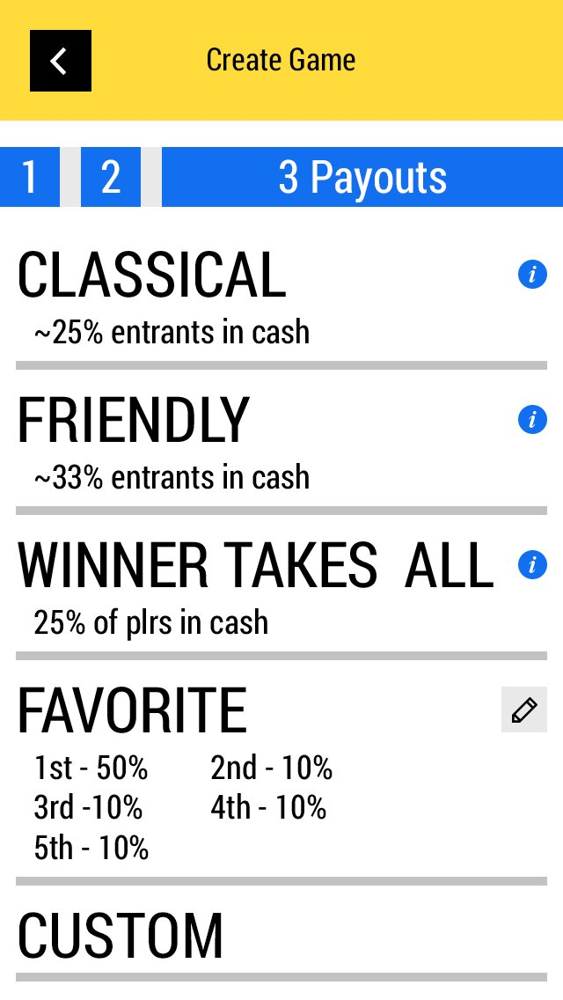

| text | x,y,w,h | font | px | colour | align |
|---|---|---|---|---|---|
| ~25% entrants in cash | 40,361,311,30 | RobotoCondensed-Regular | 38.0 | #000000 | left |
| Classical | 22,285,303,53 | RobotoCondensed-Regular | 72.07 |  | left |
| ~33% entrants in cash | 40,526,311,30 | RobotoCondensed-Regular | 38.0 | #000000 | left |
| friendly | 22,450,263,52 | RobotoCondensed-Regular | 72.07 |  | left |
| 25% of plrs in cash | 39,690,265,38 | RobotoCondensed-Regular | 38.0 | #000000 | left |
| Winner takes  all | 20,615,541,53 | RobotoCondensed-Regular | 72.07 |  | left |
| 1st - 50% 		2nd - 10%  / 3rd -10% 			4th - 10%  / 5th - 10% | 39,856,339,121 | RobotoCondensed-Regular | 38.0 | #000000 | left |
| favorite | 22,780,258,53 | RobotoCondensed-Regular | 72.07 |  | left |
| Custom | 22,1036,230,53 | RobotoCondensed-Regular | 71.7 |  | left |
| 2 | 116,181,21,38 | RobotoCondensed-Regular | 52.0 | #FFFFFF | left |
| 1 | 26,182,12,37 | RobotoCondensed-Regular | 52.0 | #FFFFFF | left |
| 3 Payouts | 318,181,189,49 | RobotoCondensed-Regular | 52.0 | #FFFFFF | center |
| Create Game | 236,54,168,27 | RobotoCondensed-Regular | 36.0 | #000000 | center |

22 filled shapes

| layer | x,y,w,h | fill | opacity |
|---|---|---|---|
| _1 / Rectangle 3 copy 3 | 17,284,606,127 | #FFFFFF |  |
| _1 / Rectangle 13 | 17,408,606,13 | #C2C2C2 |  |
| _1 / info 2 | 588,293,36,36 | #116FF0 |  |
| _2 / Rectangle 3 copy 3 | 17,449,606,127 | #FFFFFF |  |
| _2 / Rectangle 13 | 17,574,606,12 | #C2C2C2 |  |
| _2 / info 2 | 588,458,36,36 | #116FF0 |  |
| _3 / Rectangle 3 copy 3 | 17,614,606,127 | #FFFFFF |  |
| _3 / Rectangle 13 | 17,739,606,12 | #C2C2C2 |  |
| _3 / info 2 | 588,623,36,36 | #116FF0 |  |
| _4 / Rectangle 3 copy 3 | 17,779,606,127 | #FFFFFF |  |
| _4 / Rectangle 13 | 17,995,606,12 | #C2C2C2 |  |
| _4 / Rectangle 2 copy | 569,779,54,54 | #E9E9E9 |  |
| _4 / Pencil copy | 581,790,32,33 | #000000 |  |
| _5 / Rectangle 3 copy 4 | 17,1035,606,81 | #FFFFFF |  |
| _5 / Rectangle 13 copy | 17,1104,606,12 | #C2C2C2 |  |
| step_3 / Rectangle 10 | -1,166,642,71 | #E9E9E9 |  |
| step_3 / Rectangle 12 | 91,166,70,70 | #116FF0 |  |
| step_3 / Rectangle 12 copy | -1,166,70,70 | #116FF0 |  |
| step_3 / Rectangle 12 copy 2 | 183,166,458,70 | #116FF0 |  |
| head / Rectangle 7 copy | -1,-1,642,140 | #FFDB3C |  |
| head / back copy / Rectangle 2 copy | 33,33,73,73 | #000000 |  |
| head / back copy / Back icon | 55,52,21,34 | #FFFFFF |  |

### pokercam.psd — `05mcjg_pokercam`

Canvas 3159×3964 · board / multi-frame canvas · modified 2015-02-07 · 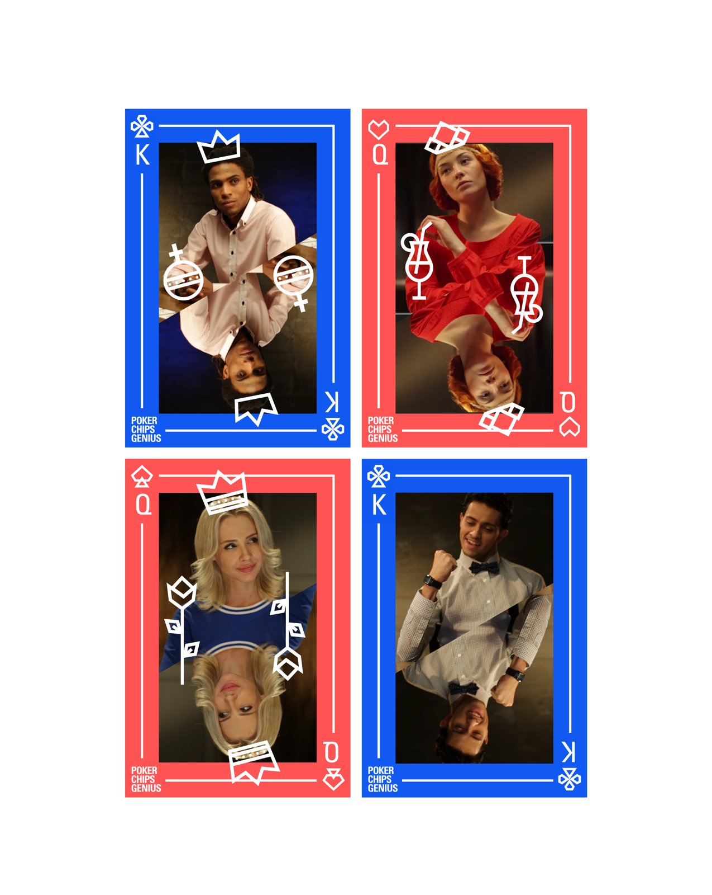

### bet_1.psd — `082UG8_bet_1`

Canvas 4413×4184 · board / multi-frame canvas · modified 2015-02-07 · 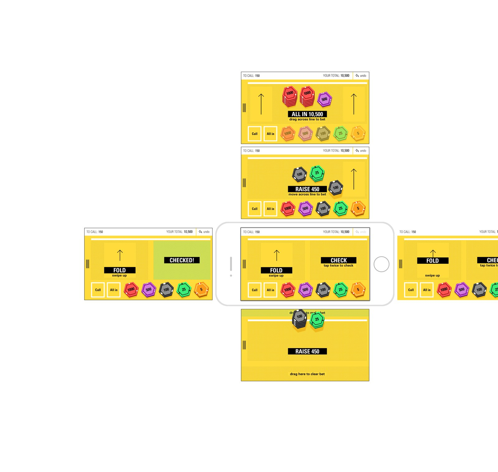

1 filled shapes

| layer | x,y,w,h | fill | opacity |
|---|---|---|---|
| iPhone 5S Gold / Group 1 / Screen (100% black) copy | 2134,2020,1139,644 | #000000 |  |

### ui.psd — `0Qxb2s_ui`

Canvas 2661×2261 · board / multi-frame canvas · modified 2015-02-07 · 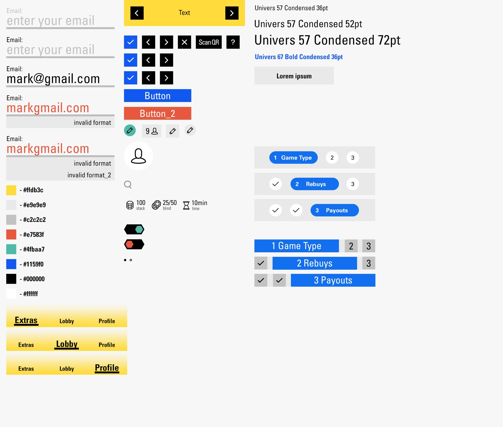

| text | x,y,w,h | font | px | colour | align |
|---|---|---|---|---|---|
| Lobby | 317,1940,74,30 | Univers-CondensedBold | 32.0 | #000000 | center |
| Profile | 505,1928,123,36 | Univers-CondensedBold | 47.0 | #000000 | center |
| Extras | 99,1940,80,24 | Univers-CondensedBold | 32.0 | #010101 | center |
| Lobby | 300,1803,110,43 | Univers-CondensedBold | 47.0 | #000000 | center |
| Profile | 524,1813,84,25 | Univers-CondensedBold | 32.0 | #000000 | center |
| Extras | 99,1814,80,24 | Univers-CondensedBold | 32.0 | #010101 | center |
| Lobby | 317,1688,74,30 | Univers-CondensedBold | 32.0 | #000000 | center |
| Profile | 524,1687,84,25 | Univers-CondensedBold | 32.0 | #000000 | center |
| Extras | 81,1677,116,35 | Univers-CondensedBold | 47.0 | #010101 | center |
| invalid format | 393,851,194,27 | Univers-Condensed | 36.0 |  | right |
| invalid format_2 | 359,913,227,31 | Univers-Condensed | 36.0 |  | right |
| markgmail.com | 38,758,430,66 | Univers-Condensed | 71.8 | #E7583F | left |
| Email: | 37,721,81,27 | Univers-Condensed | 36.0 |  | left |
| invalid format | 393,635,194,27 | Univers-Condensed | 36.0 |  | right |
| markgmail.com | 38,542,430,66 | Univers-Condensed | 71.8 | #E7583F | left |
| Email: | 37,505,81,27 | Univers-Condensed | 36.0 |  | left |
| mark@gmail.com | 38,387,487,67 | Univers-Condensed | 71.8 | #000000 | left |
| Email: | 37,351,81,27 | Univers-Condensed | 36.0 |  | left |
| enter your email | 38,234,458,66 | Univers-Condensed | 72.0 | #C2C2C2 | left |
| Email: | 37,197,81,27 | Univers-Condensed | 36.0 |  | left |
| enter your email | 38,80,458,66 | Univers-Condensed | 71.8 | #C2C2C2 | left |
| Email: | 37,43,81,27 | Univers-Condensed | 36.0 | #C2C2C2 | left |
| Text | 946,53,59,27 | Univers-Condensed | 36.0 | #000000 | center |
| Scan QR | 1053,209,105,28 | Univers-Condensed | 36.0 | #FFFFFF | center |
| Button | 768,487,132,39 | Univers-Condensed | 52.0 | #FFFFFF | center |
| Button_2 | 742,581,183,45 | Univers-Condensed | 52.0 | #FFFFFF | center |
| - #e9e9e9 | 105,1071,137,27 | Univers-CondensedBold | 36.0 |  | left |
| - #c2c2c2 | 105,1149,137,27 | Univers-CondensedBold | 36.0 |  | left |
| - #e7583f | 105,1227,127,28 | Univers-CondensedBold | 36.0 |  | left |
| - #4fbaa7 | 105,1305,130,28 | Univers-CondensedBold | 36.0 |  | left |
| - #1159f0 | 105,1384,125,28 | Univers-CondensedBold | 36.0 |  | left |
| - #000000 | 105,1463,131,27 | Univers-CondensedBold | 36.0 |  | left |
| - #ffffff | 105,1541,95,27 | Univers-CondensedBold | 36.0 |  | left |
| - #ffdb3c | 105,991,124,28 | Univers-CondensedBold | 36.0 |  | left |
| 9 | 772,678,17,32 | Univers-Condensed | 44.0 |  | center |
| 10min | 1016,1060,79,27 | Univers-Condensed | 35.9 | #000000 | left |
| time | 1016,1094,38,19 | Univers-CondensedLight | 24.0 | #010101 | left |
| 25/50 | 862,1059,72,30 | Univers-Condensed | 35.9 | #000000 | left |
| blind | 863,1093,41,19 | Univers-CondensedLight | 24.0 | #000000 | left |
| 100 | 724,1059,44,27 | Univers-Condensed | 35.9 | #000000 | left |
| stack | 722,1093,45,19 | Univers-CondensedLight | 24.0 | #010101 | left |
| 3 | 1859,823,15,23 | Univers | 30.0 | #000000 | left |
| 2 | 1750,823,14,22 | Univers | 30.0 | #000000 | left |
| 1 | 1450,824,11,21 | Univers-Bold | 30.0 | #FFFFFF | left |
| Game Type | 1489,822,160,29 | Univers-Bold | 30.0 | #FFFFFF | left |
| 3 | 1859,963,15,23 | Univers | 30.0 | #000000 | left |
| 2 | 1564,963,16,22 | Univers-Bold | 30.0 | #FFFFFF | left |
| Rebuys | 1621,963,103,28 | Univers-Bold | 30.0 | #FFFFFF | left |
| 3 | 1670,1102,15,23 | Univers-Bold | 30.0 | #FFFFFF | left |
| Payouts | 1727,1102,113,28 | Univers-Bold | 30.0 | #FFFFFF | left |
| 3 | 1940,1284,21,38 | Univers-Condensed | 52.0 | #000000 | left |
| 2 | 1848,1284,20,37 | Univers-Condensed | 52.0 | #000000 | left |
| 1 Game Type | 1440,1280,258,49 | Univers-Condensed | 52.0 | #FFFFFF | left |
| 3 | 1940,1375,21,38 | Univers-Condensed | 52.0 | #000000 | left |
| 2 Rebuys | 1573,1373,184,48 | Univers-Condensed | 52.0 | #FFFFFF | left |
| 3 Payouts | 1663,1463,199,48 | Univers-Condensed | 52.0 | #FFFFFF | left |
| Lorem ipsum / | 1465,389,183,34 | Univers-CondensedBold | 36.0 |  | center |
| Univers 67 Bold Condensed 36pt | 1350,286,463,35 | Univers-CondensedBold | 36.0 | #1159F0 | left |
| Univers 57 Condensed 72pt | 1349,183,769,67 | Univers-Condensed | 71.8 | #000000 | left |
| Univers 57 Condensed 52pt | 1348,105,568,49 | Univers-Condensed | 53.0 | #000000 | left |
| Univers 57 Condensed 36pt | 1349,27,385,34 | Univers-Condensed | 36.0 | #000000 | left |

99 filled shapes

| layer | x,y,w,h | fill | opacity |
|---|---|---|---|
| button_br / NAV_3 / Rectangle 4 | 31,1857,644,129 | #FFFFFF |  |
| button_br / NAV_3 / Shape 59 | 500,1966,133,12 | #000000 |  |
| button_br / NAV_2 / Rectangle 4 | 31,1731,644,129 | #FFFFFF |  |
| button_br / NAV_2 / Shape 59 | 285,1840,133,13 | #000000 |  |
| button_br / NAV_1 / Rectangle 4 | 31,1604,644,130 | #FFFFFF |  |
| button_br / NAV_1 / Shape 59 | 72,1713,133,14 | #000000 |  |
| input / wrong copy / Rectangle 3 copy 3 | 31,677,576,156 | #000000 |  |
| input / wrong copy / Rectangle 10 | 31,830,576,66 | #E9E9E9 |  |
| input / wrong copy / Rectangle 10 copy | 31,893,576,64 | #E9E9E9 |  |
| input / wrong / Rectangle 3 copy 3 | 31,461,576,156 | #000000 |  |
| input / wrong / Rectangle 10 | 31,614,576,66 | #E9E9E9 |  |
| input / input_1 / Rectangle 3 copy 3 | 31,306,576,158 | #000000 |  |
| input / _hint / Rectangle 3 copy 3 | 31,153,576,157 | #000000 |  |
| input / _inactive / Rectangle 3 copy 3 | 31,-1,576,157 | #000000 |  |
| navigations bars / Rectangle 7 | 654,-1,644,140 | #FFDB3C |  |
| navigations bars / next / Rectangle 2 copy | 1191,33,73,72 | #000000 |  |
| navigations bars / next / Back icon copy 2 | 1216,52,22,35 | #FFFFFF |  |
| navigations bars / back copy 3 / Rectangle 2 copy | 688,33,74,72 | #000000 |  |
| navigations bars / back copy 3 / Back icon | 711,52,21,34 | #FFFFFF |  |
| navigations bars / buttons_icons_inactive / create copy 2 / Rectangle 2 copy | 654,375,74,74 | #1159F0 |  |
| navigations bars / buttons_icons_inactive / create copy 2 / Back icon copy | 672,397,38,29 | #FFFFFF |  |
| navigations bars / buttons_icons_inactive / back copy 4 / Rectangle 2 copy | 749,375,74,74 | #000000 |  |
| navigations bars / buttons_icons_inactive / back copy 4 / Back icon | 772,395,21,34 | #FFFFFF |  |
| navigations bars / buttons_icons_inactive / next copy / Rectangle 2 copy | 844,375,73,74 | #000000 |  |
| navigations bars / buttons_icons_inactive / next copy / Back icon copy 2 | 870,395,22,35 | #FFFFFF |  |
| navigations bars / buttons_icons_pressed / create copy 2 / Rectangle 2 copy | 654,282,74,72 | #1159F0 |  |
| navigations bars / buttons_icons_pressed / create copy 2 / Back icon copy | 672,303,38,29 | #FFFFFF |  |
| navigations bars / buttons_icons_pressed / back copy 4 / Rectangle 2 copy | 749,282,74,72 | #000000 |  |
| navigations bars / buttons_icons_pressed / back copy 4 / Back icon | 772,301,21,34 | #FFFFFF |  |
| navigations bars / buttons_icons_pressed / next copy / Rectangle 2 copy | 844,282,73,72 | #000000 |  |
| navigations bars / buttons_icons_pressed / next copy / Back icon copy 2 | 870,301,22,35 | #FFFFFF |  |
| navigations bars / buttons_icons_normal / create copy 2 / Rectangle 2 copy | 654,187,74,72 | #1159F0 |  |
| navigations bars / buttons_icons_normal / create copy 2 / Back icon copy | 672,208,38,29 | #FFFFFF |  |
| navigations bars / buttons_icons_normal / back copy 4 / Rectangle 2 copy | 749,187,74,72 | #000000 |  |
| navigations bars / buttons_icons_normal / back copy 4 / Back icon | 772,206,21,34 | #FFFFFF |  |
| navigations bars / buttons_icons_normal / next copy / Rectangle 2 copy | 844,187,73,72 | #000000 |  |
| navigations bars / buttons_icons_normal / next copy / Back icon copy 2 | 870,206,22,35 | #FFFFFF |  |
| navigations bars / buttons_icons_normal / close / Rectangle 2 copy | 939,187,73,72 | #000000 |  |
| navigations bars / buttons_icons_normal / close / Back icon | 961,207,31,31 | #FFFFFF |  |
| navigations bars / buttons_icons_normal / scan / Rectangle 2 copy | 1035,187,140,72 | #000000 |  |
| navigations bars / buttons_icons_normal / help / Rectangle 2 copy | 1197,187,73,73 | #000000 |  |
| navigations bars / buttons_icons_normal / help / question copy | 1222,208,22,29 | #FFFFFF |  |
| buttons / normal / Rectangle 13 copy | 654,470,359,71 | #1158F0 |  |
| buttons / pressed / Rectangle 13 copy | 654,564,359,71 | #E7583F |  |
| pages copy / Ellipse 2 | 655,1370,14,14 | #000000 |  |
| pages copy / Ellipse 2 copy | 685,1370,14,14 | #FFFFFF |  |
| switch / off copy 3 / Polygon 1 | 655,1265,111,57 | #000000 |  |
| switch / off copy 3 / Polygon 1 copy | 663,1273,45,41 | #E7583F |  |
| switch / on / Polygon 1 | 655,1186,111,57 | #000000 |  |
| switch / on / Polygon 1 copy | 714,1194,45,41 | #4FBAA7 |  |
| color pattern / Rectangle 9 | 31,1292,56,56 | #4FBAA7 |  |
| color pattern / Rectangle 9 copy 5 | 31,980,56,56 | #FFDB3C |  |
| color pattern / Rectangle 9 copy | 31,1057,56,56 | #E9E9E9 |  |
| color pattern / Rectangle 9 copy 2 | 31,1213,56,56 | #E7583F |  |
| color pattern / Rectangle 9 copy 3 | 31,1136,56,56 | #C2C2C2 |  |
| color pattern / Rectangle 9 copy 4 | 31,1371,56,56 | #1159F0 |  |
| color pattern / Rectangle 9 copy 6 | 31,1448,56,56 | #000000 |  |
| color pattern / Rectangle 9 copy 7 | 31,1527,56,56 | #FFFFFF |  |
| icons / ic_edit (avatars) / Ellipse 2 | 654,658,65,64 | #4FBAA7 |  |
| icons / ic_edit (avatars) / Pencil | 670,673,35,34 | #000000 |  |
| icons / people / Rectangle 2 copy | 749,658,105,72 | #E9E9E9 |  |
| icons / edit / Rectangle 2 copy | 877,658,72,72 | #E9E9E9 |  |
| icons / edit / Pencil copy | 897,676,35,36 | #000000 |  |
| icons / info_gh / min / 63 | 968,1064,36,47 | #000000 |  |
| icons / info_gh / blind / Group 3 copy / help | 802,1059,51,52 | #000000 |  |
| icons / info_gh / blind / Group 3 copy / help copy 2 | 812,1059,41,40 | #000000 |  |
| icons / info_gh / stack / Shape 1 | 667,1063,41,46 | #000000 |  |
| icons / edit / Ellipse 2 | 974,657,64,64 | #E9E9E9 |  |
| icons / edit / Pencil | 989,671,35,35 | #000000 |  |
| avatar_custom / Ellipse 1 | 654,747,157,157 | #FFFFFF |  |
| avatar_custom / User Profile | 691,784,83,85 | #000000 |  |
| ui_steps / v_1 / _1 / Rectangle 10 | 1344,774,642,119 | #E9E9E9 |  |
| ui_steps / v_1 / _1 / _3 / normal / Ellipse 3 copy 9 | 1832,800,68,68 | #FFFFFF |  |
| ui_steps / v_1 / _1 / _2 / normal / Ellipse 3 copy 8 | 1723,800,68,68 | #FFFFFF |  |
| ui_steps / v_1 / _1 / _1 / active / _1 | 1424,800,259,69 | #116FF0 |  |
| ui_steps / v_1 / _2 / Rectangle 10 | 1344,914,642,119 | #E9E9E9 |  |
| ui_steps / v_1 / _2 / _3 / normal / Ellipse 3 copy 9 | 1832,940,68,68 | #FFFFFF |  |
| ui_steps / v_1 / _2 / _2 / active / _1 | 1536,940,259,69 | #116FF0 |  |
| ui_steps / v_1 / _2 / _1 / finish copy 3 / Ellipse 1 copy 3 | 1424,940,68,68 | #FFFFFF |  |
| ui_steps / v_1 / _3 / Rectangle 10 | 1344,1053,642,119 | #E9E9E9 |  |
| ui_steps / v_1 / _3 / _3 / active / _1 | 1641,1079,260,69 | #116FF0 |  |
| ui_steps / v_1 / _3 / _2 / finish copy 2 / Ellipse 1 copy 4 | 1533,1079,68,68 | #FFFFFF |  |
| ui_steps / v_1 / _3 / _1 / finish / Ellipse 1 copy 5 | 1424,1079,68,68 | #FFFFFF |  |
| ui_steps / v_2 / _1 / Rectangle 10 | 1344,1267,642,70 | #E9E9E9 |  |
| ui_steps / v_2 / _1 / _3 / Rectangle 12 | 1916,1267,70,70 | #C2C2C2 |  |
| ui_steps / v_2 / _1 / _2 / Rectangle 12 copy | 1823,1267,70,70 | #C2C2C2 |  |
| ui_steps / v_2 / _1 / _1 / Rectangle 12 copy 2 | 1345,1267,449,70 | #116FF0 |  |
| ui_steps / v_2 / _2 / Rectangle 10 | 1344,1358,642,70 | #E9E9E9 |  |
| ui_steps / v_2 / _2 / _3 / Rectangle 12 | 1916,1358,70,70 | #C2C2C2 |  |
| ui_steps / v_2 / _2 / _2 / Rectangle 12 copy 2 | 1441,1359,450,70 | #116FF0 |  |
| ui_steps / v_2 / _2 / _1 / Rectangle 12 copy | 1345,1358,70,70 | #C2C2C2 |  |
| ui_steps / v_2 / _2 / _1 / Back icon copy 3 | 1361,1379,38,29 | #000000 |  |
| ui_steps / v_2 / _3 / Rectangle 10 | 1344,1449,642,70 | #E9E9E9 |  |
| ui_steps / v_2 / _3 / _3 / Rectangle 12 copy 2 | 1538,1449,450,70 | #116FF0 |  |
| ui_steps / v_2 / _3 / _2 / Rectangle 12 copy | 1443,1449,70,70 | #C2C2C2 |  |
| ui_steps / v_2 / _3 / _2 / Back icon copy 3 | 1459,1470,38,29 | #000000 |  |
| ui_steps / v_2 / _3 / _1 / Rectangle 12 copy | 1345,1449,70,70 | #C2C2C2 |  |
| ui_steps / v_2 / _3 / _1 / Back icon copy 3 | 1361,1470,38,29 | #000000 |  |
| fonts / Rectangle 9 | 1344,351,424,98 | #E9E9E9 |  |

### WHW_2.psd — `0VyMzg_WHW_2`

Canvas 2666×1593 · board / multi-frame canvas · modified 2015-02-07 · 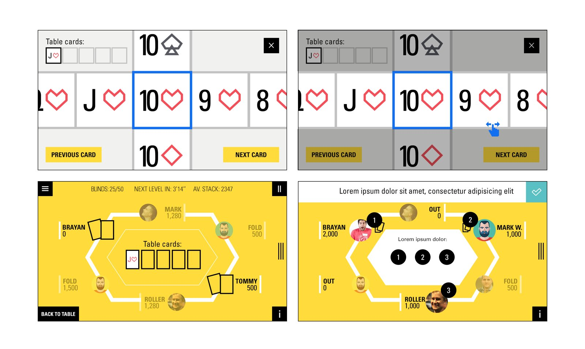

3 filled shapes

| layer | x,y,w,h | fill | opacity |
|---|---|---|---|
| Rectangle 8 | 1356,135,1139,192 | #000000 | 30 |
| Rectangle 9 | 1356,587,1139,191 | #000000 | 30 |
| move | 2212,553,67,71 | #116FF0 |  |

### TABLE_6PLUS.psd — `0VzRGs_TABLE_6PLUS`

Canvas 11338×9041 · board / multi-frame canvas · modified 2015-07-16 · 

1 filled shapes

| layer | x,y,w,h | fill | opacity |
|---|---|---|---|
| Rectangle 1 | -1,-1,2210,1244 | #FFDB3C |  |

### side menu.psd — `0Y1eFk_side_menu`

Canvas 1136×640 · iPhone 5/5s landscape @2x (568x320pt) · modified 2014-08-16 · 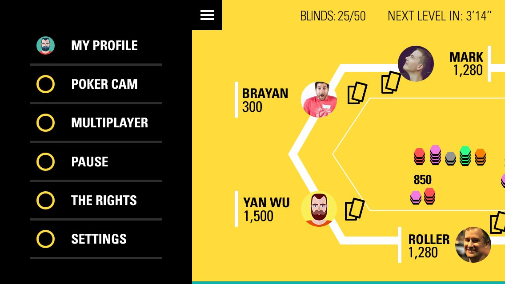

| text | x,y,w,h | font | px | colour | align |
|---|---|---|---|---|---|
| my profile | 161,91,148,23 | Univers-CondensedBold | 30.0 | #FFFFFF | left |
| Poker Cam | 162,178,147,23 | Univers-CondensedBold | 30.0 | #FFFFFF | left |
| Multiplayer | 161,265,172,23 | Univers-CondensedBold | 30.0 | #FFFFFF | left |
| Pause | 162,353,81,23 | Univers-CondensedBold | 30.0 | #FFFFFF | left |
| the rights | 160,440,147,23 | Univers-CondensedBold | 30.0 | #FFFFFF | left |
| Settings | 161,527,123,23 | Univers-CondensedBold | 30.0 | #FFFFFF | left |

13 filled shapes

| layer | x,y,w,h | fill | opacity |
|---|---|---|---|
| Rectangle 1 | -1,-1,434,642 | #000000 |  |
| my profile / Rectangle 2 | 67,73,71,72 | #000000 | 18 |
| my profile / Rectangle 2 copy | 135,73,230,72 | #000000 | 18 |
| Poker Cam / Rectangle 2 | 67,161,71,71 | #000000 | 18 |
| Poker Cam / Rectangle 2 copy | 135,161,230,71 | #000000 | 18 |
| Multiplayer / Rectangle 2 | 67,248,71,71 | #000000 | 18 |
| Multiplayer / Rectangle 2 copy | 135,248,230,71 | #000000 | 18 |
| Pause / Rectangle 2 | 67,336,71,70 | #000000 | 18 |
| Pause / Rectangle 2 copy | 135,336,230,70 | #000000 | 18 |
| the rights / Rectangle 2 | 67,423,71,70 | #000000 | 18 |
| the rights / Rectangle 2 copy | 135,423,230,70 | #000000 | 18 |
| Settings / Rectangle 2 | 67,510,70,70 | #000000 | 18 |
| Settings / Rectangle 2 copy | 135,510,230,70 | #000000 | 18 |

### WHW_4.psd — `0tRRU0_WHW_4`

Canvas 3834×972 · board / multi-frame canvas · modified 2015-02-07 · 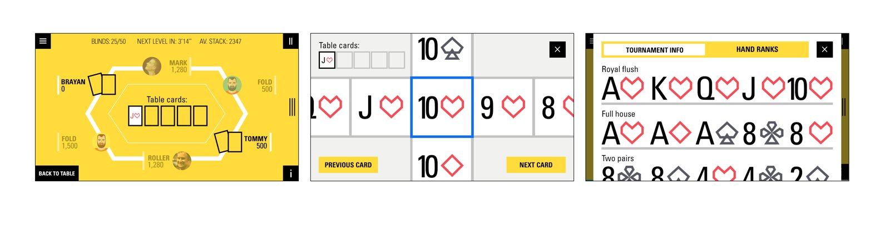

| text | x,y,w,h | font | px | colour | align |
|---|---|---|---|---|---|
| hand ranks | 3174,200,178,25 | Univers-CondensedBold | 32.03 |  | left |

1 filled shapes

| layer | x,y,w,h | fill | opacity |
|---|---|---|---|
| Group 1 / Rectangle 1 | 3160,194,210,37 | #FFDB3C |  |

### spec_6plus.psd — `1BHemc_spec_6plus`

Canvas 5465×4266 · board / multi-frame canvas · modified 2015-05-28 · 

| text | x,y,w,h | font | px | colour | align |
|---|---|---|---|---|---|
| Send request | 379,995,484,98 | RobotoCondensed-Regular | 100.2 | #FFFFFF | center |
| John Ford | 61,503,493,104 | RobotoCondensed-Regular | 133.7 |  | left |
| Nickname: | 62,407,257,52 | RobotoCondensed-Regular | 66.8 |  | left |
| Join with email | 433,92,373,52 | RobotoCondensed-Regular | 66.8 | #000000 | center |

9 filled shapes

| layer | x,y,w,h | fill | opacity |
|---|---|---|---|
| normal copy / Rectangle 7 copy | -1,912,1244,254 | #FFFFFF |  |
| normal copy / Rectangle 13 copy | 59,972,1124,134 | #1158F0 |  |
| input / Rectangle 10 | -1,341,1244,360 | #FFFFFF |  |
| input / Rectangle 3 copy 3 | 58,398,1126,246 | #000000 |  |
| head / Rectangle 7 | -1,-1,1244,250 | #FFDB3C |  |
| head / back / Rectangle 2 copy | 58,58,132,131 | #000000 |  |
| head / back / Back icon | 99,93,38,62 | #FFFFFF |  |
| head / next / Rectangle 2 copy | 1053,58,131,131 | #000000 |  |
| head / next / Back icon | 1105,93,38,62 | #FFFFFF |  |

### _startscreen.psd — `1NfM3M__startscreen`

Canvas 5000×3338 · board / multi-frame canvas · modified 2015-02-07 · 

### lobby_pr.psd — `1VJclk_lobby_pr`

Canvas 1940×1220 · board / multi-frame canvas · modified 2014-08-31 · 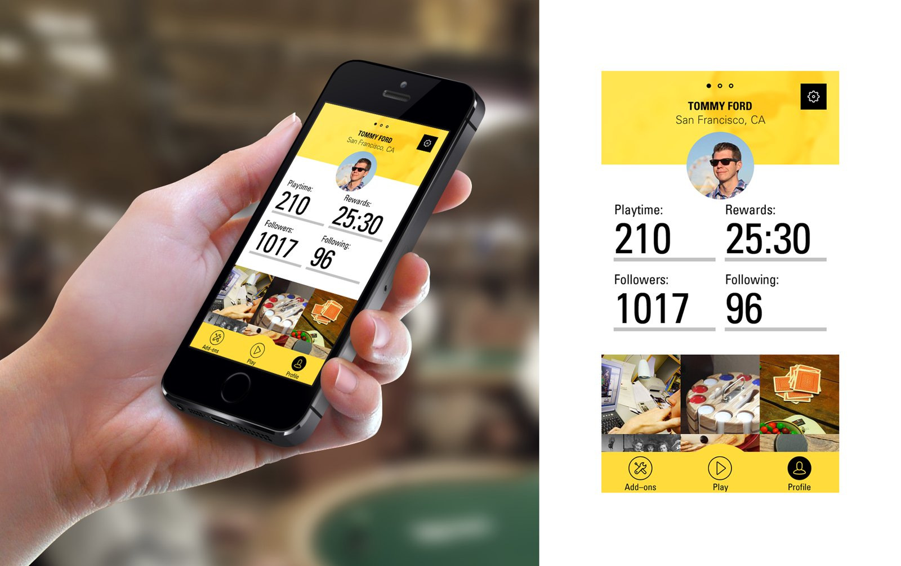

119 filled shapes

| layer | x,y,w,h | fill | opacity |
|---|---|---|---|
| Rectangle 1 | -22,-30,1185,1292 | #E2F3FC |  |
| in hand / iPhone 5S / phone / Background / Shape | 346,188,702,802 | #FFFFFF |  |
| in hand / iPhone 5S / phone / Background / Shape | 332,177,706,770 | #010000 |  |
| in hand / iPhone 5S / phone / Background / Shape | 590,912,60,32 | #B5B9C3 |  |
| in hand / iPhone 5S / phone / Background / Shape | 332,790,59,80 | #AEB3BD |  |
| in hand / iPhone 5S / phone / Background / Shape | 1001,177,37,88 | #A6ABB6 |  |
| in hand / iPhone 5S / phone / Background / Shape | 332,123,706,817 | #000000 |  |
| in hand / iPhone 5S / phone / Background / Shape | 333,121,704,822 | #1E1E1E |  |
| in hand / iPhone 5S / phone / Background / Shape | 341,120,692,813 | #000004 |  |
| in hand / iPhone 5S / phone / Background / screen border | 402,216,572,620 | #19191A |  |
| in hand / iPhone 5S / phone / Bottom / Sound / Hole / Shape | 574,944,14,10 | #050505 |  |
| in hand / iPhone 5S / phone / Bottom / Sound / Hole / Shape | 575,944,13,10 | #050506 |  |
| in hand / iPhone 5S / phone / Bottom / Sound / Hole / Shape | 578,944,7,6 | #020201 |  |
| in hand / iPhone 5S / phone / Bottom / Sound / Hole / Shape | 431,893,10,8 | #000000 |  |
| in hand / iPhone 5S / phone / Bottom / Sound / Hole / Shape | 431,893,9,8 | #000000 |  |
| in hand / iPhone 5S / phone / Bottom / Sound / Hole / Shape | 433,893,6,5 | #020201 |  |
| in hand / iPhone 5S / phone / Bottom / Sound / Hole / Shape | 427,887,10,8 | #000000 |  |
| in hand / iPhone 5S / phone / Bottom / Sound / Hole / Shape | 427,888,9,7 | #000000 |  |
| in hand / iPhone 5S / phone / Bottom / Sound / Hole / Shape | 429,888,6,5 | #020201 |  |
| in hand / iPhone 5S / phone / Bottom / Sound / Hole / Shape | 424,890,10,8 | #000000 |  |
| in hand / iPhone 5S / phone / Bottom / Sound / Hole / Shape | 425,891,9,7 | #000000 |  |
| in hand / iPhone 5S / phone / Bottom / Sound / Hole / Shape | 426,891,6,5 | #020201 |  |
| in hand / iPhone 5S / phone / Bottom / Sound / Hole / Shape | 420,885,10,8 | #000000 |  |
| in hand / iPhone 5S / phone / Bottom / Sound / Hole / Shape | 421,885,9,8 | #000000 |  |
| in hand / iPhone 5S / phone / Bottom / Sound / Hole / Shape | 422,885,6,5 | #020201 |  |
| in hand / iPhone 5S / phone / Bottom / Sound / Hole / Shape | 418,888,10,8 | #000000 |  |
| in hand / iPhone 5S / phone / Bottom / Sound / Hole / Shape | 419,889,8,7 | #000000 |  |
| in hand / iPhone 5S / phone / Bottom / Sound / Hole / Shape | 420,889,6,4 | #020201 |  |
| in hand / iPhone 5S / phone / Bottom / Sound / Hole / Shape | 415,883,9,8 | #000000 |  |
| in hand / iPhone 5S / phone / Bottom / Sound / Hole / Shape | 415,883,9,8 | #000000 |  |
| in hand / iPhone 5S / phone / Bottom / Sound / Hole / Shape | 416,883,6,5 | #020201 |  |
| in hand / iPhone 5S / phone / Bottom / Sound / Hole / Shape | 413,886,9,8 | #000000 |  |
| in hand / iPhone 5S / phone / Bottom / Sound / Hole / Shape | 413,886,8,8 | #000000 |  |
| in hand / iPhone 5S / phone / Bottom / Sound / Hole / Shape | 414,886,6,5 | #020201 |  |
| in hand / iPhone 5S / phone / Bottom / Sound / Hole / Shape | 409,881,9,7 | #000000 |  |
| in hand / iPhone 5S / phone / Bottom / Sound / Hole / Shape | 409,881,9,7 | #000000 |  |
| in hand / iPhone 5S / phone / Bottom / Sound / Hole / Shape | 410,881,6,5 | #020201 |  |
| in hand / iPhone 5S / phone / Bottom / Sound / Hole / Shape | 406,884,10,8 | #000000 |  |
| in hand / iPhone 5S / phone / Bottom / Sound / Hole / Shape | 407,884,8,8 | #000000 |  |
| in hand / iPhone 5S / phone / Bottom / Sound / Hole / Shape | 408,884,6,5 | #020201 |  |
| in hand / iPhone 5S / phone / Bottom / Sound / Hole / Shape | 559,934,13,9 | #050505 |  |
| in hand / iPhone 5S / phone / Bottom / Sound / Hole / Shape | 559,934,12,9 | #050506 |  |
| in hand / iPhone 5S / phone / Bottom / Sound / Hole / Shape | 562,934,7,6 | #020201 |  |
| in hand / iPhone 5S / phone / Bottom / Sound / Hole / Shape | 565,940,13,10 | #050505 |  |
| in hand / iPhone 5S / phone / Bottom / Sound / Hole / Shape | 565,941,12,9 | #050506 |  |
| in hand / iPhone 5S / phone / Bottom / Sound / Hole / Shape | 568,941,7,6 | #020201 |  |
| in hand / iPhone 5S / phone / Bottom / Sound / Hole / Shape | 555,937,13,10 | #050505 |  |
| in hand / iPhone 5S / phone / Bottom / Sound / Hole / Shape | 556,937,11,10 | #050506 |  |
| in hand / iPhone 5S / phone / Bottom / Sound / Hole / Shape | 558,938,7,6 | #020201 |  |
| in hand / iPhone 5S / phone / Bottom / Sound / Hole / Shape | 550,930,12,9 | #050505 |  |
| in hand / iPhone 5S / phone / Bottom / Sound / Hole / Shape | 550,930,12,9 | #050506 |  |
| in hand / iPhone 5S / phone / Bottom / Sound / Hole / Shape | 553,931,7,5 | #020201 |  |
| in hand / iPhone 5S / phone / Bottom / Sound / Hole / Shape | 546,934,12,9 | #050505 |  |
| in hand / iPhone 5S / phone / Bottom / Sound / Hole / Shape | 546,934,12,9 | #050506 |  |
| in hand / iPhone 5S / phone / Bottom / Sound / Hole / Shape | 549,934,7,6 | #020201 |  |
| in hand / iPhone 5S / phone / Bottom / Sound / Hole / Shape | 541,927,12,9 | #050505 |  |
| in hand / iPhone 5S / phone / Bottom / Sound / Hole / Shape | 541,927,11,9 | #050506 |  |
| in hand / iPhone 5S / phone / Bottom / Sound / Hole / Shape | 543,927,7,6 | #020201 |  |
| in hand / iPhone 5S / phone / Bottom / Sound / Hole / Shape | 537,930,12,10 | #050505 |  |
| in hand / iPhone 5S / phone / Bottom / Sound / Hole / Shape | 537,931,12,9 | #050506 |  |
| in hand / iPhone 5S / phone / Bottom / Sound / Hole / Shape | 540,931,7,6 | #020201 |  |
| in hand / iPhone 5S / phone / Bottom / Sound / Hole / Shape | 532,924,11,9 | #050505 |  |
| in hand / iPhone 5S / phone / Bottom / Sound / Hole / Shape | 532,924,11,9 | #050506 |  |
| in hand / iPhone 5S / phone / Bottom / Sound / Hole / Shape | 534,924,7,6 | #020201 |  |
| in hand / iPhone 5S / phone / Bottom / Sound / Hole / Shape | 528,927,12,9 | #050505 |  |
| in hand / iPhone 5S / phone / Bottom / Sound / Hole / Shape | 528,928,11,8 | #050506 |  |
| in hand / iPhone 5S / phone / Bottom / Sound / Hole / Shape | 531,928,6,5 | #020201 |  |
| in hand / iPhone 5S / phone / Bottom / Sound / Hole / Shape | 523,921,12,9 | #050505 |  |
| in hand / iPhone 5S / phone / Bottom / Sound / Hole / Shape | 523,921,11,9 | #050506 |  |
| in hand / iPhone 5S / phone / Bottom / Sound / Hole / Shape | 526,921,6,6 | #020201 |  |
| in hand / iPhone 5S / phone / Bottom / Sound / Hole / Shape | 520,924,11,9 | #050505 |  |
| in hand / iPhone 5S / phone / Bottom / Sound / Hole / Shape | 520,925,11,8 | #050506 |  |
| in hand / iPhone 5S / phone / Bottom / Sound / Hole / Shape | 522,925,7,5 | #020201 |  |
| in hand / iPhone 5S / phone / Bottom / Sound / Hole / Shape | 515,918,11,9 | #050505 |  |
| in hand / iPhone 5S / phone / Bottom / Sound / Hole / Shape | 515,918,11,9 | #050506 |  |
| in hand / iPhone 5S / phone / Bottom / Sound / Hole / Shape | 517,918,7,6 | #020201 |  |
| in hand / iPhone 5S / phone / Bottom / Sound / Hole / Shape | 511,921,11,9 | #050505 |  |
| in hand / iPhone 5S / phone / Bottom / Sound / Hole / Shape | 511,922,11,8 | #050506 |  |
| in hand / iPhone 5S / phone / Bottom / Sound / Hole / Shape | 514,922,6,5 | #020201 |  |
| in hand / iPhone 5S / phone / Bottom / Sound / Hole / Shape | 506,915,11,9 | #050505 |  |
| in hand / iPhone 5S / phone / Bottom / Sound / Hole / Shape | 506,915,11,9 | #050506 |  |
| in hand / iPhone 5S / phone / Bottom / Sound / Hole / Shape | 509,915,6,6 | #020201 |  |
| in hand / iPhone 5S / phone / Bottom / Sound / Hole / Shape | 568,936,14,10 | #050505 |  |
| in hand / iPhone 5S / phone / Bottom / Sound / Hole / Shape | 569,937,13,9 | #050506 |  |
| in hand / iPhone 5S / phone / Bottom / Sound / Hole / Shape | 572,937,7,6 | #020201 |  |
| in hand / iPhone 5S / phone / Bottom / Sound / Hole / Shape | 403,879,9,7 | #000000 |  |
| in hand / iPhone 5S / phone / Bottom / Sound / Hole / Shape | 403,879,8,7 | #000000 |  |
| in hand / iPhone 5S / phone / Bottom / Sound / Hole / Shape | 404,879,6,5 | #020201 |  |
| in hand / iPhone 5S / phone / Bottom / Shape | 495,913,15,11 | #686C6E |  |
| in hand / iPhone 5S / phone / Bottom / Shape | 495,913,15,11 | #686C6E |  |
| in hand / iPhone 5S / phone / Bottom / star | 499,915,7,7 | #0F1010 |  |
| in hand / iPhone 5S / phone / Bottom / Shape | 436,892,13,10 | #686C6E |  |
| in hand / iPhone 5S / phone / Bottom / Shape | 436,892,13,10 | #686C6E |  |
| in hand / iPhone 5S / phone / Bottom / star | 439,894,7,6 | #131414 |  |
| in hand / iPhone 5S / phone / Bottom / Shape 4 | 445,894,53,28 | #0A0A0A |  |
| in hand / iPhone 5S / phone / Bottom / Shape 5 | 447,895,50,25 | #686C6E |  |
| in hand / iPhone 5S / phone / Bottom / Shape 6 | 449,896,46,23 | #09090A |  |
| in hand / iPhone 5S / phone / Bottom / Shape 7 | 449,896,46,23 | #606773 |  |
| in hand / iPhone 5S / phone / Bottom / Light | 449,896,46,23 | #606773 |  |
| in hand / iPhone 5S / phone / Bottom / Shape | 376,868,24,19 | #59595B |  |
| in hand / iPhone 5S / phone / Bottom / Shape | 376,868,23,18 | #060606 |  |
| in hand / iPhone 5S / phone / Bottom / Shape | 376,869,23,17 | #5B5C5F |  |
| in hand / iPhone 5S / phone / Bottom / Shape | 376,869,22,17 | #676E7A |  |
| in hand / iPhone 5S / phone / Side / Shape | 999,252,31,35 | #09090A | 80 |
| in hand / iPhone 5S / phone / Side / Shape | 665,872,32,33 | #060605 | 80 |
| in hand / iPhone 5S / phone / Side / Sim / Shape | 823,526,58,109 | #706970 |  |
| in hand / iPhone 5S / phone / Side / Sim / Shape | 826,613,9,18 | #0B0C0C |  |
| in hand / iPhone 5S / phone / Side / Sim / Shape | 826,613,9,17 | #2B2C2D |  |
| in hand / iPhone 5S / phone / Home Button / Shape 8 | 471,796,74,79 | #000000 |  |
| in hand / iPhone 5S / phone / Top / Micro / Shape | 821,192,66,29 | #000000 |  |
| in hand / iPhone 5S / phone / Top / Micro / Shape | 821,192,66,29 | #000000 |  |
| in hand / iPhone 5S / phone / Top / Micro / Shape | 827,197,57,22 | #000000 |  |
| in hand / iPhone 5S / phone / Top / Camera / Shape | 860,173,18,19 | #202020 |  |
| in hand / iPhone 5S / phone / Top / Camera / Shape | 865,181,9,9 | #031428 |  |
| in hand / iPhone 5S / phone / Top / Camera / Shape | 868,184,4,6 | #3A9BD3 |  |
| in hand / iPhone 5S / phone / Top / Camera / Shape | 869,182,5,6 | #02458C |  |
| in hand / iPhone 5S / phone / Top / Camera / Shape | 867,181,5,5 | #1A6784 |  |
| in hand / iPhone 5S / phone / Top / Camera / Shape | 865,183,5,7 | #113E87 |  |
| in hand / iPhone 5S / glare | 502,123,450,428 | #FFFFFF |  |

### bet_2.psd — `25Vc0U_bet_2`

Canvas 1906×4184 · board / multi-frame canvas · modified 2015-02-07 · 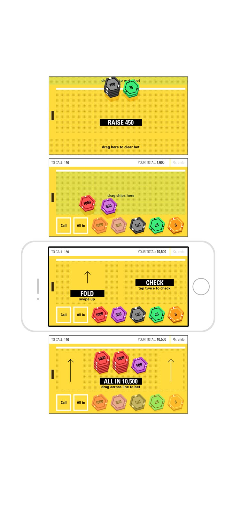

1 filled shapes

| layer | x,y,w,h | fill | opacity |
|---|---|---|---|
| iPhone 5S Gold / Screen (100% black) copy | 399,2021,1138,642 | #000000 |  |

### info.psd — `2dQYzQ_info`

Canvas 2666×1593 · board / multi-frame canvas · modified 2015-02-07 · 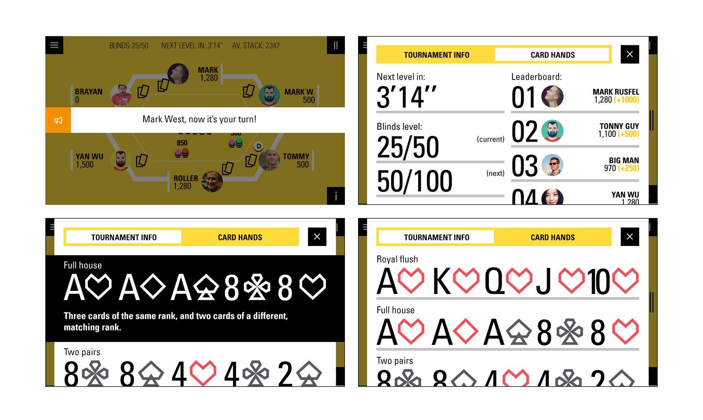

### TABLE_5S.psd — `2phUjQ_TABLE_5S`

Canvas 5403×7299 · board / multi-frame canvas · modified 2015-07-16 · 

| text | x,y,w,h | font | px | colour | align |
|---|---|---|---|---|---|
| / 23,950 | 528,5653,78,28 | RobotoCondensed-Bold | 30.1 | #000000 | center |
| john | 185,5518,65,23 | RobotoCondensed-Bold | 30.0 | #000000 | left |
| 500 | 185,5545,44,26 | RobotoCondensed-Regular | 34.0 | #000000 | left |
| PABLO | 77,5616,74,23 | RobotoCondensed-Bold | 30.0 | #000000 | left |
| 1,280 | 75,5643,68,31 | RobotoCondensed-Regular | 34.0 | #000000 | left |
| stive | 78,5745,68,23 | RobotoCondensed-Bold | 30.0 | #000000 | left |
| 500 | 77,5772,45,26 | RobotoCondensed-Regular | 34.0 | #000000 | left |
| mike | 184,5844,57,22 | RobotoCondensed-Bold | 30.0 | #000000 | left |
| 500 | 185,5871,45,26 | RobotoCondensed-Regular | 34.0 | #000000 | left |
| Isabella | 476,5885,112,23 | RobotoCondensed-Bold | 30.0 | #000000 | left |
| 500 | 474,5912,45,26 | RobotoCondensed-Regular | 34.0 | #000000 | left |
| Mark | 881,5844,68,22 | RobotoCondensed-Bold | 30.0 | #000000 | right |
| 500 | 903,5871,45,26 | RobotoCondensed-Regular | 34.0 | #000000 | right |
| vitaly | 978,5745,80,22 | RobotoCondensed-Bold | 30.0 | #000000 | right |
| 1,500 | 990,5772,67,31 | RobotoCondensed-Regular | 34.0 | #000000 | right |
| jenny | 979,5616,79,23 | RobotoCondensed-Bold | 30.0 | #000000 | right |
| 1,500 | 990,5643,67,31 | RobotoCondensed-Regular | 34.0 | #000000 | right |
| roberto | 862,5518,108,23 | RobotoCondensed-Bold | 30.0 | #000000 | right |
| 1,500 | 903,5545,68,31 | RobotoCondensed-Regular | 34.0 | #000000 | right |
| Emily | 586,5477,67,22 | RobotoCondensed-Bold | 30.0 | #000000 | right |
| 1,500 | 585,5504,68,31 | RobotoCondensed-Regular | 34.0 | #000000 | right |
| d | 301,5593,14,17 | Roboto-Bold | 24.0 | #FFFFFF | left |
| d | 252,5687,14,17 | Roboto-Bold | 24.0 | #FFFFFF | left |
| d | 276,5787,14,17 | Roboto-Bold | 24.0 | #FFFFFF | left |
| d | 385,5852,14,17 | Roboto-Bold | 24.0 | #FFFFFF | left |
| d | 514,5857,14,17 | Roboto-Bold | 24.0 | #FFFFFF | left |
| d | 737,5852,14,17 | Roboto-Bold | 24.0 | #FFFFFF | left |
| d | 846,5787,14,17 | Roboto-Bold | 24.0 | #FFFFFF | left |
| d | 870,5687,14,17 | Roboto-Bold | 24.0 | #FFFFFF | left |
| d | 821,5593,14,17 | Roboto-Bold | 24.0 | #FFFFFF | left |
| d | 608,5545,14,17 | Roboto-Bold | 24.0 | #FFFFFF | left |
| / 450K | 379,5601,59,23 | RobotoCondensed-Bold | 30.2 | #000000 | center |
| / 450K | 314,5627,59,23 | RobotoCondensed-Bold | 30.2 | #000000 | center |
| / 450K | 314,5701,59,23 | RobotoCondensed-Bold | 30.2 | #000000 | center |
| / 450K | 379,5745,59,23 | RobotoCondensed-Bold | 30.2 | #000000 | center |
| / 450K | 537,5756,59,23 | RobotoCondensed-Bold | 30.2 | #000000 | center |
| / 450K | 695,5745,59,23 | RobotoCondensed-Bold | 30.2 | #000000 | center |
| / 450K | 760,5701,59,23 | RobotoCondensed-Bold | 30.2 | #000000 | center |
| / 450K | 760,5627,59,23 | RobotoCondensed-Bold | 30.2 | #000000 | center |
| / 450K | 695,5601,59,23 | RobotoCondensed-Bold | 30.2 | #000000 | center |
| / 450K | 538,5585,58,23 | RobotoCondensed-Bold | 30.0 | #000000 | center |
| Blinds: 25/50 | 245,5384,143,24 | RobotoCondensed-Light | 30.0 | #000000 | left |
| Next level in: 3’14’’ | 441,5383,228,24 | RobotoCondensed-Light | 30.0 | #000000 | left |
| Av. stack: 2347 | 709,5384,176,23 | RobotoCondensed-Light | 30.0 | #000000 | left |
| / 23,950 | 528,4983,78,28 | RobotoCondensed-Bold | 30.1 | #000000 | center |
| john | 286,4807,65,23 | RobotoCondensed-Bold | 30.0 | #000000 | left |
| 500 | 286,4834,44,26 | RobotoCondensed-Regular | 34.0 | #000000 | left |
| PABLO | 102,4923,74,23 | RobotoCondensed-Bold | 30.0 | #000000 | left |
| 1,280 | 100,4950,68,31 | RobotoCondensed-Regular | 34.0 | #000000 | left |
| stive | 78,5057,68,23 | RobotoCondensed-Bold | 30.0 | #000000 | left |
| 500 | 77,5084,45,26 | RobotoCondensed-Regular | 34.0 | #000000 | left |
| mike | 184,5174,57,22 | RobotoCondensed-Bold | 30.0 | #000000 | left |
| 500 | 185,5201,45,26 | RobotoCondensed-Regular | 34.0 | #000000 | left |
| Isabella | 476,5215,112,23 | RobotoCondensed-Bold | 30.0 | #000000 | left |
| 500 | 474,5242,45,26 | RobotoCondensed-Regular | 34.0 | #000000 | left |
| Mark | 881,5174,68,22 | RobotoCondensed-Bold | 30.0 | #000000 | right |
| 500 | 903,5201,45,26 | RobotoCondensed-Regular | 34.0 | #000000 | right |
| vitaly | 978,5057,80,22 | RobotoCondensed-Bold | 30.0 | #000000 | right |
| 1,500 | 990,5084,67,31 | RobotoCondensed-Regular | 34.0 | #000000 | right |
| jenny | 954,4923,79,23 | RobotoCondensed-Bold | 30.0 | #000000 | right |
| 1,500 | 965,4950,67,31 | RobotoCondensed-Regular | 34.0 | #000000 | right |
| roberto | 761,4807,108,23 | RobotoCondensed-Bold | 30.0 | #000000 | right |
| 1,500 | 802,4834,68,31 | RobotoCondensed-Regular | 34.0 | #000000 | right |
| / 450K | 455,4917,59,23 | RobotoCondensed-Bold | 30.2 | #000000 | center |
| / 450K | 338,4939,59,23 | RobotoCondensed-Bold | 30.2 | #000000 | center |
| / 450K | 310,5027,59,23 | RobotoCondensed-Bold | 30.2 | #000000 | center |
| / 450K | 380,5071,59,23 | RobotoCondensed-Bold | 30.2 | #000000 | center |
| / 450K | 537,5086,59,23 | RobotoCondensed-Bold | 30.2 | #000000 | center |
| / 450K | 694,5071,59,23 | RobotoCondensed-Bold | 30.2 | #000000 | center |
| / 450K | 764,5027,59,23 | RobotoCondensed-Bold | 30.2 | #000000 | center |
| / 450K | 736,4939,59,23 | RobotoCondensed-Bold | 30.2 | #000000 | center |
| / 450K | 619,4917,59,23 | RobotoCondensed-Bold | 30.2 | #000000 | center |
| d | 401,4889,14,17 | Roboto-Bold | 24.0 | #FFFFFF | left |
| d | 270,5000,14,17 | Roboto-Bold | 24.0 | #FFFFFF | left |
| d | 268,5115,14,17 | Roboto-Bold | 24.0 | #FFFFFF | left |
| d | 388,5177,14,17 | Roboto-Bold | 24.0 | #FFFFFF | left |
| d | 514,5187,14,17 | Roboto-Bold | 24.0 | #FFFFFF | left |
| d | 734,5177,14,17 | Roboto-Bold | 24.0 | #FFFFFF | left |
| d | 854,5115,14,17 | Roboto-Bold | 24.0 | #FFFFFF | left |
| d | 852,5000,14,17 | Roboto-Bold | 24.0 | #FFFFFF | left |
| d | 721,4889,14,17 | Roboto-Bold | 24.0 | #FFFFFF | left |
| Blinds: 25/50 | 245,4714,143,24 | RobotoCondensed-Light | 30.0 | #000000 | left |
| Next level in: 3’14’’ | 441,4713,228,24 | RobotoCondensed-Light | 30.0 | #000000 | left |
| Av. stack: 2347 | 709,4714,176,23 | RobotoCondensed-Light | 30.0 | #000000 | left |
| / 23,950 | 528,4313,78,28 | RobotoCondensed-Bold | 30.1 | #000000 | center |
| john | 148,4196,65,23 | RobotoCondensed-Bold | 30.0 | #000000 | left |
| 500 | 148,4223,44,26 | RobotoCondensed-Regular | 34.0 | #000000 | left |
| PABLO | 77,4341,74,23 | RobotoCondensed-Bold | 30.0 | #000000 | left |
| 1,280 | 75,4368,68,31 | RobotoCondensed-Regular | 34.0 | #000000 | left |
| stive | 149,4486,68,23 | RobotoCondensed-Bold | 30.0 | #000000 | left |
| 500 | 148,4513,45,26 | RobotoCondensed-Regular | 34.0 | #000000 | left |
| mike | 483,4545,57,22 | RobotoCondensed-Bold | 30.0 | #000000 | left |
| 500 | 484,4572,45,26 | RobotoCondensed-Regular | 34.0 | #000000 | left |
| Isabella | 896,4486,112,23 | RobotoCondensed-Bold | 30.0 | #000000 | right |
| 500 | 960,4513,44,26 | RobotoCondensed-Regular | 34.0 | #000000 | right |
| Mark | 989,4341,68,22 | RobotoCondensed-Bold | 30.0 | #000000 | right |
| 500 | 1011,4368,45,26 | RobotoCondensed-Regular | 34.0 | #000000 | right |
| vitaly | 907,4196,80,22 | RobotoCondensed-Bold | 30.0 | #000000 | right |
| 1,500 | 919,4223,67,31 | RobotoCondensed-Regular | 34.0 | #000000 | right |
| jenny | 574,4137,79,23 | RobotoCondensed-Bold | 30.0 | #000000 | right |
| 1,500 | 585,4164,67,31 | RobotoCondensed-Regular | 34.0 | #000000 | right |
| / 450K | 373,4251,59,23 | RobotoCondensed-Bold | 30.2 | #000000 | center |
| / 450K | 313,4335,59,23 | RobotoCondensed-Bold | 30.2 | #000000 | center |
| / 450K | 373,4408,59,23 | RobotoCondensed-Bold | 30.2 | #000000 | center |
| / 450K | 537,4416,59,23 | RobotoCondensed-Bold | 30.2 | #000000 | center |
| / 450K | 701,4408,59,23 | RobotoCondensed-Bold | 30.2 | #000000 | center |
| / 450K | 761,4335,59,23 | RobotoCondensed-Bold | 30.2 | #000000 | center |
| / 450K | 701,4251,59,23 | RobotoCondensed-Bold | 30.2 | #000000 | center |
| / 450K | 538,4245,58,23 | RobotoCondensed-Bold | 30.0 | #000000 | center |
| d | 284,4276,14,17 | Roboto-Bold | 24.0 | #FFFFFF | left |
| d | 264,4403,14,17 | Roboto-Bold | 24.0 | #FFFFFF | left |
| d | 352,4507,14,17 | Roboto-Bold | 24.0 | #FFFFFF | left |
| d | 514,4517,14,17 | Roboto-Bold | 24.0 | #FFFFFF | left |
| d | 770,4507,14,17 | Roboto-Bold | 24.0 | #FFFFFF | left |
| d | 858,4403,14,17 | Roboto-Bold | 24.0 | #FFFFFF | left |
| d | 838,4276,14,17 | Roboto-Bold | 24.0 | #FFFFFF | left |
| d | 608,4205,14,17 | Roboto-Bold | 24.0 | #FFFFFF | left |
| Blinds: 100/200 | 245,4044,170,24 | RobotoCondensed-Light | 30.0 | #000000 | left |
| Next level in: 3’14’’ | 441,4043,228,24 | RobotoCondensed-Light | 30.0 | #000000 | left |
| Av. stack: 2347 | 709,4044,176,23 | RobotoCondensed-Light | 30.0 | #000000 | left |

_…132 more text layers in the JSON._

1834 filled shapes

| layer | x,y,w,h | fill | opacity |
|---|---|---|---|
| _10 / Rectangle 1 copy 11 | -1,5358,1138,644 | #FFDB3C |  |
| _10 / pot / pot_7 / _1 / Shape 3 | 606,5719,29,17 | #000000 |  |
| _10 / pot / pot_7 / _1 / Shape 5 | 606,5709,29,23 | #F98202 |  |
| _10 / pot / pot_7 / _1 / Shape 3 copy | 606,5711,29,17 | #000000 |  |
| _10 / pot / pot_7 / _1 / Shape 5 copy | 606,5701,29,23 | #F98202 |  |
| _10 / pot / pot_7 / _1 / Shape 3 copy 11 | 606,5703,29,17 | #000000 |  |
| _10 / pot / pot_7 / _1 / Shape 5 copy 11 | 606,5693,29,23 | #F98202 |  |
| _10 / pot / pot_7 / _1 / Shape 3 copy 15 | 606,5695,29,17 | #000000 |  |
| _10 / pot / pot_7 / _1 / Shape 5 copy 15 | 606,5685,29,23 | #F98202 |  |
| _10 / pot / pot_7 / _2 / Shape 3 | 580,5719,27,17 | #000000 |  |
| _10 / pot / pot_7 / _2 / Shape 5 | 580,5709,27,23 | #2EFF86 |  |
| _10 / pot / pot_7 / _2 / Shape 3 copy 2 | 580,5711,27,17 | #000000 |  |
| _10 / pot / pot_7 / _2 / Shape 5 copy 2 | 580,5701,27,23 | #2EFF86 |  |
| _10 / pot / pot_7 / _2 / Shape 3 copy 3 | 580,5703,27,17 | #000000 |  |
| _10 / pot / pot_7 / _2 / Shape 5 copy 3 | 580,5693,27,23 | #2EFF86 |  |
| _10 / pot / pot_7 / _2 / Shape 3 copy 5 | 580,5695,27,17 | #000000 |  |
| _10 / pot / pot_7 / _2 / Shape 5 copy 5 | 580,5685,27,23 | #2EFF86 |  |
| _10 / pot / pot_7 / _2 / Shape 3 copy 14 | 580,5687,27,17 | #000000 |  |
| _10 / pot / pot_7 / _2 / Shape 5 copy 14 | 580,5677,27,23 | #2EFF86 |  |
| _10 / pot / pot_7 / _3 / Shape 3 | 552,5719,29,17 | #000000 |  |
| _10 / pot / pot_7 / _3 / Shape 5 | 552,5709,29,23 | #B6B4A5 |  |
| _10 / pot / pot_7 / _3 / Shape 3 copy 4 | 552,5711,29,17 | #000000 |  |
| _10 / pot / pot_7 / _3 / Shape 5 copy 4 | 552,5701,29,23 | #B6B4A5 |  |
| _10 / pot / pot_7 / _3 / Shape 3 copy 7 | 552,5703,29,17 | #000000 |  |
| _10 / pot / pot_7 / _3 / Shape 5 copy 7 | 552,5693,29,23 | #B6B4A5 |  |
| _10 / pot / pot_7 / _4 / Shape 3 | 526,5719,27,17 | #000000 |  |
| _10 / pot / pot_7 / _4 / Shape 5 | 526,5709,27,23 | #FF95F1 |  |
| _10 / pot / pot_7 / _4 / Shape 3 copy 8 | 526,5711,27,17 | #000000 |  |
| _10 / pot / pot_7 / _4 / Shape 5 copy 8 | 526,5701,27,23 | #FF95F1 |  |
| _10 / pot / pot_7 / _4 / Shape 3 copy 9 | 526,5703,27,17 | #000000 |  |
| _10 / pot / pot_7 / _4 / Shape 5 copy 9 | 526,5693,27,23 | #FF95F1 |  |
| _10 / pot / pot_7 / _4 / Shape 3 copy 10 | 526,5695,27,17 | #000000 |  |
| _10 / pot / pot_7 / _4 / Shape 5 copy 10 | 526,5685,27,23 | #FF95F1 |  |
| _10 / pot / pot_7 / _4 / Shape 3 copy 13 | 526,5687,27,17 | #000000 |  |
| _10 / pot / pot_7 / _4 / Shape 5 copy 13 | 526,5677,27,23 | #FF95F1 |  |
| _10 / pot / pot_7 / _5 / Shape 3 | 498,5719,29,17 | #000000 |  |
| _10 / pot / pot_7 / _5 / Shape 5 | 498,5709,29,23 | #FF5252 |  |
| _10 / pot / pot_7 / _5 / Shape 3 copy 8 | 498,5711,29,17 | #000000 |  |
| _10 / pot / pot_7 / _5 / Shape 5 copy 8 | 498,5701,29,23 | #FF5252 |  |
| _10 / pot / pot_7 / _5 / Shape 3 copy 9 | 498,5703,29,17 | #000000 |  |
| _10 / pot / pot_7 / _5 / Shape 5 copy 9 | 498,5693,29,23 | #FF5252 |  |
| _10 / players / 10 / Rectangle 1 copy 7 | 162,5502,11,85 | #FFFFFF |  |
| _10 / players / 9 / Rectangle 1 copy 7 | 54,5600,11,84 | #FFFFFF |  |
| _10 / players / 8 / Rectangle 1 copy 7 | 54,5729,11,85 | #FFFFFF |  |
| _10 / players / 7 / Rectangle 1 copy 7 | 162,5828,11,85 | #FFFFFF |  |
| _10 / players / 6 / yellow | 451,5869,192,85 | #FFDB3C |  |
| _10 / players / 6 / Rectangle 1 copy 7 | 451,5869,11,85 | #FFFFFF |  |
| _10 / players / 5 / Rectangle 1 copy 7 | 961,5828,11,85 | #FFFFFF |  |
| _10 / players / 4 / Rectangle 1 copy 7 | 1069,5729,11,85 | #FFFFFF |  |
| _10 / players / 3 / Rectangle 1 copy 7 | 1069,5600,11,84 | #FFFFFF |  |
| _10 / players / 2 / Rectangle 1 copy 7 | 982,5502,10,85 | #FFFFFF |  |
| _10 / players / 1 / yellow | 503,5461,167,85 | #FFDB3C |  |
| _10 / players / 1 / Rectangle 1 copy 7 | 664,5461,10,85 | #FFFFFF |  |
| _10 / dealer / 10 / Ellipse 6 copy 5 | 287,5582,39,38 | #000000 |  |
| _10 / dealer / 9 / Ellipse 6 copy 5 | 238,5676,39,38 | #000000 |  |
| _10 / dealer / 8 / Ellipse 6 copy 5 | 262,5775,39,39 | #000000 |  |
| _10 / dealer / 7 / Ellipse 6 copy 5 | 371,5841,39,38 | #000000 |  |
| _10 / dealer / 6 / Ellipse 6 copy 5 | 500,5845,39,39 | #000000 |  |
| _10 / dealer / 5 / Ellipse 6 copy 5 | 724,5841,39,38 | #000000 |  |
| _10 / dealer / 4 / Ellipse 6 copy 5 | 832,5775,39,39 | #000000 |  |
| _10 / dealer / 3 / Ellipse 6 copy 5 | 856,5676,39,38 | #000000 |  |
| _10 / dealer / 2 / Ellipse 6 copy 5 | 808,5582,39,38 | #000000 |  |
| _10 / dealer / 1 / Ellipse 6 copy 5 | 595,5534,39,38 | #000000 |  |
| _10 / bets / 10 / _1 / Shape 3 | 408,5649,28,17 | #000000 |  |
| _10 / bets / 10 / _1 / Shape 5 | 408,5639,28,23 | #FF5252 |  |
| _10 / bets / 10 / _1 / Shape 3 copy | 408,5641,28,17 | #000000 |  |
| _10 / bets / 10 / _1 / Shape 5 copy | 408,5631,28,23 | #FF5252 |  |
| _10 / bets / 10 / _1 / Shape 3 copy 29 | 408,5633,28,17 | #000000 |  |
| _10 / bets / 10 / _1 / Shape 5 copy 29 | 408,5623,28,23 | #FF5252 |  |
| _10 / bets / 10 / _2 / Shape 3 | 381,5649,28,17 | #000000 |  |
| _10 / bets / 10 / _2 / Shape 5 | 381,5639,28,23 | #5CC5F7 |  |
| _10 / bets / 10 / _2 / Shape 3 copy 2 | 381,5641,28,17 | #000000 |  |
| _10 / bets / 10 / _2 / Shape 5 copy 2 | 381,5631,28,23 | #5CC5F7 |  |
| _10 / bets / 10 / _2 / Shape 3 copy 3 | 381,5633,28,17 | #000000 |  |
| _10 / bets / 10 / _2 / Shape 5 copy 3 | 381,5623,28,23 | #5CC5F7 |  |
| _10 / bets / 9 / _1 / Shape 3 | 343,5675,28,17 | #000000 |  |
| _10 / bets / 9 / _1 / Shape 5 | 343,5665,28,23 | #FF5252 |  |
| _10 / bets / 9 / _1 / Shape 3 copy | 343,5667,28,17 | #000000 |  |
| _10 / bets / 9 / _1 / Shape 5 copy | 343,5657,28,23 | #FF5252 |  |
| _10 / bets / 9 / _1 / Shape 3 copy 29 | 343,5659,28,17 | #000000 |  |
| _10 / bets / 9 / _1 / Shape 5 copy 29 | 343,5649,28,23 | #FF5252 |  |
| _10 / bets / 9 / _2 / Shape 3 | 316,5675,28,17 | #000000 |  |
| _10 / bets / 9 / _2 / Shape 5 | 316,5665,28,23 | #5CC5F7 |  |
| _10 / bets / 9 / _2 / Shape 3 copy 2 | 316,5667,28,17 | #000000 |  |
| _10 / bets / 9 / _2 / Shape 5 copy 2 | 316,5657,28,23 | #5CC5F7 |  |
| _10 / bets / 9 / _2 / Shape 3 copy 3 | 316,5659,28,17 | #000000 |  |
| _10 / bets / 9 / _2 / Shape 5 copy 3 | 316,5649,28,23 | #5CC5F7 |  |
| _10 / bets / 8 / _1 / Shape 3 | 343,5749,28,17 | #000000 |  |
| _10 / bets / 8 / _1 / Shape 5 | 343,5739,28,23 | #FF5252 |  |
| _10 / bets / 8 / _1 / Shape 3 copy | 343,5741,28,17 | #000000 |  |
| _10 / bets / 8 / _1 / Shape 5 copy | 343,5731,28,23 | #FF5252 |  |
| _10 / bets / 8 / _1 / Shape 3 copy 29 | 343,5733,28,17 | #000000 |  |
| _10 / bets / 8 / _1 / Shape 5 copy 29 | 343,5723,28,23 | #FF5252 |  |
| _10 / bets / 8 / _2 / Shape 3 | 316,5749,28,17 | #000000 |  |
| _10 / bets / 8 / _2 / Shape 5 | 316,5739,28,23 | #5CC5F7 |  |
| _10 / bets / 8 / _2 / Shape 3 copy 2 | 316,5741,28,17 | #000000 |  |
| _10 / bets / 8 / _2 / Shape 5 copy 2 | 316,5731,28,23 | #5CC5F7 |  |
| _10 / bets / 8 / _2 / Shape 3 copy 3 | 316,5733,28,17 | #000000 |  |
| _10 / bets / 8 / _2 / Shape 5 copy 3 | 316,5723,28,23 | #5CC5F7 |  |
| _10 / bets / 7 / _1 / Shape 3 | 408,5793,28,17 | #000000 |  |
| _10 / bets / 7 / _1 / Shape 5 | 408,5783,28,23 | #FF5252 |  |
| _10 / bets / 7 / _1 / Shape 3 copy | 408,5785,28,17 | #000000 |  |
| _10 / bets / 7 / _1 / Shape 5 copy | 408,5775,28,23 | #FF5252 |  |
| _10 / bets / 7 / _1 / Shape 3 copy 29 | 408,5777,28,17 | #000000 |  |
| _10 / bets / 7 / _1 / Shape 5 copy 29 | 408,5767,28,23 | #FF5252 |  |
| _10 / bets / 7 / _2 / Shape 3 | 381,5793,28,17 | #000000 |  |
| _10 / bets / 7 / _2 / Shape 5 | 381,5783,28,23 | #5CC5F7 |  |
| _10 / bets / 7 / _2 / Shape 3 copy 2 | 381,5785,28,17 | #000000 |  |
| _10 / bets / 7 / _2 / Shape 5 copy 2 | 381,5775,28,23 | #5CC5F7 |  |
| _10 / bets / 7 / _2 / Shape 3 copy 3 | 381,5777,28,17 | #000000 |  |
| _10 / bets / 7 / _2 / Shape 5 copy 3 | 381,5767,28,23 | #5CC5F7 |  |
| _10 / bets / 6 / _1 / Shape 3 | 566,5804,28,17 | #000000 |  |
| _10 / bets / 6 / _1 / Shape 5 | 566,5794,28,23 | #FF5252 |  |
| _10 / bets / 6 / _1 / Shape 3 copy | 566,5796,28,17 | #000000 |  |
| _10 / bets / 6 / _1 / Shape 5 copy | 566,5786,28,23 | #FF5252 |  |
| _10 / bets / 6 / _1 / Shape 3 copy 29 | 566,5788,28,17 | #000000 |  |
| _10 / bets / 6 / _1 / Shape 5 copy 29 | 566,5778,28,23 | #FF5252 |  |
| _10 / bets / 6 / _2 / Shape 3 | 539,5804,28,17 | #000000 |  |
| _10 / bets / 6 / _2 / Shape 5 | 539,5794,28,23 | #5CC5F7 |  |
| _10 / bets / 6 / _2 / Shape 3 copy 2 | 539,5796,28,17 | #000000 |  |
| _10 / bets / 6 / _2 / Shape 5 copy 2 | 539,5786,28,23 | #5CC5F7 |  |
| _10 / bets / 6 / _2 / Shape 3 copy 3 | 539,5788,28,17 | #000000 |  |
| _10 / bets / 6 / _2 / Shape 5 copy 3 | 539,5778,28,23 | #5CC5F7 |  |
| _10 / bets / 5 / _1 / Shape 3 | 724,5793,28,17 | #000000 |  |
| _10 / bets / 5 / _1 / Shape 5 | 724,5783,28,23 | #FF5252 |  |
| _10 / bets / 5 / _1 / Shape 3 copy | 724,5785,28,17 | #000000 |  |
| _10 / bets / 5 / _1 / Shape 5 copy | 724,5775,28,23 | #FF5252 |  |
| _10 / bets / 5 / _1 / Shape 3 copy 29 | 724,5777,28,17 | #000000 |  |
| _10 / bets / 5 / _1 / Shape 5 copy 29 | 724,5767,28,23 | #FF5252 |  |
| _10 / bets / 5 / _2 / Shape 3 | 697,5793,28,17 | #000000 |  |
| _10 / bets / 5 / _2 / Shape 5 | 697,5783,28,23 | #5CC5F7 |  |
| _10 / bets / 5 / _2 / Shape 3 copy 2 | 697,5785,28,17 | #000000 |  |
| _10 / bets / 5 / _2 / Shape 5 copy 2 | 697,5775,28,23 | #5CC5F7 |  |
| _10 / bets / 5 / _2 / Shape 3 copy 3 | 697,5777,28,17 | #000000 |  |
| _10 / bets / 5 / _2 / Shape 5 copy 3 | 697,5767,28,23 | #5CC5F7 |  |
| _10 / bets / 4 / _1 / Shape 3 | 789,5749,28,17 | #000000 |  |
| _10 / bets / 4 / _1 / Shape 5 | 789,5739,28,23 | #FF5252 |  |
| _10 / bets / 4 / _1 / Shape 3 copy | 789,5741,28,17 | #000000 |  |
| _10 / bets / 4 / _1 / Shape 5 copy | 789,5731,28,23 | #FF5252 |  |
| _10 / bets / 4 / _1 / Shape 3 copy 29 | 789,5733,28,17 | #000000 |  |
| _10 / bets / 4 / _1 / Shape 5 copy 29 | 789,5723,28,23 | #FF5252 |  |
| _10 / bets / 4 / _2 / Shape 3 | 762,5749,28,17 | #000000 |  |
| _10 / bets / 4 / _2 / Shape 5 | 762,5739,28,23 | #5CC5F7 |  |
| _10 / bets / 4 / _2 / Shape 3 copy 2 | 762,5741,28,17 | #000000 |  |
| _10 / bets / 4 / _2 / Shape 5 copy 2 | 762,5731,28,23 | #5CC5F7 |  |
| _10 / bets / 4 / _2 / Shape 3 copy 3 | 762,5733,28,17 | #000000 |  |
| _10 / bets / 4 / _2 / Shape 5 copy 3 | 762,5723,28,23 | #5CC5F7 |  |
| _10 / bets / 3 / _1 / Shape 3 | 789,5675,28,17 | #000000 |  |
| _10 / bets / 3 / _1 / Shape 5 | 789,5665,28,23 | #FF5252 |  |
| _10 / bets / 3 / _1 / Shape 3 copy | 789,5667,28,17 | #000000 |  |

### splash.psd — `2tUelE_splash`

Canvas 1940×1220 · board / multi-frame canvas · modified 2014-08-31 · 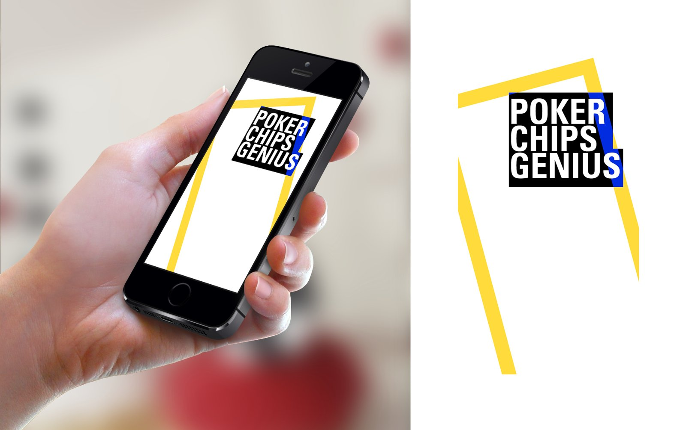

119 filled shapes

| layer | x,y,w,h | fill | opacity |
|---|---|---|---|
| presentation / Rectangle 1 | -22,-30,1185,1292 | #E2F3FC |  |
| presentation / in hand / iPhone 5S / phone / Background / Shape | 346,188,702,802 | #FFFFFF |  |
| presentation / in hand / iPhone 5S / phone / Background / Shape | 332,177,706,770 | #010000 |  |
| presentation / in hand / iPhone 5S / phone / Background / Shape | 590,912,60,32 | #B5B9C3 |  |
| presentation / in hand / iPhone 5S / phone / Background / Shape | 332,790,59,80 | #AEB3BD |  |
| presentation / in hand / iPhone 5S / phone / Background / Shape | 1001,177,37,88 | #A6ABB6 |  |
| presentation / in hand / iPhone 5S / phone / Background / Shape | 332,123,706,817 | #000000 |  |
| presentation / in hand / iPhone 5S / phone / Background / Shape | 333,121,704,822 | #1E1E1E |  |
| presentation / in hand / iPhone 5S / phone / Background / Shape | 341,120,692,813 | #000004 |  |
| presentation / in hand / iPhone 5S / phone / Background / screen border | 402,216,572,620 | #19191A |  |
| presentation / in hand / iPhone 5S / phone / Bottom / Sound / Hole / Shape | 574,944,14,10 | #050505 |  |
| presentation / in hand / iPhone 5S / phone / Bottom / Sound / Hole / Shape | 575,944,13,10 | #050506 |  |
| presentation / in hand / iPhone 5S / phone / Bottom / Sound / Hole / Shape | 578,944,7,6 | #020201 |  |
| presentation / in hand / iPhone 5S / phone / Bottom / Sound / Hole / Shape | 431,893,10,8 | #000000 |  |
| presentation / in hand / iPhone 5S / phone / Bottom / Sound / Hole / Shape | 431,893,9,8 | #000000 |  |
| presentation / in hand / iPhone 5S / phone / Bottom / Sound / Hole / Shape | 433,893,6,5 | #020201 |  |
| presentation / in hand / iPhone 5S / phone / Bottom / Sound / Hole / Shape | 427,887,10,8 | #000000 |  |
| presentation / in hand / iPhone 5S / phone / Bottom / Sound / Hole / Shape | 427,888,9,7 | #000000 |  |
| presentation / in hand / iPhone 5S / phone / Bottom / Sound / Hole / Shape | 429,888,6,5 | #020201 |  |
| presentation / in hand / iPhone 5S / phone / Bottom / Sound / Hole / Shape | 424,890,10,8 | #000000 |  |
| presentation / in hand / iPhone 5S / phone / Bottom / Sound / Hole / Shape | 425,891,9,7 | #000000 |  |
| presentation / in hand / iPhone 5S / phone / Bottom / Sound / Hole / Shape | 426,891,6,5 | #020201 |  |
| presentation / in hand / iPhone 5S / phone / Bottom / Sound / Hole / Shape | 420,885,10,8 | #000000 |  |
| presentation / in hand / iPhone 5S / phone / Bottom / Sound / Hole / Shape | 421,885,9,8 | #000000 |  |
| presentation / in hand / iPhone 5S / phone / Bottom / Sound / Hole / Shape | 422,885,6,5 | #020201 |  |
| presentation / in hand / iPhone 5S / phone / Bottom / Sound / Hole / Shape | 418,888,10,8 | #000000 |  |
| presentation / in hand / iPhone 5S / phone / Bottom / Sound / Hole / Shape | 419,889,8,7 | #000000 |  |
| presentation / in hand / iPhone 5S / phone / Bottom / Sound / Hole / Shape | 420,889,6,4 | #020201 |  |
| presentation / in hand / iPhone 5S / phone / Bottom / Sound / Hole / Shape | 415,883,9,8 | #000000 |  |
| presentation / in hand / iPhone 5S / phone / Bottom / Sound / Hole / Shape | 415,883,9,8 | #000000 |  |
| presentation / in hand / iPhone 5S / phone / Bottom / Sound / Hole / Shape | 416,883,6,5 | #020201 |  |
| presentation / in hand / iPhone 5S / phone / Bottom / Sound / Hole / Shape | 413,886,9,8 | #000000 |  |
| presentation / in hand / iPhone 5S / phone / Bottom / Sound / Hole / Shape | 413,886,8,8 | #000000 |  |
| presentation / in hand / iPhone 5S / phone / Bottom / Sound / Hole / Shape | 414,886,6,5 | #020201 |  |
| presentation / in hand / iPhone 5S / phone / Bottom / Sound / Hole / Shape | 409,881,9,7 | #000000 |  |
| presentation / in hand / iPhone 5S / phone / Bottom / Sound / Hole / Shape | 409,881,9,7 | #000000 |  |
| presentation / in hand / iPhone 5S / phone / Bottom / Sound / Hole / Shape | 410,881,6,5 | #020201 |  |
| presentation / in hand / iPhone 5S / phone / Bottom / Sound / Hole / Shape | 406,884,10,8 | #000000 |  |
| presentation / in hand / iPhone 5S / phone / Bottom / Sound / Hole / Shape | 407,884,8,8 | #000000 |  |
| presentation / in hand / iPhone 5S / phone / Bottom / Sound / Hole / Shape | 408,884,6,5 | #020201 |  |
| presentation / in hand / iPhone 5S / phone / Bottom / Sound / Hole / Shape | 559,934,13,9 | #050505 |  |
| presentation / in hand / iPhone 5S / phone / Bottom / Sound / Hole / Shape | 559,934,12,9 | #050506 |  |
| presentation / in hand / iPhone 5S / phone / Bottom / Sound / Hole / Shape | 562,934,7,6 | #020201 |  |
| presentation / in hand / iPhone 5S / phone / Bottom / Sound / Hole / Shape | 565,940,13,10 | #050505 |  |
| presentation / in hand / iPhone 5S / phone / Bottom / Sound / Hole / Shape | 565,941,12,9 | #050506 |  |
| presentation / in hand / iPhone 5S / phone / Bottom / Sound / Hole / Shape | 568,941,7,6 | #020201 |  |
| presentation / in hand / iPhone 5S / phone / Bottom / Sound / Hole / Shape | 555,937,13,10 | #050505 |  |
| presentation / in hand / iPhone 5S / phone / Bottom / Sound / Hole / Shape | 556,937,11,10 | #050506 |  |
| presentation / in hand / iPhone 5S / phone / Bottom / Sound / Hole / Shape | 558,938,7,6 | #020201 |  |
| presentation / in hand / iPhone 5S / phone / Bottom / Sound / Hole / Shape | 550,930,12,9 | #050505 |  |
| presentation / in hand / iPhone 5S / phone / Bottom / Sound / Hole / Shape | 550,930,12,9 | #050506 |  |
| presentation / in hand / iPhone 5S / phone / Bottom / Sound / Hole / Shape | 553,931,7,5 | #020201 |  |
| presentation / in hand / iPhone 5S / phone / Bottom / Sound / Hole / Shape | 546,934,12,9 | #050505 |  |
| presentation / in hand / iPhone 5S / phone / Bottom / Sound / Hole / Shape | 546,934,12,9 | #050506 |  |
| presentation / in hand / iPhone 5S / phone / Bottom / Sound / Hole / Shape | 549,934,7,6 | #020201 |  |
| presentation / in hand / iPhone 5S / phone / Bottom / Sound / Hole / Shape | 541,927,12,9 | #050505 |  |
| presentation / in hand / iPhone 5S / phone / Bottom / Sound / Hole / Shape | 541,927,11,9 | #050506 |  |
| presentation / in hand / iPhone 5S / phone / Bottom / Sound / Hole / Shape | 543,927,7,6 | #020201 |  |
| presentation / in hand / iPhone 5S / phone / Bottom / Sound / Hole / Shape | 537,930,12,10 | #050505 |  |
| presentation / in hand / iPhone 5S / phone / Bottom / Sound / Hole / Shape | 537,931,12,9 | #050506 |  |
| presentation / in hand / iPhone 5S / phone / Bottom / Sound / Hole / Shape | 540,931,7,6 | #020201 |  |
| presentation / in hand / iPhone 5S / phone / Bottom / Sound / Hole / Shape | 532,924,11,9 | #050505 |  |
| presentation / in hand / iPhone 5S / phone / Bottom / Sound / Hole / Shape | 532,924,11,9 | #050506 |  |
| presentation / in hand / iPhone 5S / phone / Bottom / Sound / Hole / Shape | 534,924,7,6 | #020201 |  |
| presentation / in hand / iPhone 5S / phone / Bottom / Sound / Hole / Shape | 528,927,12,9 | #050505 |  |
| presentation / in hand / iPhone 5S / phone / Bottom / Sound / Hole / Shape | 528,928,11,8 | #050506 |  |
| presentation / in hand / iPhone 5S / phone / Bottom / Sound / Hole / Shape | 531,928,6,5 | #020201 |  |
| presentation / in hand / iPhone 5S / phone / Bottom / Sound / Hole / Shape | 523,921,12,9 | #050505 |  |
| presentation / in hand / iPhone 5S / phone / Bottom / Sound / Hole / Shape | 523,921,11,9 | #050506 |  |
| presentation / in hand / iPhone 5S / phone / Bottom / Sound / Hole / Shape | 526,921,6,6 | #020201 |  |
| presentation / in hand / iPhone 5S / phone / Bottom / Sound / Hole / Shape | 520,924,11,9 | #050505 |  |
| presentation / in hand / iPhone 5S / phone / Bottom / Sound / Hole / Shape | 520,925,11,8 | #050506 |  |
| presentation / in hand / iPhone 5S / phone / Bottom / Sound / Hole / Shape | 522,925,7,5 | #020201 |  |
| presentation / in hand / iPhone 5S / phone / Bottom / Sound / Hole / Shape | 515,918,11,9 | #050505 |  |
| presentation / in hand / iPhone 5S / phone / Bottom / Sound / Hole / Shape | 515,918,11,9 | #050506 |  |
| presentation / in hand / iPhone 5S / phone / Bottom / Sound / Hole / Shape | 517,918,7,6 | #020201 |  |
| presentation / in hand / iPhone 5S / phone / Bottom / Sound / Hole / Shape | 511,921,11,9 | #050505 |  |
| presentation / in hand / iPhone 5S / phone / Bottom / Sound / Hole / Shape | 511,922,11,8 | #050506 |  |
| presentation / in hand / iPhone 5S / phone / Bottom / Sound / Hole / Shape | 514,922,6,5 | #020201 |  |
| presentation / in hand / iPhone 5S / phone / Bottom / Sound / Hole / Shape | 506,915,11,9 | #050505 |  |
| presentation / in hand / iPhone 5S / phone / Bottom / Sound / Hole / Shape | 506,915,11,9 | #050506 |  |
| presentation / in hand / iPhone 5S / phone / Bottom / Sound / Hole / Shape | 509,915,6,6 | #020201 |  |
| presentation / in hand / iPhone 5S / phone / Bottom / Sound / Hole / Shape | 568,936,14,10 | #050505 |  |
| presentation / in hand / iPhone 5S / phone / Bottom / Sound / Hole / Shape | 569,937,13,9 | #050506 |  |
| presentation / in hand / iPhone 5S / phone / Bottom / Sound / Hole / Shape | 572,937,7,6 | #020201 |  |
| presentation / in hand / iPhone 5S / phone / Bottom / Sound / Hole / Shape | 403,879,9,7 | #000000 |  |
| presentation / in hand / iPhone 5S / phone / Bottom / Sound / Hole / Shape | 403,879,8,7 | #000000 |  |
| presentation / in hand / iPhone 5S / phone / Bottom / Sound / Hole / Shape | 404,879,6,5 | #020201 |  |
| presentation / in hand / iPhone 5S / phone / Bottom / Shape | 495,913,15,11 | #686C6E |  |
| presentation / in hand / iPhone 5S / phone / Bottom / Shape | 495,913,15,11 | #686C6E |  |
| presentation / in hand / iPhone 5S / phone / Bottom / star | 499,915,7,7 | #0F1010 |  |
| presentation / in hand / iPhone 5S / phone / Bottom / Shape | 436,892,13,10 | #686C6E |  |
| presentation / in hand / iPhone 5S / phone / Bottom / Shape | 436,892,13,10 | #686C6E |  |
| presentation / in hand / iPhone 5S / phone / Bottom / star | 439,894,7,6 | #131414 |  |
| presentation / in hand / iPhone 5S / phone / Bottom / Shape 4 | 445,894,53,28 | #0A0A0A |  |
| presentation / in hand / iPhone 5S / phone / Bottom / Shape 5 | 447,895,50,25 | #686C6E |  |
| presentation / in hand / iPhone 5S / phone / Bottom / Shape 6 | 449,896,46,23 | #09090A |  |
| presentation / in hand / iPhone 5S / phone / Bottom / Shape 7 | 449,896,46,23 | #606773 |  |
| presentation / in hand / iPhone 5S / phone / Bottom / Light | 449,896,46,23 | #606773 |  |
| presentation / in hand / iPhone 5S / phone / Bottom / Shape | 376,868,24,19 | #59595B |  |
| presentation / in hand / iPhone 5S / phone / Bottom / Shape | 376,868,23,18 | #060606 |  |
| presentation / in hand / iPhone 5S / phone / Bottom / Shape | 376,869,23,17 | #5B5C5F |  |
| presentation / in hand / iPhone 5S / phone / Bottom / Shape | 376,869,22,17 | #676E7A |  |
| presentation / in hand / iPhone 5S / phone / Side / Shape | 999,252,31,35 | #09090A | 80 |
| presentation / in hand / iPhone 5S / phone / Side / Shape | 665,872,32,33 | #060605 | 80 |
| presentation / in hand / iPhone 5S / phone / Side / Sim / Shape | 823,526,58,109 | #706970 |  |
| presentation / in hand / iPhone 5S / phone / Side / Sim / Shape | 826,613,9,18 | #0B0C0C |  |
| presentation / in hand / iPhone 5S / phone / Side / Sim / Shape | 826,613,9,17 | #2B2C2D |  |
| presentation / in hand / iPhone 5S / phone / Home Button / Shape 8 | 471,796,74,79 | #000000 |  |
| presentation / in hand / iPhone 5S / phone / Top / Micro / Shape | 821,192,66,29 | #000000 |  |
| presentation / in hand / iPhone 5S / phone / Top / Micro / Shape | 821,192,66,29 | #000000 |  |
| presentation / in hand / iPhone 5S / phone / Top / Micro / Shape | 827,197,57,22 | #000000 |  |
| presentation / in hand / iPhone 5S / phone / Top / Camera / Shape | 860,173,18,19 | #202020 |  |
| presentation / in hand / iPhone 5S / phone / Top / Camera / Shape | 865,181,9,9 | #031428 |  |
| presentation / in hand / iPhone 5S / phone / Top / Camera / Shape | 868,184,4,6 | #3A9BD3 |  |
| presentation / in hand / iPhone 5S / phone / Top / Camera / Shape | 869,182,5,6 | #02458C |  |
| presentation / in hand / iPhone 5S / phone / Top / Camera / Shape | 867,181,5,5 | #1A6784 |  |
| presentation / in hand / iPhone 5S / phone / Top / Camera / Shape | 865,183,5,7 | #113E87 |  |
| presentation / in hand / iPhone 5S / glare | 502,123,450,428 | #FFFFFF |  |

### 2playrs.psd — `2xmU1k_2playrs`

Canvas 1136×640 · iPhone 5/5s landscape @2x (568x320pt) · modified 2014-07-16 · 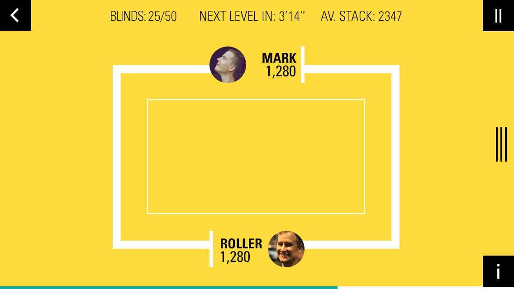

| text | x,y,w,h | font | px | colour | align |
|---|---|---|---|---|---|
| Blinds: 25/50 | 245,23,145,27 | Univers-CondensedLight | 30.0 | #000000 | left |
| Next level in: 3’14’’ | 442,24,232,23 | Univers-CondensedLight | 30.0 | #000000 | left |
| Av. stack: 2347 | 709,23,179,24 | Univers-CondensedLight | 30.0 | #000000 | left |
| Mark | 580,117,75,22 | Univers-CondensedBold | 30.0 | #000000 | center |
| 1,280 | 589,145,64,29 | Univers-Condensed | 34.0 | #000000 | center |
| Roller | 488,528,91,23 | Univers-CondensedBold | 30.0 | #000000 | center |
| 1,280 | 488,556,64,29 | Univers-Condensed | 34.0 | #000000 | center |

17 filled shapes

| layer | x,y,w,h | fill | opacity |
|---|---|---|---|
| 2 играков / Rectangle 2 | 248,143,637,410 | #000000 |  |
| 2 играков / Rectangle 2 copy | 324,218,485,258 | #000000 |  |
| 2 играков / ui scroul / Shape 2 | 1096,281,5,78 | #FFFFFF |  |
| 2 играков / ui scroul / Shape 2 copy | 1106,281,5,78 | #FFFFFF |  |
| 2 играков / ui scroul / Shape 2 copy 2 | 1115,281,6,78 | #FFFFFF |  |
| 2 играков / load / Shape 3 | -1,633,1138,8 | #FFFFFF |  |
| 2 играков / load / Shape 3 copy | -1,633,749,8 | #0EB2AB |  |
| 2 играков / кнопки / Rectangle 2 copy 4 | -1,-2,72,71 | #000000 |  |
| 2 играков / кнопки / Rectangle 2 copy 5 | 1066,-1,71,72 | #000000 |  |
| 2 играков / кнопки / Rectangle 2 copy 6 | 1066,565,71,71 | #000000 |  |
| 2 играков / кнопки / icons copy 2 / Ellipse 3 | 1097,583,9,36 | #FFFFFF |  |
| 2 играков / кнопки / icons copy 2 / Rectangle 3 copy | 1094,19,15,32 | #000000 |  |
| 2 играков / кнопки / icons copy 2 / Back icon | 21,16,21,34 | #FFFFFF |  |
| 2 играков / play copy / _0 / Rectangle 1 copy 2 | 512,101,155,85 | #FFDB3C |  |
| 2 играков / play copy / _0 / Rectangle 1 copy 7 | 664,101,11,85 | #FFFFFF |  |
| 2 играков / play copy / _3 / Rectangle 1 copy 2 | 470,510,188,84 | #FFDB3C |  |
| 2 играков / play copy / _3 / Rectangle 1 copy 6 | 462,510,11,84 | #FFFFFF |  |

### рассадка за столом к нарезке Specs.psd — `3VOX3c_рассадка_за_столом_к_нарезке_Specs`

Canvas 1136×640 · iPhone 5/5s landscape @2x (568x320pt) · modified 2014-07-15 · 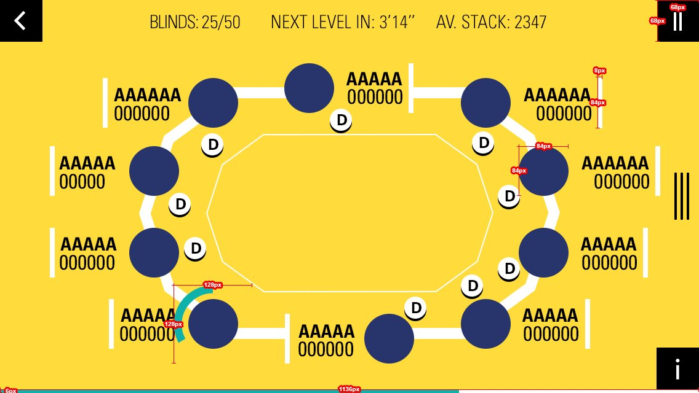

| text | x,y,w,h | font | px | colour | align |
|---|---|---|---|---|---|
| Blinds: 25/50 | 245,23,145,27 | Univers-CondensedLight | 30.0 | #000000 | left |
| Next level in: 3’14’’ | 442,24,232,23 | Univers-CondensedLight | 30.0 | #000000 | left |
| Av. stack: 2347 | 709,23,179,24 | Univers-CondensedLight | 30.0 | #000000 | left |
| aaaaaa | 185,143,110,22 | Univers-CondensedBold | 30.0 | #000000 | left |
| 000000 | 186,172,89,25 | Univers-Condensed | 34.0 | #000000 | left |
| aaaaa | 96,254,92,22 | Univers-CondensedBold | 30.0 | #000000 | left |
| 00000 | 97,283,73,25 | Univers-Condensed | 34.0 | #000000 | left |
| aaaaa | 98,386,92,22 | Univers-CondensedBold | 30.0 | #000000 | left |
| 000000 | 97,415,89,25 | Univers-Condensed | 34.0 | #000000 | left |
| aaaaa | 196,502,92,22 | Univers-CondensedBold | 30.0 | #000000 | left |
| 000000 | 195,531,89,25 | Univers-Condensed | 34.0 | #000000 | left |
| aaaaa | 485,528,92,22 | Univers-CondensedBold | 30.0 | #000000 | left |
| 000000 | 485,556,89,25 | Univers-Condensed | 34.0 | #000000 | left |
| aaaaa | 848,502,92,22 | Univers-CondensedBold | 30.0 | #000000 | right |
| 000000 | 851,531,89,25 | Univers-Condensed | 34.0 | #000000 | right |
| aaaaa | 943,386,92,22 | Univers-CondensedBold | 30.0 | #000000 | right |
| 000000 | 946,415,89,25 | Univers-Condensed | 34.0 | #000000 | right |
| aaaaaa | 945,254,110,22 | Univers-CondensedBold | 30.0 | #000000 | right |
| 000000 | 966,283,89,25 | Univers-Condensed | 34.0 | #000000 | right |
| AAAAAA | 851,143,110,22 | Univers-CondensedBold | 30.0 | #000000 | right |
| 000000 | 872,172,89,25 | Univers-Condensed | 34.0 | #000000 | right |
| AAAAA | 562,117,92,22 | Univers-CondensedBold | 30.0 | #000000 | right |
| 000000 | 565,145,89,25 | Univers-Condensed | 34.0 | #000000 | right |
| 84px | 872,234,23,9 | Arial-BoldMT | 10.0 | #F20000 | center |
| 84px | 832,274,23,9 | Arial-BoldMT | 10.0 | #F20000 | center |
| 68px | 1090,8,23,9 | Arial-BoldMT | 10.0 | #F20000 | center |
| 68px | 1057,30,23,9 | Arial-BoldMT | 10.0 | #F20000 | center |
| 8px | 966,111,17,9 | Arial-BoldMT | 10.0 | #F20000 | center |
| 84px | 960,163,23,9 | Arial-BoldMT | 10.0 | #F20000 | center |
| 128px | 332,460,28,9 | Arial-BoldMT | 10.0 | #F20000 | center |
| 128px | 268,524,28,9 | Arial-BoldMT | 10.0 | #F20000 | center |
| 1136px | 551,630,33,9 | Arial-BoldMT | 10.0 | #F20000 | center |
| 6px | 9,633,17,9 | Arial-BoldMT | 10.0 | #F20000 | center |

25 filled shapes

| layer | x,y,w,h | fill | opacity |
|---|---|---|---|
| DESIGN CANVAS (1136x640px) / 10 играков / PNG:im_table_10 / Polygon 2 | 225,140,687,414 | #28356C |  |
| DESIGN CANVAS (1136x640px) / 10 играков / PNG:im_table_10 / Polygon 2 copy | 334,216,470,262 | #28356C |  |
| DESIGN CANVAS (1136x640px) / 10 играков / load / Shape 3 | -1,633,1138,8 | #FFFFFF |  |
| DESIGN CANVAS (1136x640px) / 10 играков / load / Shape 3 copy | -1,633,749,8 | #0EB2AB |  |
| DESIGN CANVAS (1136x640px) / 10 играков / кнопки / Rectangle 2 copy 4 | -1,-2,72,71 | #000000 |  |
| DESIGN CANVAS (1136x640px) / 10 играков / кнопки / Rectangle 2 copy 5 | 1067,-1,70,71 | #000000 |  |
| DESIGN CANVAS (1136x640px) / 10 играков / кнопки / Rectangle 2 copy 6 | 1066,565,71,71 | #000000 |  |
| DESIGN CANVAS (1136x640px) / 10 играков / кнопки / icons copy 2 / PNG:ic_info /  | 1097,583,9,36 | #FFFFFF |  |
| DESIGN CANVAS (1136x640px) / 10 играков / кнопки / icons copy 2 / PNG:ic_sitout  | 1094,19,15,32 | #000000 |  |
| DESIGN CANVAS (1136x640px) / 10 играков / кнопки / icons copy 2 / PNG:ic_back /  | 21,16,21,34 | #FFFFFF |  |
| DESIGN CANVAS (1136x640px) / 10 играков / PNG:ic_scroll / Shape 2 | 1096,281,5,78 | #FFFFFF |  |
| DESIGN CANVAS (1136x640px) / 10 играков / PNG:ic_scroll / Shape 2 copy | 1106,281,5,78 | #FFFFFF |  |
| DESIGN CANVAS (1136x640px) / 10 играков / PNG:ic_scroll / Shape 2 copy 2 | 1115,281,6,78 | #FFFFFF |  |
| DESIGN CANVAS (1136x640px) / 10 играков / play copy / _9 / Rectangle 1 copy 8 | 166,126,11,83 | #FFFFFF |  |
| DESIGN CANVAS (1136x640px) / 10 играков / play copy / _8 / Rectangle 1 | 80,237,11,84 | #FFFFFF |  |
| DESIGN CANVAS (1136x640px) / 10 играков / play copy / _7 / Rectangle 1 copy 4 | 80,370,11,84 | #FFFFFF |  |
| DESIGN CANVAS (1136x640px) / 10 играков / play copy / _6 / Rectangle 1 copy 4 | 176,486,11,83 | #FFFFFF |  |
| DESIGN CANVAS (1136x640px) / 10 играков / play copy / _5 / Rectangle 1 copy 2 | 470,510,188,84 | #FFDB3C |  |
| DESIGN CANVAS (1136x640px) / 10 играков / play copy / _5 / Rectangle 1 copy 6 | 462,510,11,84 | #FFFFFF |  |
| DESIGN CANVAS (1136x640px) / 10 играков / play copy / _4 / PNG:im_player_line /  | 950,486,11,83 | #FFFFFF |  |
| DESIGN CANVAS (1136x640px) / 10 играков / play copy / _3 / Rectangle 1 copy 4 | 1044,370,11,84 | #FFFFFF |  |
| DESIGN CANVAS (1136x640px) / 10 играков / play copy / _2 / Rectangle 1 | 1064,237,11,84 | #FFFFFF |  |
| DESIGN CANVAS (1136x640px) / 10 играков / play copy / _1 / Rectangle 1 | 970,124,11,86 | #FFFFFF |  |
| DESIGN CANVAS (1136x640px) / 10 играков / play copy / _0 / Rectangle 1 copy 2 | 511,101,155,85 | #FFDB3C |  |
| DESIGN CANVAS (1136x640px) / 10 играков / play copy / _0 / Rectangle 1 copy 7 | 663,101,11,85 | #FFFFFF |  |

### 6playrs.psd — `3djSUU_6playrs`

Canvas 1136×640 · iPhone 5/5s landscape @2x (568x320pt) · modified 2014-07-16 · 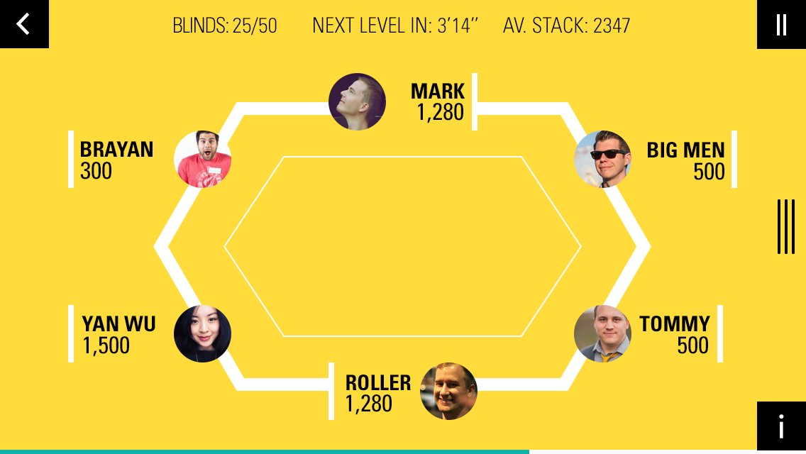

| text | x,y,w,h | font | px | colour | align |
|---|---|---|---|---|---|
| Blinds: 25/50 | 245,23,145,27 | Univers-CondensedLight | 30.0 | #000000 | left |
| Next level in: 3’14’’ | 442,24,232,23 | Univers-CondensedLight | 30.0 | #000000 | left |
| Av. stack: 2347 | 709,23,179,24 | Univers-CondensedLight | 30.0 | #000000 | left |
| Brayan | 114,199,101,22 | Univers-CondensedBold | 30.0 | #000000 | left |
| 300 | 113,228,44,25 | Univers-Condensed | 34.0 | #000000 | left |
| Yan Wu | 115,445,104,23 | Univers-CondensedBold | 30.0 | #000000 | left |
| 1,500 | 118,474,64,29 | Univers-Condensed | 34.0 | #000000 | left |
| Tommy | 901,445,100,23 | Univers-CondensedBold | 30.0 | #000000 | left |
| 500 | 955,474,43,25 | Univers-Condensed | 34.0 | #000000 | left |
| Big Men | 913,200,108,23 | Univers-CondensedBold | 30.0 | #000000 | left |
| 500 | 978,229,43,25 | Univers-Condensed | 34.0 | #000000 | left |
| Mark | 580,117,75,22 | Univers-CondensedBold | 30.0 | #000000 | center |
| 1,280 | 589,145,64,29 | Univers-Condensed | 34.0 | #000000 | center |
| Roller | 488,528,91,23 | Univers-CondensedBold | 30.0 | #000000 | center |
| 1,280 | 488,556,64,29 | Univers-Condensed | 34.0 | #000000 | center |

21 filled shapes

| layer | x,y,w,h | fill | opacity |
|---|---|---|---|
| 6 играков / Polygon 1 | 214,143,706,410 | #FFDB3C |  |
| 6 играков / Polygon 1 copy | 313,219,509,258 | #FFDB3C |  |
| 6 играков / ui scroul / Shape 2 | 1096,281,5,78 | #FFFFFF |  |
| 6 играков / ui scroul / Shape 2 copy | 1106,281,5,78 | #FFFFFF |  |
| 6 играков / ui scroul / Shape 2 copy 2 | 1115,281,6,78 | #FFFFFF |  |
| 6 играков / load / Shape 3 | -1,633,1138,8 | #FFFFFF |  |
| 6 играков / load / Shape 3 copy | -1,633,749,8 | #0EB2AB |  |
| 6 играков / кнопки / Rectangle 2 copy 4 | -1,-2,72,71 | #000000 |  |
| 6 играков / кнопки / Rectangle 2 copy 5 | 1066,-1,71,72 | #000000 |  |
| 6 играков / кнопки / Rectangle 2 copy 6 | 1066,565,71,71 | #000000 |  |
| 6 играков / кнопки / icons copy 2 / Ellipse 3 | 1097,583,9,36 | #FFFFFF |  |
| 6 играков / кнопки / icons copy 2 / Rectangle 3 copy | 1094,19,15,32 | #000000 |  |
| 6 играков / кнопки / icons copy 2 / Back icon | 21,16,21,34 | #FFFFFF |  |
| 6 играков / play copy / _5 / Rectangle 1 copy 5 | 95,183,11,84 | #FFFFFF |  |
| 6 играков / play copy / _4 / Rectangle 1 copy 3 | 95,429,11,83 | #FFFFFF |  |
| 6 играков / play copy / _2 / Rectangle 1 copy 4 | 1010,429,11,84 | #FFFFFF |  |
| 6 играков / play copy / _1 / Rectangle 1 | 1029,183,12,83 | #FFFFFF |  |
| 6 играков / play copy / _0 / Rectangle 1 copy 2 | 512,101,155,85 | #FFDB3C |  |
| 6 играков / play copy / _0 / Rectangle 1 copy 7 | 664,101,11,85 | #FFFFFF |  |
| _3 / Rectangle 1 copy 2 | 470,510,188,84 | #FFDB3C |  |
| _3 / Rectangle 1 copy 6 | 462,510,11,84 | #FFFFFF |  |

### winphone_bet.psd — `3pQajg_winphone_bet`

Canvas 1920×1080 · board / multi-frame canvas · modified 2014-07-16 · 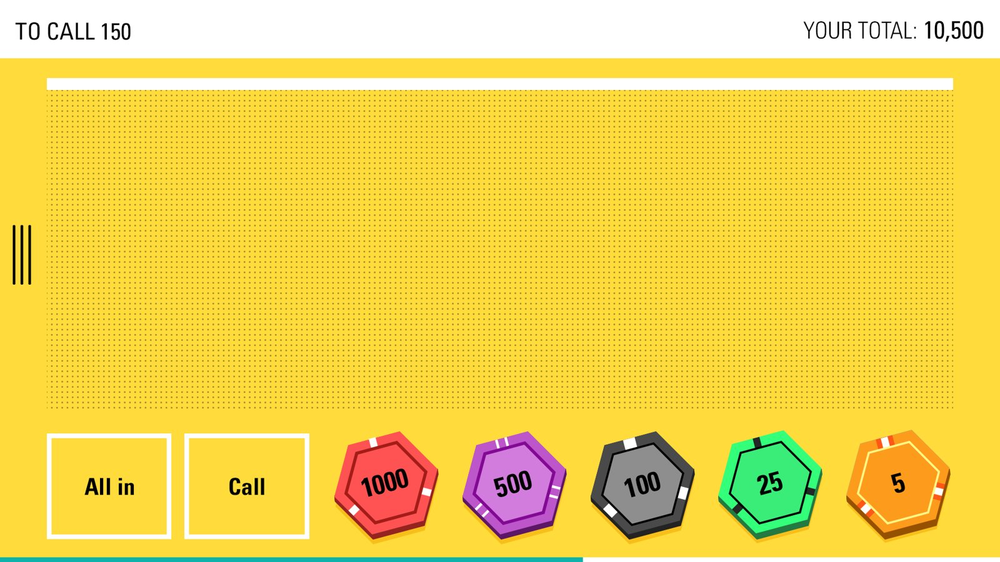

| text | x,y,w,h | font | px | colour | align |
|---|---|---|---|---|---|
| All in | 162,918,95,33 | Univers-CondensedBold | 45.0 | #000000 | left |
| Call | 440,918,68,34 | Univers-CondensedBold | 45.0 | #000000 | left |
| 5 | 1710,908,28,40 | Univers-CondensedBold | 50.7 | #000000 | left |
| 25 | 1453,905,50,47 | Univers-CondensedBold | 50.7 | #000000 | left |
| 100 | 1198,906,70,50 | Univers-CondensedBold | 50.7 | #000000 | left |
| 500 | 947,904,74,52 | Univers-CondensedBold | 50.7 | #000000 | left |
| 1000 | 693,900,91,55 | Univers-CondensedBold | 50.7 | #000000 | left |
| Your Total: 10,500 | 1542,40,346,40 | Univers-CondensedLight | 45.0 | #000000 | left |
| to call 150 | 29,42,222,35 | Univers-Condensed | 45.0 | #000000 | left |

43 filled shapes

| layer | x,y,w,h | fill | opacity |
|---|---|---|---|
| bet / load copy / Shape 3 | -1,1070,1923,11 | #FFFFFF |  |
| bet / load copy / Shape 3 copy | -1,1070,1122,11 | #0EB2AB |  |
| bet / 5_items / button_all in / Rectangle 2 copy 2 | 89,832,241,205 | #000000 |  |
| bet / 5_items / button_call / Rectangle 2 copy 7 | 353,832,243,205 | #000000 |  |
| bet / 5_items / chips_5 / 5 / 5 copy | 1623,824,201,201 | #3ECFF3 |  |
| bet / 5_items / chips_5 / 5 / 1000 copy 12 | 1623,838,203,201 | #965100 |  |
| bet / 5_items / chips_5 / 5 / 5 copy 2 | 1623,824,201,201 | #FD9B1D |  |
| bet / 5_items / chips_5 / 5 / Shape 6 copy 9 | 1690,837,22,30 | #FFFFFF |  |
| bet / 5_items / chips_5 / 5 / Shape 6 copy 9 | 1784,932,29,23 | #FFFFFF |  |
| bet / 5_items / chips_5 / 5 / Shape 6 copy 9 | 1650,961,29,29 | #FFFFFF |  |
| bet / 5_items / chips_5 / 25 / 25 copy | 1377,826,201,201 | #57FA4F |  |
| bet / 5_items / chips_5 / 25 / 1000 copy 11 | 1377,838,203,201 | #237941 |  |
| bet / 5_items / chips_5 / 25 / 25 copy 2 | 1377,826,201,201 | #33FF7A |  |
| bet / 5_items / chips_5 / 25 / Shape 6 copy 6 | 1444,837,22,30 | #242725 |  |
| bet / 5_items / chips_5 / 25 / Shape 6 copy 6 | 1538,932,29,23 | #242725 |  |
| bet / 5_items / chips_5 / 25 / Shape 6 copy 6 | 1404,961,29,29 | #242725 |  |
| bet / 5_items / chips_5 / 100 / 100 copy | 1133,827,201,201 | #2F2E2E |  |
| bet / 5_items / chips_5 / 100 / 1000 copy 10 | 1133,838,202,201 | #232323 |  |
| bet / 5_items / chips_5 / 100 / 100 copy 2 | 1133,827,201,201 | #4A4A4A |  |
| bet / 5_items / chips_5 / 100 / Shape 6 copy 5 | 1199,840,22,30 | #FFFFFF |  |
| bet / 5_items / chips_5 / 100 / Shape 6 copy 5 | 1293,935,30,23 | #FFFFFF |  |
| bet / 5_items / chips_5 / 100 / Shape 6 copy 5 | 1159,964,30,29 | #FFFFFF |  |
| bet / 5_items / chips_5 / 100 / Shape 6 copy 8 | 1199,840,22,30 | #FFFFFF |  |
| bet / 5_items / chips_5 / 100 / Shape 6 copy 8 | 1293,935,30,23 | #FFFFFF |  |
| bet / 5_items / chips_5 / 100 / Shape 6 copy 8 | 1159,964,30,29 | #FFFFFF |  |
| bet / 5_items / chips_5 / 500 / 500 copy | 887,827,201,201 | #AB2FBC |  |
| bet / 5_items / chips_5 / 500 / 1000 copy 9 | 887,838,202,201 | #5C1766 |  |
| bet / 5_items / chips_5 / 500 / 500 copy 3 | 887,827,201,201 | #BD56CB |  |
| bet / 5_items / chips_5 / 500 / Shape 6 copy 4 | 953,839,22,29 | #FF9C00 |  |
| bet / 5_items / chips_5 / 500 / Shape 6 copy 4 | 1047,934,30,22 | #FF9C00 |  |
| bet / 5_items / chips_5 / 500 / Shape 6 copy 4 | 913,962,30,30 | #FF9C00 |  |
| bet / 5_items / chips_5 / 1000 / 1000 copy 5 | 641,827,201,201 | #F64E4A |  |
| bet / 5_items / chips_5 / 1000 / 1000 copy | 641,838,202,201 | #952421 |  |
| bet / 5_items / chips_5 / 1000 / 1000 copy 4 | 641,827,201,201 | #FF5353 |  |
| bet / 5_items / chips_5 / 1000 / Shape 6 | 707,839,22,29 | #FFFFFF |  |
| bet / 5_items / chips_5 / 1000 / Shape 6 copy | 801,934,30,22 | #FFFFFF |  |
| bet / 5_items / chips_5 / 1000 / Shape 6 copy 2 | 667,962,30,30 | #FFFFFF |  |
| bet / green_table / точечки на столе | 88,150,1744,643 | #FFFFFF | 33 |
| bet / ui scroul_ставки / Shape 2 | 24,432,6,116 | #FFFFFF |  |
| bet / ui scroul_ставки / Shape 2 copy | 39,432,6,116 | #FFFFFF |  |
| bet / ui scroul_ставки / Shape 2 copy 2 | 54,432,6,116 | #FFFFFF |  |
| bet / покерная линия | 89,149,1743,25 | #FFFFFF |  |
| bet / head_по умолчанию / белая / Shape 4 | -1,6,1923,108 | #FFFFFF |  |

### players.psd — `Dk1VTA_players`

Canvas 975×1358 · board / multi-frame canvas · modified 2015-07-08 · 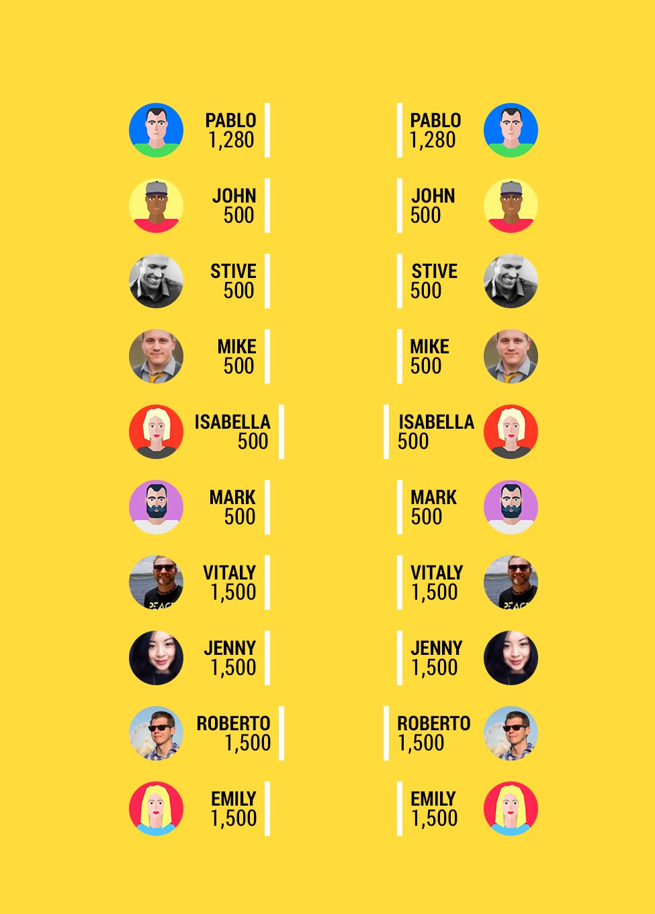

| text | x,y,w,h | font | px | colour | align |
|---|---|---|---|---|---|
| Emily | 612,1175,67,22 | RobotoCondensed-Bold | 30.0 | #000000 | left |
| 1,500 | 613,1202,68,31 | RobotoCondensed-Regular | 34.0 | #000000 | left |
| roberto | 592,1063,108,23 | RobotoCondensed-Bold | 30.0 | #000000 | left |
| 1,500 | 593,1090,68,31 | RobotoCondensed-Regular | 34.0 | #000000 | left |
| jenny | 611,951,78,23 | RobotoCondensed-Bold | 30.0 | #000000 | left |
| 1,500 | 613,978,68,31 | RobotoCondensed-Regular | 34.0 | #000000 | left |
| vitaly | 611,839,79,22 | RobotoCondensed-Bold | 30.0 | #000000 | left |
| 1,500 | 613,866,68,31 | RobotoCondensed-Regular | 34.0 | #000000 | left |
| Mark | 612,727,68,22 | RobotoCondensed-Bold | 30.0 | #000000 | left |
| 500 | 613,754,45,26 | RobotoCondensed-Regular | 34.0 | #000000 | left |
| Isabella | 595,615,112,23 | RobotoCondensed-Bold | 30.0 | #000000 | left |
| 500 | 593,642,45,26 | RobotoCondensed-Regular | 34.0 | #000000 | left |
| mike | 611,503,57,22 | RobotoCondensed-Bold | 30.0 | #000000 | left |
| 500 | 612,530,45,26 | RobotoCondensed-Regular | 34.0 | #000000 | left |
| stive | 613,391,68,23 | RobotoCondensed-Bold | 30.0 | #000000 | left |
| 500 | 612,418,45,26 | RobotoCondensed-Regular | 34.0 | #000000 | left |
| john | 612,279,65,23 | RobotoCondensed-Bold | 30.0 | #000000 | left |
| 500 | 612,306,44,26 | RobotoCondensed-Regular | 34.0 | #000000 | left |
| PABLO | 612,167,74,23 | RobotoCondensed-Bold | 30.0 | #000000 | left |
| 1,280 | 610,194,68,31 | RobotoCondensed-Regular | 34.0 | #000000 | left |
| Emily | 315,1175,67,22 | RobotoCondensed-Bold | 30.0 | #000000 | right |
| 1,500 | 314,1202,68,31 | RobotoCondensed-Regular | 34.0 | #000000 | right |
| roberto | 294,1063,108,23 | RobotoCondensed-Bold | 30.0 | #000000 | right |
| 1,500 | 335,1090,68,31 | RobotoCondensed-Regular | 34.0 | #000000 | right |
| jenny | 303,951,79,23 | RobotoCondensed-Bold | 30.0 | #000000 | right |
| 1,500 | 314,978,67,31 | RobotoCondensed-Regular | 34.0 | #000000 | right |
| vitaly | 302,839,80,22 | RobotoCondensed-Bold | 30.0 | #000000 | right |
| 1,500 | 314,866,67,31 | RobotoCondensed-Regular | 34.0 | #000000 | right |
| Mark | 313,727,68,22 | RobotoCondensed-Bold | 30.0 | #000000 | right |
| 500 | 335,754,45,26 | RobotoCondensed-Regular | 34.0 | #000000 | right |
| Isabella | 291,615,112,23 | RobotoCondensed-Bold | 30.0 | #000000 | right |
| 500 | 355,642,44,26 | RobotoCondensed-Regular | 34.0 | #000000 | right |
| mike | 325,503,56,22 | RobotoCondensed-Bold | 30.0 | #000000 | right |
| 500 | 334,530,44,26 | RobotoCondensed-Regular | 34.0 | #000000 | right |
| stive | 314,391,67,23 | RobotoCondensed-Bold | 30.0 | #000000 | right |
| 500 | 334,418,44,26 | RobotoCondensed-Regular | 34.0 | #000000 | right |
| john | 316,279,65,23 | RobotoCondensed-Bold | 30.0 | #000000 | right |
| 500 | 334,306,44,26 | RobotoCondensed-Regular | 34.0 | #000000 | right |
| PABLO | 307,167,74,23 | RobotoCondensed-Bold | 30.0 | #000000 | right |
| 1,280 | 311,194,67,31 | RobotoCondensed-Regular | 34.0 | #000000 | right |

60 filled shapes

| layer | x,y,w,h | fill | opacity |
|---|---|---|---|
| left / 10 / yellow | 590,1159,162,84 | #FFDB3C |  |
| left / 10 / Ellipse 10 | 719,1160,83,84 | #FFDB3C |  |
| left / 10 / Rectangle 1 copy 7 | 590,1159,10,84 | #FFFFFF |  |
| left / 9 / yellow | 570,1047,191,84 | #FFDB3C |  |
| left / 9 / Ellipse 10 | 719,1048,83,84 | #FFDB3C |  |
| left / 9 / Rectangle 1 copy 7 | 570,1047,10,84 | #FFFFFF |  |
| left / 8 / yellow | 590,935,162,84 | #FFDB3C |  |
| left / 8 / Ellipse 10 | 719,936,83,84 | #FFDB3C |  |
| left / 8 / Rectangle 1 copy 7 | 590,935,10,84 | #FFFFFF |  |
| left / 7 / yellow | 590,823,162,84 | #FFDB3C |  |
| left / 7 / Ellipse 10 | 719,823,83,85 | #FFDB3C |  |
| left / 7 / Rectangle 1 copy 7 | 590,823,10,84 | #FFFFFF |  |
| left / 6 / yellow | 590,711,162,85 | #FFDB3C |  |
| left / 6 / Ellipse 10 | 719,711,83,85 | #FFDB3C |  |
| left / 6 / Rectangle 1 copy 7 | 590,711,10,85 | #FFFFFF |  |
| left / 5 / yellow | 570,599,192,84 | #FFDB3C |  |
| left / 5 / Ellipse 10 | 719,599,83,84 | #FFDB3C |  |
| left / 5 / Rectangle 1 copy 7 | 570,599,10,84 | #FFFFFF |  |
| left / 4 / yellow | 590,487,172,84 | #FFDB3C |  |
| left / 4 / Ellipse 10 | 719,487,83,84 | #FFDB3C |  |
| left / 4 / Rectangle 1 copy 7 | 590,487,10,84 | #FFFFFF |  |
| left / 3 / yellow | 590,375,172,84 | #FFDB3C |  |
| left / 3 / Ellipse 10 | 719,375,83,84 | #FFDB3C |  |
| left / 3 / Rectangle 1 copy 7 | 590,375,10,84 | #FFFFFF |  |
| left / 2 / yellow | 590,263,172,84 | #FFDB3C |  |
| left / 2 / Ellipse 10 | 719,263,83,84 | #FFDB3C |  |
| left / 2 / Rectangle 1 copy 7 | 590,263,10,84 | #FFFFFF |  |
| left / 1 / yellow | 590,151,172,84 | #FFDB3C |  |
| left / 1 / Ellipse 10 | 719,152,83,83 | #FFDB3C |  |
| left / 1 / Rectangle 1 copy 7 | 590,151,10,84 | #FFFFFF |  |
| right / 10 / yellow | 232,1159,167,84 | #FFDB3C |  |
| right / 10 / Ellipse 10 | 191,1160,83,84 | #FFDB3C |  |
| right / 10 / Rectangle 1 copy 7 | 393,1159,10,84 | #FFFFFF |  |
| right / 9 / yellow | 232,1047,191,84 | #FFDB3C |  |
| right / 9 / Ellipse 10 | 191,1048,83,84 | #FFDB3C |  |
| right / 9 / Rectangle 1 copy 7 | 414,1047,10,84 | #FFFFFF |  |
| right / 8 / yellow | 232,935,167,84 | #FFDB3C |  |
| right / 8 / Ellipse 10 | 191,936,83,84 | #FFDB3C |  |
| right / 8 / Rectangle 1 copy 7 | 393,935,10,84 | #FFFFFF |  |
| right / 7 / yellow | 232,823,171,84 | #FFDB3C |  |
| right / 7 / Ellipse 10 | 191,823,83,85 | #FFDB3C |  |
| right / 7 / Rectangle 1 copy 7 | 393,823,10,84 | #FFFFFF |  |
| right / 6 / yellow | 232,711,171,85 | #FFDB3C |  |
| right / 6 / Ellipse 10 | 191,711,83,85 | #FFDB3C |  |
| right / 6 / Rectangle 1 copy 7 | 393,711,10,85 | #FFFFFF |  |
| right / 5 / yellow | 232,599,188,84 | #FFDB3C |  |
| right / 5 / Ellipse 10 | 191,599,83,84 | #FFDB3C |  |
| right / 5 / Rectangle 1 copy 7 | 414,599,10,84 | #FFFFFF |  |
| right / 4 / yellow | 241,487,162,84 | #FFDB3C |  |
| right / 4 / Ellipse 10 | 191,487,83,84 | #FFDB3C |  |
| right / 4 / Rectangle 1 copy 7 | 393,487,10,84 | #FFFFFF |  |
| right / 3 / yellow | 241,375,162,84 | #FFDB3C |  |
| right / 3 / Ellipse 10 | 191,375,83,84 | #FFDB3C |  |
| right / 3 / Rectangle 1 copy 7 | 393,375,10,84 | #FFFFFF |  |
| right / 2 / yellow | 241,263,162,84 | #FFDB3C |  |
| right / 2 / Ellipse 10 | 191,263,83,84 | #FFDB3C |  |
| right / 2 / Rectangle 1 copy 7 | 393,263,10,84 | #FFFFFF |  |
| right / 1 / yellow | 241,151,162,84 | #FFDB3C |  |
| right / 1 / Ellipse 10 | 191,152,83,83 | #FFDB3C |  |
| right / 1 / Rectangle 1 copy 7 | 393,151,10,84 | #FFFFFF |  |

### Which hand wins.psd — `DlIVWM_Which_hand_wins`

Canvas 1940×1220 · board / multi-frame canvas · modified 2014-08-31 · 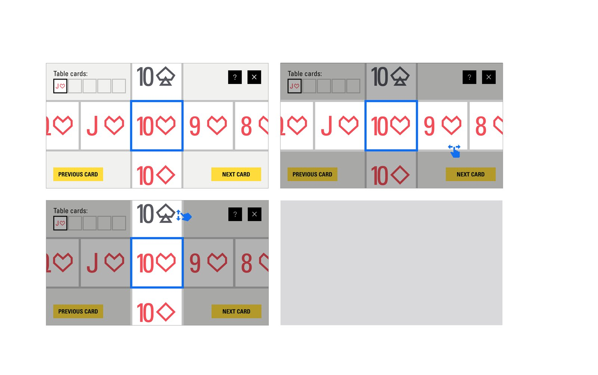

6 filled shapes

| layer | x,y,w,h | fill | opacity |
|---|---|---|---|
| _4 | 908,651,724,409 | #D9D9DB |  |
| номинал / Rectangle 8 | 909,204,723,123 | #000000 | 30 |
| номинал / Rectangle 9 | 909,491,723,122 | #000000 | 30 |
| номинал / move | 1452,468,43,46 | #116FF0 |  |
| масти / Rectangle 8 copy | 149,651,723,408 | #000000 | 30 |
| масти / вертикально | 570,680,54,41 | #116FF0 |  |

### cam_2.psd — `EY0czQ_cam_2`

Canvas 3142×1598 · board / multi-frame canvas · modified 2015-02-07 · 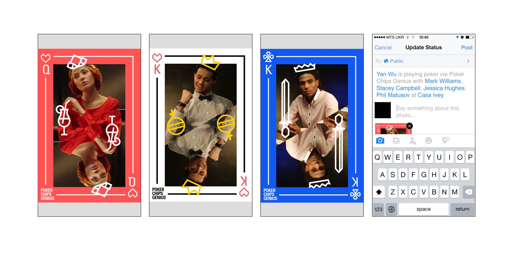

### _1.psd — `EczWXM__1`

Canvas 3193×1242 · board / multi-frame canvas · modified 2015-04-03 · 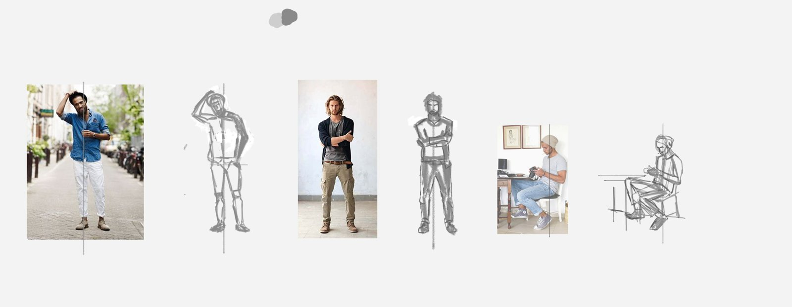

### players.psd — `ExNUGM_players`

Canvas 640×1136 · iPhone 5/5s portrait @2x (320x568pt) · modified 2015-06-11 · 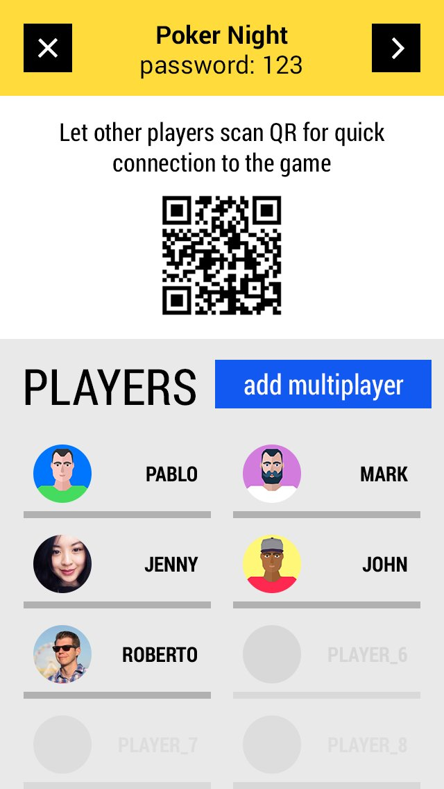

| text | x,y,w,h | font | px | colour | align |
|---|---|---|---|---|---|
| PABLO | 211,671,73,23 | RobotoCondensed-Bold | 30.1 | #000000 | right |
| Mark | 520,671,68,22 | RobotoCondensed-Bold | 30.1 | #000000 | right |
| JENNY | 208,801,78,23 | RobotoCondensed-Bold | 30.1 | #000000 | right |
| John | 522,801,65,23 | RobotoCondensed-Bold | 30.1 | #000000 | right |
| roberto | 177,931,107,23 | RobotoCondensed-Bold | 30.1 | #000000 | right |
| player_6 | 473,931,114,26 | RobotoCondensed-Bold | 30.1 | #A9A9A9 | right |
| player_7 | 171,1061,114,26 | RobotoCondensed-Bold | 30.1 | #C2C2C2 | right |
| player_8 | 473,1061,114,26 | RobotoCondensed-Bold | 30.1 | #C2C2C2 | right |
| players | 36,531,246,53 | RobotoCondensed-Regular | 72.0 | #000000 | center |
| add multiplayer | 352,537,230,40 | RobotoCondensed-Regular | 40.0 | #FFFFFF | center |
| Let other players scan QR for quick connection to the game | 87,175,468,80 | RobotoCondensed-Regular | 36.0 |  | center |
| Poker Night / password: 123 | 203,35,232,79 | Roboto-Bold | 36.0 | #000000 | center |

24 filled shapes

| layer | x,y,w,h | fill | opacity |
|---|---|---|---|
| version_3 / Rectangle 8 copy 2 | -2,487,643,757 | #E9E9E9 |  |
| version_3 / Rectangle 8 copy 3 | -2,487,643,757 | #E9E9E9 |  |
| version_3 / _1 / Rectangle 3 copy 3 | 33,615,273,133 | #FFFFFF |  |
| version_3 / _1 / Ellipse 1 | 46,639,87,87 | #F44E59 |  |
| version_3 / _2 / Rectangle 3 copy 3 | 335,615,273,133 | #000000 |  |
| version_3 / _2 / Ellipse 1 | 348,639,87,87 | #F44E59 |  |
| version_3 / _3 / Rectangle 3 copy 3 | 33,745,273,132 | #000000 |  |
| version_3 / _3 / Ellipse 1 | 46,769,87,87 | #F44E59 |  |
| version_3 / _4 / Rectangle 3 copy 3 | 335,745,273,132 | #000000 |  |
| version_3 / _4 / Ellipse 1 | 348,769,87,87 | #F44E59 |  |
| version_3 / _5 / Rectangle 3 copy 3 | 33,874,273,133 | #000000 |  |
| version_3 / _5 / Ellipse 1 | 46,899,87,86 | #F44E59 |  |
| version_3 / _6 / Rectangle 3 copy 3 | 335,874,273,133 | #000000 |  |
| version_3 / _6 / Ellipse 1 | 348,899,87,86 | #B1B1B1 |  |
| version_3 / _7 / Rectangle 3 copy 3 | 33,1004,273,133 | #000000 |  |
| version_3 / _7 / Ellipse 1 | 46,1029,87,86 | #C2C2C2 |  |
| version_3 / _8 / Rectangle 3 copy 3 | 335,1004,273,133 | #000000 |  |
| version_3 / _8 / Ellipse 1 | 348,1029,87,86 | #C2C2C2 |  |
| version_3 / Rounded Rectangle 2 copy | 309,516,315,74 | #1159F0 |  |
| version_3 / head / Rectangle 7 | -1,-1,642,141 | #FFDB3C |  |
| version_3 / head / close / Rectangle 2 copy | 33,33,73,73 | #000000 |  |
| version_3 / head / close / Back icon | 54,53,31,31 | #FFFFFF |  |
| version_3 / head / back copy 2 / Rectangle 2 copy | 535,33,73,73 | #000000 |  |
| version_3 / head / back copy 2 / Back icon | 564,52,21,34 | #FFFFFF |  |

### lobby.psd — `FF0N1U_lobby`

Canvas 640×1136 · iPhone 5/5s portrait @2x (320x568pt) · modified 2014-08-17 · 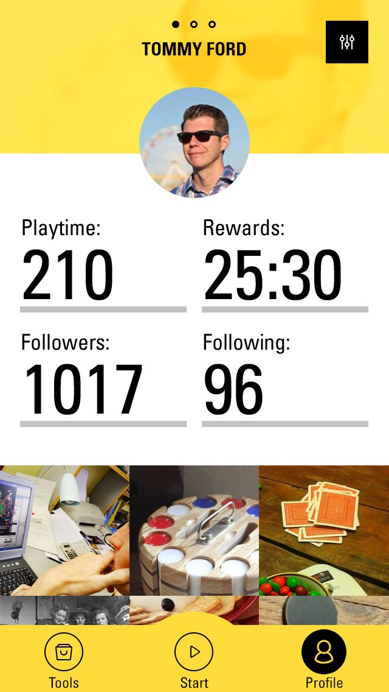

| text | x,y,w,h | font | px | colour | align |
|---|---|---|---|---|---|
| 210 | 39,409,146,84 | Univers-Condensed | 116.0 |  | left |
| Playtime: | 37,360,127,33 | Univers-Condensed | 36.0 |  | left |
| 25:30 | 338,409,223,84 | Univers-Condensed | 116.0 |  | left |
| Rewards: | 335,360,132,27 | Univers-Condensed | 36.0 |  | left |
| 1017 | 44,597,190,84 | Univers-Condensed | 116.0 |  | left |
| Followers: | 36,548,143,27 | Univers-Condensed | 36.0 |  | left |
| 96 | 337,597,95,84 | Univers-Condensed | 116.0 |  | left |
| Following: | 335,548,141,33 | Univers-Condensed | 36.0 |  | left |
| Tommy ford | 233,69,172,23 | Univers-CondensedBold | 30.0 | #000000 | center |
| Tools | 80,1111,49,19 | Univers-Condensed | 24.0 |  | left |
| Start | 297,1111,46,19 | Univers-Condensed | 24.0 | #000000 | left |
| Profile | 504,1111,60,19 | Univers-Condensed | 24.0 | #000000 | left |

27 filled shapes

| layer | x,y,w,h | fill | opacity |
|---|---|---|---|
| альбом / _1 | -1,763,216,216 | #B84A4A |  |
| альбом / _2 | 212,763,216,216 | #AA6565 |  |
| альбом / _3 | 425,763,216,216 | #4C1C1C |  |
| альбом / _4 | -1,977,216,216 | #5B1B1B |  |
| альбом / _5 | 212,977,216,216 | #EF9292 |  |
| альбом / _6 | 425,977,216,216 | #921515 |  |
| summary / _1 / Rectangle 3 copy 3 | 32,358,276,156 | #000000 |  |
| summary / _2 / Rectangle 3 copy 3 | 331,358,276,156 | #000000 |  |
| summary / _3 / Rectangle 3 copy 3 | 32,546,276,156 | #000000 |  |
| summary / _4 / Rectangle 3 copy 3 | 331,546,276,156 | #000000 |  |
| Rectangle 7 | -1,-1,642,254 | #FFDB3C |  |
| avatars | 247,164,144,144 | #619F57 |  |
| avatars copy | 227,141,185,185 | #619F57 |  |
| Settings / Rectangle 2 copy | 535,33,73,73 | #000000 |  |
| Settings / Settings | 558,56,26,27 | #FFFFFF |  |
| pages copy / Ellipse 2 | 282,33,14,14 | #000000 |  |
| pages copy / Ellipse 2 copy | 312,33,14,14 | #FFFFFF |  |
| pages copy / Ellipse 2 copy 2 | 342,33,14,14 | #FFFFFF |  |
| navigation copy 2 / Rectangle 1 | -1,1025,642,127 | #FFDB3C |  |
| navigation copy 2 / Ellipse 1 copy | 211,1003,216,214 | #FFDB3C |  |
| navigation copy 2 / play / circle | 285,1037,67,67 | #FFFFFF |  |
| navigation copy 2 / play / play | 312,1058,19,24 | #FFFFFF |  |
| navigation copy 2 / profile / Ellipse 3 | 501,1038,64,64 | #000000 |  |
| navigation copy 2 / profile / circle copy | 499,1037,67,67 | #000000 |  |
| navigation copy 2 / profile / user | 517,1049,33,41 | #FFDB3C |  |
| navigation copy 2 / Shopping bag / circle | 71,1037,67,67 | #FFFFFF |  |
| navigation copy 2 / Shopping bag / bag | 90,1056,31,30 | #FFFFFF |  |

### Poker_Hands.psd — `FVVNlE_Poker_Hands`

Canvas 1136×640 · iPhone 5/5s landscape @2x (568x320pt) · modified 2014-08-16 · 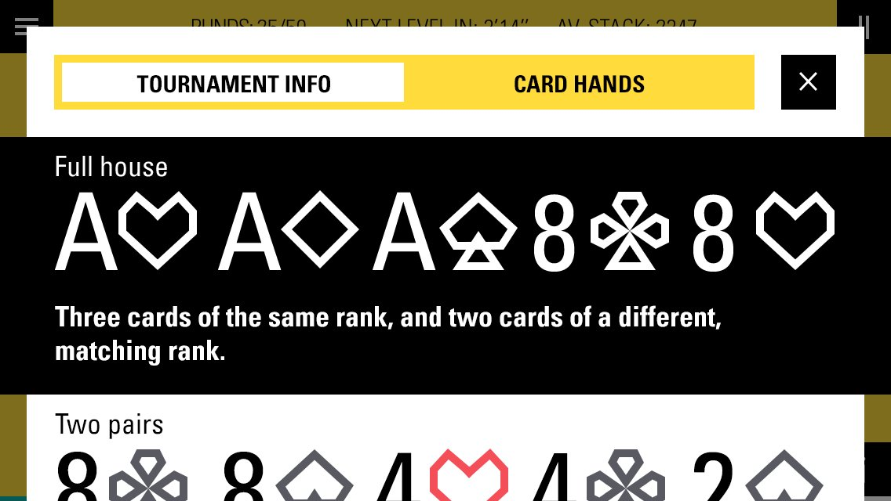

| text | x,y,w,h | font | px | colour | align |
|---|---|---|---|---|---|
| Card Hands | 656,96,166,23 | Univers-CondensedBold | 30.0 | #000000 | left |
| Tournament info | 174,96,247,23 | Univers-CondensedBold | 30.0 | #000000 | left |
| 04 | 585,615,97,84 | Univers-Condensed | 116.0 |  | left |
| yan wu | 961,626,104,23 | Univers-CondensedBold | 30.1 | #000000 | right |
| 1,280 | 1001,654,64,29 | Univers-Condensed | 34.1 | #000000 | right |
| 03 | 585,485,95,84 | Univers-Condensed | 116.0 |  | left |
| big man | 953,496,111,23 | Univers-CondensedBold | 30.1 | #000000 | right |
| 970 (+250) | 934,522,132,30 | Univers-Condensed | 34.1 | #000000 | right |
| 02 | 585,355,96,84 | Univers-Condensed | 116.0 |  | left |
| Tonny guy | 916,366,150,23 | Univers-CondensedBold | 30.1 | #000000 | right |
| 1,100 (+500) | 913,392,153,31 | Univers-Condensed | 34.1 | #000000 | right |
| 01 | 585,225,81,84 | Univers-Condensed | 116.0 |  | left |
| Mark rusfel | 891,236,176,23 | Univers-CondensedBold | 30.1 | #000000 | right |
| 1,280 (+1000) | 898,262,168,31 | Univers-Condensed | 34.1 | #000000 | right |
| Leaderboard: | 584,176,187,27 | Univers-Condensed | 36.0 |  | left |
| 3’14’’ | 72,223,226,86 | Univers-Condensed | 116.0 |  | left |
| 25/50 | 75,412,230,96 | Univers-Condensed | 116.0 |  | left |
| (current) | 452,414,102,27 | Univers-Condensed | 30.0 | #000000 | right |
| Blinds level: | 73,365,168,27 | Univers-Condensed | 36.0 |  | left |
| 50/100 | 75,541,281,96 | Univers-Condensed | 116.0 |  | left |
| (next) | 488,543,66,27 | Univers-Condensed | 30.0 | #000000 | right |
| Next level in: | 73,176,180,27 | Univers-Condensed | 36.0 |  | left |
| Three cards of the same rank, and two cards of a different,  / matchin | 70,390,849,77 | Univers-CondensedBold | 36.0 | #FFFFFF | left |
| A | 70,245,80,100 | Univers-Condensed | 137.4 |  | left |
| a | 278,245,81,100 | Univers-Condensed | 137.4 |  | left |
| a | 475,245,81,100 | Univers-Condensed | 137.4 |  | left |
| 8 | 681,248,52,99 | Univers-Condensed | 136.8 |  | left |
| 8 | 884,248,51,99 | Univers-Condensed | 136.6 |  | left |
| Full house | 71,199,142,27 | Univers-Condensed | 35.9 |  | left |
| 8 | 73,577,51,99 | Univers-Condensed | 137.6 |  | left |
| 8 | 285,577,52,99 | Univers-Condensed | 137.6 |  | left |
| 4 | 480,578,56,96 | Univers-Condensed | 137.6 |  | left |
| 4 | 679,579,56,95 | Univers-Condensed | 137.0 |  | left |
| 2 | 885,577,52,98 | Univers-Condensed | 136.8 |  | left |
| Two pairs | 70,528,138,33 | Univers-Condensed | 36.0 |  | left |

25 filled shapes

| layer | x,y,w,h | fill | opacity |
|---|---|---|---|
| popup / Rectangle 1 copy 2 | 33,33,1070,608 | #FFFFFF |  |
| popup / Tournament info / head / Rectangle 2 | 68,69,452,72 | #FFDB3C |  |
| popup / Tournament info / head / Rectangle 2 copy 2 | 507,69,457,72 | #FFDB3C |  |
| popup / Tournament info / head / Rectangle 2 copy | 995,69,73,72 | #000000 |  |
| popup / Tournament info / head / Shape 1 | 1017,90,27,28 | #FFFFFF |  |
| popup / Tournament info / head / Shape 1 copy | 1018,90,25,28 | #FFFFFF |  |
| popup / Tournament info / _2 / _4 / Rectangle 3 copy 3 | 578,564,489,156 | #000000 |  |
| popup / Tournament info / _2 / _4 / Ellipse 1 | 694,611,86,87 | #F44E59 |  |
| popup / Tournament info / _2 / _3 / Rectangle 3 copy 3 | 578,434,489,156 | #000000 |  |
| popup / Tournament info / _2 / _3 / Ellipse 1 | 694,481,86,87 | #F44E59 |  |
| popup / Tournament info / _2 / Rectangle 3 copy 3 | 578,304,489,156 | #000000 |  |
| popup / Tournament info / _2 / Ellipse 1 | 694,351,86,87 | #F44E59 |  |
| popup / Tournament info / _1 / Rectangle 3 copy 3 | 579,174,488,156 | #000000 |  |
| popup / Tournament info / _1 / Ellipse 1 | 694,221,86,87 | #F44E59 |  |
| popup / Tournament info / info / _1 copy 2 / Rectangle 3 copy 3 | 67,173,489,157 | #000000 |  |
| popup / Tournament info / info / _1 copy 3 / Rectangle 3 copy 3 | 67,363,489,156 | #000000 |  |
| popup / Tournament info / info / _1 copy 4 / Rectangle 3 copy 3 | 67,492,489,156 | #000000 |  |
| popup / Card Hands / Rectangle 1 copy 3 | 33,33,1070,608 | #FFFFFF |  |
| popup / Card Hands / head / Rectangle 2 | 67,69,459,72 | #FEEEA7 |  |
| popup / Card Hands / head / Rectangle 2 copy 2 | 515,69,449,72 | #FFDB3C |  |
| popup / Card Hands / head / Rectangle 2 copy | 995,69,73,72 | #000000 |  |
| popup / Card Hands / head / Shape 1 | 1017,90,27,28 | #FFFFFF |  |
| popup / Card Hands / head / Shape 1 copy | 1018,90,25,28 | #FFFFFF |  |
| popup / Card Hands / combination full view / Full house copy / Rectangle 4 | -1,174,1138,331 | #000000 |  |
| popup / Card Hands / combination full view / Two pairs / Rectangle 3 | 68,541,999,156 | #000000 |  |

### step_3b.psd — `FkwcWc_step_3b`

Canvas 640×1136 · iPhone 5/5s portrait @2x (320x568pt) · modified 2015-06-11 · 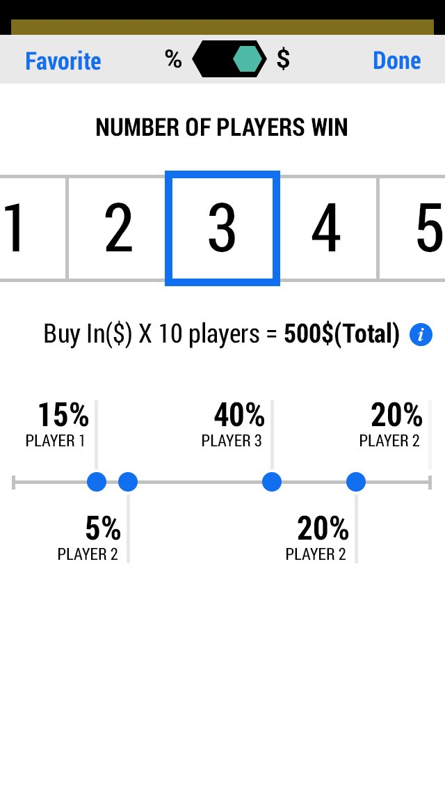

| text | x,y,w,h | font | px | colour | align |
|---|---|---|---|---|---|
| 40% /  player 3 | 291,577,89,65 | RobotoCondensed-Bold | 48.0 | #000000 | right |
| 20% /  player 2 | 412,740,89,64 | RobotoCondensed-Bold | 48.0 | #000000 | right |
| 5% /  player 2 | 84,740,89,64 | RobotoCondensed-Bold | 48.0 | #000000 | right |
| 20% /  player 2 | 518,577,89,64 | RobotoCondensed-Bold | 48.0 | #000000 | right |
| 15% /  player 1 | 38,577,89,64 | RobotoCondensed-Bold | 48.0 | #000000 | right |
| Buy In($) X 10 players = 500$(Total) | 64,460,510,41 | RobotoCondensed-Regular | 38.1 | #000000 | center |
| 2 | 151,291,39,70 | RobotoCondensed-Regular | 97.0 |  | center |
| 1 | 7,292,21,69 | RobotoCondensed-Regular | 97.0 |  | center |
| 4 | 448,292,42,69 | RobotoCondensed-Regular | 97.0 |  | center |
| 5 | 600,292,37,70 | RobotoCondensed-Regular | 97.0 |  | center |
| 3 | 300,291,38,71 | RobotoCondensed-Regular | 97.0 |  | center |
| Number of Players Win | 139,169,360,27 | RobotoCondensed-Bold | 36.0 | #000000 | center |
| Done | 538,73,67,27 | RobotoCondensed-Bold | 36.0 | #116FF0 | center |
| Favorite | 38,72,107,29 | RobotoCondensed-Bold | 36.0 | #116FF0 | center |
| % | 237,71,24,27 | Roboto-Bold | 36.0 | #000000 | center |
| $ | 398,67,18,34 | Roboto-Bold | 36.0 | #000000 | center |

20 filled shapes

| layer | x,y,w,h | fill | opacity |
|---|---|---|---|
| _4 / Rectangle 11 copy | -1,49,642,1088 | #FFFFFF |  |
| _4 / _5 player copy / Rectangle 17 | 16,689,606,7 | #C2C2C2 |  |
| _4 / _5 player copy / Ellipse 11 | 124,677,30,30 | #116FF0 |  |
| _4 / _5 player copy / Ellipse 11 copy | 376,677,30,30 | #116FF0 |  |
| _4 / _5 player copy / Ellipse 11 copy 3 | 169,677,30,30 | #116FF0 |  |
| _4 / _5 player copy / Ellipse 11 copy 2 | 497,677,30,30 | #116FF0 |  |
| _4 / _5 player copy / Rectangle 19 | 615,682,7,22 | #C2C2C2 |  |
| _4 / _5 player copy / Rectangle 19 copy | 16,682,7,22 | #C2C2C2 |  |
| _4 / _5 player copy / _2 / Rectangle 18 | 388,574,7,101 | #E9E9E9 |  |
| _4 / _5 player copy / _2 copy 3 / Rectangle 18 | 509,709,7,101 | #E9E9E9 |  |
| _4 / _5 player copy / _2 copy 4 / Rectangle 18 | 181,709,7,101 | #E9E9E9 |  |
| _4 / _5 player copy / _2 copy / Rectangle 18 | 615,574,7,101 | #E9E9E9 | 50 |
| _4 / _5 player copy / _2 copy 2 / Rectangle 18 | 135,574,7,101 | #E9E9E9 |  |
| _4 / info 2 | 588,462,36,37 | #116FF0 |  |
| _4 / Number of Players Win / num copy 2 / _3 / центральный блок copy | 236,244,168,169 | #FFFFFF |  |
| _4 / head_2 / Rectangle 12 | -1,49,642,72 | #E9E9E9 |  |
| _4 / head_2 / Rectangle 2 copy 2 | 569,49,72,72 | #E9E9E9 |  |
| _4 / head_2 / Rectangle 2 copy 3 | -1,49,72,72 | #E9E9E9 |  |
| _4 / on / Polygon 1 | 275,56,111,57 | #000000 |  |
| _4 / on / Polygon 1 copy | 334,64,45,41 | #4FBAA7 |  |

### step_2b.psd — `FpMLWs_step_2b`

Canvas 640×1136 · iPhone 5/5s portrait @2x (320x568pt) · modified 2015-06-11 · 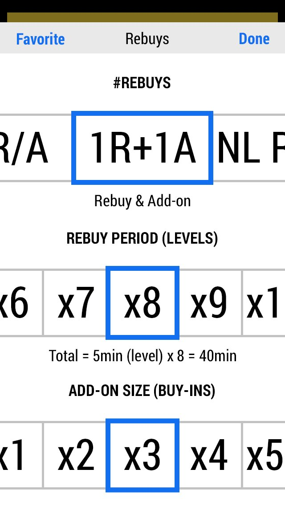

| text | x,y,w,h | font | px | colour | align |
|---|---|---|---|---|---|
| x2 | 129,985,82,70 | RobotoCondensed-Regular | 97.0 |  | center |
| x1 | -20,986,69,69 | RobotoCondensed-Regular | 97.0 |  | center |
| x4 | 427,986,84,69 | RobotoCondensed-Regular | 97.0 |  | center |
| x50 | 553,985,127,71 | RobotoCondensed-Regular | 97.0 |  | center |
| x3 | 278,985,81,71 | RobotoCondensed-Regular | 97.0 |  | center |
| add-on size (buy-ins) | 154,860,329,37 | RobotoCondensed-Bold | 36.05 | #000000 | center |
| x7 | 129,644,82,69 | RobotoCondensed-Regular | 97.0 |  | center |
| x6 | -20,643,83,71 | RobotoCondensed-Regular | 97.0 |  | center |
| x9 | 427,643,81,71 | RobotoCondensed-Regular | 97.0 |  | center |
| x10 | 553,643,127,71 | RobotoCondensed-Regular | 97.0 |  | center |
| x8 | 278,643,82,71 | RobotoCondensed-Regular | 97.0 |  | center |
| Total = 5min (level) x 8 = 40min | 110,782,420,38 | RobotoCondensed-Regular | 35.9 |  | center |
| rebuy period (levels) | 151,518,338,37 | RobotoCondensed-Bold | 36.0 | #000000 | center |
| 1R+1A | 206,296,234,69 | RobotoCondensed-Regular | 97.0 |  | center |
| NL R+A | 491,296,266,69 | RobotoCondensed-Regular | 97.0 |  | center |
| freezeout | -389,308,210,48 | RobotoCondensed-Regular | 60.1 |  | center |
| 1R/A | -65,296,173,75 | RobotoCondensed-Regular | 97.0 |  | center |
| Rebuy & Add-on | 213,435,214,36 | RobotoCondensed-Regular | 35.9 |  | center |
| #rebuys | 254,172,129,27 | RobotoCondensed-Bold | 36.0 | #000000 | center |
| Rebuys | 283,71,96,36 | RobotoCondensed-Regular | 36.0 | #000000 | center |
| Done | 538,73,67,27 | RobotoCondensed-Bold | 36.0 | #116FF0 | center |
| Favorite | 38,72,107,29 | RobotoCondensed-Bold | 36.0 | #116FF0 | center |

7 filled shapes

| layer | x,y,w,h | fill | opacity |
|---|---|---|---|
| over copy 2 / Rectangle 11 copy | -1,49,642,1088 | #FFFFFF |  |
| over copy 2 / size / num copy 2 / _3 / центральный блок copy | 236,938,168,169 | #FFFFFF |  |
| over copy 2 / rebuy period / num copy 2 / _3 / центральный блок copy | 236,596,168,169 | #FFFFFF |  |
| over copy 2 / num copy 2 / центральный блок copy | 159,247,322,169 | #FFFFFF |  |
| over copy 2 / head_2 / Rectangle 12 | -1,49,642,72 | #E9E9E9 |  |
| over copy 2 / head_2 / Rectangle 2 copy 2 | 569,49,72,72 | #E9E9E9 |  |
| over copy 2 / head_2 / Rectangle 2 copy 3 | -1,49,72,72 | #E9E9E9 |  |

### photo_share.psd — `GpqbVE_photo_share`

Canvas 640×1136 · iPhone 5/5s portrait @2x (320x568pt) · modified 2015-02-07 · 

| text | x,y,w,h | font | px | colour | align |
|---|---|---|---|---|---|
| Yan Wu is playing poker via Poker Chips Genius with Mark Williams, Sta | 28,236,552,164 | Helvetica | 36.0 | #1D88FF | left |

### Untitled-1.psd — `GtjNVE_Untitled-1`

Canvas 900×506 · board / multi-frame canvas · modified 2015-04-03 · 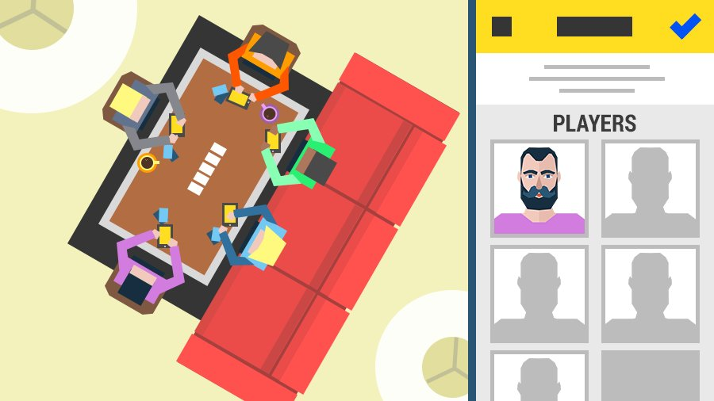

| text | x,y,w,h | font | px | colour | align |
|---|---|---|---|---|---|
| 1000 | 148,184,119,72 | RobotoCondensed-Bold | 65.8 | #000000 | left |
| 1000 | 783,278,119,72 | RobotoCondensed-Bold | 65.8 | #000000 | left |
| 1000 | 146,160,119,72 | RobotoCondensed-Bold | 65.8 | #000000 | left |
| 1000 | 164,132,117,58 | RobotoCondensed-Bold | 67.8 | #000000 | left |
| 1000 | 159,90,119,82 | RobotoCondensed-Bold | 63.4 | #000000 | left |
| PLAYERS | 698,144,104,23 | RobotoCondensed-Bold | 30.0 | #3B3B3B | center |

143 filled shapes

| layer | x,y,w,h | fill | opacity |
|---|---|---|---|
| _SCREEN_9 / red@3 / 1000 copy 4 | 78,184,262,196 | #F7C036 |  |
| _SCREEN_9 / red@3 / 1000 copy | 77,103,262,258 | #932525 |  |
| _SCREEN_9 / red@3 / 1000 copy 6 | 78,90,261,259 | #FC5558 |  |
| _SCREEN_9 / red@3 / Shape 6 copy 10 | 117,104,212,198 | #FFFFFF |  |
| _SCREEN_9 / red@3 copy 4 / 1000 copy 4 | 713,278,262,196 | #F7C036 |  |
| _SCREEN_9 / red@3 copy 4 / 1000 copy | 712,197,262,258 | #932525 |  |
| _SCREEN_9 / red@3 copy 4 / 1000 copy 6 | 713,184,261,259 | #FC5558 |  |
| _SCREEN_9 / red@3 copy 4 / Shape 6 copy 10 | 752,198,212,198 | #FFFFFF |  |
| _SCREEN_9 / red@3 copy / 1000 copy | 75,79,262,258 | #932525 |  |
| _SCREEN_9 / red@3 copy / 1000 copy 6 | 76,66,261,259 | #FC5558 |  |
| _SCREEN_9 / red@3 copy / Shape 6 copy 10 | 115,80,212,198 | #FFFFFF |  |
| _SCREEN_9 / red@3 copy 2 / 1000 copy | 87,52,270,243 | #932525 |  |
| _SCREEN_9 / red@3 copy 2 / 1000 copy 6 | 88,38,269,245 | #FC5558 |  |
| _SCREEN_9 / red@3 copy 2 / Shape 6 copy 10 | 121,44,217,186 | #FFFFFF |  |
| _SCREEN_9 / red@3 copy 3 / 1000 copy | 93,11,254,264 | #932525 |  |
| _SCREEN_9 / red@3 copy 3 / 1000 copy 6 | 94,-3,251,266 | #FC5558 |  |
| _SCREEN_9 / red@3 copy 3 / Shape 6 copy 10 | 136,19,205,202 | #FFFFFF |  |
| _SCREEN_8 / room / Group 8 / Rectangle 39 | 83,18,338,389 | #353535 |  |
| _SCREEN_8 / room / Ellipse 3 | 472,365,196,196 | #FEFEF9 |  |
| _SCREEN_8 / room / Ellipse 3 copy | 531,424,79,79 | #E1DDA1 |  |
| _SCREEN_8 / room / Group 10 / Shape 84 | 569,424,10,43 | #1159F0 |  |
| _SCREEN_8 / room / Group 10 / Shape 84 copy | 569,461,39,29 | #1159F0 |  |
| _SCREEN_8 / room / Group 10 / Shape 84 copy 2 | 536,461,41,24 | #1159F0 |  |
| _SCREEN_8 / room / Ellipse 3 copy 3 | -94,-124,268,268 | #FEFEF9 |  |
| _SCREEN_8 / room / Ellipse 3 copy 3 | -13,-43,107,107 | #E1DDA1 |  |
| _SCREEN_8 / room / Group 10 copy / Shape 84 | 37,-38,13,53 | #1159F0 |  |
| _SCREEN_8 / room / Group 10 copy / Shape 84 copy | 37,8,49,36 | #1159F0 |  |
| _SCREEN_8 / room / Group 10 copy / Shape 84 copy 2 | -5,8,51,31 | #1159F0 |  |
| _SCREEN_8 / room / on table / _2 / cards copy / Rectangle 55 | 205,182,22,24 | #2C5774 |  |
| _SCREEN_8 / room / on table / _2 / cards copy / Rectangle 55 copy | 204,181,15,21 | #77CAF1 |  |
| _SCREEN_8 / room / on table / _2 / phone / Rectangle 56 | 212,142,22,32 | #4A4A4A |  |
| _SCREEN_8 / room / on table / _2 / phone / Rectangle 57 | 214,145,17,24 | #FFDB3C |  |
| _SCREEN_8 / room / on table / _2 / phone / Rectangle 58 | 221,169,4,4 | #BCBCBC |  |
| _SCREEN_8 / room / on table / _3 / cards copy / Rectangle 55 | 268,110,23,23 | #2C5774 |  |
| _SCREEN_8 / room / on table / _3 / cards copy / Rectangle 55 copy | 265,104,24,19 | #77CAF1 |  |
| _SCREEN_8 / room / on table / _3 / phone / Rectangle 56 | 283,108,37,33 | #4A4A4A |  |
| _SCREEN_8 / room / on table / _3 / phone / Rectangle 57 | 286,111,29,25 | #FFDB3C |  |
| _SCREEN_8 / room / on table / _3 / phone / Rectangle 58 | 310,126,6,6 | #BCBCBC |  |
| _SCREEN_8 / room / on table / _1 / cards copy 2 / Rectangle 55 | 191,262,23,24 | #2C5774 |  |
| _SCREEN_8 / room / on table / _1 / cards copy 2 / Rectangle 55 copy | 199,261,15,21 | #77CAF1 |  |
| _SCREEN_8 / room / on table / _1 / phone copy / Rectangle 56 | 197,282,22,32 | #4A4A4A |  |
| _SCREEN_8 / room / on table / _1 / phone copy / Rectangle 57 | 199,285,17,24 | #FFDB3C |  |
| _SCREEN_8 / room / on table / _1 / phone copy / Rectangle 58 | 206,309,4,4 | #BCBCBC |  |
| _SCREEN_8 / room / on table / _5 / cards copy 2 / Rectangle 55 | 258,288,23,23 | #2C5774 |  |
| _SCREEN_8 / room / on table / _5 / cards copy 2 / Rectangle 55 copy | 265,285,16,21 | #77CAF1 |  |
| _SCREEN_8 / room / on table / _5 / phone copy / Rectangle 56 | 279,255,22,32 | #4A4A4A |  |
| _SCREEN_8 / room / on table / _5 / phone copy / Rectangle 57 | 281,258,17,24 | #FFDB3C |  |
| _SCREEN_8 / room / on table / _5 / phone copy / Rectangle 58 | 288,282,4,4 | #BCBCBC |  |
| _SCREEN_8 / room / on table / _4 / phone copy / Rectangle 56 | 333,162,22,33 | #4A4A4A |  |
| _SCREEN_8 / room / on table / _4 / phone copy / Rectangle 57 | 336,165,17,25 | #FFDB3C |  |
| _SCREEN_8 / room / on table / _4 / phone copy / Rectangle 58 | 342,189,5,5 | #BCBCBC |  |
| _SCREEN_8 / room / on table / Rectangle 55 copy 6 | 263,178,25,21 | #FFFFFF |  |
| _SCREEN_8 / room / on table / Group 9 / Ellipse 4 | 172,192,27,27 | #FD9B1D |  |
| _SCREEN_8 / room / on table / Group 9 / Ellipse 4 copy | 175,195,21,22 | #FFF887 |  |
| _SCREEN_8 / room / on table / Group 9 / Ellipse 4 copy 2 | 177,197,18,17 | #4C3426 |  |
| _SCREEN_8 / room / on table / Group 9 / Rectangle 59 | 192,202,10,6 | #FFF685 |  |
| _SCREEN_8 / room / on table / Group 9 / Rectangle 60 | 182,200,3,3 | #B26D47 |  |
| _SCREEN_8 / room / on table / Group 9 / Rectangle 60 copy | 184,200,3,3 | #B26D47 |  |
| _SCREEN_8 / room / on table / Group 9 / Rectangle 60 copy 2 | 183,201,3,3 | #B26D47 |  |
| _SCREEN_8 / room / on table / Group 9 copy / Ellipse 4 | 324,128,32,31 | #9A64A2 |  |
| _SCREEN_8 / room / on table / Group 9 copy / Ellipse 4 copy | 328,131,24,25 | #ECA2F7 |  |
| _SCREEN_8 / room / on table / Group 9 copy / Ellipse 4 copy 2 | 330,134,20,20 | #4C3426 |  |
| _SCREEN_8 / room / on table / Group 9 copy / Rectangle 59 | 327,129,11,12 | #EAA1F5 |  |
| _SCREEN_8 / room / on table / Group 9 copy / Rectangle 60 | 336,145,4,5 | #B26D47 |  |
| _SCREEN_8 / room / on table / Group 9 copy / Rectangle 60 copy | 334,144,5,4 | #B26D47 |  |
| _SCREEN_8 / room / on table / Group 9 copy / Rectangle 60 copy 2 | 336,144,4,4 | #B26D47 |  |
| _SCREEN_8 / room / sofa / Rectangle 36 | 222,65,358,468 | #A34141 |  |
| _SCREEN_8 / room / sofa / Rectangle 37 | 426,64,156,115 | #FF5353 |  |
| _SCREEN_8 / room / sofa / Rectangle 37 copy | 221,419,156,115 | #FF5353 |  |
| _SCREEN_8 / room / sofa / _1 / Rectangle 38 | 412,270,92,123 | #FF5454 |  |
| _SCREEN_8 / room / sofa / _1 / Rectangle 38 copy | 402,264,72,112 | #E94E4E |  |
| _SCREEN_8 / room / sofa / _1 copy 6 / Rectangle 38 | 351,376,92,123 | #FF5454 |  |
| _SCREEN_8 / room / sofa / _1 copy 6 / Rectangle 38 copy | 341,370,72,111 | #E94E4E |  |
| _SCREEN_8 / room / sofa / _1 copy 5 / Rectangle 38 | 473,165,92,122 | #FF5454 |  |
| _SCREEN_8 / room / sofa / _1 copy 5 / Rectangle 38 copy | 463,159,72,111 | #E94E4E |  |
| _SCREEN_8 / room / sofa / _0 / Rectangle 38 | 366,103,155,159 | #E94E4E |  |
| _SCREEN_8 / room / sofa / _0 / Rectangle 38 copy | 366,103,72,111 | #A34141 |  |
| _SCREEN_8 / room / sofa / _0 / Rectangle 38 copy 2 | 449,151,72,111 | #A34141 |  |
| _SCREEN_8 / room / sofa / _0 copy / Rectangle 38 | 305,208,155,160 | #E94E4E |  |
| _SCREEN_8 / room / sofa / _0 copy / Rectangle 38 copy | 305,208,72,112 | #A34141 |  |
| _SCREEN_8 / room / sofa / _0 copy / Rectangle 38 copy 2 | 388,256,72,112 | #A34141 |  |
| _SCREEN_8 / room / sofa / _0 copy 2 / Rectangle 38 | 244,314,155,159 | #E94E4E |  |
| _SCREEN_8 / room / sofa / _0 copy 2 / Rectangle 38 copy | 244,314,72,111 | #A34141 |  |
| _SCREEN_8 / room / sofa / _0 copy 2 / Rectangle 38 copy 2 | 327,362,72,111 | #A34141 |  |
| _SCREEN_8 / room / people_1 / Shape 82 copy | 130,327,82,71 | #7E5843 |  |
| _SCREEN_8 / room / people_1 / Rectangle 45 | 159,320,51,41 | #172E3F |  |
| _SCREEN_8 / room / people_1 / Rectangle 43 | 141,322,72,63 | #D07FDC |  |
| _SCREEN_8 / room / people_1 / Rectangle 46 | 184,287,21,16 | #F1C9BE |  |
| _SCREEN_8 / room / people_1 / Rectangle 46 copy | 209,299,16,20 | #F1C9BE |  |
| _SCREEN_8 / room / people_1 / Shape 83 | 145,289,52,54 | #D07FDC |  |
| _SCREEN_8 / room / people_1 / Shape 83 copy | 199,308,35,64 | #D07FDC |  |
| _SCREEN_8 / room / people_1 / Rectangle 44 | 147,338,49,50 | #172E3F |  |
| _SCREEN_8 / room / people_1 / Rectangle 44 copy | 161,333,38,30 | #F1C9BE |  |
| _SCREEN_8 / room / people_2 / Shape 82 copy 2 | 127,89,71,81 | #7E5843 |  |
| _SCREEN_8 / room / people_2 / Rectangle 45 | 164,116,40,51 | #172E3F |  |
| _SCREEN_8 / room / people_2 / Rectangle 43 | 140,98,62,72 | #62738D |  |
| _SCREEN_8 / room / people_2 / Rectangle 46 | 221,141,16,21 | #F1C9BE |  |
| _SCREEN_8 / room / people_2 / Rectangle 46 copy | 205,166,21,16 | #F1C9BE |  |
| _SCREEN_8 / room / people_2 / Shape 83 | 181,102,55,53 | #85878D |  |
| _SCREEN_8 / room / people_2 / Shape 83 copy | 152,156,64,35 | #85878D |  |
| _SCREEN_8 / room / people_2 / Rectangle 44 | 137,104,50,49 | #FFF887 |  |
| _SCREEN_8 / room / people_2 / Rectangle 44 copy | 162,118,30,38 | #F1C9BE |  |
| _SCREEN_8 / room / people_3 / Shape 82 | 298,30,82,71 | #7E5843 |  |
| _SCREEN_8 / room / people_3 / Rectangle 45 | 303,63,51,40 | #172E3F |  |
| _SCREEN_8 / room / people_3 / Rectangle 43 | 302,40,71,62 | #FD9B1D |  |
| _SCREEN_8 / room / people_3 / Rectangle 46 | 312,115,19,15 | #F1C9BE |  |
| _SCREEN_8 / room / people_3 / Rectangle 46 copy | 294,101,15,19 | #F1C9BE |  |
| _SCREEN_8 / room / people_3 / Shape 83 | 319,81,47,48 | #FF5816 |  |
| _SCREEN_8 / room / people_3 / Shape 83 copy | 286,52,29,59 | #FF5816 |  |
| _SCREEN_8 / room / people_3 / Rectangle 44 copy | 316,59,38,31 | #F1C9BE |  |
| _SCREEN_8 / room / people_3 / Rectangle 44 | 312,38,55,51 | #4A4A4A |  |
| _SCREEN_8 / room / people_4 / Rectangle 45 | 359,173,40,51 | #172E3F |  |
| _SCREEN_8 / room / people_4 / Rectangle 43 | 361,170,63,71 | #3AED78 |  |
| _SCREEN_8 / room / people_4 / Rectangle 46 | 326,177,16,21 | #AD765E |  |
| _SCREEN_8 / room / people_4 / Rectangle 46 copy | 337,157,21,16 | #AD765E |  |
| _SCREEN_8 / room / people_4 / Shape 83 | 327,185,55,52 | #8CFFB4 |  |
| _SCREEN_8 / room / people_4 / Shape 83 copy | 347,148,64,35 | #8CFFB4 |  |
| _SCREEN_8 / room / people_4 / Rectangle 44 | 376,187,50,49 | #4A4A4A |  |
| _SCREEN_8 / room / people_4 / Rectangle 44 copy | 371,184,30,38 | #AD765E |  |
| _SCREEN_8 / room / people_5 / Rectangle 45 | 298,277,41,51 | #172E3F |  |
| _SCREEN_8 / room / people_5 / Rectangle 43 | 301,273,62,71 | #77CAF1 |  |
| _SCREEN_8 / room / people_5 / Rectangle 46 | 273,283,15,19 | #F1C9BE |  |
| _SCREEN_8 / room / people_5 / Rectangle 46 copy | 283,265,19,15 | #F1C9BE |  |
| _SCREEN_8 / room / people_5 / Shape 83 | 274,290,48,47 | #35729B |  |
| _SCREEN_8 / room / people_5 / Shape 83 copy | 292,257,59,29 | #35729B |  |
| _SCREEN_8 / room / people_5 / Rectangle 44 copy | 311,287,30,38 | #F1C9BE |  |
| _SCREEN_8 / room / people_5 / Rectangle 44 | 311,283,52,55 | #FFF887 |  |
| _SCREEN_8 / line | 589,-5,12,512 | #2C5774 |  |
| _SCREEN_8 / Rectangle 48 | 599,-1,302,508 | #FFFFFF |  |
| _SCREEN_8 / Rectangle 48 copy 2 | 599,131,302,376 | #E9E9E9 |  |
| _SCREEN_8 / _1 / Rectangle 53 | 617,171,125,132 | #FFFFFF |  |
| _SCREEN_8 / _2 / Rectangle 53 | 757,171,125,132 | #FFFFFF |  |
| _SCREEN_8 / _3 / Rectangle 53 | 617,304,125,132 | #FFFFFF |  |
| _SCREEN_8 / _4 / Rectangle 53 | 757,304,125,132 | #FFFFFF |  |
| _SCREEN_8 / _3 copy / Rectangle 53 | 617,437,125,132 | #FFFFFF |  |
| _SCREEN_8 / head / Rectangle 48 copy | 599,-1,302,69 | #FFDB3C |  |
| _SCREEN_8 / head / Rectangle 51 | 843,25,26,26 | #1159F0 |  |
| _SCREEN_8 / head / Rectangle 51 copy | 850,15,36,36 | #1159F0 |  |
| _SCREEN_8 / head / Rectangle 50 | 619,20,27,27 | #353535 |  |
| _SCREEN_8 / head / Rectangle 50 copy | 701,20,97,27 | #353535 |  |
| _SCREEN_8 / head / Rectangle 49 copy | 685,81,135,7 | #BCBCBC |  |
| _SCREEN_8 / head / Rectangle 49 copy 2 | 666,95,174,8 | #BCBCBC |  |
| _SCREEN_8 / head / Rectangle 49 copy 3 | 704,111,97,7 | #BCBCBC |  |

### WHW_3.psd — `Gw5cWs_WHW_3`

Canvas 1413×2325 · board / multi-frame canvas · modified 2015-02-07 · 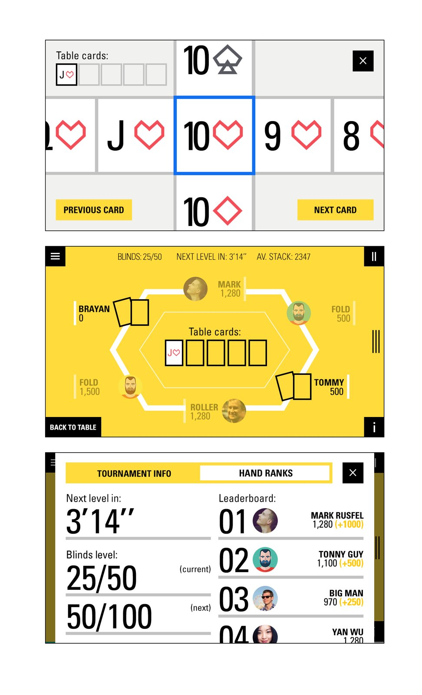

| text | x,y,w,h | font | px | colour | align |
|---|---|---|---|---|---|
| hand ranks | 802,1570,178,25 | Univers-CondensedBold | 32.03 |  | left |

1 filled shapes

| layer | x,y,w,h | fill | opacity |
|---|---|---|---|
| Group 1 / Rectangle 1 | 788,1565,209,36 | #FFFFFF |  |

### TABLE_5S.psd — `HJNMW8_TABLE_5S`

Canvas 5403×7299 · board / multi-frame canvas · modified 2015-07-08 · 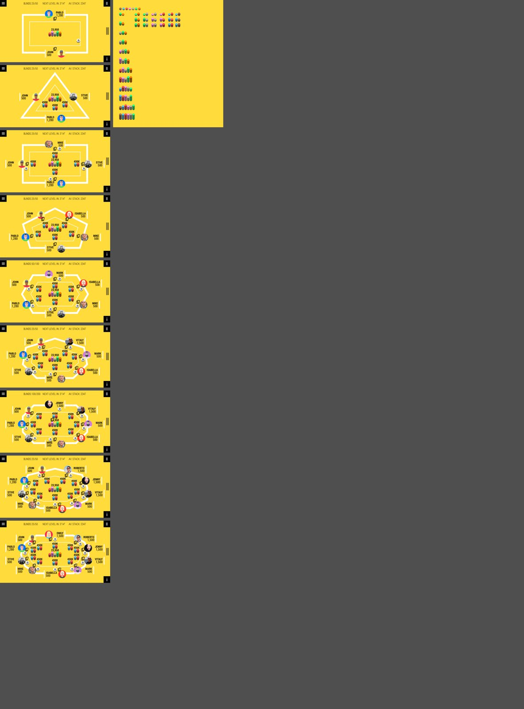

| text | x,y,w,h | font | px | colour | align |
|---|---|---|---|---|---|
| / 23,950 | 528,5653,78,28 | RobotoCondensed-Bold | 30.1 | #000000 | center |
| john | 185,5518,65,23 | RobotoCondensed-Bold | 30.0 | #000000 | left |
| 500 | 185,5545,44,26 | RobotoCondensed-Regular | 34.0 | #000000 | left |
| PABLO | 77,5616,74,23 | RobotoCondensed-Bold | 30.0 | #000000 | left |
| 1,280 | 75,5643,68,31 | RobotoCondensed-Regular | 34.0 | #000000 | left |
| stive | 78,5745,68,23 | RobotoCondensed-Bold | 30.0 | #000000 | left |
| 500 | 77,5772,45,26 | RobotoCondensed-Regular | 34.0 | #000000 | left |
| mike | 184,5844,57,22 | RobotoCondensed-Bold | 30.0 | #000000 | left |
| 500 | 185,5871,45,26 | RobotoCondensed-Regular | 34.0 | #000000 | left |
| Isabella | 476,5885,112,23 | RobotoCondensed-Bold | 30.0 | #000000 | left |
| 500 | 474,5912,45,26 | RobotoCondensed-Regular | 34.0 | #000000 | left |
| Mark | 881,5844,68,22 | RobotoCondensed-Bold | 30.0 | #000000 | right |
| 500 | 903,5871,45,26 | RobotoCondensed-Regular | 34.0 | #000000 | right |
| vitaly | 978,5745,80,22 | RobotoCondensed-Bold | 30.0 | #000000 | right |
| 1,500 | 990,5772,67,31 | RobotoCondensed-Regular | 34.0 | #000000 | right |
| jenny | 979,5616,79,23 | RobotoCondensed-Bold | 30.0 | #000000 | right |
| 1,500 | 990,5643,67,31 | RobotoCondensed-Regular | 34.0 | #000000 | right |
| roberto | 862,5518,108,23 | RobotoCondensed-Bold | 30.0 | #000000 | right |
| 1,500 | 903,5545,68,31 | RobotoCondensed-Regular | 34.0 | #000000 | right |
| Emily | 586,5477,67,22 | RobotoCondensed-Bold | 30.0 | #000000 | right |
| 1,500 | 585,5504,68,31 | RobotoCondensed-Regular | 34.0 | #000000 | right |
| d | 301,5589,16,18 | Univers-Bold | 25.03 | #000000 | left |
| d | 252,5683,16,18 | Univers-Bold | 25.03 | #000000 | left |
| d | 276,5783,16,18 | Univers-Bold | 25.03 | #000000 | left |
| d | 385,5848,16,18 | Univers-Bold | 25.03 | #000000 | left |
| d | 561,5853,16,18 | Univers-Bold | 25.03 | #000000 | left |
| d | 737,5848,16,18 | Univers-Bold | 25.03 | #000000 | left |
| d | 846,5783,16,18 | Univers-Bold | 25.03 | #000000 | left |
| d | 870,5683,16,18 | Univers-Bold | 25.03 | #000000 | left |
| d | 821,5589,16,18 | Univers-Bold | 25.03 | #000000 | left |
| d | 561,5541,16,18 | Univers-Bold | 25.03 | #000000 | left |
| / 450K | 379,5601,59,23 | RobotoCondensed-Bold | 30.2 | #000000 | center |
| / 450K | 314,5627,59,23 | RobotoCondensed-Bold | 30.2 | #000000 | center |
| / 450K | 314,5701,59,23 | RobotoCondensed-Bold | 30.2 | #000000 | center |
| / 450K | 379,5745,59,23 | RobotoCondensed-Bold | 30.2 | #000000 | center |
| / 450K | 537,5756,59,23 | RobotoCondensed-Bold | 30.2 | #000000 | center |
| / 450K | 695,5745,59,23 | RobotoCondensed-Bold | 30.2 | #000000 | center |
| / 450K | 760,5701,59,23 | RobotoCondensed-Bold | 30.2 | #000000 | center |
| / 450K | 760,5627,59,23 | RobotoCondensed-Bold | 30.2 | #000000 | center |
| / 450K | 695,5601,59,23 | RobotoCondensed-Bold | 30.2 | #000000 | center |
| / 450K | 538,5585,58,23 | RobotoCondensed-Bold | 30.0 | #000000 | center |
| Blinds: 25/50 | 245,5384,143,24 | RobotoCondensed-Light | 30.0 | #000000 | left |
| Next level in: 3’14’’ | 441,5383,228,24 | RobotoCondensed-Light | 30.0 | #000000 | left |
| Av. stack: 2347 | 709,5384,176,23 | RobotoCondensed-Light | 30.0 | #000000 | left |
| / 23,950 | 528,4983,78,28 | RobotoCondensed-Bold | 30.1 | #000000 | center |
| john | 286,4807,65,23 | RobotoCondensed-Bold | 30.0 | #000000 | left |
| 500 | 286,4834,44,26 | RobotoCondensed-Regular | 34.0 | #000000 | left |
| PABLO | 102,4923,74,23 | RobotoCondensed-Bold | 30.0 | #000000 | left |
| 1,280 | 100,4950,68,31 | RobotoCondensed-Regular | 34.0 | #000000 | left |
| stive | 78,5057,68,23 | RobotoCondensed-Bold | 30.0 | #000000 | left |
| 500 | 77,5084,45,26 | RobotoCondensed-Regular | 34.0 | #000000 | left |
| mike | 184,5174,57,22 | RobotoCondensed-Bold | 30.0 | #000000 | left |
| 500 | 185,5201,45,26 | RobotoCondensed-Regular | 34.0 | #000000 | left |
| Isabella | 476,5215,112,23 | RobotoCondensed-Bold | 30.0 | #000000 | left |
| 500 | 474,5242,45,26 | RobotoCondensed-Regular | 34.0 | #000000 | left |
| Mark | 881,5174,68,22 | RobotoCondensed-Bold | 30.0 | #000000 | right |
| 500 | 903,5201,45,26 | RobotoCondensed-Regular | 34.0 | #000000 | right |
| vitaly | 978,5057,80,22 | RobotoCondensed-Bold | 30.0 | #000000 | right |
| 1,500 | 990,5084,67,31 | RobotoCondensed-Regular | 34.0 | #000000 | right |
| jenny | 954,4923,79,23 | RobotoCondensed-Bold | 30.0 | #000000 | right |
| 1,500 | 965,4950,67,31 | RobotoCondensed-Regular | 34.0 | #000000 | right |
| roberto | 761,4807,108,23 | RobotoCondensed-Bold | 30.0 | #000000 | right |
| 1,500 | 802,4834,68,31 | RobotoCondensed-Regular | 34.0 | #000000 | right |
| / 450K | 455,4917,59,23 | RobotoCondensed-Bold | 30.2 | #000000 | center |
| / 450K | 338,4939,59,23 | RobotoCondensed-Bold | 30.2 | #000000 | center |
| / 450K | 310,5027,59,23 | RobotoCondensed-Bold | 30.2 | #000000 | center |
| / 450K | 380,5071,59,23 | RobotoCondensed-Bold | 30.2 | #000000 | center |
| / 450K | 537,5086,59,23 | RobotoCondensed-Bold | 30.2 | #000000 | center |
| / 450K | 694,5071,59,23 | RobotoCondensed-Bold | 30.2 | #000000 | center |
| / 450K | 764,5027,59,23 | RobotoCondensed-Bold | 30.2 | #000000 | center |
| / 450K | 736,4939,59,23 | RobotoCondensed-Bold | 30.2 | #000000 | center |
| / 450K | 619,4917,59,23 | RobotoCondensed-Bold | 30.2 | #000000 | center |
| d | 401,4885,16,18 | Univers-Bold | 25.03 | #000000 | left |
| d | 270,4996,16,18 | Univers-Bold | 25.03 | #000000 | left |
| d | 268,5111,16,18 | Univers-Bold | 25.03 | #000000 | left |
| d | 388,5173,16,18 | Univers-Bold | 25.03 | #000000 | left |
| d | 561,5183,16,18 | Univers-Bold | 25.03 | #000000 | left |
| d | 734,5173,16,18 | Univers-Bold | 25.03 | #000000 | left |
| d | 854,5111,16,18 | Univers-Bold | 25.03 | #000000 | left |
| d | 852,4996,16,18 | Univers-Bold | 25.03 | #000000 | left |
| d | 721,4885,16,18 | Univers-Bold | 25.03 | #000000 | left |
| Blinds: 25/50 | 245,4714,143,24 | RobotoCondensed-Light | 30.0 | #000000 | left |
| Next level in: 3’14’’ | 441,4713,228,24 | RobotoCondensed-Light | 30.0 | #000000 | left |
| Av. stack: 2347 | 709,4714,176,23 | RobotoCondensed-Light | 30.0 | #000000 | left |
| / 23,950 | 528,4313,78,28 | RobotoCondensed-Bold | 30.1 | #000000 | center |
| john | 148,4196,65,23 | RobotoCondensed-Bold | 30.0 | #000000 | left |
| 500 | 148,4223,44,26 | RobotoCondensed-Regular | 34.0 | #000000 | left |
| PABLO | 77,4341,74,23 | RobotoCondensed-Bold | 30.0 | #000000 | left |
| 1,280 | 75,4368,68,31 | RobotoCondensed-Regular | 34.0 | #000000 | left |
| stive | 149,4486,68,23 | RobotoCondensed-Bold | 30.0 | #000000 | left |
| 500 | 148,4513,45,26 | RobotoCondensed-Regular | 34.0 | #000000 | left |
| mike | 483,4545,57,22 | RobotoCondensed-Bold | 30.0 | #000000 | left |
| 500 | 484,4572,45,26 | RobotoCondensed-Regular | 34.0 | #000000 | left |
| Isabella | 896,4486,112,23 | RobotoCondensed-Bold | 30.0 | #000000 | right |
| 500 | 960,4513,44,26 | RobotoCondensed-Regular | 34.0 | #000000 | right |
| Mark | 989,4341,68,22 | RobotoCondensed-Bold | 30.0 | #000000 | right |
| 500 | 1011,4368,45,26 | RobotoCondensed-Regular | 34.0 | #000000 | right |
| vitaly | 907,4196,80,22 | RobotoCondensed-Bold | 30.0 | #000000 | right |
| 1,500 | 919,4223,67,31 | RobotoCondensed-Regular | 34.0 | #000000 | right |
| jenny | 574,4137,79,23 | RobotoCondensed-Bold | 30.0 | #000000 | right |
| 1,500 | 585,4164,67,31 | RobotoCondensed-Regular | 34.0 | #000000 | right |
| / 450K | 538,4245,58,23 | RobotoCondensed-Bold | 30.0 | #000000 | center |
| / 450K | 701,4251,59,23 | RobotoCondensed-Bold | 30.2 | #000000 | center |
| / 450K | 761,4335,59,23 | RobotoCondensed-Bold | 30.2 | #000000 | center |
| / 450K | 701,4408,59,23 | RobotoCondensed-Bold | 30.2 | #000000 | center |
| / 450K | 537,4416,59,23 | RobotoCondensed-Bold | 30.2 | #000000 | center |
| / 450K | 373,4408,59,23 | RobotoCondensed-Bold | 30.2 | #000000 | center |
| / 450K | 313,4335,59,23 | RobotoCondensed-Bold | 30.2 | #000000 | center |
| / 450K | 373,4251,59,23 | RobotoCondensed-Bold | 30.2 | #000000 | center |
| d | 284,4272,16,18 | Univers-Bold | 25.03 | #000000 | left |
| d | 264,4399,16,18 | Univers-Bold | 25.03 | #000000 | left |
| d | 352,4503,16,18 | Univers-Bold | 25.03 | #000000 | left |
| d | 514,4513,16,18 | Univers-Bold | 25.03 | #000000 | left |
| d | 770,4503,16,18 | Univers-Bold | 25.03 | #000000 | left |
| d | 858,4399,16,18 | Univers-Bold | 25.03 | #000000 | left |
| d | 838,4272,16,18 | Univers-Bold | 25.03 | #000000 | left |
| d | 608,4201,16,18 | Univers-Bold | 25.03 | #000000 | left |
| Blinds: 100/200 | 245,4044,170,24 | RobotoCondensed-Light | 30.0 | #000000 | left |
| Next level in: 3’14’’ | 441,4043,228,24 | RobotoCondensed-Light | 30.0 | #000000 | left |
| Av. stack: 2347 | 709,4044,176,23 | RobotoCondensed-Light | 30.0 | #000000 | left |

_…121 more text layers in the JSON._

1853 filled shapes

| layer | x,y,w,h | fill | opacity |
|---|---|---|---|
| _10 / Rectangle 1 copy 11 | -1,5358,1138,644 | #FFDB3C |  |
| _10 / pot / pot_7 / _1 / Shape 3 | 606,5719,29,17 | #000000 |  |
| _10 / pot / pot_7 / _1 / Shape 5 | 606,5709,29,23 | #F98202 |  |
| _10 / pot / pot_7 / _1 / Shape 3 copy | 606,5711,29,17 | #000000 |  |
| _10 / pot / pot_7 / _1 / Shape 5 copy | 606,5701,29,23 | #F98202 |  |
| _10 / pot / pot_7 / _1 / Shape 3 copy 11 | 606,5703,29,17 | #000000 |  |
| _10 / pot / pot_7 / _1 / Shape 5 copy 11 | 606,5693,29,23 | #F98202 |  |
| _10 / pot / pot_7 / _1 / Shape 3 copy 15 | 606,5695,29,17 | #000000 |  |
| _10 / pot / pot_7 / _1 / Shape 5 copy 15 | 606,5685,29,23 | #F98202 |  |
| _10 / pot / pot_7 / _2 / Shape 3 | 580,5719,27,17 | #000000 |  |
| _10 / pot / pot_7 / _2 / Shape 5 | 580,5709,27,23 | #2EFF86 |  |
| _10 / pot / pot_7 / _2 / Shape 3 copy 2 | 580,5711,27,17 | #000000 |  |
| _10 / pot / pot_7 / _2 / Shape 5 copy 2 | 580,5701,27,23 | #2EFF86 |  |
| _10 / pot / pot_7 / _2 / Shape 3 copy 3 | 580,5703,27,17 | #000000 |  |
| _10 / pot / pot_7 / _2 / Shape 5 copy 3 | 580,5693,27,23 | #2EFF86 |  |
| _10 / pot / pot_7 / _2 / Shape 3 copy 5 | 580,5695,27,17 | #000000 |  |
| _10 / pot / pot_7 / _2 / Shape 5 copy 5 | 580,5685,27,23 | #2EFF86 |  |
| _10 / pot / pot_7 / _2 / Shape 3 copy 14 | 580,5687,27,17 | #000000 |  |
| _10 / pot / pot_7 / _2 / Shape 5 copy 14 | 580,5677,27,23 | #2EFF86 |  |
| _10 / pot / pot_7 / _3 / Shape 3 | 552,5719,29,17 | #000000 |  |
| _10 / pot / pot_7 / _3 / Shape 5 | 552,5709,29,23 | #B6B4A5 |  |
| _10 / pot / pot_7 / _3 / Shape 3 copy 4 | 552,5711,29,17 | #000000 |  |
| _10 / pot / pot_7 / _3 / Shape 5 copy 4 | 552,5701,29,23 | #B6B4A5 |  |
| _10 / pot / pot_7 / _3 / Shape 3 copy 7 | 552,5703,29,17 | #000000 |  |
| _10 / pot / pot_7 / _3 / Shape 5 copy 7 | 552,5693,29,23 | #B6B4A5 |  |
| _10 / pot / pot_7 / _4 / Shape 3 | 526,5719,27,17 | #000000 |  |
| _10 / pot / pot_7 / _4 / Shape 5 | 526,5709,27,23 | #FF95F1 |  |
| _10 / pot / pot_7 / _4 / Shape 3 copy 8 | 526,5711,27,17 | #000000 |  |
| _10 / pot / pot_7 / _4 / Shape 5 copy 8 | 526,5701,27,23 | #FF95F1 |  |
| _10 / pot / pot_7 / _4 / Shape 3 copy 9 | 526,5703,27,17 | #000000 |  |
| _10 / pot / pot_7 / _4 / Shape 5 copy 9 | 526,5693,27,23 | #FF95F1 |  |
| _10 / pot / pot_7 / _4 / Shape 3 copy 10 | 526,5695,27,17 | #000000 |  |
| _10 / pot / pot_7 / _4 / Shape 5 copy 10 | 526,5685,27,23 | #FF95F1 |  |
| _10 / pot / pot_7 / _4 / Shape 3 copy 13 | 526,5687,27,17 | #000000 |  |
| _10 / pot / pot_7 / _4 / Shape 5 copy 13 | 526,5677,27,23 | #FF95F1 |  |
| _10 / pot / pot_7 / _5 / Shape 3 | 498,5719,29,17 | #000000 |  |
| _10 / pot / pot_7 / _5 / Shape 5 | 498,5709,29,23 | #FF5252 |  |
| _10 / pot / pot_7 / _5 / Shape 3 copy 8 | 498,5711,29,17 | #000000 |  |
| _10 / pot / pot_7 / _5 / Shape 5 copy 8 | 498,5701,29,23 | #FF5252 |  |
| _10 / pot / pot_7 / _5 / Shape 3 copy 9 | 498,5703,29,17 | #000000 |  |
| _10 / pot / pot_7 / _5 / Shape 5 copy 9 | 498,5693,29,23 | #FF5252 |  |
| _10 / players / 10 / Rectangle 1 copy 7 | 162,5502,11,85 | #FFFFFF |  |
| _10 / players / 9 / Rectangle 1 copy 7 | 54,5600,11,84 | #FFFFFF |  |
| _10 / players / 8 / Rectangle 1 copy 7 | 54,5729,11,85 | #FFFFFF |  |
| _10 / players / 7 / Rectangle 1 copy 7 | 162,5828,11,85 | #FFFFFF |  |
| _10 / players / 6 / yellow | 451,5869,192,85 | #FFDB3C |  |
| _10 / players / 6 / Rectangle 1 copy 7 | 451,5869,11,85 | #FFFFFF |  |
| _10 / players / 5 / Ellipse 10 | 759,5828,83,85 | #FFDB3C |  |
| _10 / players / 5 / Rectangle 1 copy 7 | 961,5828,11,85 | #FFFFFF |  |
| _10 / players / 4 / Rectangle 1 copy 7 | 1069,5729,11,85 | #FFFFFF |  |
| _10 / players / 3 / Rectangle 1 copy 7 | 1069,5600,11,84 | #FFFFFF |  |
| _10 / players / 2 / Rectangle 1 copy 7 | 982,5502,10,85 | #FFFFFF |  |
| _10 / players / 1 / yellow | 503,5461,167,85 | #FFDB3C |  |
| _10 / players / 1 / Rectangle 1 copy 7 | 664,5461,10,85 | #FFFFFF |  |
| _10 / dealer / 10 / Ellipse 6 copy 5 | 287,5582,39,38 | #000000 |  |
| _10 / dealer / 10 / Ellipse 6 copy 6 | 287,5578,39,39 | #FFFFFF |  |
| _10 / dealer / 9 / Ellipse 6 copy 5 | 238,5676,39,38 | #000000 |  |
| _10 / dealer / 9 / Ellipse 6 copy 6 | 238,5672,39,39 | #FFFFFF |  |
| _10 / dealer / 8 / Ellipse 6 copy 5 | 262,5775,39,39 | #000000 |  |
| _10 / dealer / 8 / Ellipse 6 copy 6 | 262,5773,39,39 | #FFFFFF |  |
| _10 / dealer / 7 / Ellipse 6 copy 5 | 371,5841,39,38 | #000000 |  |
| _10 / dealer / 7 / Ellipse 6 copy 6 | 371,5837,39,39 | #FFFFFF |  |
| _10 / dealer / 6 / Ellipse 6 copy 5 | 547,5845,39,39 | #000000 |  |
| _10 / dealer / 6 / Ellipse 6 copy 6 | 547,5843,39,38 | #FFFFFF |  |
| _10 / dealer / 5 / Ellipse 6 copy 5 | 724,5841,39,38 | #000000 |  |
| _10 / dealer / 5 / Ellipse 6 copy 6 | 724,5837,39,39 | #FFFFFF |  |
| _10 / dealer / 4 / Ellipse 6 copy 5 | 832,5775,39,39 | #000000 |  |
| _10 / dealer / 4 / Ellipse 6 copy 6 | 832,5773,39,39 | #FFFFFF |  |
| _10 / dealer / 3 / Ellipse 6 copy 5 | 856,5676,39,38 | #000000 |  |
| _10 / dealer / 3 / Ellipse 6 copy 6 | 856,5672,39,39 | #FFFFFF |  |
| _10 / dealer / 2 / Ellipse 6 copy 5 | 808,5582,39,38 | #000000 |  |
| _10 / dealer / 2 / Ellipse 6 copy 6 | 808,5578,39,39 | #FFFFFF |  |
| _10 / dealer / 1 / Ellipse 6 copy 5 | 548,5534,39,38 | #000000 |  |
| _10 / dealer / 1 / Ellipse 6 copy 6 | 548,5530,39,39 | #FFFFFF |  |
| _10 / bets / 10 / _1 / Shape 3 | 408,5649,28,17 | #000000 |  |
| _10 / bets / 10 / _1 / Shape 5 | 408,5639,28,23 | #FF5252 |  |
| _10 / bets / 10 / _1 / Shape 3 copy | 408,5641,28,17 | #000000 |  |
| _10 / bets / 10 / _1 / Shape 5 copy | 408,5631,28,23 | #FF5252 |  |
| _10 / bets / 10 / _1 / Shape 3 copy 29 | 408,5633,28,17 | #000000 |  |
| _10 / bets / 10 / _1 / Shape 5 copy 29 | 408,5623,28,23 | #FF5252 |  |
| _10 / bets / 10 / _2 / Shape 3 | 381,5649,28,17 | #000000 |  |
| _10 / bets / 10 / _2 / Shape 5 | 381,5639,28,23 | #5CC5F7 |  |
| _10 / bets / 10 / _2 / Shape 3 copy 2 | 381,5641,28,17 | #000000 |  |
| _10 / bets / 10 / _2 / Shape 5 copy 2 | 381,5631,28,23 | #5CC5F7 |  |
| _10 / bets / 10 / _2 / Shape 3 copy 3 | 381,5633,28,17 | #000000 |  |
| _10 / bets / 10 / _2 / Shape 5 copy 3 | 381,5623,28,23 | #5CC5F7 |  |
| _10 / bets / 9 / _1 / Shape 3 | 343,5675,28,17 | #000000 |  |
| _10 / bets / 9 / _1 / Shape 5 | 343,5665,28,23 | #FF5252 |  |
| _10 / bets / 9 / _1 / Shape 3 copy | 343,5667,28,17 | #000000 |  |
| _10 / bets / 9 / _1 / Shape 5 copy | 343,5657,28,23 | #FF5252 |  |
| _10 / bets / 9 / _1 / Shape 3 copy 29 | 343,5659,28,17 | #000000 |  |
| _10 / bets / 9 / _1 / Shape 5 copy 29 | 343,5649,28,23 | #FF5252 |  |
| _10 / bets / 9 / _2 / Shape 3 | 316,5675,28,17 | #000000 |  |
| _10 / bets / 9 / _2 / Shape 5 | 316,5665,28,23 | #5CC5F7 |  |
| _10 / bets / 9 / _2 / Shape 3 copy 2 | 316,5667,28,17 | #000000 |  |
| _10 / bets / 9 / _2 / Shape 5 copy 2 | 316,5657,28,23 | #5CC5F7 |  |
| _10 / bets / 9 / _2 / Shape 3 copy 3 | 316,5659,28,17 | #000000 |  |
| _10 / bets / 9 / _2 / Shape 5 copy 3 | 316,5649,28,23 | #5CC5F7 |  |
| _10 / bets / 8 / _1 / Shape 3 | 343,5749,28,17 | #000000 |  |
| _10 / bets / 8 / _1 / Shape 5 | 343,5739,28,23 | #FF5252 |  |
| _10 / bets / 8 / _1 / Shape 3 copy | 343,5741,28,17 | #000000 |  |
| _10 / bets / 8 / _1 / Shape 5 copy | 343,5731,28,23 | #FF5252 |  |
| _10 / bets / 8 / _1 / Shape 3 copy 29 | 343,5733,28,17 | #000000 |  |
| _10 / bets / 8 / _1 / Shape 5 copy 29 | 343,5723,28,23 | #FF5252 |  |
| _10 / bets / 8 / _2 / Shape 3 | 316,5749,28,17 | #000000 |  |
| _10 / bets / 8 / _2 / Shape 5 | 316,5739,28,23 | #5CC5F7 |  |
| _10 / bets / 8 / _2 / Shape 3 copy 2 | 316,5741,28,17 | #000000 |  |
| _10 / bets / 8 / _2 / Shape 5 copy 2 | 316,5731,28,23 | #5CC5F7 |  |
| _10 / bets / 8 / _2 / Shape 3 copy 3 | 316,5733,28,17 | #000000 |  |
| _10 / bets / 8 / _2 / Shape 5 copy 3 | 316,5723,28,23 | #5CC5F7 |  |
| _10 / bets / 7 / _1 / Shape 3 | 408,5793,28,17 | #000000 |  |
| _10 / bets / 7 / _1 / Shape 5 | 408,5783,28,23 | #FF5252 |  |
| _10 / bets / 7 / _1 / Shape 3 copy | 408,5785,28,17 | #000000 |  |
| _10 / bets / 7 / _1 / Shape 5 copy | 408,5775,28,23 | #FF5252 |  |
| _10 / bets / 7 / _1 / Shape 3 copy 29 | 408,5777,28,17 | #000000 |  |
| _10 / bets / 7 / _1 / Shape 5 copy 29 | 408,5767,28,23 | #FF5252 |  |
| _10 / bets / 7 / _2 / Shape 3 | 381,5793,28,17 | #000000 |  |
| _10 / bets / 7 / _2 / Shape 5 | 381,5783,28,23 | #5CC5F7 |  |
| _10 / bets / 7 / _2 / Shape 3 copy 2 | 381,5785,28,17 | #000000 |  |
| _10 / bets / 7 / _2 / Shape 5 copy 2 | 381,5775,28,23 | #5CC5F7 |  |
| _10 / bets / 7 / _2 / Shape 3 copy 3 | 381,5777,28,17 | #000000 |  |
| _10 / bets / 7 / _2 / Shape 5 copy 3 | 381,5767,28,23 | #5CC5F7 |  |
| _10 / bets / 6 / _1 / Shape 3 | 566,5804,28,17 | #000000 |  |
| _10 / bets / 6 / _1 / Shape 5 | 566,5794,28,23 | #FF5252 |  |
| _10 / bets / 6 / _1 / Shape 3 copy | 566,5796,28,17 | #000000 |  |
| _10 / bets / 6 / _1 / Shape 5 copy | 566,5786,28,23 | #FF5252 |  |
| _10 / bets / 6 / _1 / Shape 3 copy 29 | 566,5788,28,17 | #000000 |  |
| _10 / bets / 6 / _1 / Shape 5 copy 29 | 566,5778,28,23 | #FF5252 |  |
| _10 / bets / 6 / _2 / Shape 3 | 539,5804,28,17 | #000000 |  |
| _10 / bets / 6 / _2 / Shape 5 | 539,5794,28,23 | #5CC5F7 |  |
| _10 / bets / 6 / _2 / Shape 3 copy 2 | 539,5796,28,17 | #000000 |  |
| _10 / bets / 6 / _2 / Shape 5 copy 2 | 539,5786,28,23 | #5CC5F7 |  |
| _10 / bets / 6 / _2 / Shape 3 copy 3 | 539,5788,28,17 | #000000 |  |
| _10 / bets / 6 / _2 / Shape 5 copy 3 | 539,5778,28,23 | #5CC5F7 |  |
| _10 / bets / 5 / _1 / Shape 3 | 724,5793,28,17 | #000000 |  |
| _10 / bets / 5 / _1 / Shape 5 | 724,5783,28,23 | #FF5252 |  |
| _10 / bets / 5 / _1 / Shape 3 copy | 724,5785,28,17 | #000000 |  |
| _10 / bets / 5 / _1 / Shape 5 copy | 724,5775,28,23 | #FF5252 |  |
| _10 / bets / 5 / _1 / Shape 3 copy 29 | 724,5777,28,17 | #000000 |  |
| _10 / bets / 5 / _1 / Shape 5 copy 29 | 724,5767,28,23 | #FF5252 |  |
| _10 / bets / 5 / _2 / Shape 3 | 697,5793,28,17 | #000000 |  |
| _10 / bets / 5 / _2 / Shape 5 | 697,5783,28,23 | #5CC5F7 |  |
| _10 / bets / 5 / _2 / Shape 3 copy 2 | 697,5785,28,17 | #000000 |  |
| _10 / bets / 5 / _2 / Shape 5 copy 2 | 697,5775,28,23 | #5CC5F7 |  |
| _10 / bets / 5 / _2 / Shape 3 copy 3 | 697,5777,28,17 | #000000 |  |
| _10 / bets / 5 / _2 / Shape 5 copy 3 | 697,5767,28,23 | #5CC5F7 |  |
| _10 / bets / 4 / _1 / Shape 3 | 789,5749,28,17 | #000000 |  |
| _10 / bets / 4 / _1 / Shape 5 | 789,5739,28,23 | #FF5252 |  |
| _10 / bets / 4 / _1 / Shape 3 copy | 789,5741,28,17 | #000000 |  |
| _10 / bets / 4 / _1 / Shape 5 copy | 789,5731,28,23 | #FF5252 |  |

### wizard_2.psd — `HgzMG8_wizard_2`

Canvas 2538×1308 · board / multi-frame canvas · modified 2015-02-07 · 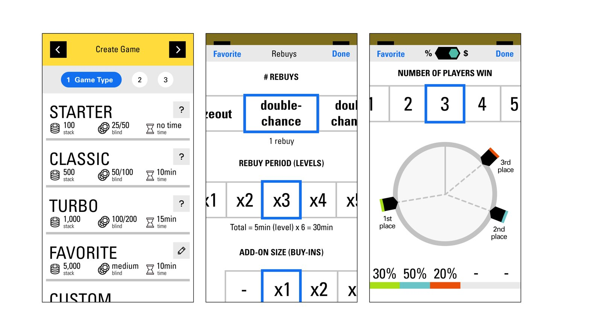

### create.psd — `HpRVDA_create`

Canvas 3142×1598 · board / multi-frame canvas · modified 2015-02-07 · 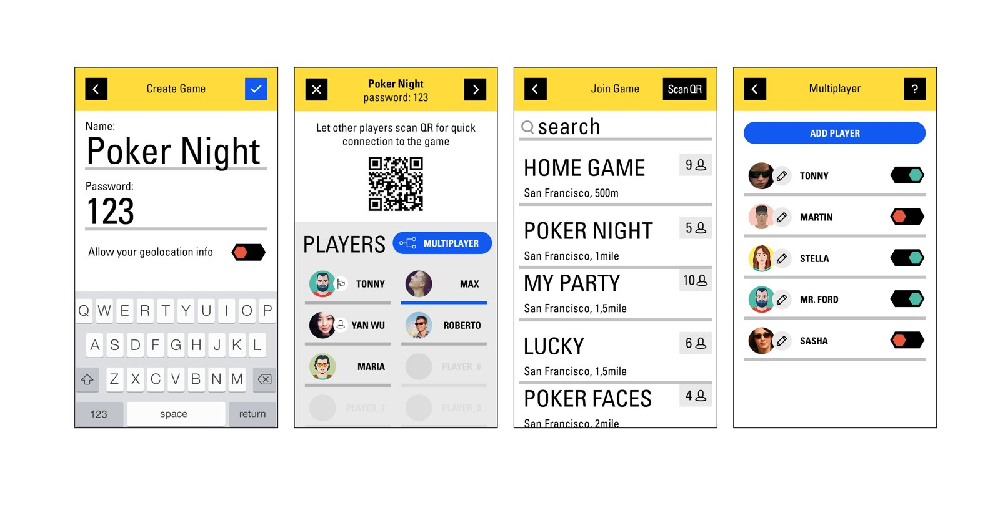

### Info.psd — `TNBcWs_Info`

Canvas 1940×1220 · board / multi-frame canvas · modified 2014-08-31 · 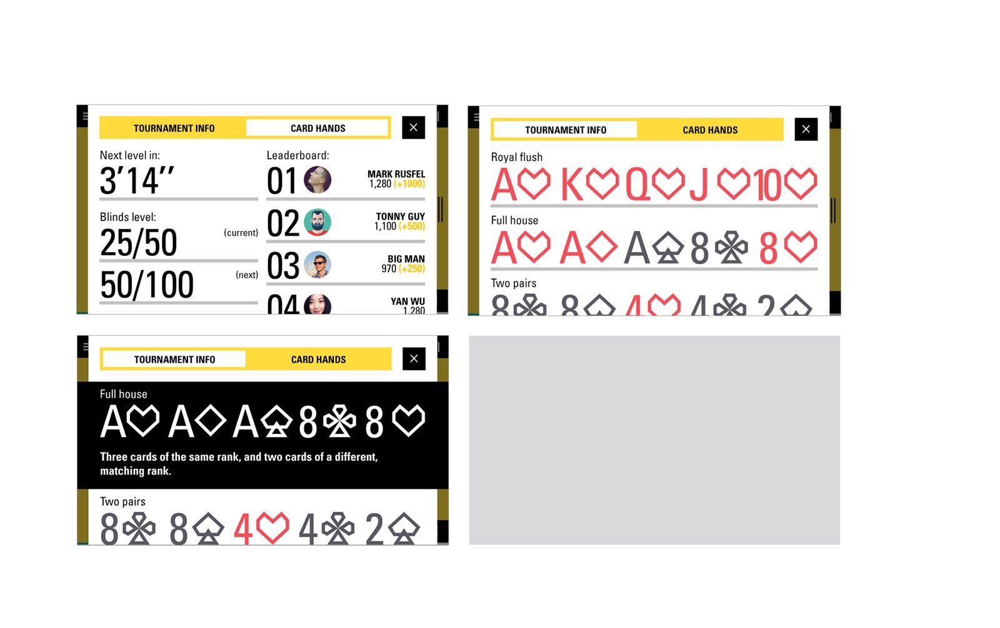

2 filled shapes

| layer | x,y,w,h | fill | opacity |
|---|---|---|---|
| _4 | 908,651,724,409 | #D9D9DB |  |
| _3 | 149,651,722,409 | #D9D9DB |  |

### create_1.psd — `TRWOHM_create_1`

Canvas 4432×1475 · board / multi-frame canvas · modified 2015-02-07 · 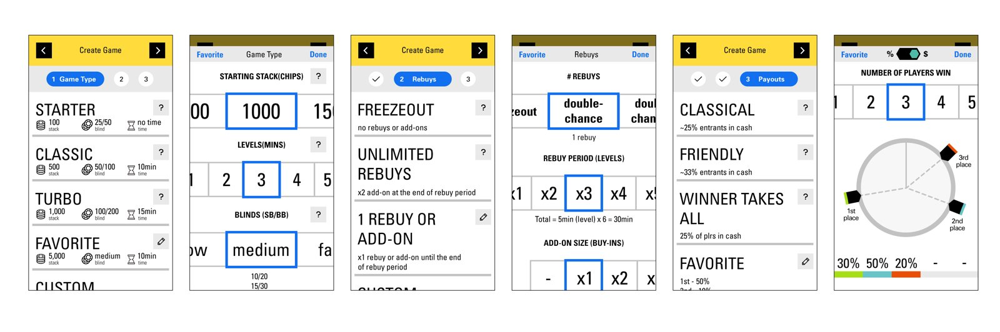

### spash_2.psd — `TRyVjQ_spash_2`

Canvas 1940×1220 · board / multi-frame canvas · modified 2014-08-31 · 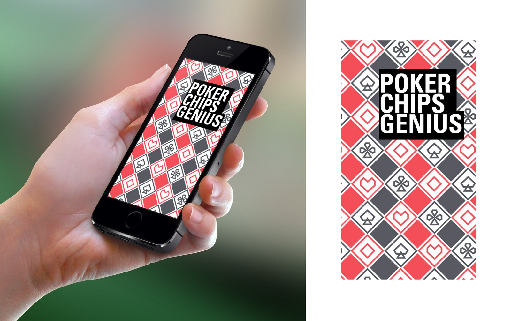

119 filled shapes

| layer | x,y,w,h | fill | opacity |
|---|---|---|---|
| presentation screen / Rectangle 1 | -22,-30,1185,1292 | #E2F3FC |  |
| presentation screen / in hand / iPhone 5S / phone / Background / Shape | 346,188,702,802 | #FFFFFF |  |
| presentation screen / in hand / iPhone 5S / phone / Background / Shape | 332,177,706,770 | #010000 |  |
| presentation screen / in hand / iPhone 5S / phone / Background / Shape | 590,912,60,32 | #B5B9C3 |  |
| presentation screen / in hand / iPhone 5S / phone / Background / Shape | 332,790,59,80 | #AEB3BD |  |
| presentation screen / in hand / iPhone 5S / phone / Background / Shape | 1001,177,37,88 | #A6ABB6 |  |
| presentation screen / in hand / iPhone 5S / phone / Background / Shape | 332,123,706,817 | #000000 |  |
| presentation screen / in hand / iPhone 5S / phone / Background / Shape | 333,121,704,822 | #1E1E1E |  |
| presentation screen / in hand / iPhone 5S / phone / Background / Shape | 341,120,692,813 | #000004 |  |
| presentation screen / in hand / iPhone 5S / phone / Background / screen border | 402,216,572,620 | #19191A |  |
| presentation screen / in hand / iPhone 5S / phone / Bottom / Sound / Hole / Shap | 574,944,14,10 | #050505 |  |
| presentation screen / in hand / iPhone 5S / phone / Bottom / Sound / Hole / Shap | 575,944,13,10 | #050506 |  |
| presentation screen / in hand / iPhone 5S / phone / Bottom / Sound / Hole / Shap | 578,944,7,6 | #020201 |  |
| presentation screen / in hand / iPhone 5S / phone / Bottom / Sound / Hole / Shap | 431,893,10,8 | #000000 |  |
| presentation screen / in hand / iPhone 5S / phone / Bottom / Sound / Hole / Shap | 431,893,9,8 | #000000 |  |
| presentation screen / in hand / iPhone 5S / phone / Bottom / Sound / Hole / Shap | 433,893,6,5 | #020201 |  |
| presentation screen / in hand / iPhone 5S / phone / Bottom / Sound / Hole / Shap | 427,887,10,8 | #000000 |  |
| presentation screen / in hand / iPhone 5S / phone / Bottom / Sound / Hole / Shap | 427,888,9,7 | #000000 |  |
| presentation screen / in hand / iPhone 5S / phone / Bottom / Sound / Hole / Shap | 429,888,6,5 | #020201 |  |
| presentation screen / in hand / iPhone 5S / phone / Bottom / Sound / Hole / Shap | 424,890,10,8 | #000000 |  |
| presentation screen / in hand / iPhone 5S / phone / Bottom / Sound / Hole / Shap | 425,891,9,7 | #000000 |  |
| presentation screen / in hand / iPhone 5S / phone / Bottom / Sound / Hole / Shap | 426,891,6,5 | #020201 |  |
| presentation screen / in hand / iPhone 5S / phone / Bottom / Sound / Hole / Shap | 420,885,10,8 | #000000 |  |
| presentation screen / in hand / iPhone 5S / phone / Bottom / Sound / Hole / Shap | 421,885,9,8 | #000000 |  |
| presentation screen / in hand / iPhone 5S / phone / Bottom / Sound / Hole / Shap | 422,885,6,5 | #020201 |  |
| presentation screen / in hand / iPhone 5S / phone / Bottom / Sound / Hole / Shap | 418,888,10,8 | #000000 |  |
| presentation screen / in hand / iPhone 5S / phone / Bottom / Sound / Hole / Shap | 419,889,8,7 | #000000 |  |
| presentation screen / in hand / iPhone 5S / phone / Bottom / Sound / Hole / Shap | 420,889,6,4 | #020201 |  |
| presentation screen / in hand / iPhone 5S / phone / Bottom / Sound / Hole / Shap | 415,883,9,8 | #000000 |  |
| presentation screen / in hand / iPhone 5S / phone / Bottom / Sound / Hole / Shap | 415,883,9,8 | #000000 |  |
| presentation screen / in hand / iPhone 5S / phone / Bottom / Sound / Hole / Shap | 416,883,6,5 | #020201 |  |
| presentation screen / in hand / iPhone 5S / phone / Bottom / Sound / Hole / Shap | 413,886,9,8 | #000000 |  |
| presentation screen / in hand / iPhone 5S / phone / Bottom / Sound / Hole / Shap | 413,886,8,8 | #000000 |  |
| presentation screen / in hand / iPhone 5S / phone / Bottom / Sound / Hole / Shap | 414,886,6,5 | #020201 |  |
| presentation screen / in hand / iPhone 5S / phone / Bottom / Sound / Hole / Shap | 409,881,9,7 | #000000 |  |
| presentation screen / in hand / iPhone 5S / phone / Bottom / Sound / Hole / Shap | 409,881,9,7 | #000000 |  |
| presentation screen / in hand / iPhone 5S / phone / Bottom / Sound / Hole / Shap | 410,881,6,5 | #020201 |  |
| presentation screen / in hand / iPhone 5S / phone / Bottom / Sound / Hole / Shap | 406,884,10,8 | #000000 |  |
| presentation screen / in hand / iPhone 5S / phone / Bottom / Sound / Hole / Shap | 407,884,8,8 | #000000 |  |
| presentation screen / in hand / iPhone 5S / phone / Bottom / Sound / Hole / Shap | 408,884,6,5 | #020201 |  |
| presentation screen / in hand / iPhone 5S / phone / Bottom / Sound / Hole / Shap | 559,934,13,9 | #050505 |  |
| presentation screen / in hand / iPhone 5S / phone / Bottom / Sound / Hole / Shap | 559,934,12,9 | #050506 |  |
| presentation screen / in hand / iPhone 5S / phone / Bottom / Sound / Hole / Shap | 562,934,7,6 | #020201 |  |
| presentation screen / in hand / iPhone 5S / phone / Bottom / Sound / Hole / Shap | 565,940,13,10 | #050505 |  |
| presentation screen / in hand / iPhone 5S / phone / Bottom / Sound / Hole / Shap | 565,941,12,9 | #050506 |  |
| presentation screen / in hand / iPhone 5S / phone / Bottom / Sound / Hole / Shap | 568,941,7,6 | #020201 |  |
| presentation screen / in hand / iPhone 5S / phone / Bottom / Sound / Hole / Shap | 555,937,13,10 | #050505 |  |
| presentation screen / in hand / iPhone 5S / phone / Bottom / Sound / Hole / Shap | 556,937,11,10 | #050506 |  |
| presentation screen / in hand / iPhone 5S / phone / Bottom / Sound / Hole / Shap | 558,938,7,6 | #020201 |  |
| presentation screen / in hand / iPhone 5S / phone / Bottom / Sound / Hole / Shap | 550,930,12,9 | #050505 |  |
| presentation screen / in hand / iPhone 5S / phone / Bottom / Sound / Hole / Shap | 550,930,12,9 | #050506 |  |
| presentation screen / in hand / iPhone 5S / phone / Bottom / Sound / Hole / Shap | 553,931,7,5 | #020201 |  |
| presentation screen / in hand / iPhone 5S / phone / Bottom / Sound / Hole / Shap | 546,934,12,9 | #050505 |  |
| presentation screen / in hand / iPhone 5S / phone / Bottom / Sound / Hole / Shap | 546,934,12,9 | #050506 |  |
| presentation screen / in hand / iPhone 5S / phone / Bottom / Sound / Hole / Shap | 549,934,7,6 | #020201 |  |
| presentation screen / in hand / iPhone 5S / phone / Bottom / Sound / Hole / Shap | 541,927,12,9 | #050505 |  |
| presentation screen / in hand / iPhone 5S / phone / Bottom / Sound / Hole / Shap | 541,927,11,9 | #050506 |  |
| presentation screen / in hand / iPhone 5S / phone / Bottom / Sound / Hole / Shap | 543,927,7,6 | #020201 |  |
| presentation screen / in hand / iPhone 5S / phone / Bottom / Sound / Hole / Shap | 537,930,12,10 | #050505 |  |
| presentation screen / in hand / iPhone 5S / phone / Bottom / Sound / Hole / Shap | 537,931,12,9 | #050506 |  |
| presentation screen / in hand / iPhone 5S / phone / Bottom / Sound / Hole / Shap | 540,931,7,6 | #020201 |  |
| presentation screen / in hand / iPhone 5S / phone / Bottom / Sound / Hole / Shap | 532,924,11,9 | #050505 |  |
| presentation screen / in hand / iPhone 5S / phone / Bottom / Sound / Hole / Shap | 532,924,11,9 | #050506 |  |
| presentation screen / in hand / iPhone 5S / phone / Bottom / Sound / Hole / Shap | 534,924,7,6 | #020201 |  |
| presentation screen / in hand / iPhone 5S / phone / Bottom / Sound / Hole / Shap | 528,927,12,9 | #050505 |  |
| presentation screen / in hand / iPhone 5S / phone / Bottom / Sound / Hole / Shap | 528,928,11,8 | #050506 |  |
| presentation screen / in hand / iPhone 5S / phone / Bottom / Sound / Hole / Shap | 531,928,6,5 | #020201 |  |
| presentation screen / in hand / iPhone 5S / phone / Bottom / Sound / Hole / Shap | 523,921,12,9 | #050505 |  |
| presentation screen / in hand / iPhone 5S / phone / Bottom / Sound / Hole / Shap | 523,921,11,9 | #050506 |  |
| presentation screen / in hand / iPhone 5S / phone / Bottom / Sound / Hole / Shap | 526,921,6,6 | #020201 |  |
| presentation screen / in hand / iPhone 5S / phone / Bottom / Sound / Hole / Shap | 520,924,11,9 | #050505 |  |
| presentation screen / in hand / iPhone 5S / phone / Bottom / Sound / Hole / Shap | 520,925,11,8 | #050506 |  |
| presentation screen / in hand / iPhone 5S / phone / Bottom / Sound / Hole / Shap | 522,925,7,5 | #020201 |  |
| presentation screen / in hand / iPhone 5S / phone / Bottom / Sound / Hole / Shap | 515,918,11,9 | #050505 |  |
| presentation screen / in hand / iPhone 5S / phone / Bottom / Sound / Hole / Shap | 515,918,11,9 | #050506 |  |
| presentation screen / in hand / iPhone 5S / phone / Bottom / Sound / Hole / Shap | 517,918,7,6 | #020201 |  |
| presentation screen / in hand / iPhone 5S / phone / Bottom / Sound / Hole / Shap | 511,921,11,9 | #050505 |  |
| presentation screen / in hand / iPhone 5S / phone / Bottom / Sound / Hole / Shap | 511,922,11,8 | #050506 |  |
| presentation screen / in hand / iPhone 5S / phone / Bottom / Sound / Hole / Shap | 514,922,6,5 | #020201 |  |
| presentation screen / in hand / iPhone 5S / phone / Bottom / Sound / Hole / Shap | 506,915,11,9 | #050505 |  |
| presentation screen / in hand / iPhone 5S / phone / Bottom / Sound / Hole / Shap | 506,915,11,9 | #050506 |  |
| presentation screen / in hand / iPhone 5S / phone / Bottom / Sound / Hole / Shap | 509,915,6,6 | #020201 |  |
| presentation screen / in hand / iPhone 5S / phone / Bottom / Sound / Hole / Shap | 568,936,14,10 | #050505 |  |
| presentation screen / in hand / iPhone 5S / phone / Bottom / Sound / Hole / Shap | 569,937,13,9 | #050506 |  |
| presentation screen / in hand / iPhone 5S / phone / Bottom / Sound / Hole / Shap | 572,937,7,6 | #020201 |  |
| presentation screen / in hand / iPhone 5S / phone / Bottom / Sound / Hole / Shap | 403,879,9,7 | #000000 |  |
| presentation screen / in hand / iPhone 5S / phone / Bottom / Sound / Hole / Shap | 403,879,8,7 | #000000 |  |
| presentation screen / in hand / iPhone 5S / phone / Bottom / Sound / Hole / Shap | 404,879,6,5 | #020201 |  |
| presentation screen / in hand / iPhone 5S / phone / Bottom / Shape | 495,913,15,11 | #686C6E |  |
| presentation screen / in hand / iPhone 5S / phone / Bottom / Shape | 495,913,15,11 | #686C6E |  |
| presentation screen / in hand / iPhone 5S / phone / Bottom / star | 499,915,7,7 | #0F1010 |  |
| presentation screen / in hand / iPhone 5S / phone / Bottom / Shape | 436,892,13,10 | #686C6E |  |
| presentation screen / in hand / iPhone 5S / phone / Bottom / Shape | 436,892,13,10 | #686C6E |  |
| presentation screen / in hand / iPhone 5S / phone / Bottom / star | 439,894,7,6 | #131414 |  |
| presentation screen / in hand / iPhone 5S / phone / Bottom / Shape 4 | 445,894,53,28 | #0A0A0A |  |
| presentation screen / in hand / iPhone 5S / phone / Bottom / Shape 5 | 447,895,50,25 | #686C6E |  |
| presentation screen / in hand / iPhone 5S / phone / Bottom / Shape 6 | 449,896,46,23 | #09090A |  |
| presentation screen / in hand / iPhone 5S / phone / Bottom / Shape 7 | 449,896,46,23 | #606773 |  |
| presentation screen / in hand / iPhone 5S / phone / Bottom / Light | 449,896,46,23 | #606773 |  |
| presentation screen / in hand / iPhone 5S / phone / Bottom / Shape | 376,868,24,19 | #59595B |  |
| presentation screen / in hand / iPhone 5S / phone / Bottom / Shape | 376,868,23,18 | #060606 |  |
| presentation screen / in hand / iPhone 5S / phone / Bottom / Shape | 376,869,23,17 | #5B5C5F |  |
| presentation screen / in hand / iPhone 5S / phone / Bottom / Shape | 376,869,22,17 | #676E7A |  |
| presentation screen / in hand / iPhone 5S / phone / Side / Shape | 999,252,31,35 | #09090A | 80 |
| presentation screen / in hand / iPhone 5S / phone / Side / Shape | 665,872,32,33 | #060605 | 80 |
| presentation screen / in hand / iPhone 5S / phone / Side / Sim / Shape | 823,526,58,109 | #706970 |  |
| presentation screen / in hand / iPhone 5S / phone / Side / Sim / Shape | 826,613,9,18 | #0B0C0C |  |
| presentation screen / in hand / iPhone 5S / phone / Side / Sim / Shape | 826,613,9,17 | #2B2C2D |  |
| presentation screen / in hand / iPhone 5S / phone / Home Button / Shape 8 | 471,796,74,79 | #000000 |  |
| presentation screen / in hand / iPhone 5S / phone / Top / Micro / Shape | 821,192,66,29 | #000000 |  |
| presentation screen / in hand / iPhone 5S / phone / Top / Micro / Shape | 821,192,66,29 | #000000 |  |
| presentation screen / in hand / iPhone 5S / phone / Top / Micro / Shape | 827,197,57,22 | #000000 |  |
| presentation screen / in hand / iPhone 5S / phone / Top / Camera / Shape | 860,173,18,19 | #202020 |  |
| presentation screen / in hand / iPhone 5S / phone / Top / Camera / Shape | 865,181,9,9 | #031428 |  |
| presentation screen / in hand / iPhone 5S / phone / Top / Camera / Shape | 868,184,4,6 | #3A9BD3 |  |
| presentation screen / in hand / iPhone 5S / phone / Top / Camera / Shape | 869,182,5,6 | #02458C |  |
| presentation screen / in hand / iPhone 5S / phone / Top / Camera / Shape | 867,181,5,5 | #1A6784 |  |
| presentation screen / in hand / iPhone 5S / phone / Top / Camera / Shape | 865,183,5,7 | #113E87 |  |
| presentation screen / in hand / iPhone 5S / glare | 502,123,450,428 | #FFFFFF |  |

### step_1b.psd — `TVlbUE_step_1b`

Canvas 640×1136 · iPhone 5/5s portrait @2x (320x568pt) · modified 2015-06-11 · 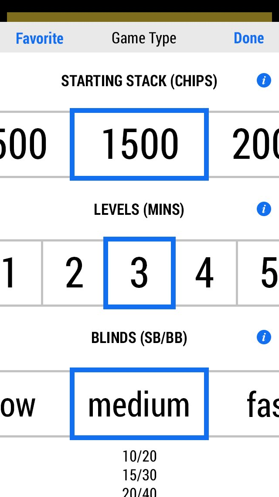

| text | x,y,w,h | font | px | colour | align |
|---|---|---|---|---|---|
| 10/20 / 15/30 / 20/40 / 25/50 / 30/60 / 40/80 / 50/100 | 274,1029,94,288 | RobotoCondensed-Regular | 36.0 |  | center |
| fast | 567,892,109,62 | RobotoCondensed-Regular | 78.0 |  | center |
| slow | -49,892,130,61 | RobotoCondensed-Regular | 78.0 |  | center |
| medium | 205,892,228,61 | RobotoCondensed-Regular | 78.0 |  | center |
| blinds (sb/bb) | 211,755,218,37 | RobotoCondensed-Bold | 36.0 | #000000 | center |
| 2 | 151,587,39,70 | RobotoCondensed-Regular | 97.0 |  | center |
| 1 | 7,588,21,69 | RobotoCondensed-Regular | 97.0 |  | center |
| 4 | 448,588,42,69 | RobotoCondensed-Regular | 97.0 |  | center |
| 5 | 600,588,37,70 | RobotoCondensed-Regular | 97.0 |  | center |
| 3 | 300,587,38,71 | RobotoCondensed-Regular | 97.0 |  | center |
| levels (mins) | 217,462,205,37 | RobotoCondensed-Bold | 36.0 | #000000 | center |
| 2000 | 534,293,176,71 | RobotoCondensed-Regular | 97.0 |  | center |
| 1500 | -65,293,171,71 | RobotoCondensed-Regular | 97.0 |  | center |
| 1500 | 237,293,171,71 | RobotoCondensed-Regular | 97.0 |  | center |
| Starting Stack (chips) | 141,168,357,37 | RobotoCondensed-Bold | 36.0 | #000000 | center |
| Game Type | 257,73,147,34 | RobotoCondensed-Regular | 36.0 | #000000 | center |
| Done | 538,73,67,27 | RobotoCondensed-Bold | 36.0 | #116FF0 | center |
| Favorite | 38,72,107,29 | RobotoCondensed-Bold | 36.0 | #116FF0 | center |

8 filled shapes

| layer | x,y,w,h | fill | opacity |
|---|---|---|---|
| Rectangle 11 copy | -1,49,642,1088 | #FFFFFF |  |
| blinds / num copy 3 / _2 / центральный блок copy | 159,839,322,168 | #FFFFFF |  |
| blinds / info 2 copy 3 | 588,752,36,36 | #116FF0 |  |
| levels / num copy 2 / _3 / центральный блок copy | 236,540,168,169 | #FFFFFF |  |
| levels / info 2 copy 3 | 588,459,36,36 | #116FF0 |  |
| statrting stack / num copy 2 / _2 / центральный блок copy | 159,246,322,168 | #FFFFFF |  |
| statrting stack / info 2 copy 3 | 588,165,36,36 | #116FF0 |  |
| head_2 / Rectangle 12 | -1,49,642,72 | #E9E9E9 |  |

### table.psd — `U90alU_table`

Canvas 5000×3338 · board / multi-frame canvas · modified 2015-02-07 · 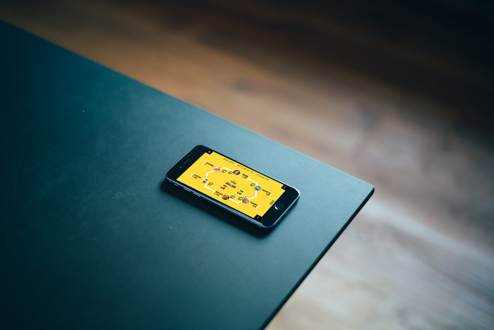

### рассадка за столом к нарезке Specs.psd — `UJzZDA_рассадка_за_столом_к_нарезке_Specs`

Canvas 1136×640 · iPhone 5/5s landscape @2x (568x320pt) · modified 2014-07-16 · 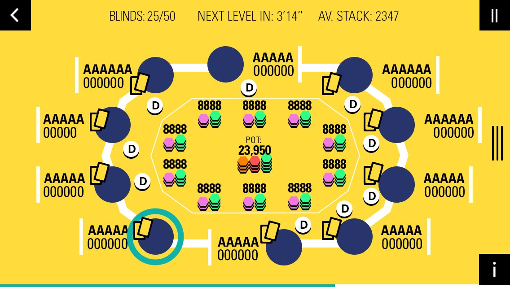

| text | x,y,w,h | font | px | colour | align |
|---|---|---|---|---|---|
| Blinds: 25/50 | 245,23,145,27 | Univers-CondensedLight | 30.0 | #000000 | left |
| Next level in: 3’14’’ | 442,24,232,23 | Univers-CondensedLight | 30.0 | #000000 | left |
| Av. stack: 2347 | 709,23,179,24 | Univers-CondensedLight | 30.0 | #000000 | left |
| aaaaaa | 185,143,110,22 | Univers-CondensedBold | 30.0 | #000000 | left |
| 000000 | 186,172,89,25 | Univers-Condensed | 34.0 | #000000 | left |
| aaaaa | 96,254,92,22 | Univers-CondensedBold | 30.0 | #000000 | left |
| 00000 | 97,283,73,25 | Univers-Condensed | 34.0 | #000000 | left |
| aaaaa | 98,386,92,22 | Univers-CondensedBold | 30.0 | #000000 | left |
| 000000 | 97,415,89,25 | Univers-Condensed | 34.0 | #000000 | left |
| aaaaa | 196,502,92,22 | Univers-CondensedBold | 30.0 | #000000 | left |
| 000000 | 195,531,89,25 | Univers-Condensed | 34.0 | #000000 | left |
| aaaaa | 485,528,92,22 | Univers-CondensedBold | 30.0 | #000000 | left |
| 000000 | 485,556,89,25 | Univers-Condensed | 34.0 | #000000 | left |
| aaaaa | 848,502,92,22 | Univers-CondensedBold | 30.0 | #000000 | right |
| 000000 | 851,531,89,25 | Univers-Condensed | 34.0 | #000000 | right |
| aaaaa | 943,386,92,22 | Univers-CondensedBold | 30.0 | #000000 | right |
| 000000 | 946,415,89,25 | Univers-Condensed | 34.0 | #000000 | right |
| aaaaaa | 945,254,110,22 | Univers-CondensedBold | 30.0 | #000000 | right |
| 000000 | 966,283,89,25 | Univers-Condensed | 34.0 | #000000 | right |
| AAAAAA | 851,143,110,22 | Univers-CondensedBold | 30.0 | #000000 | right |
| 000000 | 872,172,89,25 | Univers-Condensed | 34.0 | #000000 | right |
| AAAAA | 562,117,92,22 | Univers-CondensedBold | 30.0 | #000000 | right |
| 000000 | 565,145,89,25 | Univers-Condensed | 34.0 | #000000 | right |
| Pot:  / 23,950 | 531,304,73,44 | Univers-Condensed | 20.0 | #000000 | center |

25 filled shapes

| layer | x,y,w,h | fill | opacity |
|---|---|---|---|
| DESIGN CANVAS (1136x640px) / 10 играков / PNG:im_table_10 / Polygon 2 | 225,140,687,414 | #28356C |  |
| DESIGN CANVAS (1136x640px) / 10 играков / PNG:im_table_10 / Polygon 2 copy | 334,216,470,262 | #28356C |  |
| DESIGN CANVAS (1136x640px) / 10 играков / load / Shape 3 | -1,633,1138,8 | #FFFFFF |  |
| DESIGN CANVAS (1136x640px) / 10 играков / load / Shape 3 copy | -1,633,749,8 | #0EB2AB |  |
| DESIGN CANVAS (1136x640px) / 10 играков / кнопки / Rectangle 2 copy 4 | -1,-2,72,71 | #000000 |  |
| DESIGN CANVAS (1136x640px) / 10 играков / кнопки / Rectangle 2 copy 5 | 1067,-1,70,71 | #000000 |  |
| DESIGN CANVAS (1136x640px) / 10 играков / кнопки / Rectangle 2 copy 6 | 1066,565,71,71 | #000000 |  |
| DESIGN CANVAS (1136x640px) / 10 играков / кнопки / icons copy 2 / PNG:ic_info /  | 1097,583,9,36 | #FFFFFF |  |
| DESIGN CANVAS (1136x640px) / 10 играков / кнопки / icons copy 2 / PNG:ic_sitout  | 1094,19,15,32 | #000000 |  |
| DESIGN CANVAS (1136x640px) / 10 играков / кнопки / icons copy 2 / PNG:ic_back /  | 21,16,21,34 | #FFFFFF |  |
| DESIGN CANVAS (1136x640px) / 10 играков / PNG:ic_scroll / Shape 2 | 1096,281,5,78 | #FFFFFF |  |
| DESIGN CANVAS (1136x640px) / 10 играков / PNG:ic_scroll / Shape 2 copy | 1106,281,5,78 | #FFFFFF |  |
| DESIGN CANVAS (1136x640px) / 10 играков / PNG:ic_scroll / Shape 2 copy 2 | 1115,281,6,78 | #FFFFFF |  |
| DESIGN CANVAS (1136x640px) / 10 играков / play copy / _9 / Rectangle 1 copy 8 | 166,126,11,83 | #FFFFFF |  |
| DESIGN CANVAS (1136x640px) / 10 играков / play copy / _8 / Rectangle 1 | 80,237,11,84 | #FFFFFF |  |
| DESIGN CANVAS (1136x640px) / 10 играков / play copy / _7 / Rectangle 1 copy 4 | 80,370,11,84 | #FFFFFF |  |
| DESIGN CANVAS (1136x640px) / 10 играков / play copy / _6 / Rectangle 1 copy 4 | 176,486,11,83 | #FFFFFF |  |
| DESIGN CANVAS (1136x640px) / 10 играков / play copy / _5 / Rectangle 1 copy 2 | 470,510,188,84 | #FFDB3C |  |
| DESIGN CANVAS (1136x640px) / 10 играков / play copy / _5 / Rectangle 1 copy 6 | 462,510,11,84 | #FFFFFF |  |
| DESIGN CANVAS (1136x640px) / 10 играков / play copy / _4 / PNG:im_player_line /  | 950,486,11,83 | #FFFFFF |  |
| DESIGN CANVAS (1136x640px) / 10 играков / play copy / _3 / Rectangle 1 copy 4 | 1044,370,11,84 | #FFFFFF |  |
| DESIGN CANVAS (1136x640px) / 10 играков / play copy / _2 / Rectangle 1 | 1064,237,11,84 | #FFFFFF |  |
| DESIGN CANVAS (1136x640px) / 10 играков / play copy / _1 / Rectangle 1 | 970,124,11,87 | #FFFFFF |  |
| DESIGN CANVAS (1136x640px) / 10 играков / play copy / _0 / Rectangle 1 copy 2 | 511,101,155,85 | #FFDB3C |  |
| DESIGN CANVAS (1136x640px) / 10 играков / play copy / _0 / Rectangle 1 copy 7 | 663,101,11,85 | #FFFFFF |  |

### 8playrs.psd — `V9yNUU_8playrs`

Canvas 1136×640 · iPhone 5/5s landscape @2x (568x320pt) · modified 2014-07-16 · 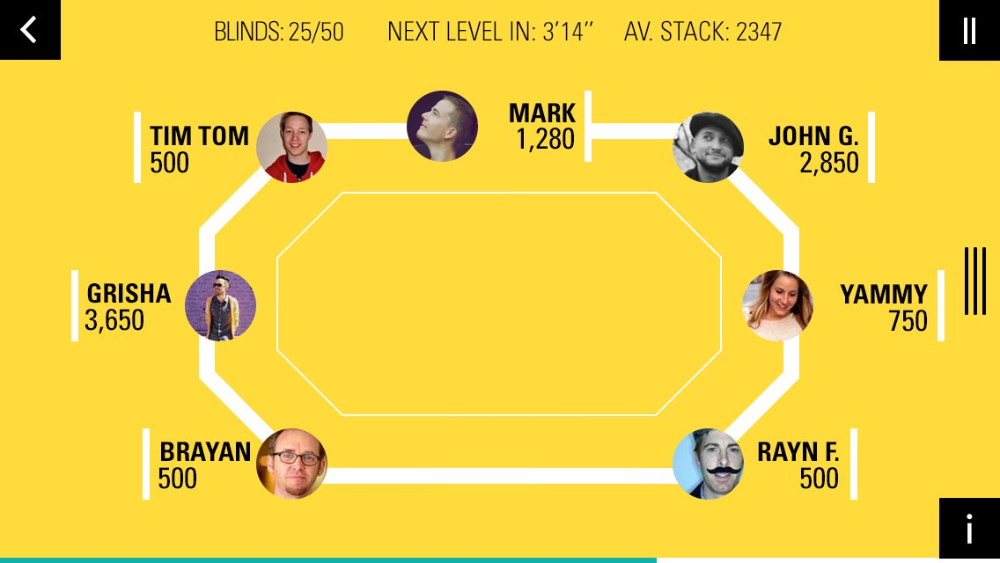

| text | x,y,w,h | font | px | colour | align |
|---|---|---|---|---|---|
| Blinds: 25/50 | 245,23,145,27 | Univers-CondensedLight | 30.0 | #000000 | left |
| Next level in: 3’14’’ | 442,24,232,23 | Univers-CondensedLight | 30.0 | #000000 | left |
| Av. stack: 2347 | 709,23,179,24 | Univers-CondensedLight | 30.0 | #000000 | left |
| tim tom | 170,143,112,23 | Univers-CondensedBold | 30.0 | #000000 | left |
| 500 | 171,172,43,25 | Univers-Condensed | 34.0 | #000000 | left |
| grisha | 99,322,96,23 | Univers-CondensedBold | 30.0 | #000000 | left |
| 3,650 | 96,351,67,29 | Univers-Condensed | 34.0 | #000000 | left |
| brayan | 183,502,101,22 | Univers-CondensedBold | 30.0 | #000000 | left |
| 500 | 180,531,43,25 | Univers-Condensed | 34.0 | #000000 | left |
| Rayn F. | 861,502,92,22 | Univers-CondensedBold | 30.0 | #000000 | left |
| 500 | 909,531,43,25 | Univers-Condensed | 34.0 | #000000 | left |
| Yammy | 954,323,100,22 | Univers-CondensedBold | 30.0 | #000000 | left |
| 750 | 1010,352,43,25 | Univers-Condensed | 34.0 | #000000 | left |
| John g. | 873,143,102,23 | Univers-CondensedBold | 30.0 | #000000 | left |
| 2,850 | 909,172,66,29 | Univers-Condensed | 34.0 | #000000 | left |
| Mark | 579,117,75,22 | Univers-CondensedBold | 30.0 | #000000 | center |
| 1,280 | 588,145,64,29 | Univers-Condensed | 34.0 | #000000 | center |

21 filled shapes

| layer | x,y,w,h | fill | opacity |
|---|---|---|---|
| 8 играков / Polygon 5 | 225,139,685,413 | #000000 |  |
| 8 играков / Polygon 5 copy | 313,217,509,258 | #000000 |  |
| 8 играков / load / Shape 3 | -1,633,1138,8 | #FFFFFF |  |
| 8 играков / load / Shape 3 copy | -1,633,749,8 | #0EB2AB |  |
| 8 играков / кнопки / Rectangle 2 copy 4 | -1,-2,72,71 | #000000 |  |
| 8 играков / кнопки / Rectangle 2 copy 5 | 1066,-1,71,72 | #000000 |  |
| 8 играков / кнопки / Rectangle 2 copy 6 | 1066,565,71,71 | #000000 |  |
| 8 играков / кнопки / icons copy 2 / Ellipse 3 | 1097,583,9,36 | #FFFFFF |  |
| 8 играков / кнопки / icons copy 2 / Rectangle 3 copy | 1094,19,15,32 | #000000 |  |
| 8 играков / кнопки / icons copy 2 / Back icon | 21,16,21,34 | #FFFFFF |  |
| 8 играков / ui scroul / Shape 2 | 1096,281,5,78 | #FFFFFF |  |
| 8 играков / ui scroul / Shape 2 copy | 1106,281,5,78 | #FFFFFF |  |
| 8 играков / ui scroul / Shape 2 copy 2 | 1115,281,6,78 | #FFFFFF |  |
| 8 играков / play copy / _7 / Rectangle 1 copy 8 | 151,126,11,83 | #FFFFFF |  |
| 8 играков / play copy / _6 / Rectangle 1 copy 4 | 80,306,11,83 | #FFFFFF |  |
| 8 играков / play copy / _5 / Rectangle 1 copy 4 | 161,486,11,83 | #FFFFFF |  |
| 8 играков / play copy / _3 / Rectangle 1 copy 4 | 964,486,12,83 | #FFFFFF |  |
| 8 играков / play copy / _2 / Rectangle 1 | 1064,306,11,83 | #FFFFFF |  |
| 8 играков / play copy / _1 / Rectangle 1 | 985,126,11,83 | #FFFFFF |  |
| 8 играков / play copy / _0 / Rectangle 1 copy 2 | 511,101,155,85 | #FFDB3C |  |
| 8 играков / play copy / _0 / Rectangle 1 copy 7 | 663,101,11,85 | #FFFFFF |  |

### step_1a.psd — `VNFY0E_step_1a`

Canvas 640×1136 · iPhone 5/5s portrait @2x (320x568pt) · modified 2015-06-11 · 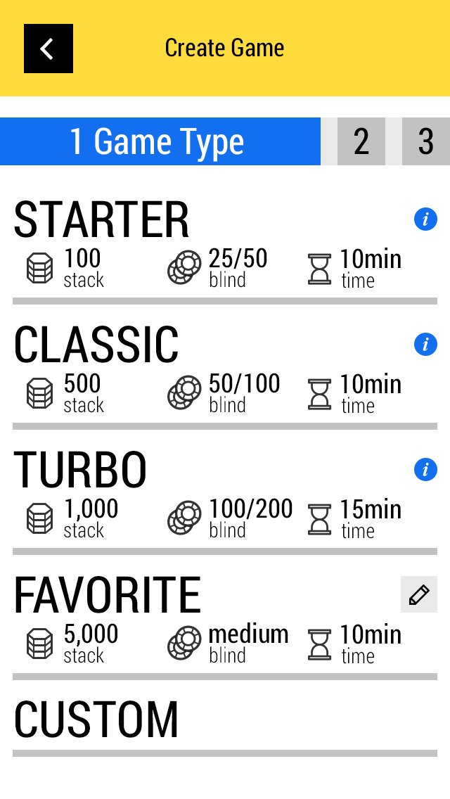

| text | x,y,w,h | font | px | colour | align |
|---|---|---|---|---|---|
| 10min | 485,352,85,30 | RobotoCondensed-Regular | 38.0 | #000000 | left |
| time | 486,386,46,24 | RobotoCondensed-Light | 30.0 | #000000 | left |
| 25/50 | 297,352,83,31 | RobotoCondensed-Regular | 38.0 | #000000 | left |
| blind | 299,385,50,24 | RobotoCondensed-Light | 30.0 | #000000 | left |
| 100 | 93,352,49,29 | RobotoCondensed-Regular | 38.0 | #000000 | left |
| stack | 91,385,57,24 | RobotoCondensed-Light | 30.0 | #000000 | left |
| Starter / | 20,285,249,53 | RobotoCondensed-Regular | 72.07 |  | left |
| 10min | 485,530,85,30 | RobotoCondensed-Regular | 38.0 | #000000 | left |
| time | 486,564,46,24 | RobotoCondensed-Light | 30.0 | #000000 | left |
| 50/100 | 298,530,100,31 | RobotoCondensed-Regular | 38.0 | #000000 | left |
| blind | 299,563,50,24 | RobotoCondensed-Light | 30.0 | #000000 | left |
| 500 | 92,530,50,29 | RobotoCondensed-Regular | 38.0 | #000000 | left |
| stack | 91,563,57,24 | RobotoCondensed-Light | 30.0 | #000000 | left |
| classic / | 22,463,231,53 | RobotoCondensed-Regular | 72.07 |  | left |
| 15min | 485,708,85,30 | RobotoCondensed-Regular | 38.0 | #000000 | left |
| time | 486,742,46,24 | RobotoCondensed-Light | 30.0 | #000000 | left |
| 100/200 | 299,708,117,31 | RobotoCondensed-Regular | 38.0 | #000000 | left |
| blind | 299,741,50,24 | RobotoCondensed-Light | 30.0 | #000000 | left |
| 1,000 | 93,708,74,34 | RobotoCondensed-Regular | 38.0 | #000000 | left |
| stack | 91,741,57,24 | RobotoCondensed-Light | 30.0 | #000000 | left |
| turbo / | 19,641,188,53 | RobotoCondensed-Regular | 72.07 |  | left |
| 10min | 485,886,85,30 | RobotoCondensed-Regular | 38.0 | #000000 | left |
| time | 486,920,46,24 | RobotoCondensed-Light | 30.0 | #000000 | left |
| medium | 298,885,112,30 | RobotoCondensed-Regular | 38.0 | #000000 | left |
| blind | 299,919,50,24 | RobotoCondensed-Light | 30.0 | #000000 | left |
| 5,000 | 92,886,75,34 | RobotoCondensed-Regular | 38.0 | #000000 | left |
| stack | 91,919,57,24 | RobotoCondensed-Light | 30.0 | #000000 | left |
| favorite / | 22,819,263,53 | RobotoCondensed-Regular | 72.07 |  | left |
| Custom | 22,996,230,53 | RobotoCondensed-Regular | 72.07 |  | left |
| 3 | 596,181,20,39 | RobotoCondensed-Regular | 52.0 | #000000 | left |
| 2 | 504,181,21,38 | RobotoCondensed-Regular | 52.0 | #000000 | left |
| 1 Game Type | 101,181,245,49 | RobotoCondensed-Regular | 52.0 | #FFFFFF | left |
| Create Game | 236,54,168,27 | RobotoCondensed-Regular | 36.0 | #000000 | center |

52 filled shapes

| layer | x,y,w,h | fill | opacity |
|---|---|---|---|
| content / _1 / Rectangle 3 copy 3 | 17,284,606,150 | #FFFFFF |  |
| content / _1 / Rectangle 13 | 17,422,606,12 | #C2C2C2 |  |
| content / _1 / info_gh / _3 | 417,336,202,88 | #FFFFFF |  |
| content / _1 / info_gh / min / 63 | 437,359,36,47 | #000000 |  |
| content / _1 / info_gh / _2 | 217,336,202,88 | #FFFFFF |  |
| content / _1 / info_gh / blind / help | 237,355,50,51 | #000000 |  |
| content / _1 / info_gh / blind / help copy 2 | 247,354,41,40 | #000000 |  |
| content / _1 / info_gh / _1 | 17,336,202,88 | #FFFFFF |  |
| content / _1 / info_gh / stack / Shape 1 | 36,358,40,47 | #000000 |  |
| content / _1 / info 2 | 588,293,36,36 | #116FF0 |  |
| content / _2 / Rectangle 3 copy 3 | 17,462,606,150 | #FFFFFF |  |
| content / _2 / Rectangle 13 | 17,600,606,12 | #C2C2C2 |  |
| content / _2 / info_gh / _3 | 417,514,202,88 | #FFFFFF |  |
| content / _2 / info_gh / min / 63 | 437,537,36,47 | #000000 |  |
| content / _2 / info_gh / _2 | 217,514,202,88 | #FFFFFF |  |
| content / _2 / info_gh / blind / help | 237,533,50,51 | #000000 |  |
| content / _2 / info_gh / blind / help copy 2 | 247,532,41,40 | #000000 |  |
| content / _2 / info_gh / _1 | 17,514,202,88 | #FFFFFF |  |
| content / _2 / info_gh / stack / Shape 1 | 36,536,40,47 | #000000 |  |
| content / _2 / info 2 copy | 588,471,36,36 | #116FF0 |  |
| content / _3 / Rectangle 3 copy 3 | 17,640,606,150 | #FFFFFF |  |
| content / _3 / Rectangle 13 | 17,778,606,12 | #C2C2C2 |  |
| content / _3 / info_gh / _3 | 417,692,202,88 | #FFFFFF |  |
| content / _3 / info_gh / min / 63 | 437,715,36,47 | #000000 |  |
| content / _3 / info_gh / _2 | 217,692,202,88 | #FFFFFF |  |
| content / _3 / info_gh / blind / help | 237,711,50,51 | #000000 |  |
| content / _3 / info_gh / blind / help copy 2 | 247,710,41,40 | #000000 |  |
| content / _3 / info_gh / _1 | 17,692,202,88 | #FFFFFF |  |
| content / _3 / info_gh / stack / Shape 1 | 36,714,40,47 | #000000 |  |
| content / _3 / info 2 copy 2 | 588,649,36,36 | #116FF0 |  |
| content / _4 / Rectangle 3 copy 3 | 17,818,606,150 | #FFFFFF |  |
| content / _4 / Rectangle 13 | 17,956,606,12 | #C2C2C2 |  |
| content / _4 / info_gh / _3 | 417,870,202,88 | #FFFFFF |  |
| content / _4 / info_gh / min / 63 | 437,893,36,47 | #000000 |  |
| content / _4 / info_gh / _2 | 217,870,202,88 | #FFFFFF |  |
| content / _4 / info_gh / blind / help | 237,889,50,51 | #000000 |  |
| content / _4 / info_gh / blind / help copy 2 | 247,888,41,40 | #000000 |  |
| content / _4 / info_gh / _1 | 17,870,202,88 | #FFFFFF |  |
| content / _4 / info_gh / stack / Shape 1 | 36,892,40,47 | #000000 |  |
| content / _4 / Rectangle 2 copy | 569,818,54,54 | #E9E9E9 |  |
| content / _4 / Pencil copy | 581,829,32,33 | #000000 |  |
| content / _5 / Rectangle 3 copy 4 | 17,996,606,81 | #FFFFFF |  |
| content / _5 / Rectangle 13 copy | 17,1065,606,12 | #C2C2C2 |  |
| state_1 copy / _1 / Rectangle 10 | -1,166,642,71 | #E9E9E9 |  |
| state_1 copy / _1 / Rectangle 12 | 571,166,70,71 | #C2C2C2 |  |
| state_1 copy / _1 / Rectangle 12 copy | 479,166,70,71 | #C2C2C2 |  |
| state_1 copy / _1 / Rectangle 12 copy 2 | -1,166,458,71 | #116FF0 |  |
| state_1 copy / head / Rectangle 7 copy | -1,-1,642,140 | #FFDB3C |  |
| state_1 copy / head / close copy / Rectangle 2 copy | 33,33,73,73 | #000000 |  |
| state_1 copy / head / close copy / Back icon | 54,53,31,31 | #FFFFFF |  |
| state_1 copy / head / back copy / Rectangle 2 copy | 33,33,73,73 | #000000 |  |
| state_1 copy / head / back copy / Back icon | 55,52,21,34 | #FFFFFF |  |

### multy.psd — `VZLT0E_multy`

Canvas 2538×1598 · board / multi-frame canvas · modified 2015-02-07 · 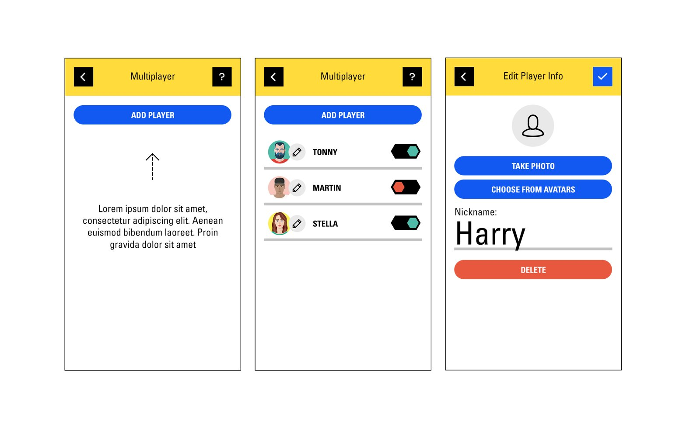

### suit cards.psd — `Vh6UDg_suit_cards`

Canvas 1940×1220 · board / multi-frame canvas · modified 2014-08-31 · 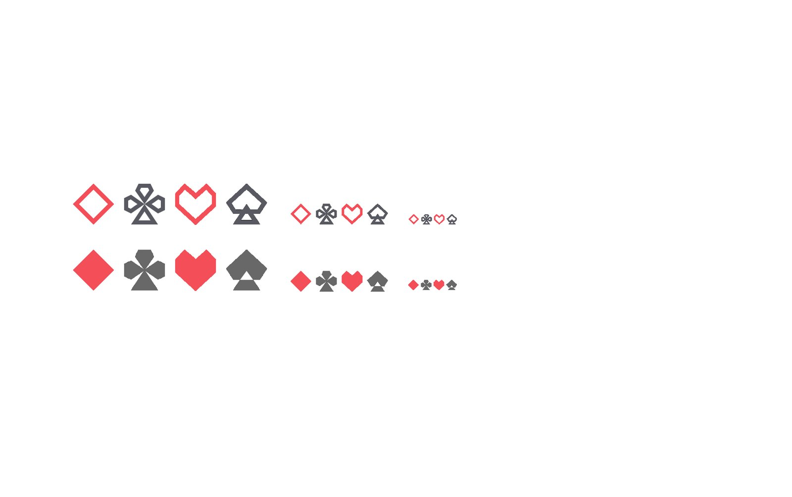

17 filled shapes

| layer | x,y,w,h | fill | opacity |
|---|---|---|---|
| Rectangle 5 | 303,450,102,103 | #FFFFFF |  |
| бубна / Rectangle 4 | 178,450,102,102 | #F44E59 |  |
| крестя / Polygon 1 | 319,499,70,53 | #686869 |  |
| крестя / Polygon 1 copy | 330,450,49,53 | #686869 |  |
| крестя / Polygon 1 copy 3 | 352,477,53,49 | #686869 |  |
| крестя / Polygon 1 copy 4 | 303,477,53,49 | #686869 |  |
| чирва / Polygon 3 copy | 467,477,24,13 | #F44E59 |  |
| пика / Polygon 1 copy 2 | 569,499,70,53 | #686869 |  |
| пика / Polygon 1 copy 5 | 553,449,102,78 | #686869 |  |
| бубна copy / Rectangle 4 | 178,612,102,102 | #F44E59 |  |
| крестя copy / Polygon 1 | 319,661,70,53 | #686869 |  |
| крестя copy / Polygon 1 copy 3 | 352,639,53,49 | #686869 |  |
| крестя copy / Polygon 1 copy 4 | 303,639,53,49 | #686869 |  |
| чирва copy / Polygon 2 copy 2 | 427,612,104,104 | #F44E59 |  |
| пика copy / Polygon 1 copy 2 | 569,661,70,53 | #686869 |  |
| пика copy / Polygon 1 copy 5 | 553,611,102,77 | #686869 |  |
| пика copy / Polygon 2 | 587,664,35,25 | #FFFFFF |  |

### screens.psd — `VhHYUE_screens`

Canvas 1940×1220 · board / multi-frame canvas · modified 2014-08-31 · 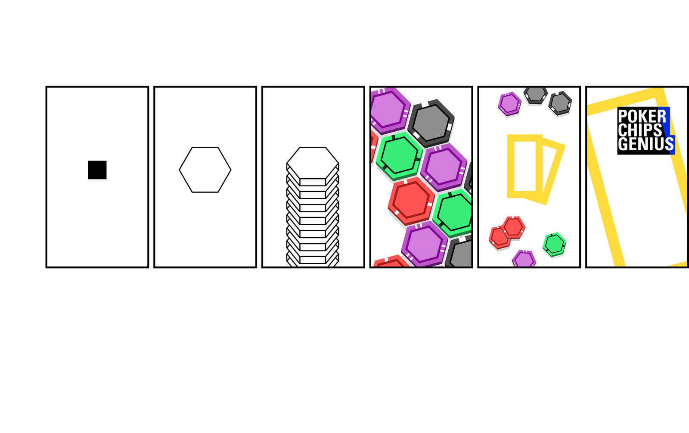

8 filled shapes

| layer | x,y,w,h | fill | opacity |
|---|---|---|---|
| РАСКАДРОВКА / Rectangle 3 | 127,241,294,516 | #FFFFFF |  |
| РАСКАДРОВКА / Rectangle 4 | 246,452,55,54 | #000000 |  |
| РАСКАДРОВКА / Rectangle 3 copy | 431,241,294,516 | #FFFFFF |  |
| РАСКАДРОВКА / Polygon 1 | 502,413,152,132 | #000000 |  |
| РАСКАДРОВКА / Rectangle 3 copy 2 | 735,241,294,516 | #FFFFFF |  |
| РАСКАДРОВКА / Rectangle 3 copy 3 | 1039,241,294,516 | #FFFFFF |  |
| РАСКАДРОВКА / Rectangle 3 copy 4 | 1343,241,294,516 | #FFFFFF |  |
| РАСКАДРОВКА / Rectangle 3 copy 5 | 1647,241,294,516 | #FFFFFF |  |

### step_2a.psd — `XBqUU0_step_2a`

Canvas 640×1136 · iPhone 5/5s portrait @2x (320x568pt) · modified 2015-06-11 · 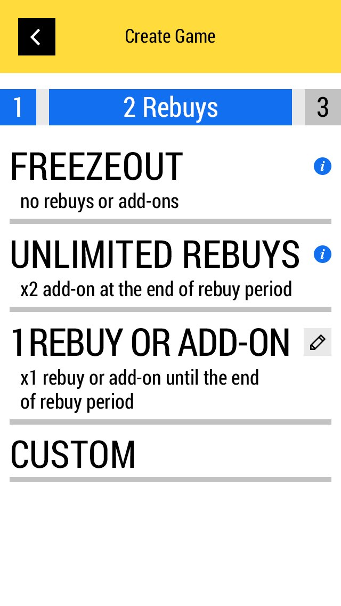

| text | x,y,w,h | font | px | colour | align |
|---|---|---|---|---|---|
| no rebuys or add-ons | 40,361,295,37 | RobotoCondensed-Regular | 38.0 | #000000 | left |
| freezeout / | 22,285,321,53 | RobotoCondensed-Regular | 72.07 |  | left |
| x2 add-on at the end of rebuy period | 38,525,509,38 | RobotoCondensed-Regular | 38.0 | #000000 | left |
| unlimited rebuys / | 22,450,539,53 | RobotoCondensed-Regular | 72.07 |  | left |
| x1 rebuy or add-on until the end  / of rebuy period | 38,692,447,82 | RobotoCondensed-Regular | 38.0 | #000000 | left |
| 1 Rebuy or Add-on | 24,615,518,53 | RobotoCondensed-Regular | 72.07 |  | left |
| Custom | 22,825,230,53 | RobotoCondensed-Regular | 71.7 |  | left |
| 3 | 596,181,20,39 | RobotoCondensed-Regular | 52.0 | #000000 | left |
| 1 | 26,182,12,37 | RobotoCondensed-Regular | 52.0 | #FFFFFF | left |
| 2 Rebuys | 233,179,175,51 | RobotoCondensed-Regular | 52.0 | #FFFFFF | center |
| Create Game | 236,54,168,27 | RobotoCondensed-Regular | 36.0 | #000000 | center |

19 filled shapes

| layer | x,y,w,h | fill | opacity |
|---|---|---|---|
| rebuys / _1 / Rectangle 3 copy 3 | 17,284,606,127 | #FFFFFF |  |
| rebuys / _1 / Rectangle 13 | 17,408,606,13 | #C2C2C2 |  |
| rebuys / _1 / info 2 | 588,293,36,36 | #116FF0 |  |
| rebuys / _2 / Rectangle 3 copy 3 | 17,449,606,127 | #FFFFFF |  |
| rebuys / _2 / Rectangle 13 | 17,574,606,12 | #C2C2C2 |  |
| rebuys / _2 / info 2 | 588,458,36,36 | #116FF0 |  |
| rebuys / _3 / Rectangle 3 copy 3 | 17,614,606,127 | #FFFFFF |  |
| rebuys / _3 / Rectangle 13 | 17,785,606,12 | #C2C2C2 |  |
| rebuys / _3 / Rectangle 2 copy | 569,614,54,54 | #E9E9E9 |  |
| rebuys / _3 / Pencil copy | 581,625,32,33 | #000000 |  |
| rebuys / _4 / Rectangle 3 copy 4 | 17,824,606,81 | #FFFFFF |  |
| rebuys / _4 / Rectangle 13 copy | 17,893,606,12 | #C2C2C2 |  |
| _2 / Rectangle 10 | -1,166,642,71 | #E9E9E9 |  |
| _2 / Rectangle 12 | 571,166,70,71 | #C2C2C2 |  |
| _2 / Rectangle 12 copy | -1,166,70,70 | #116FF0 |  |
| _2 / Rectangle 12 copy 2 | 91,166,458,70 | #116FF0 |  |
| head / Rectangle 7 copy | -1,-1,642,140 | #FFDB3C |  |
| head / back copy / Rectangle 2 copy | 33,33,73,73 | #000000 |  |
| head / back copy / Back icon | 55,52,21,34 | #FFFFFF |  |

### Which hand wins.psd — `XYyb3M_Which_hand_wins`

Canvas 1940×1220 · board / multi-frame canvas · modified 2015-02-07 · 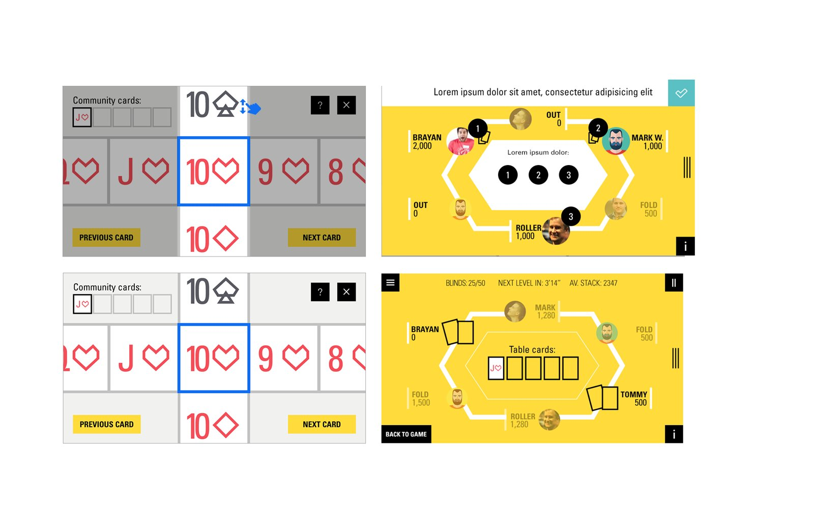

5 filled shapes

| layer | x,y,w,h | fill | opacity |
|---|---|---|---|
| номинал / Rectangle 8 | 908,204,725,123 | #000000 | 30 |
| номинал / Rectangle 9 | 908,491,725,123 | #000000 | 30 |
| номинал / move | 1452,468,43,46 | #116FF0 |  |
| масти / Rectangle 8 copy | 149,204,723,410 | #000000 | 30 |
| масти / вертикально | 570,234,54,41 | #116FF0 |  |

### 4 playrs.psd — `XhQWm8_4_playrs`

Canvas 1136×640 · iPhone 5/5s landscape @2x (568x320pt) · modified 2014-07-16 · 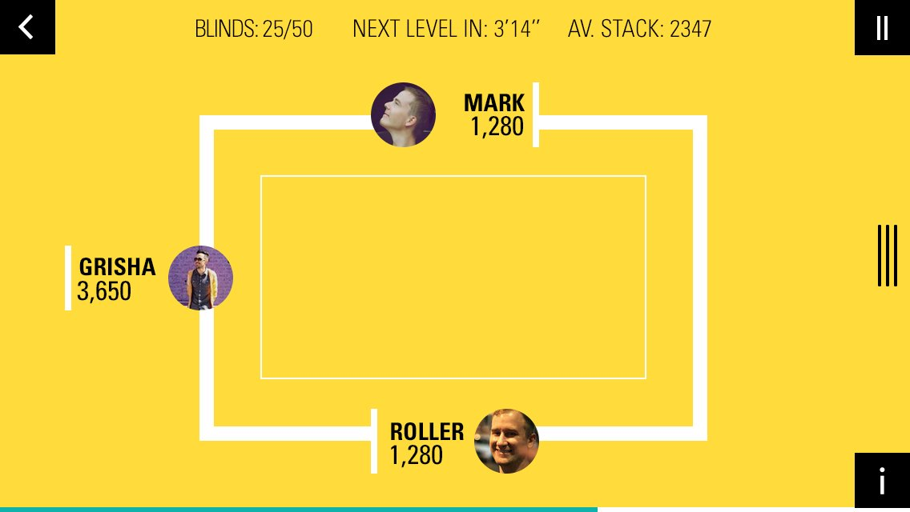

| text | x,y,w,h | font | px | colour | align |
|---|---|---|---|---|---|
| Blinds: 25/50 | 245,23,145,27 | Univers-CondensedLight | 30.0 | #000000 | left |
| Next level in: 3’14’’ | 442,24,232,23 | Univers-CondensedLight | 30.0 | #000000 | left |
| Av. stack: 2347 | 709,23,179,24 | Univers-CondensedLight | 30.0 | #000000 | left |
| grisha | 99,322,96,23 | Univers-CondensedBold | 30.0 | #000000 | left |
| 3,650 | 96,351,67,29 | Univers-Condensed | 34.0 | #000000 | left |
| Roller | 488,528,91,23 | Univers-CondensedBold | 30.0 | #000000 | center |
| 1,280 | 488,556,64,29 | Univers-Condensed | 34.0 | #000000 | center |
| Mark | 580,117,75,22 | Univers-CondensedBold | 30.0 | #000000 | center |
| 1,280 | 589,145,64,29 | Univers-Condensed | 34.0 | #000000 | center |

18 filled shapes

| layer | x,y,w,h | fill | opacity |
|---|---|---|---|
| 4 играков / Rectangle 2 | 248,143,637,410 | #000000 |  |
| 4 играков / Rectangle 2 copy | 324,218,485,258 | #000000 |  |
| 4 играков / ui scroul / Shape 2 | 1096,281,5,78 | #FFFFFF |  |
| 4 играков / ui scroul / Shape 2 copy | 1106,281,5,78 | #FFFFFF |  |
| 4 играков / ui scroul / Shape 2 copy 2 | 1115,281,6,78 | #FFFFFF |  |
| 4 играков / load / Shape 3 | -1,633,1138,8 | #FFFFFF |  |
| 4 играков / load / Shape 3 copy | -1,633,749,8 | #0EB2AB |  |
| 4 играков / кнопки / Rectangle 2 copy 4 | -1,-2,72,71 | #000000 |  |
| 4 играков / кнопки / Rectangle 2 copy 5 | 1066,-1,71,72 | #000000 |  |
| 4 играков / кнопки / Rectangle 2 copy 6 | 1066,565,71,71 | #000000 |  |
| 4 играков / кнопки / icons copy 2 / Ellipse 3 | 1097,583,9,36 | #FFFFFF |  |
| 4 играков / кнопки / icons copy 2 / Rectangle 3 copy | 1094,19,15,32 | #000000 |  |
| 4 играков / кнопки / icons copy 2 / Back icon | 21,16,21,34 | #FFFFFF |  |
| 4 играков / play copy / _3 / Rectangle 1 copy 4 | 80,306,11,83 | #FFFFFF |  |
| 4 играков / play copy / _3 / Rectangle 1 copy 2 | 470,510,188,84 | #FFDB3C |  |
| 4 играков / play copy / _3 / Rectangle 1 copy 6 | 462,510,11,84 | #FFFFFF |  |
| 4 играков / play copy / _0 / Rectangle 1 copy 2 | 512,101,155,85 | #FFDB3C |  |
| 4 играков / play copy / _0 / Rectangle 1 copy 7 | 664,101,11,85 | #FFFFFF |  |

### table.psd — `jE2OGM_table`

Canvas 1940×1220 · board / multi-frame canvas · modified 2014-08-31 · 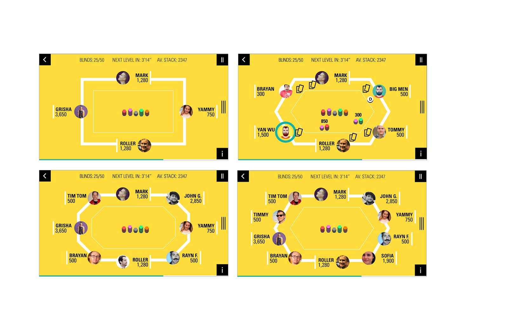

### animation.psd — `jRySjQ_animation`

Canvas 1136×2001 · board / multi-frame canvas · modified 2015-07-08 · 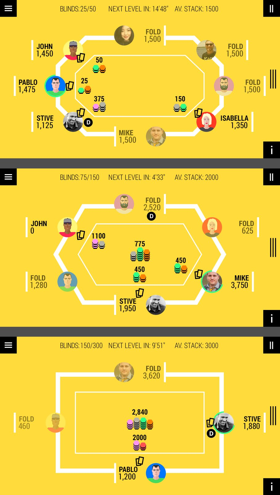

| text | x,y,w,h | font | px | colour | align |
|---|---|---|---|---|---|
| / 2,840 | 536,1654,63,28 | RobotoCondensed-Bold | 30.1 | #000000 | center |
| Fold | 78,1682,59,23 | RobotoCondensed-Bold | 30.0 | #000000 | left |
| 460 | 76,1709,45,26 | RobotoCondensed-Regular | 34.0 | #000000 | left |
| PABLO | 484,1886,74,23 | RobotoCondensed-Bold | 30.0 | #000000 | left |
| 1,200 | 482,1913,68,31 | RobotoCondensed-Regular | 34.0 | #000000 | left |
| stive | 990,1682,67,23 | RobotoCondensed-Bold | 30.0 | #000000 | right |
| 1,880 | 987,1709,67,31 | RobotoCondensed-Regular | 34.0 | #000000 | right |
| Fold | 593,1478,59,23 | RobotoCondensed-Bold | 30.0 | #000000 | right |
| 3,620 | 581,1505,68,31 | RobotoCondensed-Regular | 34.0 | #000000 | right |
| / 2000 | 538,1757,56,23 | RobotoCondensed-Bold | 30.2 | #000000 | center |
| d | 850,1743,16,18 | Univers-Bold | 24.0 | #FFFFFF | left |
| Blinds: 150/300 | 245,1385,170,24 | RobotoCondensed-Light | 30.0 | #000000 | left |
| Next level in: 9'51'' | 441,1384,228,24 | RobotoCondensed-Light | 30.0 | #000000 | left |
| Av. stack: 3000 | 709,1385,176,23 | RobotoCondensed-Light | 30.0 | #000000 | left |
| / 775 | 546,974,42,23 | RobotoCondensed-Bold | 30.1 | #000000 | center |
| john | 125,892,65,23 | RobotoCondensed-Bold | 30.0 | #000000 | left |
| 0 | 124,919,14,26 | RobotoCondensed-Regular | 34.0 | #000000 | left |
| fold | 125,1112,59,23 | RobotoCondensed-Bold | 30.0 | #000000 | left |
| 1,280 | 123,1139,68,31 | RobotoCondensed-Regular | 34.0 | #000000 | left |
| stive | 485,1206,68,23 | RobotoCondensed-Bold | 30.0 | #000000 | left |
| 1,950 | 484,1233,67,31 | RobotoCondensed-Regular | 34.0 | #000000 | left |
| mike | 953,1112,56,22 | RobotoCondensed-Bold | 30.0 | #000000 | right |
| 3,750 | 938,1139,68,31 | RobotoCondensed-Regular | 34.0 | #000000 | right |
| fold | 971,892,59,23 | RobotoCondensed-Bold | 30.0 | #000000 | right |
| 625 | 982,919,45,26 | RobotoCondensed-Regular | 34.0 | #000000 | right |
| fold | 592,798,59,23 | RobotoCondensed-Bold | 30.0 | #000000 | right |
| 2,520 | 583,825,68,31 | RobotoCondensed-Regular | 34.0 | #000000 | right |
| d | 608,865,14,17 | Roboto-Bold | 24.0 | #FFFFFF | left |
| / 1100 | 373,942,54,23 | RobotoCondensed-Bold | 30.2 | #000000 | center |
| / 450 | 545,1077,42,23 | RobotoCondensed-Bold | 30.2 | #000000 | center |
| / 450 | 712,1041,42,23 | RobotoCondensed-Bold | 30.2 | #000000 | center |
| Blinds: 75/150 | 245,705,157,24 | RobotoCondensed-Light | 30.0 | #000000 | left |
| Next level in: 4'33'' | 441,704,228,24 | RobotoCondensed-Light | 30.0 | #000000 | left |
| Av. stack: 2000 | 709,705,176,23 | RobotoCondensed-Light | 30.0 | #000000 | left |
| john | 148,176,65,23 | RobotoCondensed-Bold | 30.0 | #000000 | left |
| 1,450 | 148,203,67,31 | RobotoCondensed-Regular | 34.0 | #000000 | left |
| PABLO | 77,321,74,23 | RobotoCondensed-Bold | 30.0 | #000000 | left |
| 1,475 | 75,348,68,31 | RobotoCondensed-Regular | 34.0 | #000000 | left |
| stive | 149,466,68,23 | RobotoCondensed-Bold | 30.0 | #000000 | left |
| 1,125 | 148,493,67,31 | RobotoCondensed-Regular | 34.0 | #000000 | left |
| mike | 483,525,57,22 | RobotoCondensed-Bold | 30.0 | #000000 | left |
| 1,500 | 484,552,68,31 | RobotoCondensed-Regular | 34.0 | #000000 | left |
| Isabella | 896,466,112,23 | RobotoCondensed-Bold | 30.0 | #000000 | right |
| 1,350 | 937,493,67,31 | RobotoCondensed-Regular | 34.0 | #000000 | right |
| fold | 997,321,59,23 | RobotoCondensed-Bold | 30.0 | #000000 | right |
| 1,500 | 989,348,67,31 | RobotoCondensed-Regular | 34.0 | #000000 | right |
| fold | 926,176,59,23 | RobotoCondensed-Bold | 30.0 | #000000 | right |
| 1,500 | 919,203,67,31 | RobotoCondensed-Regular | 34.0 | #000000 | right |
| fold | 592,117,59,23 | RobotoCondensed-Bold | 30.0 | #000000 | right |
| 1,500 | 585,144,67,31 | RobotoCondensed-Regular | 34.0 | #000000 | right |
| / 150 | 711,388,40,23 | RobotoCondensed-Bold | 30.2 | #000000 | center |
| / 375 | 381,388,42,23 | RobotoCondensed-Bold | 30.2 | #000000 | center |
| / 25 | 329,315,27,23 | RobotoCondensed-Bold | 30.2 | #000000 | center |
| / 50 | 389,231,27,23 | RobotoCondensed-Bold | 30.2 | #000000 | center |
| d | 352,486,14,17 | Roboto-Bold | 24.0 | #FFFFFF | left |
| Blinds: 25/50 | 245,24,143,24 | RobotoCondensed-Light | 30.0 | #000000 | left |
| Next level in: 14'48'' | 441,23,241,24 | RobotoCondensed-Light | 30.0 | #000000 | left |
| Av. stack: 1500 | 709,24,176,23 | RobotoCondensed-Light | 30.0 | #000000 | left |

208 filled shapes

| layer | x,y,w,h | fill | opacity |
|---|---|---|---|
| _4 / Rectangle 1 copy | -1,1360,1138,642 | #FFDB3C |  |
| _4 /  pot / pot_5 / _1 / Shape 3 | 594,1721,29,17 | #000000 |  |
| _4 /  pot / pot_5 / _1 / Shape 5 | 594,1710,29,23 | #F98202 |  |
| _4 /  pot / pot_5 / _1 / Shape 3 copy | 594,1712,29,17 | #000000 |  |
| _4 /  pot / pot_5 / _1 / Shape 5 copy | 594,1703,29,22 | #F98202 |  |
| _4 /  pot / pot_5 / _1 / Shape 3 copy 11 | 594,1705,29,17 | #000000 |  |
| _4 /  pot / pot_5 / _1 / Shape 5 copy 11 | 594,1694,29,23 | #F98202 |  |
| _4 /  pot / pot_5 / _2 / Shape 3 | 568,1721,27,17 | #000000 |  |
| _4 /  pot / pot_5 / _2 / Shape 5 | 568,1710,27,23 | #2EFF86 |  |
| _4 /  pot / pot_5 / _2 / Shape 3 copy 2 | 568,1712,27,17 | #000000 |  |
| _4 /  pot / pot_5 / _2 / Shape 5 copy 2 | 568,1703,27,22 | #2EFF86 |  |
| _4 /  pot / pot_5 / _2 / Shape 3 copy 3 | 568,1705,27,17 | #000000 |  |
| _4 /  pot / pot_5 / _2 / Shape 5 copy 3 | 568,1694,27,23 | #2EFF86 |  |
| _4 /  pot / pot_5 / _2 / Shape 3 copy 5 | 568,1696,27,17 | #000000 |  |
| _4 /  pot / pot_5 / _2 / Shape 5 copy 5 | 568,1687,27,23 | #2EFF86 |  |
| _4 /  pot / pot_5 / _3 / Shape 3 | 540,1721,29,17 | #000000 |  |
| _4 /  pot / pot_5 / _3 / Shape 5 | 540,1710,29,23 | #B6B4A5 |  |
| _4 /  pot / pot_5 / _3 / Shape 3 copy 4 | 540,1712,29,17 | #000000 |  |
| _4 /  pot / pot_5 / _3 / Shape 5 copy 4 | 540,1703,29,22 | #B6B4A5 |  |
| _4 /  pot / pot_5 / _3 / Shape 3 copy 7 | 540,1705,29,17 | #000000 |  |
| _4 /  pot / pot_5 / _3 / Shape 5 copy 7 | 540,1694,29,23 | #B6B4A5 |  |
| _4 /  pot / pot_5 / _3 / Shape 3 copy 12 | 540,1696,29,17 | #000000 |  |
| _4 /  pot / pot_5 / _3 / Shape 5 copy 12 | 540,1687,29,23 | #B6B4A5 |  |
| _4 /  pot / pot_5 / _4 / Shape 3 | 514,1721,27,17 | #000000 |  |
| _4 /  pot / pot_5 / _4 / Shape 5 | 514,1710,27,23 | #FF95F1 |  |
| _4 /  pot / pot_5 / _4 / Shape 3 copy 8 | 514,1712,27,17 | #000000 |  |
| _4 /  pot / pot_5 / _4 / Shape 5 copy 8 | 514,1703,27,22 | #FF95F1 |  |
| _4 /  pot / pot_5 / _4 / Shape 3 copy 9 | 514,1705,27,17 | #000000 |  |
| _4 /  pot / pot_5 / _4 / Shape 5 copy 9 | 514,1694,27,23 | #FF95F1 |  |
| _4 / players / 4 / yellow | 55,1666,172,84 | #FFDB3C |  |
| _4 / players / 4 / Rectangle 1 copy 7 | 54,1666,11,84 | #FFFFFF |  |
| _4 / players / 4 copy / yellow | 55,1666,172,84 | #FFDB3C |  |
| _4 / players / 4 copy / Rectangle 1 copy 7 | 54,1666,11,84 | #FFFFFF |  |
| _4 / players / 3 / yellow | 462,1870,172,84 | #FFDB3C |  |
| _4 / players / 3 / Rectangle 1 copy 7 | 461,1870,11,84 | #FFFFFF |  |
| _4 / players / 2 / yellow | 917,1666,163,84 | #FFDB3C |  |
| _4 / players / 2 / Rectangle 1 copy 7 | 1069,1666,11,84 | #FFFFFF |  |
| _4 / players / 2 / Ellipse 12 copy 2 | 862,1643,116,112 | #2EFF86 |  |
| _4 / players / 1 / yellow | 512,1462,162,84 | #FFDB3C |  |
| _4 / players / 1 / Ellipse 10 | 462,1463,83,83 | #FFDB3C |  |
| _4 / players / 1 / Rectangle 1 copy 7 | 664,1462,10,84 | #FFFFFF |  |
| _4 / players / 1 copy / yellow | 512,1462,162,84 | #FFDB3C |  |
| _4 / players / 1 copy / Ellipse 10 | 462,1463,83,83 | #FFDB3C |  |
| _4 / players / 1 copy / Rectangle 1 copy 7 | 664,1462,10,84 | #FFFFFF |  |
| _4 / bets / bet_5 copy 2 / _1 / Shape 3 | 566,1805,29,17 | #000000 |  |
| _4 / bets / bet_5 copy 2 / _1 / Shape 5 | 566,1796,29,23 | #FF5252 |  |
| _4 / bets / bet_5 copy 2 / _1 / Shape 3 copy | 566,1798,29,17 | #000000 |  |
| _4 / bets / bet_5 copy 2 / _1 / Shape 5 copy | 566,1788,29,23 | #FF5252 |  |
| _4 / bets / bet_5 copy 2 / _2 / Shape 3 | 540,1805,27,17 | #000000 |  |
| _4 / bets / bet_5 copy 2 / _2 / Shape 5 | 540,1796,27,23 | #FF95F1 |  |
| _4 / bets / bet_5 copy 2 / _2 / Shape 3 copy 2 | 540,1798,27,17 | #000000 |  |
| _4 / bets / bet_5 copy 2 / _2 / Shape 5 copy 2 | 540,1788,27,23 | #FF95F1 |  |
| _4 / bets / bet_5 copy 2 / _2 / Shape 3 copy 3 | 540,1789,27,17 | #000000 |  |
| _4 / bets / bet_5 copy 2 / _2 / Shape 5 copy 3 | 540,1780,27,23 | #FF95F1 |  |
| _4 / dealer / 2 / Ellipse 6 copy 5 | 838,1733,39,39 | #000000 |  |
| _4 / button / info / Rectangle 2 copy 6 | 1067,1932,71,71 | #000000 |  |
| _4 / button / info / icon | 1098,1949,9,36 | #FFFFFF |  |
| _4 / button / sit out / Rectangle 2 copy 5 | 1066,1359,71,72 | #000000 |  |
| _4 / button / sit out / Rectangle 3 copy | 1094,1379,16,33 | #FFFFFF |  |
| _4 / button / menu / Rectangle 2 copy 4 | -1,1359,71,72 | #000000 |  |
| _4 / button / menu / Rectangle 3 copy 3 | 17,1382,33,25 | #FFFFFF |  |
| _4 / ui scroul / Shape 2 | 1096,1641,4,78 | #FFFFFF |  |
| _4 / ui scroul / Shape 2 copy | 1106,1641,5,78 | #FFFFFF |  |
| _4 / ui scroul / Shape 2 copy 2 | 1115,1641,6,78 | #FFFFFF |  |
| _6 / Rectangle 1 copy | -1,680,1138,642 | #FFDB3C |  |
| _6 /  pot / pot_7 / _1 / Shape 3 | 581,1040,29,18 | #000000 |  |
| _6 /  pot / pot_7 / _1 / Shape 5 | 581,1030,29,23 | #F98202 |  |
| _6 /  pot / pot_7 / _1 / Shape 3 copy | 581,1032,29,17 | #000000 |  |
| _6 /  pot / pot_7 / _1 / Shape 5 copy | 581,1022,29,23 | #F98202 |  |
| _6 /  pot / pot_7 / _1 / Shape 3 copy 11 | 581,1024,29,17 | #000000 |  |
| _6 /  pot / pot_7 / _1 / Shape 5 copy 11 | 581,1014,29,23 | #F98202 |  |
| _6 /  pot / pot_7 / _1 / Shape 3 copy 15 | 581,1016,29,17 | #000000 |  |
| _6 /  pot / pot_7 / _1 / Shape 5 copy 15 | 581,1006,29,23 | #F98202 |  |
| _6 /  pot / pot_7 / _2 / Shape 3 | 554,1040,29,18 | #000000 |  |
| _6 /  pot / pot_7 / _2 / Shape 5 | 554,1030,29,23 | #2EFF86 |  |
| _6 /  pot / pot_7 / _2 / Shape 3 copy 2 | 554,1032,29,17 | #000000 |  |
| _6 /  pot / pot_7 / _2 / Shape 5 copy 2 | 554,1022,29,23 | #2EFF86 |  |
| _6 /  pot / pot_7 / _2 / Shape 3 copy 3 | 554,1024,29,17 | #000000 |  |
| _6 /  pot / pot_7 / _2 / Shape 5 copy 3 | 554,1014,29,23 | #2EFF86 |  |
| _6 /  pot / pot_7 / _2 / Shape 3 copy 5 | 554,1016,29,17 | #000000 |  |
| _6 /  pot / pot_7 / _2 / Shape 5 copy 5 | 554,1006,29,23 | #2EFF86 |  |
| _6 /  pot / pot_7 / _2 / Shape 3 copy 14 | 554,1008,29,17 | #000000 |  |
| _6 /  pot / pot_7 / _2 / Shape 5 copy 14 | 554,998,29,23 | #2EFF86 |  |
| _6 /  pot / pot_7 / _3 / Shape 3 | 527,1040,29,18 | #000000 |  |
| _6 /  pot / pot_7 / _3 / Shape 5 | 527,1030,29,23 | #B6B4A5 |  |
| _6 /  pot / pot_7 / _3 / Shape 3 copy 4 | 527,1032,29,17 | #000000 |  |
| _6 /  pot / pot_7 / _3 / Shape 5 copy 4 | 527,1022,29,23 | #B6B4A5 |  |
| _6 /  pot / pot_7 / _3 / Shape 3 copy 7 | 527,1024,29,17 | #000000 |  |
| _6 /  pot / pot_7 / _3 / Shape 5 copy 7 | 527,1014,29,23 | #B6B4A5 |  |
| _6 / players / 6 / Rectangle 1 copy 7 | 102,876,11,84 | #FFFFFF |  |
| _6 / players / 5 / Rectangle 1 copy 7 | 102,1096,11,84 | #FFFFFF |  |
| _6 / players / 5 copy / Rectangle 1 copy 7 | 102,1096,11,84 | #FFFFFF |  |
| _6 / players / 4 / yellow | 462,1190,172,84 | #FFDB3C |  |
| _6 / players / 4 / Rectangle 1 copy 7 | 461,1190,11,84 | #FFFFFF |  |
| _6 / players / 3 / Rectangle 1 copy 7 | 1021,1096,11,84 | #FFFFFF |  |
| _6 / players / 3 / Ellipse 12 copy 2 | 814,1074,116,111 | #2EFF86 |  |
| _6 / players / 2 / Rectangle 1 copy 7 | 1042,876,10,84 | #FFFFFF |  |
| _6 / players / 2 copy / Rectangle 1 copy 7 | 1042,876,10,84 | #FFFFFF |  |
| _6 / players / 1 / yellow | 503,783,171,83 | #FFDB3C |  |
| _6 / players / 1 / Ellipse 10 | 462,783,83,83 | #FFDB3C |  |
| _6 / players / 1 / Rectangle 1 copy 7 | 664,783,10,83 | #FFFFFF |  |
| _6 / players / 1 copy 2 / yellow | 503,783,171,83 | #FFDB3C |  |
| _6 / players / 1 copy 2 / Ellipse 10 | 462,783,83,83 | #FFDB3C |  |
| _6 / players / 1 copy 2 / Rectangle 1 copy 7 | 664,783,10,83 | #FFFFFF |  |
| _6 / dealer / 1 / Ellipse 6 copy 5 | 595,854,39,39 | #000000 |  |
| _6 / bets / 6 / _1 / Shape 3 | 399,990,28,18 | #000000 |  |
| _6 / bets / 6 / _1 / Shape 5 | 399,980,28,23 | #B6B4A5 |  |
| _6 / bets / 6 / _1 / Shape 3 copy | 399,982,28,17 | #000000 |  |
| _6 / bets / 6 / _1 / Shape 5 copy | 399,972,28,23 | #B6B4A5 |  |
| _6 / bets / 6 / _2 / Shape 3 | 372,990,28,18 | #000000 |  |
| _6 / bets / 6 / _2 / Shape 5 | 372,980,28,23 | #FF95F1 |  |
| _6 / bets / 6 / _2 / Shape 3 copy 2 | 372,982,28,17 | #000000 |  |
| _6 / bets / 6 / _2 / Shape 5 copy 2 | 372,972,28,23 | #FF95F1 |  |
| _6 / bets / 6 / _2 / Shape 3 copy 3 | 372,974,28,17 | #000000 |  |
| _6 / bets / 6 / _2 / Shape 5 copy 3 | 372,964,28,23 | #FF95F1 |  |
| _6 / bets / 4 / _1 / Shape 3 | 566,1125,28,18 | #000000 |  |
| _6 / bets / 4 / _1 / Shape 5 | 566,1115,28,23 | #F98202 |  |
| _6 / bets / 4 / _1 / Shape 3 copy | 566,1117,28,17 | #000000 |  |
| _6 / bets / 4 / _1 / Shape 5 copy | 566,1107,28,23 | #F98202 |  |
| _6 / bets / 4 / _2 / Shape 3 | 539,1125,28,18 | #000000 |  |
| _6 / bets / 4 / _2 / Shape 5 | 539,1115,28,23 | #2EFF86 |  |
| _6 / bets / 4 / _2 / Shape 3 copy 2 | 539,1117,28,17 | #000000 |  |
| _6 / bets / 4 / _2 / Shape 5 copy 2 | 539,1107,28,23 | #2EFF86 |  |
| _6 / bets / 4 / _2 / Shape 3 copy 3 | 539,1109,28,17 | #000000 |  |
| _6 / bets / 4 / _2 / Shape 5 copy 3 | 539,1099,28,23 | #2EFF86 |  |
| _6 / bets / 3 / _1 / Shape 3 | 733,1089,28,18 | #000000 |  |
| _6 / bets / 3 / _1 / Shape 5 | 733,1079,28,23 | #F98202 |  |
| _6 / bets / 3 / _1 / Shape 3 copy | 733,1081,28,17 | #000000 |  |
| _6 / bets / 3 / _1 / Shape 5 copy | 733,1071,28,23 | #F98202 |  |
| _6 / bets / 3 / _2 / Shape 3 | 706,1089,28,18 | #000000 |  |
| _6 / bets / 3 / _2 / Shape 5 | 706,1079,28,23 | #2EFF86 |  |
| _6 / bets / 3 / _2 / Shape 3 copy 2 | 706,1081,28,17 | #000000 |  |
| _6 / bets / 3 / _2 / Shape 5 copy 2 | 706,1071,28,23 | #2EFF86 |  |
| _6 / bets / 3 / _2 / Shape 3 copy 3 | 706,1073,28,17 | #000000 |  |
| _6 / bets / 3 / _2 / Shape 5 copy 3 | 706,1063,28,23 | #2EFF86 |  |
| _6 / button / info / Rectangle 2 copy 6 | 1067,1251,71,71 | #000000 |  |
| _6 / button / info / icon | 1098,1269,9,37 | #FFFFFF |  |
| _6 / button / sit out / Rectangle 2 copy 5 | 1066,679,71,72 | #000000 |  |
| _6 / button / sit out / Rectangle 3 copy | 1094,700,16,33 | #FFFFFF |  |
| _6 / button / menu / Rectangle 2 copy 4 | -1,680,71,71 | #000000 |  |
| _6 / button / menu / Rectangle 3 copy 3 | 17,703,33,24 | #FFFFFF |  |
| _6 / ui scroul / Shape 2 | 1096,961,4,79 | #FFFFFF |  |
| _6 / ui scroul / Shape 2 copy | 1106,961,5,79 | #FFFFFF |  |
| _6 / ui scroul / Shape 2 copy 2 | 1115,961,6,79 | #FFFFFF |  |
| _8 / Rectangle 1 copy 9 | -1,-1,1138,642 | #FFDB3C |  |
| _8 / players / 8 / Rectangle 1 copy 7 | 125,160,11,85 | #FFFFFF |  |
| _8 / players / 7 / Rectangle 1 copy 7 | 54,306,11,83 | #FFFFFF |  |
| _8 / players / 6 / Rectangle 1 copy 7 | 125,450,11,84 | #FFFFFF |  |
| _8 / players / 5 / yellow | 462,510,172,83 | #FFDB3C |  |
| _8 / players / 5 / Rectangle 1 copy 7 | 461,510,11,83 | #FFFFFF |  |

### loading.psd — `k5nQzg_loading`

Canvas 726×334 · board / multi-frame canvas · modified 2015-07-08 · 

4 filled shapes

| layer | x,y,w,h | fill | opacity |
|---|---|---|---|
| Rectangle 1 copy 9 | -74,-183,1138,643 | #FFDB3C |  |
| _1 / Ellipse 12 copy 2 | 105,14,118,111 | #2EFF86 |  |
| _2 / Ellipse 12 copy 3 | 221,14,118,128 | #FF9500 |  |
| _3 / Ellipse 12 copy 4 | 319,14,145,147 | #FF3824 |  |

### 10playrs.psd — `k8xcVU_10playrs`

Canvas 1136×640 · iPhone 5/5s landscape @2x (568x320pt) · modified 2014-07-16 · 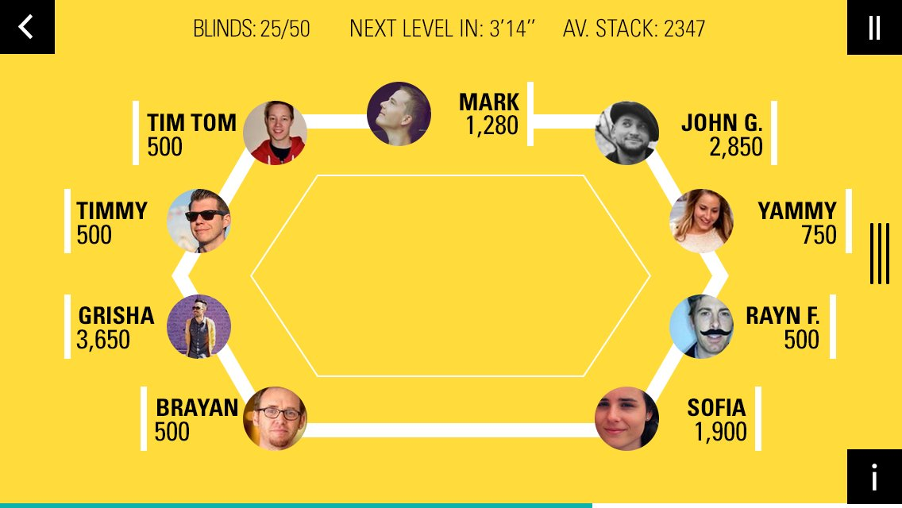

| text | x,y,w,h | font | px | colour | align |
|---|---|---|---|---|---|
| Blinds: 25/50 | 245,23,145,27 | Univers-CondensedLight | 30.0 | #000000 | left |
| Next level in: 3’14’’ | 442,24,232,23 | Univers-CondensedLight | 30.0 | #000000 | left |
| Av. stack: 2347 | 709,23,179,24 | Univers-CondensedLight | 30.0 | #000000 | left |
| tim tom | 185,143,112,23 | Univers-CondensedBold | 30.0 | #000000 | left |
| 500 | 186,172,43,25 | Univers-Condensed | 34.0 | #000000 | left |
| Timmy | 96,254,90,22 | Univers-CondensedBold | 30.0 | #000000 | left |
| 500 | 97,283,43,25 | Univers-Condensed | 34.0 | #000000 | left |
| grisha | 99,386,96,23 | Univers-CondensedBold | 30.0 | #000000 | left |
| 3,650 | 96,415,67,29 | Univers-Condensed | 34.0 | #000000 | left |
| brayan | 198,502,101,22 | Univers-CondensedBold | 30.0 | #000000 | left |
| 500 | 195,531,43,25 | Univers-Condensed | 34.0 | #000000 | left |
| sofia | 866,502,74,23 | Univers-CondensedBold | 30.0 | #000000 | left |
| 1,900 | 876,531,64,29 | Univers-Condensed | 34.0 | #000000 | left |
| Rayn F. | 940,386,92,22 | Univers-CondensedBold | 30.0 | #000000 | left |
| 500 | 988,415,43,25 | Univers-Condensed | 34.0 | #000000 | left |
| Yammy | 954,254,100,22 | Univers-CondensedBold | 30.0 | #000000 | left |
| 750 | 1010,283,43,25 | Univers-Condensed | 34.0 | #000000 | left |
| John g. | 858,143,102,23 | Univers-CondensedBold | 30.0 | #000000 | left |
| 2,850 | 894,172,66,29 | Univers-Condensed | 34.0 | #000000 | left |
| Mark | 579,117,75,22 | Univers-CondensedBold | 30.0 | #000000 | center |
| 1,280 | 588,145,64,29 | Univers-Condensed | 34.0 | #000000 | center |

23 filled shapes

| layer | x,y,w,h | fill | opacity |
|---|---|---|---|
| 10 играков / Polygon 1 | 214,143,706,410 | #FFDB3C |  |
| 10 играков / Polygon 1 copy | 313,219,509,258 | #FFDB3C |  |
| 10 играков / load / Shape 3 | -1,633,1138,8 | #FFFFFF |  |
| 10 играков / load / Shape 3 copy | -1,633,749,8 | #0EB2AB |  |
| 10 играков / кнопки / Rectangle 2 copy 4 | -1,-2,72,71 | #000000 |  |
| 10 играков / кнопки / Rectangle 2 copy 5 | 1066,-1,71,72 | #000000 |  |
| 10 играков / кнопки / Rectangle 2 copy 6 | 1066,565,71,71 | #000000 |  |
| 10 играков / кнопки / icons copy 2 / Ellipse 3 | 1097,583,9,36 | #FFFFFF |  |
| 10 играков / кнопки / icons copy 2 / Rectangle 3 copy | 1094,19,15,32 | #000000 |  |
| 10 играков / кнопки / icons copy 2 / Back icon | 21,16,21,34 | #FFFFFF |  |
| 10 играков / ui scroul / Shape 2 | 1096,281,5,78 | #FFFFFF |  |
| 10 играков / ui scroul / Shape 2 copy | 1106,281,5,78 | #FFFFFF |  |
| 10 играков / ui scroul / Shape 2 copy 2 | 1115,281,6,78 | #FFFFFF |  |
| 10 играков / play copy / _9 / Rectangle 1 copy 8 | 166,126,11,83 | #FFFFFF |  |
| 10 играков / play copy / _8 / Rectangle 1 | 80,237,11,84 | #FFFFFF |  |
| 10 играков / play copy / _7 / Rectangle 1 copy 4 | 80,370,11,84 | #FFFFFF |  |
| 10 играков / play copy / _6 / Rectangle 1 copy 4 | 176,486,11,83 | #FFFFFF |  |
| 10 играков / play copy / _4 / Rectangle 1 copy 4 | 950,486,11,83 | #FFFFFF |  |
| 10 играков / play copy / _3 / Rectangle 1 copy 4 | 1044,370,11,84 | #FFFFFF |  |
| 10 играков / play copy / _2 / Rectangle 1 | 1064,237,11,84 | #FFFFFF |  |
| 10 играков / play copy / _1 / Rectangle 1 | 970,126,11,83 | #FFFFFF |  |
| 10 играков / play copy / _0 / Rectangle 1 copy 2 | 511,101,155,85 | #FFDB3C |  |
| 10 играков / play copy / _0 / Rectangle 1 copy 7 | 663,101,11,85 | #FFFFFF |  |

### all_progect.psd — `kYzdUk_all_progect`

Canvas 15028×11603 · board / multi-frame canvas · modified 2015-02-07 · 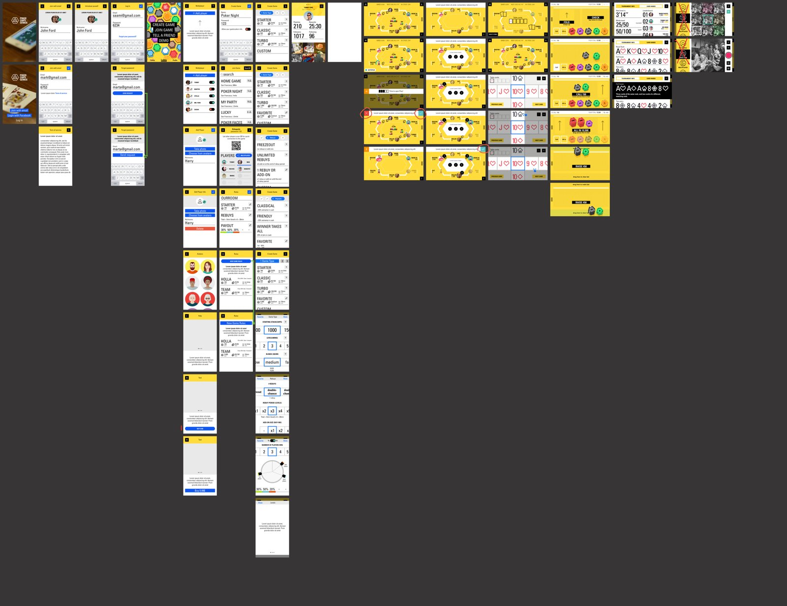

1 filled shapes

| layer | x,y,w,h | fill | opacity |
|---|---|---|---|
| menu / extras / Rectangle 1 | 6258,49,643,1138 | #FFFFFF |  |

### winner_2.psd — `kdhTVE_winner_2`

Canvas 3801×1092 · board / multi-frame canvas · modified 2015-02-07 · 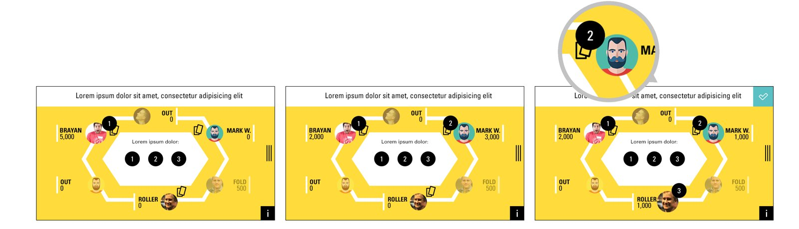

1 filled shapes

| layer | x,y,w,h | fill | opacity |
|---|---|---|---|
| Polygon 1 | 3075,346,54,48 | #C2C2C2 |  |

### winner.psd — `klVTzA_winner`

Canvas 2538×2700 · board / multi-frame canvas · modified 2015-02-07 · 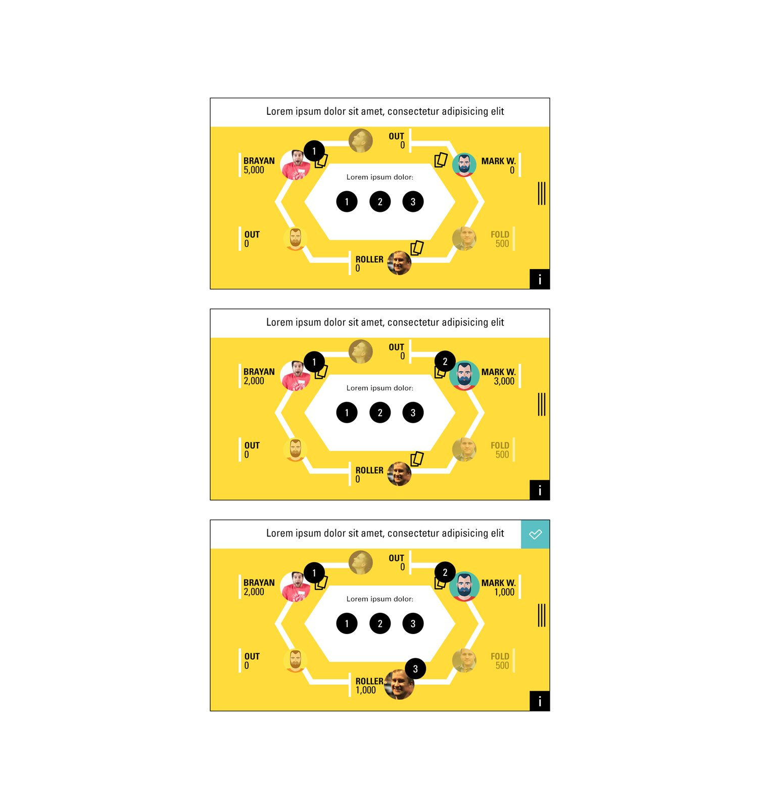

### registration_5s.psd — `kpNNUk_registration_5s`

Canvas 5403×5333 · board / multi-frame canvas · modified 2015-05-28 · 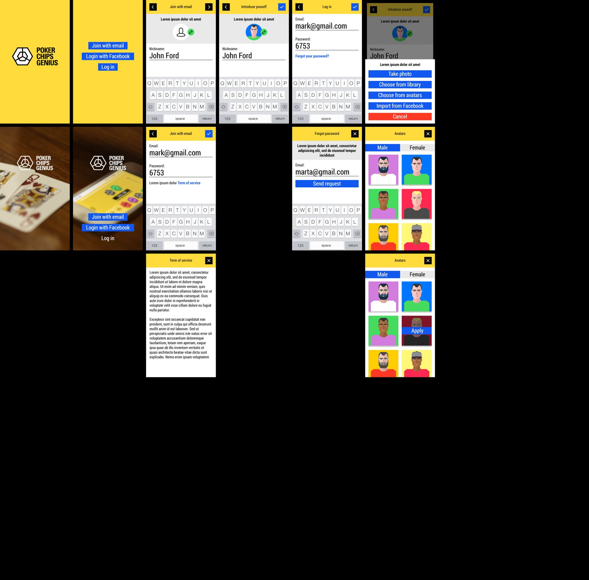

| text | x,y,w,h | font | px | colour | align |
|---|---|---|---|---|---|
| Male | 3465,2501,89,41 | RobotoCondensed-Regular | 52.0 | #FFFFFF | center |
| Female | 3761,2501,137,41 | RobotoCondensed-Regular | 52.0 | #000000 | center |
| Apply | 3774,3018,110,51 | RobotoCondensed-Regular | 52.0 | #FFFFFF | center |
| Avatars | 3619,2380,100,27 | RobotoCondensed-Regular | 36.0 | #000000 | center |
| Male | 3465,1335,89,41 | RobotoCondensed-Regular | 52.0 | #FFFFFF | center |
| Female | 3761,1335,137,41 | RobotoCondensed-Regular | 52.0 | #000000 | center |
| Avatars | 3619,1214,100,27 | RobotoCondensed-Regular | 36.0 | #000000 | center |
| Cancel | 3606,1049,126,41 | RobotoCondensed-Regular | 52.0 | #FFFFFF | center |
| Import from Facebook | 3457,950,428,52 | RobotoCondensed-Regular | 52.0 | #FFFFFF | center |
| Choose from avatars | 3471,852,397,42 | RobotoCondensed-Regular | 52.0 | #FFFFFF | center |
| Choose from library | 3480,754,380,52 | RobotoCondensed-Regular | 52.0 | #FFFFFF | center |
| Take photo | 3564,657,210,51 | RobotoCondensed-Regular | 52.0 | #FFFFFF | center |
| Lorem ipsum dolor sit amet | 3488,578,367,36 | RobotoCondensed-Bold | 36.0 | #000000 | center |
| Send request | 2874,1666,252,51 | RobotoCondensed-Regular | 52.0 | #FFFFFF | center |
| marta@gmail.com | 2714,1550,488,71 | RobotoCondensed-Regular | 72.0 |  | left |
| Email: | 2712,1502,79,29 | RobotoCondensed-Regular | 36.03 |  | left |
| Lorem ipsum dolor sit amet, consectetur adipisicing elit, sed do eiusm | 2729,1325,543,116 | RobotoCondensed-Bold | 36.0 |  | center |
| Forgot password | 2889,1212,221,36 | RobotoCondensed-Regular | 36.0 | #000000 | center |
| Forgot your password? | 2712,500,305,36 | RobotoCondensed-Bold | 36.0 | #1159F0 | left |
| 6753 | 2713,395,128,53 | RobotoCondensed-Regular | 72.0 |  | left |
| Password: | 2712,344,136,29 | RobotoCondensed-Regular | 36.03 |  | left |
| mark@gmail.com | 2714,208,466,71 | RobotoCondensed-Regular | 72.0 |  | left |
| Email: | 2712,160,79,29 | RobotoCondensed-Regular | 36.03 |  | left |
| Log in | 2960,46,79,36 | RobotoCondensed-Regular | 36.0 | #000000 | center |
| John Ford | 2042,481,266,56 | RobotoCondensed-Regular | 72.0 |  | left |
| Nickname: | 2042,433,139,29 | RobotoCondensed-Regular | 36.03 |  | left |
| Lorem ipsum dolor sit amet | 2147,161,367,36 | RobotoCondensed-Bold | 36.0 | #000000 | center |
| Introduse youself | 2215,46,231,36 | RobotoCondensed-Regular | 36.0 | #000000 | center |
| Lorem ipsum dolor sit amet, consectetur adipisicing elit, sed do eiusm | 1372,2489,571,814 | RobotoCondensed-Regular | 36.0 |  | left |
| Term of service | 1557,2378,205,29 | RobotoCondensed-Regular | 36.0 | #000000 | center |
| Lorem ipsum dolor Term of service | 1372,1666,466,36 | RobotoCondensed-Regular | 36.0 | #000000 | left |
| 6753 | 1373,1561,128,53 | RobotoCondensed-Regular | 72.0 |  | left |
| Password: | 1372,1510,136,29 | RobotoCondensed-Regular | 36.03 |  | left |
| mark@gmail.com | 1374,1374,466,71 | RobotoCondensed-Regular | 72.0 |  | left |
| Email: | 1372,1326,79,29 | RobotoCondensed-Regular | 36.03 |  | left |
| Join with email | 1559,1212,200,29 | RobotoCondensed-Regular | 36.0 | #000000 | center |
| John Ford | 1372,481,266,56 | RobotoCondensed-Regular | 72.0 |  | left |
| Nickname: | 1372,433,139,29 | RobotoCondensed-Regular | 36.03 |  | left |
| Lorem ipsum dolor sit amet | 1477,161,367,36 | RobotoCondensed-Bold | 36.0 | #000000 | center |
| Join with email | 1559,46,200,29 | RobotoCondensed-Regular | 36.0 | #000000 | center |
| Log in | 933,2168,114,51 | RobotoCondensed-Regular | 52.0 | #FFFFFF | center |
| Login with Facebook | 793,2070,397,51 | RobotoCondensed-Regular | 52.0 | #FFFFFF | center |
| Join with email | 844,1972,290,41 | RobotoCondensed-Regular | 52.0 | #FFFFFF | center |
| Log in | 933,593,114,51 | RobotoCondensed-Regular | 52.0 | #FFFFFF | center |
| Login with Facebook | 793,495,397,51 | RobotoCondensed-Regular | 52.0 | #FFFFFF | center |
| Join with email | 844,397,290,41 | RobotoCondensed-Regular | 52.0 | #FFFFFF | center |

99 filled shapes

| layer | x,y,w,h | fill | opacity |
|---|---|---|---|
| _6_3 / tab / Rectangle 13 copy | 3349,2489,322,70 | #1158F0 |  |
| _6_3 / tab / Rectangle 13 copy 3 | 3669,2489,322,70 | #E9E9E9 |  |
| _6_3 / Rectangle 18 | 3684,3217,277,252 | #C2C2C2 |  |
| _6_3 / Rectangle 18 copy | 3379,3217,277,252 | #C2C2C2 |  |
| _6_3 / _2_2 / Rectangle 17 copy | 3684,3177,277,12 | #C2C2C2 |  |
| _6_3 / _2_2 / Rectangle 19 | 3684,2902,277,277 | #000000 |  |
| _6_3 / _2_2 / Apply / Rectangle 13 copy | 3684,3006,277,70 | #1158F0 |  |
| _6_3 / _2_1 / Rectangle 17 copy | 3684,2862,277,12 | #C2C2C2 |  |
| _6_3 / _1_2 / Rectangle 17 | 3379,3177,277,12 | #C2C2C2 |  |
| _6_3 / _1_1 / Rectangle 17 | 3379,2862,277,12 | #C2C2C2 |  |
| _6_3 / head / Rectangle 7 | 3349,2331,642,130 | #FFDB3C |  |
| _6_3 / head / close copy 2 / Rectangle 2 copy | 3891,2361,70,70 | #000000 |  |
| _6_3 / head / close copy 2 / close copy | 3910,2380,32,32 | #FFFFFF |  |
| _6_2 / tab / Rectangle 13 copy | 3349,1322,322,71 | #1158F0 |  |
| _6_2 / tab / Rectangle 13 copy 3 | 3668,1322,323,71 | #E9E9E9 |  |
| _6_2 / Rectangle 18 | 3684,2050,277,253 | #C2C2C2 |  |
| _6_2 / Rectangle 18 copy | 3379,2050,278,253 | #C2C2C2 |  |
| _6_2 / _2_2 / Rectangle 17 copy | 3684,2010,277,14 | #C2C2C2 |  |
| _6_2 / _2_1 / Rectangle 17 copy | 3684,1695,277,13 | #C2C2C2 |  |
| _6_2 / _1_2 / Rectangle 17 | 3379,2010,278,14 | #C2C2C2 |  |
| _6_2 / _1_1 / Rectangle 17 | 3379,1695,278,13 | #C2C2C2 |  |
| _6_2 / head / Rectangle 7 | 3349,1164,642,131 | #FFDB3C |  |
| _6_2 / head / close copy 2 / Rectangle 2 copy | 3890,1195,71,71 | #000000 |  |
| _6_2 / head / close copy 2 / close copy | 3910,1214,32,32 | #FFFFFF |  |
| _6 / Rectangle 15 | 3349,-1,642,1138 | #000000 | 50 |
| _6 / Rectangle 15 copy | 3349,544,642,593 | #FFFFFF |  |
| _6 / normal copy / Rectangle 10 copy | 3349,1006,642,131 | #FFFFFF |  |
| _6 / normal copy / Rectangle 13 copy | 3379,1037,582,71 | #FF3824 |  |
| _6 / normal copy 2 / Rectangle 10 copy | 3349,908,642,132 | #FFFFFF |  |
| _6 / normal copy 2 / Rectangle 13 copy | 3379,938,582,71 | #1158F0 |  |
| _6 / normal copy 3 / Rectangle 10 copy | 3349,811,642,130 | #FFFFFF |  |
| _6 / normal copy 3 / Rectangle 13 copy | 3379,841,582,70 | #1158F0 |  |
| _6 / normal copy 4 / Rectangle 10 copy | 3349,712,642,132 | #FFFFFF |  |
| _6 / normal copy 4 / Rectangle 13 copy | 3379,743,582,71 | #1158F0 |  |
| _6 / normal copy 5 / Rectangle 10 copy | 3349,615,642,131 | #FFFFFF |  |
| _6 / normal copy 5 / Rectangle 13 copy | 3379,644,582,71 | #1158F0 |  |
| _5_2 / normal copy / Rectangle 13 copy | 2709,1653,583,71 | #1158F0 |  |
| _5_2 / input_2 copy / Rectangle 10 | 2679,1468,643,188 | #FFFFFF |  |
| _5_2 / input_2 copy / Rectangle 3 copy 3 | 2709,1499,583,128 | #000000 |  |
| _5_2 / text / Rectangle 9 | 2679,1292,643,179 | #E9E9E9 |  |
| _5_2 / head / Rectangle 7 | 2679,1164,643,131 | #FFDB3C |  |
| _5_2 / head / close / Rectangle 2 copy | 3220,1195,72,71 | #000000 |  |
| _5_2 / head / close / close copy | 3240,1214,32,32 | #FFFFFF |  |
| _5 / input_2 / Rectangle 10 | 2679,310,643,189 | #FFFFFF |  |
| _5 / input_2 / Rectangle 3 copy 3 | 2709,340,583,129 | #000000 |  |
| _5 / input / Rectangle 10 | 2679,126,643,188 | #FFFFFF |  |
| _5 / input / Rectangle 3 copy 3 | 2709,156,583,129 | #000000 |  |
| _5 / head / Rectangle 7 | 2679,-1,643,130 | #FFDB3C |  |
| _5 / head / back / Rectangle 2 copy | 2709,29,70,71 | #000000 |  |
| _5 / head / back / Back icon | 2730,47,21,34 | #FFFFFF |  |
| _5 / head / done / Rectangle 2 copy | 3220,29,72,71 | #1159F0 |  |
| _5 / head / done / done | 3237,49,38,29 | #FFFFFF |  |
| _4 / input / Rectangle 10 | 2008,400,644,188 | #FFFFFF |  |
| _4 / input / Rectangle 3 copy 3 | 2038,430,584,127 | #000000 |  |
| _4 / avatars / Rectangle 14 | 2008,126,644,277 | #E9E9E9 |  |
| _4 / avatars / Ellipse 1 | 2253,217,154,155 | #FFFFFF |  |
| _4 / avatars / edit / Ellipse 2 | 2389,262,65,65 | #44DB5E |  |
| _4 / avatars / edit / Pencil | 2404,278,35,34 | #000000 |  |
| _4 / head / Rectangle 7 | 2008,-1,644,130 | #FFDB3C |  |
| _4 / head / back / Rectangle 2 copy | 2038,29,72,71 | #000000 |  |
| _4 / head / back / Back icon | 2060,47,21,34 | #FFFFFF |  |
| _4 / head / done / Rectangle 2 copy | 2551,29,71,71 | #1159F0 |  |
| _4 / head / done / done | 2567,49,38,29 | #FFFFFF |  |
| _3_3 / head / Rectangle 7 | 1338,2330,643,132 | #FFDB3C |  |
| _3_3 / head / close / Rectangle 2 copy | 1881,2361,70,71 | #000000 |  |
| _3_3 / head / close / close | 1901,2380,31,31 | #FFFFFF |  |
| _3_2 / input_2 / Rectangle 10 | 1338,1477,643,188 | #FFFFFF |  |
| _3_2 / input_2 / Rectangle 3 copy 3 | 1368,1506,583,129 | #000000 |  |
| _3_2 / input / Rectangle 10 | 1338,1292,643,189 | #FFFFFF |  |
| _3_2 / input / Rectangle 3 copy 3 | 1368,1322,583,129 | #000000 |  |
| _3_2 / head / Rectangle 7 | 1338,1164,643,131 | #FFDB3C |  |
| _3_2 / head / back / Rectangle 2 copy | 1368,1195,72,71 | #000000 |  |
| _3_2 / head / back / Back icon | 1390,1213,21,34 | #FFFFFF |  |
| _3_2 / head / done / Rectangle 2 copy | 1881,1195,70,71 | #1159F0 |  |
| _3_2 / head / done / done | 1897,1215,38,29 | #FFFFFF |  |
| _3 / input / Rectangle 10 | 1338,400,643,188 | #FFFFFF |  |
| _3 / input / Rectangle 3 copy 3 | 1368,430,583,127 | #000000 |  |
| _3 / avatars / Rectangle 14 | 1338,126,643,277 | #E9E9E9 |  |
| _3 / avatars / Ellipse 1 | 1582,217,155,155 | #FFFFFF |  |
| _3 / avatars / User Profile | 1619,254,83,85 | #000000 |  |
| _3 / avatars / edit / Ellipse 2 | 1719,262,64,65 | #44DB5E |  |
| _3 / avatars / edit / Pencil | 1734,278,35,34 | #000000 |  |
| _3 / head / Rectangle 7 | 1338,-1,643,130 | #FFDB3C |  |
| _3 / head / back / Rectangle 2 copy | 1368,29,72,71 | #000000 |  |
| _3 / head / back / Back icon | 1390,47,21,34 | #FFFFFF |  |
| _3 / head / next / Rectangle 2 copy | 1881,29,70,71 | #000000 |  |
| _3 / head / next / Back icon | 1909,47,21,34 | #FFFFFF |  |
| _2_2 / Rectangle 1 copy | 669,1164,642,1139 | #FFDB3C |  |
| _2_2 / Login with Facebook_bt copy 2 / Rectangle 13 | 748,2058,483,71 | #1158F0 |  |
| _2_2 / Join with email_bt copy 2 / Rectangle 13 copy | 808,1959,363,71 | #1158F0 |  |
| _2_2 / PCG copy / Poker Chips  Genius copy 2 | 1002,1431,156,134 | #000000 |  |
| _2 / Rectangle 1 copy | 669,-1,642,1138 | #FFDB3C |  |
| _2 / Log in_bt copy 2 / Rectangle 13 copy 2 | 898,580,183,71 | #1158F0 |  |
| _2 / Login with Facebook_bt copy 2 / Rectangle 13 | 748,483,483,70 | #1158F0 |  |
| _2 / Join with email_bt copy 2 / Rectangle 13 copy | 808,385,363,71 | #1158F0 |  |
| _1_2 / Rectangle 1 | -1,1164,643,1139 | #FFDB3C |  |
| _1_2 / PCG / Poker Chips  Genius copy 2 | 332,1431,156,134 | #000000 |  |
| _1 / Rectangle 1 | -1,-1,643,1138 | #FFDB3C |  |
| _1 / PCG / Poker Chips  Genius copy 2 | 336,434,196,168 | #000000 |  |

### spec_5s.psd — `lF1ZXM_spec_5s`

Canvas 3043×1714 · board / multi-frame canvas · modified 2015-05-28 · 

| text | x,y,w,h | font | px | colour | align |
|---|---|---|---|---|---|
| Send request | 194,569,252,51 | RobotoCondensed-Regular | 52.0 | #FFFFFF | center |
| marta@gmail.com | 34,343,488,71 | RobotoCondensed-Regular | 72.0 |  | left |
| Email: | 32,295,79,29 | RobotoCondensed-Regular | 36.03 |  | left |
| Forgot password | 209,46,221,36 | RobotoCondensed-Regular | 36.0 | #000000 | center |

9 filled shapes

| layer | x,y,w,h | fill | opacity |
|---|---|---|---|
| normal copy / Rectangle 10 copy | -1,527,642,130 | #FFFFFF |  |
| normal copy / Rectangle 13 copy | 29,557,582,70 | #1158F0 |  |
| input / Rectangle 10 | -1,262,642,188 | #FFFFFF |  |
| input / Rectangle 3 copy 3 | 28,292,584,127 | #000000 |  |
| head / Rectangle 7 | -1,-1,642,131 | #FFDB3C |  |
| head / back / Rectangle 2 copy | 28,28,71,71 | #000000 |  |
| head / back / Back icon | 50,47,21,34 | #FFFFFF |  |
| head / next / Rectangle 2 copy | 540,28,72,71 | #000000 |  |
| head / next / Back icon | 569,47,21,34 | #FFFFFF |  |

### update game menu.psd — `lhwSlU_update_game_menu`

Canvas 1136×640 · iPhone 5/5s landscape @2x (568x320pt) · modified 2014-08-17 · 

| text | x,y,w,h | font | px | colour | align |
|---|---|---|---|---|---|
| my Profile | 87,166,148,23 | Univers-CondensedBold | 30.0 | #FFFFFF | center |
| poker cam | 88,353,147,23 | Univers-CondensedBold | 30.0 | #FFFFFF | center |
| Multiplayer | 76,541,171,23 | Univers-CondensedBold | 30.0 | #FFFFFF | center |
| Profile | 112,730,99,23 | Univers-CondensedBold | 30.0 | #FFFFFF | center |

26 filled shapes

| layer | x,y,w,h | fill | opacity |
|---|---|---|---|
| Rectangle 1 copy 2 | 33,-1,1070,642 | #FFFFFF |  |
| state_1 / menu / Rectangle 3 copy 2 | 33,-4,257,648 | #FFDB3C |  |
| state_1 / menu / _1 / Ellipse 3 | 102,33,120,120 | #000000 |  |
| state_1 / menu / _1 / user | 128,65,68,74 | #000000 |  |
| state_1 / menu / _2 / Ellipse 3 | 102,220,120,120 | #FFDB3C |  |
| state_1 / menu / _2 / camera copy | 91,252,108,91 | #000000 |  |
| state_1 / menu / _2 / Ellipse 4 | 169,271,8,8 | #000000 |  |
| state_1 / menu / _2 copy / Rectangle 5 | 24,206,275,187 | #000000 |  |
| state_1 / menu / _2 copy / Ellipse 3 | 102,220,120,120 | #000000 |  |
| state_1 / menu / _2 copy / camera copy | 91,252,108,91 | #FFFFFF |  |
| state_1 / menu / _3 / Ellipse 3 | 102,408,120,120 | #FFDB3C |  |
| state_1 / menu / _3 / image | 133,428,102,81 | #000000 |  |
| state_1 / menu / _4 / Ellipse 3 | 102,596,120,121 | #FFDB3C |  |
| state_1 / menu / _4 / fast forward | 104,619,93,93 | #000000 |  |
| state_1 / Rectangle 4 | 321,-1,643,642 | #FFDB3C |  |
| state_1 / _5 / Rectangle 2 copy | 995,535,73,73 | #000000 |  |
| state_1 / _5 / grid | 1015,555,31,31 | #FFFFFF |  |
| state_1 / _4 / Rectangle 2 copy | 995,431,73,73 | #000000 |  |
| state_1 / _4 / camera | 1013,450,36,33 | #FFFFFF |  |
| state_1 / _3 copy / Ellipse 2 | 967,255,130,130 | #000000 |  |
| state_1 / _3 copy / Ellipse 2 copy | 975,263,116,116 | #000000 |  |
| state_1 / _2 / Rectangle 2 copy | 995,136,73,73 | #000000 |  |
| state_1 / _2 / sun | 1015,156,32,33 | #FFFFFF |  |
| state_1 / close / Rectangle 2 copy | 995,33,73,73 | #000000 |  |
| state_1 / close / Shape 1 | 1017,54,27,28 | #FFFFFF |  |
| state_1 / close / Shape 1 copy | 1018,54,25,28 | #FFFFFF |  |

### pokercam_ic.psd — `m16cGc_pokercam_ic`

Canvas 2529×1428 · board / multi-frame canvas · modified 2015-02-07 · 

### pokerCam.psd — `m5PSHc_pokerCam`

Canvas 1940×1220 · board / multi-frame canvas · modified 2014-08-31 · 

2 filled shapes

| layer | x,y,w,h | fill | opacity |
|---|---|---|---|
| _4 | 908,651,724,409 | #D9D9DB |  |
| _3 | 149,651,722,409 | #D9D9DB |  |

### Android_poker.psd — `mdJd1E_Android_poker`

Canvas 1280×800 · Android tablet/phone landscape (mdpi 1280x800) · modified 2014-07-16 · 

| text | x,y,w,h | font | px | colour | align |
|---|---|---|---|---|---|
| Blinds: 25/50 | 319,23,145,27 | Univers-CondensedLight | 30.0 | #000000 | left |
| Next level in: 3’14’’ | 516,24,232,23 | Univers-CondensedLight | 30.0 | #000000 | left |
| Av. stack: 2347 | 783,23,179,24 | Univers-CondensedLight | 30.0 | #000000 | left |
| aaaaaa | 235,143,110,22 | Univers-CondensedBold | 30.0 | #000000 | left |
| 000000 | 236,172,89,25 | Univers-Condensed | 34.0 | #000000 | left |
| aaaaa | 141,278,92,22 | Univers-CondensedBold | 30.0 | #000000 | left |
| 00000 | 142,307,73,25 | Univers-Condensed | 34.0 | #000000 | left |
| aaaaa | 143,410,92,22 | Univers-CondensedBold | 30.0 | #000000 | left |
| 000000 | 142,439,89,25 | Univers-Condensed | 34.0 | #000000 | left |
| aaaaa | 245,556,92,22 | Univers-CondensedBold | 30.0 | #000000 | left |
| 000000 | 244,585,89,25 | Univers-Condensed | 34.0 | #000000 | left |
| aaaaa | 547,575,92,22 | Univers-CondensedBold | 30.0 | #000000 | left |
| 000000 | 547,603,89,25 | Univers-Condensed | 34.0 | #000000 | left |
| aaaaa | 940,555,92,22 | Univers-CondensedBold | 30.0 | #000000 | right |
| 000000 | 943,584,89,25 | Univers-Condensed | 34.0 | #000000 | right |
| aaaaa | 1041,410,92,22 | Univers-CondensedBold | 30.0 | #000000 | right |
| 000000 | 1044,439,89,25 | Univers-Condensed | 34.0 | #000000 | right |
| aaaaaa | 1043,278,110,22 | Univers-CondensedBold | 30.0 | #000000 | right |
| 000000 | 1064,307,89,25 | Univers-Condensed | 34.0 | #000000 | right |
| AAAAAA | 942,142,110,22 | Univers-CondensedBold | 30.0 | #000000 | right |
| 000000 | 963,171,89,25 | Univers-Condensed | 34.0 | #000000 | right |
| AAAAA | 624,115,92,22 | Univers-CondensedBold | 30.0 | #000000 | right |
| 000000 | 627,143,89,25 | Univers-Condensed | 34.0 | #000000 | right |
| Pot:  / 23,950 | 603,321,73,44 | Univers-Condensed | 20.0 | #000000 | center |

25 filled shapes

| layer | x,y,w,h | fill | opacity |
|---|---|---|---|
| 10 играков / PNG:im_table_10 / Polygon 2 | 262,143,755,455 | #28356C |  |
| 10 играков / PNG:im_table_10 / Polygon 2 copy | 368,220,542,301 | #28356C |  |
| 10 играков / load / Shape 3 | -1,697,1282,8 | #FFFFFF |  |
| 10 играков / load / Shape 3 copy | -1,697,749,8 | #0EB2AB |  |
| 10 играков / кнопки / Rectangle 2 copy 4 | -1,-2,72,71 | #000000 |  |
| 10 играков / кнопки / Rectangle 2 copy 5 | 1212,-2,70,71 | #000000 |  |
| 10 играков / кнопки / Rectangle 2 copy 6 | 1210,628,71,71 | #000000 |  |
| 10 играков / кнопки / icons copy 2 / PNG:ic_info / Ellipse 3 | 1241,646,9,36 | #FFFFFF |  |
| 10 играков / кнопки / icons copy 2 / PNG:ic_sitout / Rectangle 3 copy | 1239,18,15,33 | #000000 |  |
| 10 играков / кнопки / icons copy 2 / PNG:ic_back / Back icon | 21,16,21,34 | #FFFFFF |  |
| 10 играков / PNG:ic_scroll / Shape 2 | 1239,314,5,78 | #FFFFFF |  |
| 10 играков / PNG:ic_scroll / Shape 2 copy | 1249,314,5,78 | #FFFFFF |  |
| 10 играков / PNG:ic_scroll / Shape 2 copy 2 | 1258,314,6,78 | #FFFFFF |  |
| 10 играков / play copy / _9 / Rectangle 1 copy 8 | 216,126,11,83 | #FFFFFF |  |
| 10 играков / play copy / _8 / Rectangle 1 | 125,261,11,84 | #FFFFFF |  |
| 10 играков / play copy / _7 / Rectangle 1 copy 4 | 125,394,11,84 | #FFFFFF |  |
| 10 играков / play copy / _6 / Rectangle 1 copy 4 | 225,540,11,83 | #FFFFFF |  |
| 10 играков / play copy / _5 / Rectangle 1 copy 2 | 532,557,188,84 | #FFDB3C |  |
| 10 играков / play copy / _5 / Rectangle 1 copy 6 | 524,557,11,84 | #FFFFFF |  |
| 10 играков / play copy / _4 / PNG:im_player_line / Rectangle 1 copy 4 | 1042,539,11,83 | #FFFFFF |  |
| 10 играков / play copy / _3 / Rectangle 1 copy 4 | 1142,394,11,84 | #FFFFFF |  |
| 10 играков / play copy / _2 / Rectangle 1 | 1162,261,11,84 | #FFFFFF |  |
| 10 играков / play copy / _1 / Rectangle 1 | 1061,122,11,88 | #FFFFFF |  |
| 10 играков / play copy / _0 / Rectangle 1 copy 2 | 573,99,155,85 | #FFDB3C |  |
| 10 играков / play copy / _0 / Rectangle 1 copy 7 | 725,99,11,85 | #FFFFFF |  |

### ui.psd — `mpCYVU_ui`

Canvas 2661×2261 · board / multi-frame canvas · modified 2015-05-28 · 

| text | x,y,w,h | font | px | colour | align |
|---|---|---|---|---|---|
| Lobby | 317,1940,74,30 | Univers-CondensedBold | 32.0 | #000000 | center |
| Profile | 505,1928,123,36 | Univers-CondensedBold | 47.0 | #000000 | center |
| Extras | 99,1940,80,24 | Univers-CondensedBold | 32.0 | #010101 | center |
| Lobby | 300,1803,110,43 | Univers-CondensedBold | 47.0 | #000000 | center |
| Profile | 524,1813,84,25 | Univers-CondensedBold | 32.0 | #000000 | center |
| Extras | 99,1814,80,24 | Univers-CondensedBold | 32.0 | #010101 | center |
| Lobby | 317,1688,74,30 | Univers-CondensedBold | 32.0 | #000000 | center |
| Profile | 524,1687,84,25 | Univers-CondensedBold | 32.0 | #000000 | center |
| Extras | 81,1677,116,35 | Univers-CondensedBold | 47.0 | #010101 | center |
| invalid format | 393,851,194,27 | Univers-Condensed | 36.0 |  | right |
| invalid format_2 | 359,913,227,31 | Univers-Condensed | 36.0 |  | right |
| markgmail.com | 38,758,430,66 | Univers-Condensed | 71.8 | #E7583F | left |
| Email: | 37,721,81,27 | Univers-Condensed | 36.0 |  | left |
| invalid format | 393,635,194,27 | Univers-Condensed | 36.0 |  | right |
| markgmail.com | 38,542,430,66 | Univers-Condensed | 71.8 | #E7583F | left |
| Email: | 37,505,81,27 | Univers-Condensed | 36.0 |  | left |
| mark@gmail.com | 38,387,487,67 | Univers-Condensed | 71.8 | #000000 | left |
| Email: | 37,351,81,27 | Univers-Condensed | 36.0 |  | left |
| enter your email | 38,234,458,66 | Univers-Condensed | 72.0 | #C2C2C2 | left |
| Email: | 37,197,81,27 | Univers-Condensed | 36.0 |  | left |
| enter your email | 38,80,458,66 | Univers-Condensed | 71.8 | #C2C2C2 | left |
| Email: | 37,43,81,27 | Univers-Condensed | 36.0 | #C2C2C2 | left |
| Text | 946,53,59,27 | Univers-Condensed | 36.0 | #000000 | center |
| Scan QR | 1053,209,105,28 | Univers-Condensed | 36.0 | #FFFFFF | center |
| Button | 768,487,132,39 | Univers-Condensed | 52.0 | #FFFFFF | center |
| Button_2 | 742,581,183,45 | Univers-Condensed | 52.0 | #FFFFFF | center |
| - #e9e9e9 | 105,1071,137,27 | Univers-CondensedBold | 36.0 |  | left |
| - #c2c2c2 | 105,1149,137,27 | Univers-CondensedBold | 36.0 |  | left |
| - #e7583f | 105,1227,127,28 | Univers-CondensedBold | 36.0 |  | left |
| - #4fbaa7 | 105,1305,130,28 | Univers-CondensedBold | 36.0 |  | left |
| - #1159f0 | 105,1384,125,28 | Univers-CondensedBold | 36.0 |  | left |
| - #000000 | 105,1463,131,27 | Univers-CondensedBold | 36.0 |  | left |
| - #ffffff | 105,1541,95,27 | Univers-CondensedBold | 36.0 |  | left |
| - #ffdb3c | 105,991,124,28 | Univers-CondensedBold | 36.0 |  | left |
| - #4fbaa7 | 353,1305,130,28 | Univers-CondensedBold | 36.0 |  | left |
| - #e7583f | 353,1227,128,28 | Univers-CondensedBold | 36.0 |  | left |
| 9 | 772,678,17,32 | Univers-Condensed | 44.0 |  | center |
| 10min | 1016,1060,79,27 | Univers-Condensed | 35.9 | #000000 | left |
| time | 1016,1094,38,19 | Univers-CondensedLight | 24.0 | #010101 | left |
| 25/50 | 862,1059,72,30 | Univers-Condensed | 35.9 | #000000 | left |
| blind | 863,1093,41,19 | Univers-CondensedLight | 24.0 | #000000 | left |
| 100 | 724,1059,44,27 | Univers-Condensed | 35.9 | #000000 | left |
| stack | 722,1093,45,19 | Univers-CondensedLight | 24.0 | #010101 | left |
| 3 | 1940,1284,21,38 | Univers-Condensed | 52.0 | #000000 | left |
| 2 | 1848,1284,20,37 | Univers-Condensed | 52.0 | #000000 | left |
| 1 Game Type | 1440,1280,258,49 | Univers-Condensed | 52.0 | #FFFFFF | left |
| 3 | 1940,1375,21,38 | Univers-Condensed | 52.0 | #000000 | left |
| 2 Rebuys | 1573,1373,184,48 | Univers-Condensed | 52.0 | #FFFFFF | left |
| 3 Payouts | 1663,1463,199,48 | Univers-Condensed | 52.0 | #FFFFFF | left |
| Lorem ipsum / | 1465,389,183,34 | Univers-CondensedBold | 36.0 |  | center |
| Univers 67 Bold Condensed 36pt | 1350,286,463,35 | Univers-CondensedBold | 36.0 | #1159F0 | left |
| Univers 57 Condensed 72pt | 1349,183,769,67 | Univers-Condensed | 71.8 | #000000 | left |
| Univers 57 Condensed 52pt | 1348,105,568,49 | Univers-Condensed | 53.0 | #000000 | left |
| Univers 57 Condensed 36pt | 1349,27,385,34 | Univers-Condensed | 36.0 | #000000 | left |

89 filled shapes

| layer | x,y,w,h | fill | opacity |
|---|---|---|---|
| button_br / NAV_3 / Rectangle 4 | 31,1857,644,129 | #FFFFFF |  |
| button_br / NAV_3 / Shape 59 | 500,1966,133,12 | #000000 |  |
| button_br / NAV_2 / Rectangle 4 | 31,1731,644,129 | #FFFFFF |  |
| button_br / NAV_2 / Shape 59 | 285,1840,133,13 | #000000 |  |
| button_br / NAV_1 / Rectangle 4 | 31,1604,644,130 | #FFFFFF |  |
| button_br / NAV_1 / Shape 59 | 72,1713,133,14 | #000000 |  |
| input / wrong copy / Rectangle 3 copy 3 | 31,677,576,156 | #000000 |  |
| input / wrong copy / Rectangle 10 | 31,830,576,66 | #E9E9E9 |  |
| input / wrong copy / Rectangle 10 copy | 31,893,576,64 | #E9E9E9 |  |
| input / wrong / Rectangle 3 copy 3 | 31,461,576,156 | #000000 |  |
| input / wrong / Rectangle 10 | 31,614,576,66 | #E9E9E9 |  |
| input / input_1 / Rectangle 3 copy 3 | 31,306,576,158 | #000000 |  |
| input / _hint / Rectangle 3 copy 3 | 31,153,576,157 | #000000 |  |
| input / _inactive / Rectangle 3 copy 3 | 31,-1,576,157 | #000000 |  |
| navigations bars / Rectangle 7 | 654,-1,644,140 | #FFDB3C |  |
| navigations bars / next / Rectangle 2 copy | 1191,33,73,72 | #000000 |  |
| navigations bars / next / Back icon copy 2 | 1216,52,22,35 | #FFFFFF |  |
| navigations bars / back copy 3 / Rectangle 2 copy | 688,33,74,72 | #000000 |  |
| navigations bars / back copy 3 / Back icon | 711,52,21,34 | #FFFFFF |  |
| navigations bars / buttons_icons_inactive / create copy 2 / Rectangle 2 copy | 654,375,74,74 | #1159F0 |  |
| navigations bars / buttons_icons_inactive / create copy 2 / Back icon copy | 672,397,38,29 | #FFFFFF |  |
| navigations bars / buttons_icons_inactive / back copy 4 / Rectangle 2 copy | 749,375,74,74 | #000000 |  |
| navigations bars / buttons_icons_inactive / back copy 4 / Back icon | 772,395,21,34 | #FFFFFF |  |
| navigations bars / buttons_icons_inactive / next copy / Rectangle 2 copy | 844,375,73,74 | #000000 |  |
| navigations bars / buttons_icons_inactive / next copy / Back icon copy 2 | 870,395,22,35 | #FFFFFF |  |
| navigations bars / buttons_icons_pressed / create copy 2 / Rectangle 2 copy | 654,282,74,72 | #1159F0 |  |
| navigations bars / buttons_icons_pressed / create copy 2 / Back icon copy | 672,303,38,29 | #FFFFFF |  |
| navigations bars / buttons_icons_pressed / back copy 4 / Rectangle 2 copy | 749,282,74,72 | #000000 |  |
| navigations bars / buttons_icons_pressed / back copy 4 / Back icon | 772,301,21,34 | #FFFFFF |  |
| navigations bars / buttons_icons_pressed / next copy / Rectangle 2 copy | 844,282,73,72 | #000000 |  |
| navigations bars / buttons_icons_pressed / next copy / Back icon copy 2 | 870,301,22,35 | #FFFFFF |  |
| navigations bars / buttons_icons_normal / create copy 2 / Rectangle 2 copy | 654,187,74,72 | #1159F0 |  |
| navigations bars / buttons_icons_normal / create copy 2 / Back icon copy | 672,208,38,29 | #FFFFFF |  |
| navigations bars / buttons_icons_normal / back copy 4 / Rectangle 2 copy | 749,187,74,72 | #000000 |  |
| navigations bars / buttons_icons_normal / back copy 4 / Back icon | 772,206,21,34 | #FFFFFF |  |
| navigations bars / buttons_icons_normal / next copy / Rectangle 2 copy | 844,187,73,72 | #000000 |  |
| navigations bars / buttons_icons_normal / next copy / Back icon copy 2 | 870,206,22,35 | #FFFFFF |  |
| navigations bars / buttons_icons_normal / close / Rectangle 2 copy | 939,187,73,72 | #000000 |  |
| navigations bars / buttons_icons_normal / close / Back icon | 961,207,31,31 | #FFFFFF |  |
| navigations bars / buttons_icons_normal / scan / Rectangle 2 copy | 1035,187,140,72 | #000000 |  |
| navigations bars / buttons_icons_normal / help / Rectangle 2 copy | 1197,187,73,72 | #000000 |  |
| navigations bars / buttons_icons_normal / help / question copy | 1222,208,22,29 | #FFFFFF |  |
| buttons / normal / Rectangle 13 copy | 654,470,359,71 | #1158F0 |  |
| buttons / pressed / Rectangle 13 copy | 654,564,359,71 | #E7583F |  |
| pages copy / Ellipse 2 | 654,1369,15,16 | #000000 |  |
| pages copy / Ellipse 2 copy | 685,1369,15,16 | #FFFFFF |  |
| switch / off copy 3 / Polygon 1 | 655,1265,111,57 | #000000 |  |
| switch / off copy 3 / Polygon 1 copy | 663,1273,45,41 | #E7583F |  |
| switch / on / Polygon 1 | 655,1186,111,57 | #000000 |  |
| switch / on / Polygon 1 copy | 714,1194,45,41 | #4FBAA7 |  |
| color pattern / Rectangle 9 | 31,1292,56,56 | #4FBAA7 |  |
| color pattern / Rectangle 9 copy 5 | 31,980,56,56 | #FFDB3C |  |
| color pattern / Rectangle 9 copy | 31,1057,56,56 | #E9E9E9 |  |
| color pattern / Rectangle 9 copy 2 | 31,1213,56,56 | #E7583F |  |
| color pattern / Rectangle 9 copy 3 | 31,1136,56,56 | #C2C2C2 |  |
| color pattern / Rectangle 9 copy 4 | 31,1371,56,56 | #1159F0 |  |
| color pattern / Rectangle 9 copy 6 | 31,1448,56,56 | #000000 |  |
| color pattern / Rectangle 9 copy 7 | 31,1527,56,56 | #FFFFFF |  |
| color pattern / Rectangle 9 copy 9 | 280,1292,55,55 | #49C15E |  |
| color pattern / Rectangle 9 copy 8 | 280,1214,56,55 | #FF3824 |  |
| icons / ic_edit (avatars) / Ellipse 2 | 654,658,65,64 | #4FBAA7 |  |
| icons / ic_edit (avatars) / Pencil | 670,673,35,34 | #000000 |  |
| icons / people / Rectangle 2 copy | 749,658,105,72 | #E9E9E9 |  |
| icons / edit / Rectangle 2 copy | 877,658,72,72 | #E9E9E9 |  |
| icons / edit / Pencil copy | 897,677,35,34 | #000000 |  |
| icons / info_gh / min / 63 | 968,1064,36,47 | #000000 |  |
| icons / info_gh / blind / Group 3 copy / help | 802,1060,51,51 | #000000 |  |
| icons / info_gh / blind / Group 3 copy / help copy 2 | 812,1059,41,40 | #000000 |  |
| icons / info_gh / stack / Shape 1 | 667,1063,41,46 | #000000 |  |
| icons / edit / Ellipse 2 | 973,656,65,66 | #E9E9E9 |  |
| icons / edit / Pencil | 989,671,35,36 | #000000 |  |
| avatar_custom / Ellipse 1 | 654,747,157,157 | #FFFFFF |  |
| avatar_custom / User Profile | 691,784,83,85 | #000000 |  |
| ui_steps / v_2 / _1 / Rectangle 10 | 1343,1266,644,71 | #E9E9E9 |  |
| ui_steps / v_2 / _1 / _3 / Rectangle 12 | 1916,1266,71,71 | #C2C2C2 |  |
| ui_steps / v_2 / _1 / _2 / Rectangle 12 copy | 1822,1266,71,71 | #C2C2C2 |  |
| ui_steps / v_2 / _1 / _1 / Rectangle 12 copy 2 | 1344,1266,451,71 | #116FF0 |  |
| ui_steps / v_2 / _2 / Rectangle 10 | 1343,1357,644,71 | #E9E9E9 |  |
| ui_steps / v_2 / _2 / _3 / Rectangle 12 | 1916,1357,71,71 | #C2C2C2 |  |
| ui_steps / v_2 / _2 / _2 / Rectangle 12 copy 2 | 1440,1358,451,71 | #116FF0 |  |
| ui_steps / v_2 / _2 / _1 / Rectangle 12 copy | 1344,1357,71,71 | #C2C2C2 |  |
| ui_steps / v_2 / _2 / _1 / Back icon copy 3 | 1361,1379,38,29 | #000000 |  |
| ui_steps / v_2 / _3 / Rectangle 10 | 1343,1448,644,71 | #E9E9E9 |  |
| ui_steps / v_2 / _3 / _3 / Rectangle 12 copy 2 | 1537,1448,451,71 | #116FF0 |  |
| ui_steps / v_2 / _3 / _2 / Rectangle 12 copy | 1443,1448,71,71 | #C2C2C2 |  |
| ui_steps / v_2 / _3 / _2 / Back icon copy 3 | 1459,1470,38,29 | #000000 |  |
| ui_steps / v_2 / _3 / _1 / Rectangle 12 copy | 1344,1448,71,71 | #C2C2C2 |  |
| ui_steps / v_2 / _3 / _1 / Back icon copy 3 | 1361,1470,38,29 | #000000 |  |
| fonts / Rectangle 9 | 1344,351,424,98 | #E9E9E9 |  |

### registration_6plus.psd — `nBVcFE_registration_6plus`

Canvas 11338×9041 · board / multi-frame canvas · modified 2015-05-28 · 

| text | x,y,w,h | font | px | colour | align |
|---|---|---|---|---|---|
| Apply | 7317,5869,210,99 | RobotoCondensed-Regular | 100.2 | #FFFFFF | center |
| Male | 6734,4866,172,78 | RobotoCondensed-Regular | 100.2 | #FFFFFF | center |
| Female | 7309,4866,264,78 | RobotoCondensed-Regular | 100.2 | #000000 | center |
| Avatars | 7037,4631,185,49 | RobotoCondensed-Regular | 66.8 | #000000 | center |
| Male | 6734,2598,172,78 | RobotoCondensed-Regular | 100.2 | #FFFFFF | center |
| Female | 7309,2598,264,78 | RobotoCondensed-Regular | 100.2 | #000000 | center |
| Avatars | 7037,2363,185,49 | RobotoCondensed-Regular | 66.8 | #000000 | center |
| Cancel | 7009,2038,241,79 | RobotoCondensed-Regular | 100.2 | #FFFFFF | center |
| Import from Facebook | 6723,1845,822,99 | RobotoCondensed-Regular | 100.2 | #FFFFFF | center |
| Choose from avarats | 6749,1653,764,80 | RobotoCondensed-Regular | 100.2 | #FFFFFF | center |
| Choose from library | 6767,1461,730,100 | RobotoCondensed-Regular | 100.2 | #FFFFFF | center |
| Take photo | 6927,1270,404,98 | RobotoCondensed-Regular | 100.2 | #FFFFFF | center |
| Lorem ipsum dolor sit amet | 6791,1120,683,65 | RobotoCondensed-Bold | 66.8 | #000000 | center |
| Send request | 5587,3235,484,98 | RobotoCondensed-Regular | 100.2 | #FFFFFF | center |
| mark@gmail.com | 5274,3016,865,132 | RobotoCondensed-Regular | 133.7 |  | left |
| Email: | 5271,2920,146,52 | RobotoCondensed-Regular | 66.8 |  | left |
| Lorem ipsum dolor sit amet, consectetur adipisicing elit, sed do eiusm | 5326,2583,1009,212 | RobotoCondensed-Bold | 66.83 | #000000 | center |
| Forgot password | 5623,2360,410,66 | RobotoCondensed-Regular | 66.8 | #000000 | center |
| Forgot your password? | 5271,973,566,66 | RobotoCondensed-Bold | 66.8 | #1159F0 | left |
| 6753 | 5273,772,238,99 | RobotoCondensed-Regular | 133.7 |  | left |
| Password: | 5271,671,251,52 | RobotoCondensed-Regular | 66.8 |  | left |
| mark@gmail.com | 5274,410,865,132 | RobotoCondensed-Regular | 133.7 |  | left |
| Email: | 5271,314,146,52 | RobotoCondensed-Regular | 66.8 |  | left |
| Log in | 5755,92,146,66 | RobotoCondensed-Regular | 66.8 | #000000 | center |
| John Ford | 3967,939,493,104 | RobotoCondensed-Regular | 133.7 |  | left |
| Nickname: | 3968,843,257,52 | RobotoCondensed-Regular | 66.8 |  | left |
| Lorem ipsum dolor sit amet | 4187,315,683,65 | RobotoCondensed-Bold | 66.8 | #000000 | center |
| Introduse youself | 4314,91,428,67 | RobotoCondensed-Regular | 66.8 | #000000 | center |
| Lorem ipsum dolor sit amet, consectetur adipisicing elit, sed do eiusm | 2666,4844,1108,1428 | RobotoCondensed-Regular | 66.83 |  | left |
| Term of service | 3032,4627,382,53 | RobotoCondensed-Regular | 66.8 | #000000 | center |
| Lorem ipsum dolor Term of service | 2668,3240,865,66 | RobotoCondensed-Regular | 66.8 | #000000 | left |
| 6753 | 2669,3040,238,99 | RobotoCondensed-Regular | 133.7 |  | left |
| Password: | 2667,2939,251,52 | RobotoCondensed-Regular | 66.8 |  | left |
| mark@gmail.com | 2670,2678,865,132 | RobotoCondensed-Regular | 133.7 |  | left |
| Email: | 2667,2582,146,52 | RobotoCondensed-Regular | 66.8 |  | left |
| Join with email | 3037,2360,373,52 | RobotoCondensed-Regular | 66.8 | #000000 | center |
| John Ford | 2665,939,493,104 | RobotoCondensed-Regular | 133.7 |  | left |
| Nickname: | 2666,843,257,52 | RobotoCondensed-Regular | 66.8 |  | left |
| Lorem ipsum dolor sit amet | 2885,315,683,65 | RobotoCondensed-Bold | 66.8 | #000000 | center |
| Join with email | 3037,92,372,52 | RobotoCondensed-Regular | 66.8 | #000000 | center |
| Log in | 1814,4203,218,99 | RobotoCondensed-Regular | 100.2 | #FFFFFF | center |
| Login with Facebook | 1543,4011,765,99 | RobotoCondensed-Regular | 100.2 | #FFFFFF | center |
| Join with email | 1641,3819,558,79 | RobotoCondensed-Regular | 100.2 | #FFFFFF | center |
| Log in | 1814,1063,218,99 | RobotoCondensed-Regular | 100.2 | #FFFFFF | center |
| Login with Facebook | 1543,871,765,99 | RobotoCondensed-Regular | 100.2 | #FFFFFF | center |
| Join with email | 1641,679,558,79 | RobotoCondensed-Regular | 100.2 | #FFFFFF | center |

108 filled shapes

| layer | x,y,w,h | fill | opacity |
|---|---|---|---|
| _6_3 / 1242_2208 copy | 6509,4535,1244,2210 | #FFFFFF |  |
| _6_3 / _1_3 / Rectangle 17 | 6569,6257,533,488 | #FFFFFF |  |
| _6_3 / _2_3 / Rectangle 18 | 7160,6257,533,488 | #FFFFFF |  |
| _6_3 / _2_2 / Rectangle 16 copy | 7160,6177,533,22 | #C2C2C2 |  |
| _6_3 / _2_2 / Rectangle 19 | 7160,5646,533,533 | #000000 |  |
| _6_3 / _2_2 / Apply / Rectangle 13 copy | 7160,5846,533,134 | #1158F0 |  |
| _6_3 / _2_1 / Rectangle 16 copy | 7160,5566,533,22 | #C2C2C2 |  |
| _6_3 / _1_2_apply / Rectangle 16 | 6569,6177,533,22 | #C2C2C2 |  |
| _6_3 / _1_1 / Rectangle 16 | 6569,5566,533,22 | #C2C2C2 |  |
| _6_3 / tab / active / Rectangle 13 copy | 6509,4843,623,134 | #1158F0 |  |
| _6_3 / tab / unactive / Rectangle 13 copy | 7130,4843,623,134 | #E9E9E9 |  |
| _6_3 / head / Rectangle 7 | 6509,4535,1244,250 | #FFDB3C |  |
| _6_3 / head / close copy / Rectangle 2 copy | 7563,4595,130,130 | #000000 |  |
| _6_3 / head / close copy / close | 7599,4631,59,58 | #FFFFFF |  |
| _6_2 / 1242_2208 copy | 6509,2267,1244,2210 | #FFFFFF |  |
| _6_2 / _1_3 / Rectangle 17 | 6569,3989,533,488 | #FFFFFF |  |
| _6_2 / _2_3 / Rectangle 18 | 7160,3989,533,488 | #FFFFFF |  |
| _6_2 / _2_2 / Rectangle 16 copy | 7159,3909,534,23 | #C2C2C2 |  |
| _6_2 / _2_1 / Rectangle 16 copy | 7160,3297,534,23 | #C2C2C2 |  |
| _6_2 / _1_2 / Rectangle 16 | 6568,3909,534,23 | #C2C2C2 |  |
| _6_2 / _1_1 / Rectangle 16 | 6569,3298,533,22 | #C2C2C2 |  |
| _6_2 / tab / active / Rectangle 13 copy | 6509,2575,623,134 | #1158F0 |  |
| _6_2 / tab / unactive / Rectangle 13 copy | 7130,2575,623,134 | #E9E9E9 |  |
| _6_2 / head / Rectangle 7 | 6509,2267,1244,250 | #FFDB3C |  |
| _6_2 / head / close copy / Rectangle 2 copy | 7563,2327,130,130 | #000000 |  |
| _6_2 / head / close copy / close | 7599,2363,59,58 | #FFFFFF |  |
| _6 / 1242_2208 | 6509,-1,1244,2211 | #000000 |  |
| _6 / 1242_2208 copy 3 | 6509,-1,1244,2211 | #000000 |  |
| _6 / 1242_2208 copy 2 | 6509,1060,1244,1149 | #FFFFFF |  |
| _6 / normal copy / Rectangle 7 copy | 6509,1955,1244,255 | #FFFFFF |  |
| _6 / normal copy / Rectangle 13 copy | 6569,2015,1124,135 | #FF3824 |  |
| _6 / normal copy 2 / Rectangle 7 copy | 6509,1762,1244,256 | #FFFFFF |  |
| _6 / normal copy 2 / Rectangle 13 copy | 6569,1823,1124,135 | #1158F0 |  |
| _6 / normal copy 3 / Rectangle 7 copy | 6509,1570,1244,256 | #FFFFFF |  |
| _6 / normal copy 3 / Rectangle 13 copy | 6569,1630,1124,135 | #1158F0 |  |
| _6 / normal copy 4 / Rectangle 7 copy | 6509,1378,1244,255 | #FFFFFF |  |
| _6 / normal copy 4 / Rectangle 13 copy | 6569,1438,1124,135 | #1158F0 |  |
| _6 / normal copy 5 / Rectangle 7 copy | 6509,1187,1244,254 | #FFFFFF |  |
| _6 / normal copy 5 / Rectangle 13 copy | 6569,1246,1124,135 | #1158F0 |  |
| _5_2 / 1242_2208 copy | 5207,2267,1245,2210 | #FFFFFF |  |
| _5_2 / normal copy / Rectangle 13 copy | 5267,3212,1125,134 | #1158F0 |  |
| _5_2 / input / Rectangle 10 | 5208,2854,1244,361 | #FFFFFF |  |
| _5_2 / input / Rectangle 3 copy 3 | 5268,2911,1124,246 | #000000 |  |
| _5_2 / Rectangle 15 | 5207,2515,1245,342 | #E9E9E9 |  |
| _5_2 / head / Rectangle 7 | 5207,2267,1245,251 | #FFDB3C |  |
| _5_2 / head / close copy / Rectangle 2 copy | 6261,2326,131,132 | #000000 |  |
| _5_2 / head / close copy / close | 6297,2363,59,58 | #FFFFFF |  |
| _5 / 1242_2208 copy | 5207,-1,1245,2211 | #FFFFFF |  |
| _5 / input_2 / Rectangle 10 | 5208,605,1244,361 | #FFFFFF |  |
| _5 / input_2 / Rectangle 3 copy 3 | 5268,662,1124,246 | #000000 |  |
| _5 / input / Rectangle 10 | 5208,248,1244,361 | #FFFFFF |  |
| _5 / input / Rectangle 3 copy 3 | 5268,305,1124,246 | #000000 |  |
| _5 / head / Rectangle 7 | 5207,-1,1245,251 | #FFDB3C |  |
| _5 / head / back / Rectangle 2 copy | 5267,58,131,131 | #000000 |  |
| _5 / head / back / Back icon | 5307,93,38,62 | #FFFFFF |  |
| _5 / head / done / Rectangle 2 copy | 6261,59,131,130 | #1159F0 |  |
| _5 / head / done / done | 6291,98,69,52 | #FFFFFF |  |
| _4 / 1242_2208 | 3904,-1,1246,2211 | #FFFFFF |  |
| _4 / input / Rectangle 10 | 3904,777,1246,361 | #FFFFFF |  |
| _4 / input / Rectangle 3 copy 3 | 3964,835,1126,245 | #000000 |  |
| _4 / avatars / Rectangle 14 | 3904,247,1246,533 | #E9E9E9 |  |
| _4 / avatars / Ellipse 1 | 4378,423,297,297 | #FFFFFF |  |
| _4 / avatars / edit / Ellipse 2 | 4642,511,123,123 | #44DB5E |  |
| _4 / avatars / edit / Pencil | 4671,540,65,65 | #000000 |  |
| _4 / head / Rectangle 7 | 3904,-1,1246,251 | #FFDB3C |  |
| _4 / head / back / Rectangle 2 copy | 3964,59,131,130 | #000000 |  |
| _4 / head / back / Back icon | 4005,93,38,63 | #FFFFFF |  |
| _4 / head / done / Rectangle 2 copy | 4960,59,131,130 | #1159F0 |  |
| _4 / head / done / done | 4990,98,69,52 | #FFFFFF |  |
| _3_3 / 1242_2208 copy | 2602,4534,1245,2212 | #FFFFFF |  |
| _3_3 / head / Rectangle 7 | 2602,4534,1245,251 | #FFDB3C |  |
| _3_3 / head / close / Rectangle 2 copy | 3656,4595,131,130 | #000000 |  |
| _3_3 / head / close / close | 3693,4631,59,58 | #FFFFFF |  |
| _3_2 / 1242_2208 copy | 2602,2267,1245,2210 | #FFFFFF |  |
| _3_2 / input_2 / Rectangle 10 | 2603,2872,1246,361 | #FFFFFF |  |
| _3_2 / input_2 / Rectangle 3 copy 3 | 2663,2930,1126,246 | #000000 |  |
| _3_2 / input / Rectangle 10 | 2603,2515,1246,361 | #FFFFFF |  |
| _3_2 / input / Rectangle 3 copy 3 | 2663,2573,1126,246 | #000000 |  |
| _3_2 / head / Rectangle 7 | 2602,2267,1245,251 | #FFDB3C |  |
| _3_2 / head / back / Rectangle 2 copy | 2662,2326,131,131 | #000000 |  |
| _3_2 / head / back / Back icon | 2703,2361,38,62 | #FFFFFF |  |
| _3_2 / head / done / Rectangle 2 copy | 3656,2326,131,132 | #1159F0 |  |
| _3_2 / head / done / done | 3687,2366,69,52 | #FFFFFF |  |
| _3 / 1242_2208 | 2602,-1,1245,2211 | #FFFFFF |  |
| _3 / input / Rectangle 10 | 2602,777,1245,361 | #FFFFFF |  |
| _3 / input / Rectangle 3 copy 3 | 2662,835,1125,245 | #000000 |  |
| _3 / avatars / Rectangle 14 | 2602,247,1245,533 | #E9E9E9 |  |
| _3 / avatars / Ellipse 1 | 3076,423,297,297 | #FFFFFF |  |
| _3 / avatars / User Profile | 3147,493,158,162 | #000000 |  |
| _3 / avatars / edit / Ellipse 2 | 3340,511,123,123 | #44DB5E |  |
| _3 / avatars / edit / Pencil | 3369,540,65,65 | #000000 |  |
| _3 / head / Rectangle 7 | 2602,-1,1245,251 | #FFDB3C |  |
| _3 / head / back / Rectangle 2 copy | 2662,59,131,130 | #000000 |  |
| _3 / head / back / Back icon | 2703,93,38,63 | #FFFFFF |  |
| _3 / head / next / Rectangle 2 copy | 3656,59,131,130 | #000000 |  |
| _3 / head / next / Back icon | 3709,93,38,63 | #FFFFFF |  |
| _2_2 / Rectangle 1 | 1301,2266,1244,2210 | #FFDB3C |  |
| _2_2 / Login with Facebook copy / Rectangle 13 copy | 1452,3987,943,135 | #1158F0 |  |
| _2_2 / Join with email copy 2 / Rectangle 13 copy | 1574,3795,702,135 | #1158F0 |  |
| _2_2 / PCG / Poker Chips  Genius copy 2 | 1947,2750,299,257 | #000000 |  |
| _2 / Rectangle 1 | 1301,-1,1244,2211 | #FFDB3C |  |
| _2 / Log in / Rectangle 13 copy | 1731,1039,383,135 | #1158F0 |  |
| _2 / Login with Facebook / Rectangle 13 copy | 1452,848,943,135 | #1158F0 |  |
| _2 / Join with email copy / Rectangle 13 copy | 1574,656,702,135 | #1158F0 |  |
| _1_2 / Rectangle 1 | -1,2266,1245,2210 | #FFDB3C |  |
| _1_2 / PCG / Poker Chips  Genius copy 2 | 645,2750,299,257 | #000000 |  |
| _1 / Rectangle 1 | -1,-1,1245,2211 | #FFDB3C |  |
| _1 / PCG / Poker Chips  Genius copy 2 | 653,846,377,324 | #000000 |  |

### play.psd — `nVZaEk_play`

Canvas 1940×1220 · board / multi-frame canvas · modified 2014-08-31 · 

120 filled shapes

| layer | x,y,w,h | fill | opacity |
|---|---|---|---|
| Rectangle 2 | 1160,-3,781,1224 | #3E4143 |  |
| Rectangle 1 | -22,-30,1185,1292 | #5187A4 |  |
| in hand / iPhone 5S / phone / Background / Shape | 346,188,702,802 | #FFFFFF |  |
| in hand / iPhone 5S / phone / Background / Shape | 332,177,706,770 | #010000 |  |
| in hand / iPhone 5S / phone / Background / Shape | 590,912,60,32 | #B5B9C3 |  |
| in hand / iPhone 5S / phone / Background / Shape | 332,790,59,80 | #AEB3BD |  |
| in hand / iPhone 5S / phone / Background / Shape | 1001,177,37,88 | #A6ABB6 |  |
| in hand / iPhone 5S / phone / Background / Shape | 332,123,706,817 | #000000 |  |
| in hand / iPhone 5S / phone / Background / Shape | 333,121,704,822 | #1E1E1E |  |
| in hand / iPhone 5S / phone / Background / Shape | 341,120,692,813 | #000004 |  |
| in hand / iPhone 5S / phone / Background / screen border | 402,216,572,620 | #19191A |  |
| in hand / iPhone 5S / phone / Bottom / Sound / Hole / Shape | 574,944,14,10 | #050505 |  |
| in hand / iPhone 5S / phone / Bottom / Sound / Hole / Shape | 575,944,13,10 | #050506 |  |
| in hand / iPhone 5S / phone / Bottom / Sound / Hole / Shape | 578,944,7,6 | #020201 |  |
| in hand / iPhone 5S / phone / Bottom / Sound / Hole / Shape | 431,893,10,8 | #000000 |  |
| in hand / iPhone 5S / phone / Bottom / Sound / Hole / Shape | 431,893,9,8 | #000000 |  |
| in hand / iPhone 5S / phone / Bottom / Sound / Hole / Shape | 433,893,6,5 | #020201 |  |
| in hand / iPhone 5S / phone / Bottom / Sound / Hole / Shape | 427,887,10,8 | #000000 |  |
| in hand / iPhone 5S / phone / Bottom / Sound / Hole / Shape | 427,888,9,7 | #000000 |  |
| in hand / iPhone 5S / phone / Bottom / Sound / Hole / Shape | 429,888,6,5 | #020201 |  |
| in hand / iPhone 5S / phone / Bottom / Sound / Hole / Shape | 424,890,10,8 | #000000 |  |
| in hand / iPhone 5S / phone / Bottom / Sound / Hole / Shape | 425,891,9,7 | #000000 |  |
| in hand / iPhone 5S / phone / Bottom / Sound / Hole / Shape | 426,891,6,5 | #020201 |  |
| in hand / iPhone 5S / phone / Bottom / Sound / Hole / Shape | 420,885,10,8 | #000000 |  |
| in hand / iPhone 5S / phone / Bottom / Sound / Hole / Shape | 421,885,9,8 | #000000 |  |
| in hand / iPhone 5S / phone / Bottom / Sound / Hole / Shape | 422,885,6,5 | #020201 |  |
| in hand / iPhone 5S / phone / Bottom / Sound / Hole / Shape | 418,888,10,8 | #000000 |  |
| in hand / iPhone 5S / phone / Bottom / Sound / Hole / Shape | 419,889,8,7 | #000000 |  |
| in hand / iPhone 5S / phone / Bottom / Sound / Hole / Shape | 420,889,6,4 | #020201 |  |
| in hand / iPhone 5S / phone / Bottom / Sound / Hole / Shape | 415,883,9,8 | #000000 |  |
| in hand / iPhone 5S / phone / Bottom / Sound / Hole / Shape | 415,883,9,8 | #000000 |  |
| in hand / iPhone 5S / phone / Bottom / Sound / Hole / Shape | 416,883,6,5 | #020201 |  |
| in hand / iPhone 5S / phone / Bottom / Sound / Hole / Shape | 413,886,9,8 | #000000 |  |
| in hand / iPhone 5S / phone / Bottom / Sound / Hole / Shape | 413,886,8,8 | #000000 |  |
| in hand / iPhone 5S / phone / Bottom / Sound / Hole / Shape | 414,886,6,5 | #020201 |  |
| in hand / iPhone 5S / phone / Bottom / Sound / Hole / Shape | 409,881,9,7 | #000000 |  |
| in hand / iPhone 5S / phone / Bottom / Sound / Hole / Shape | 409,881,9,7 | #000000 |  |
| in hand / iPhone 5S / phone / Bottom / Sound / Hole / Shape | 410,881,6,5 | #020201 |  |
| in hand / iPhone 5S / phone / Bottom / Sound / Hole / Shape | 406,884,10,8 | #000000 |  |
| in hand / iPhone 5S / phone / Bottom / Sound / Hole / Shape | 407,884,8,8 | #000000 |  |
| in hand / iPhone 5S / phone / Bottom / Sound / Hole / Shape | 408,884,6,5 | #020201 |  |
| in hand / iPhone 5S / phone / Bottom / Sound / Hole / Shape | 559,934,13,9 | #050505 |  |
| in hand / iPhone 5S / phone / Bottom / Sound / Hole / Shape | 559,934,12,9 | #050506 |  |
| in hand / iPhone 5S / phone / Bottom / Sound / Hole / Shape | 562,934,7,6 | #020201 |  |
| in hand / iPhone 5S / phone / Bottom / Sound / Hole / Shape | 565,940,13,10 | #050505 |  |
| in hand / iPhone 5S / phone / Bottom / Sound / Hole / Shape | 565,941,12,9 | #050506 |  |
| in hand / iPhone 5S / phone / Bottom / Sound / Hole / Shape | 568,941,7,6 | #020201 |  |
| in hand / iPhone 5S / phone / Bottom / Sound / Hole / Shape | 555,937,13,10 | #050505 |  |
| in hand / iPhone 5S / phone / Bottom / Sound / Hole / Shape | 556,937,11,10 | #050506 |  |
| in hand / iPhone 5S / phone / Bottom / Sound / Hole / Shape | 558,938,7,6 | #020201 |  |
| in hand / iPhone 5S / phone / Bottom / Sound / Hole / Shape | 550,930,12,9 | #050505 |  |
| in hand / iPhone 5S / phone / Bottom / Sound / Hole / Shape | 550,930,12,9 | #050506 |  |
| in hand / iPhone 5S / phone / Bottom / Sound / Hole / Shape | 553,931,7,5 | #020201 |  |
| in hand / iPhone 5S / phone / Bottom / Sound / Hole / Shape | 546,934,12,9 | #050505 |  |
| in hand / iPhone 5S / phone / Bottom / Sound / Hole / Shape | 546,934,12,9 | #050506 |  |
| in hand / iPhone 5S / phone / Bottom / Sound / Hole / Shape | 549,934,7,6 | #020201 |  |
| in hand / iPhone 5S / phone / Bottom / Sound / Hole / Shape | 541,927,12,9 | #050505 |  |
| in hand / iPhone 5S / phone / Bottom / Sound / Hole / Shape | 541,927,11,9 | #050506 |  |
| in hand / iPhone 5S / phone / Bottom / Sound / Hole / Shape | 543,927,7,6 | #020201 |  |
| in hand / iPhone 5S / phone / Bottom / Sound / Hole / Shape | 537,930,12,10 | #050505 |  |
| in hand / iPhone 5S / phone / Bottom / Sound / Hole / Shape | 537,931,12,9 | #050506 |  |
| in hand / iPhone 5S / phone / Bottom / Sound / Hole / Shape | 540,931,7,6 | #020201 |  |
| in hand / iPhone 5S / phone / Bottom / Sound / Hole / Shape | 532,924,11,9 | #050505 |  |
| in hand / iPhone 5S / phone / Bottom / Sound / Hole / Shape | 532,924,11,9 | #050506 |  |
| in hand / iPhone 5S / phone / Bottom / Sound / Hole / Shape | 534,924,7,6 | #020201 |  |
| in hand / iPhone 5S / phone / Bottom / Sound / Hole / Shape | 528,927,12,9 | #050505 |  |
| in hand / iPhone 5S / phone / Bottom / Sound / Hole / Shape | 528,928,11,8 | #050506 |  |
| in hand / iPhone 5S / phone / Bottom / Sound / Hole / Shape | 531,928,6,5 | #020201 |  |
| in hand / iPhone 5S / phone / Bottom / Sound / Hole / Shape | 523,921,12,9 | #050505 |  |
| in hand / iPhone 5S / phone / Bottom / Sound / Hole / Shape | 523,921,11,9 | #050506 |  |
| in hand / iPhone 5S / phone / Bottom / Sound / Hole / Shape | 526,921,6,6 | #020201 |  |
| in hand / iPhone 5S / phone / Bottom / Sound / Hole / Shape | 520,924,11,9 | #050505 |  |
| in hand / iPhone 5S / phone / Bottom / Sound / Hole / Shape | 520,925,11,8 | #050506 |  |
| in hand / iPhone 5S / phone / Bottom / Sound / Hole / Shape | 522,925,7,5 | #020201 |  |
| in hand / iPhone 5S / phone / Bottom / Sound / Hole / Shape | 515,918,11,9 | #050505 |  |
| in hand / iPhone 5S / phone / Bottom / Sound / Hole / Shape | 515,918,11,9 | #050506 |  |
| in hand / iPhone 5S / phone / Bottom / Sound / Hole / Shape | 517,918,7,6 | #020201 |  |
| in hand / iPhone 5S / phone / Bottom / Sound / Hole / Shape | 511,921,11,9 | #050505 |  |
| in hand / iPhone 5S / phone / Bottom / Sound / Hole / Shape | 511,922,11,8 | #050506 |  |
| in hand / iPhone 5S / phone / Bottom / Sound / Hole / Shape | 514,922,6,5 | #020201 |  |
| in hand / iPhone 5S / phone / Bottom / Sound / Hole / Shape | 506,915,11,9 | #050505 |  |
| in hand / iPhone 5S / phone / Bottom / Sound / Hole / Shape | 506,915,11,9 | #050506 |  |
| in hand / iPhone 5S / phone / Bottom / Sound / Hole / Shape | 509,915,6,6 | #020201 |  |
| in hand / iPhone 5S / phone / Bottom / Sound / Hole / Shape | 568,936,14,10 | #050505 |  |
| in hand / iPhone 5S / phone / Bottom / Sound / Hole / Shape | 569,937,13,9 | #050506 |  |
| in hand / iPhone 5S / phone / Bottom / Sound / Hole / Shape | 572,937,7,6 | #020201 |  |
| in hand / iPhone 5S / phone / Bottom / Sound / Hole / Shape | 403,879,9,7 | #000000 |  |
| in hand / iPhone 5S / phone / Bottom / Sound / Hole / Shape | 403,879,8,7 | #000000 |  |
| in hand / iPhone 5S / phone / Bottom / Sound / Hole / Shape | 404,879,6,5 | #020201 |  |
| in hand / iPhone 5S / phone / Bottom / Shape | 495,913,15,11 | #686C6E |  |
| in hand / iPhone 5S / phone / Bottom / Shape | 495,913,15,11 | #686C6E |  |
| in hand / iPhone 5S / phone / Bottom / star | 499,915,7,7 | #0F1010 |  |
| in hand / iPhone 5S / phone / Bottom / Shape | 436,892,13,10 | #686C6E |  |
| in hand / iPhone 5S / phone / Bottom / Shape | 436,892,13,10 | #686C6E |  |
| in hand / iPhone 5S / phone / Bottom / star | 439,894,7,6 | #131414 |  |
| in hand / iPhone 5S / phone / Bottom / Shape 4 | 445,894,53,28 | #0A0A0A |  |
| in hand / iPhone 5S / phone / Bottom / Shape 5 | 447,895,50,25 | #686C6E |  |
| in hand / iPhone 5S / phone / Bottom / Shape 6 | 449,896,46,23 | #09090A |  |
| in hand / iPhone 5S / phone / Bottom / Shape 7 | 449,896,46,23 | #606773 |  |
| in hand / iPhone 5S / phone / Bottom / Light | 449,896,46,23 | #606773 |  |
| in hand / iPhone 5S / phone / Bottom / Shape | 376,868,24,19 | #59595B |  |
| in hand / iPhone 5S / phone / Bottom / Shape | 376,868,23,18 | #060606 |  |
| in hand / iPhone 5S / phone / Bottom / Shape | 376,869,23,17 | #5B5C5F |  |
| in hand / iPhone 5S / phone / Bottom / Shape | 376,869,22,17 | #676E7A |  |
| in hand / iPhone 5S / phone / Side / Shape | 999,252,31,35 | #09090A | 80 |
| in hand / iPhone 5S / phone / Side / Shape | 665,872,32,33 | #060605 | 80 |
| in hand / iPhone 5S / phone / Side / Sim / Shape | 823,526,58,109 | #706970 |  |
| in hand / iPhone 5S / phone / Side / Sim / Shape | 826,613,9,18 | #0B0C0C |  |
| in hand / iPhone 5S / phone / Side / Sim / Shape | 826,613,9,17 | #2B2C2D |  |
| in hand / iPhone 5S / phone / Home Button / Shape 8 | 471,796,74,79 | #000000 |  |
| in hand / iPhone 5S / phone / Top / Micro / Shape | 821,192,66,29 | #000000 |  |
| in hand / iPhone 5S / phone / Top / Micro / Shape | 821,192,66,29 | #000000 |  |
| in hand / iPhone 5S / phone / Top / Micro / Shape | 827,197,57,22 | #000000 |  |
| in hand / iPhone 5S / phone / Top / Camera / Shape | 860,173,18,19 | #202020 |  |
| in hand / iPhone 5S / phone / Top / Camera / Shape | 865,181,9,9 | #031428 |  |
| in hand / iPhone 5S / phone / Top / Camera / Shape | 868,184,4,6 | #3A9BD3 |  |
| in hand / iPhone 5S / phone / Top / Camera / Shape | 869,182,5,6 | #02458C |  |
| in hand / iPhone 5S / phone / Top / Camera / Shape | 867,181,5,5 | #1A6784 |  |
| in hand / iPhone 5S / phone / Top / Camera / Shape | 865,183,5,7 | #113E87 |  |
| in hand / iPhone 5S / glare | 502,123,450,428 | #FFFFFF |  |

### 6playrs_bet.psd — `y00U0U_6playrs_bet`

Canvas 2272×640 · board / multi-frame canvas · modified 2014-07-02 · 

| text | x,y,w,h | font | px | colour | align |
|---|---|---|---|---|---|
| d | 789,263,16,18 | Univers-Bold | 25.03 | #000000 | left |
| Blinds: 25/50 | 245,23,145,27 | Univers-CondensedLight | 30.0 | #000000 | left |
| Next level in: 3’14’’ | 442,24,232,23 | Univers-CondensedLight | 30.0 | #000000 | left |
| Av. stack: 2347 | 709,23,179,24 | Univers-CondensedLight | 30.0 | #000000 | left |
| Brayan | 114,199,101,22 | Univers-CondensedBold | 30.0 | #000000 | left |
| 300 | 113,228,44,25 | Univers-Condensed | 34.0 | #000000 | left |
| Yan Wu | 115,445,104,23 | Univers-CondensedBold | 30.0 | #000000 | left |
| 1,500 | 118,474,64,29 | Univers-Condensed | 34.0 | #000000 | left |
| Roller | 488,528,91,23 | Univers-CondensedBold | 30.0 | #000000 | center |
| 1,280 | 488,556,64,29 | Univers-Condensed | 34.0 | #000000 | center |
| Tommy | 901,445,100,23 | Univers-CondensedBold | 30.0 | #000000 | left |
| 500 | 955,474,43,25 | Univers-Condensed | 34.0 | #000000 | left |
| Big Men | 913,200,108,23 | Univers-CondensedBold | 30.0 | #000000 | left |
| 500 | 978,229,43,25 | Univers-Condensed | 34.0 | #000000 | left |
| Mark | 580,117,75,22 | Univers-CondensedBold | 30.0 | #000000 | center |
| 1,280 | 589,145,64,29 | Univers-Condensed | 34.0 | #000000 | center |
| $ 850 | 489,391,60,27 | Univers-CondensedBold | 30.0 | #000000 | center |
| $ 300 | 693,353,60,27 | Univers-CondensedBold | 30.0 | #000000 | center |
| All in | 1225,538,64,22 | Univers-CondensedBold | 30.03 | #000000 | left |
| Call | 1373,538,46,23 | Univers-CondensedBold | 30.03 | #000000 | left |
| 5 | 2164,531,18,27 | Univers-CondensedBold | 33.8 | #000000 | left |
| 25 | 2001,529,33,32 | Univers-CondensedBold | 33.8 | #000000 | left |
| 100 | 1839,530,47,34 | Univers-CondensedBold | 33.8 | #000000 | left |
| 500 | 1681,529,49,34 | Univers-CondensedBold | 33.8 | #000000 | left |
| 1000 | 1519,526,61,38 | Univers-CondensedBold | 33.8 | #000000 | left |
| drop chips here | 1615,292,220,28 | Univers-Bold | 30.0 | #000000 | center |
| Your Total: 10,500 | 2024,21,230,27 | Univers-CondensedLight | 30.0 | #000000 | left |
| to call 150 | 1155,22,148,24 | Univers-Condensed | 30.0 | #000000 | left |

74 filled shapes

| layer | x,y,w,h | fill | opacity |
|---|---|---|---|
| 6 играков / Polygon 1 | 214,143,706,410 | #FFDB3C |  |
| 6 играков / Polygon 1 copy | 313,219,509,258 | #FFDB3C |  |
| 6 играков / d / Ellipse 6 copy 4 | 776,253,39,38 | #FFFFFF |  |
| 6 играков / ui scroul / Shape 2 | 1096,281,5,78 | #FFFFFF |  |
| 6 играков / ui scroul / Shape 2 copy | 1106,281,5,78 | #FFFFFF |  |
| 6 играков / ui scroul / Shape 2 copy 2 | 1116,281,5,78 | #FFFFFF |  |
| 6 играков / load / Shape 3 | -1,633,1138,8 | #FFFFFF |  |
| 6 играков / load / Shape 3 copy | -1,633,749,8 | #0EB2AB |  |
| 6 играков / кнопки / Rectangle 2 copy 4 | -1,-2,72,71 | #000000 |  |
| 6 играков / кнопки / Rectangle 2 copy 5 | 1066,-1,71,72 | #000000 |  |
| 6 играков / кнопки / Rectangle 2 copy 6 | 1065,564,71,71 | #000000 |  |
| 6 играков / кнопки / icons copy 2 / Ellipse 3 | 1096,582,9,36 | #FFFFFF |  |
| 6 играков / кнопки / icons copy 2 / Rectangle 3 copy | 1094,19,16,32 | #000000 |  |
| 6 играков / кнопки / icons copy 2 / Back icon | 21,16,21,34 | #FFFFFF |  |
| 6 играков / play copy / _5 / Rectangle 1 copy 5 | 95,183,11,84 | #FFFFFF |  |
| 6 играков / play copy / _4 / Rectangle 1 copy 3 | 95,429,11,83 | #FFFFFF |  |
| 6 играков / play copy / _3 / Rectangle 1 copy 2 | 470,510,188,84 | #FFDB3C |  |
| 6 играков / play copy / _3 / Rectangle 1 copy 6 | 462,510,11,84 | #FFFFFF |  |
| 6 играков / play copy / _2 / Rectangle 1 copy 4 | 1010,429,11,84 | #FFFFFF |  |
| 6 играков / play copy / _1 / Rectangle 1 | 1030,183,11,83 | #FFFFFF |  |
| 6 играков / play copy / _0 / Rectangle 1 copy 2 | 512,101,155,85 | #FFDB3C |  |
| 6 играков / play copy / _0 / Rectangle 1 copy 7 | 664,101,11,85 | #FFFFFF |  |
| bet / load copy / Shape 3 | 1135,633,1138,8 | #FFFFFF |  |
| bet / load copy / Shape 3 copy | 1135,633,749,8 | #0EB2AB |  |
| bet / 5_items / button_all in / Rectangle 2 copy 2 | 1195,481,124,138 | #000000 |  |
| bet / 5_items / button_call / Rectangle 2 copy 7 | 1334,481,125,138 | #000000 |  |
| bet / 5_items / chips_5 / 5 / 5 copy | 2106,476,135,135 | #3ECFF3 |  |
| bet / 5_items / chips_5 / 5 / 1000 copy 12 | 2105,485,136,135 | #965100 |  |
| bet / 5_items / chips_5 / 5 / 5 copy 2 | 2106,476,135,135 | #FD9B1D |  |
| bet / 5_items / chips_5 / 5 / Shape 6 copy 9 | 2150,484,16,21 | #FFFFFF |  |
| bet / 5_items / chips_5 / 5 / Shape 6 copy 9 | 2212,548,21,16 | #FFFFFF |  |
| bet / 5_items / chips_5 / 5 / Shape 6 copy 9 | 2123,567,21,20 | #FFFFFF |  |
| bet / 5_items / chips_5 / 25 / 25 copy | 1951,477,135,135 | #57FA4F |  |
| bet / 5_items / chips_5 / 25 / 1000 copy 11 | 1950,485,137,135 | #237941 |  |
| bet / 5_items / chips_5 / 25 / 25 copy 2 | 1951,477,135,135 | #33FF7A |  |
| bet / 5_items / chips_5 / 25 / Shape 6 copy 6 | 1995,484,16,21 | #242725 |  |
| bet / 5_items / chips_5 / 25 / Shape 6 copy 6 | 2057,548,21,16 | #242725 |  |
| bet / 5_items / chips_5 / 25 / Shape 6 copy 6 | 1968,567,21,20 | #242725 |  |
| bet / 5_items / chips_5 / 100 / 100 copy | 1795,478,135,135 | #2F2E2E |  |
| bet / 5_items / chips_5 / 100 / 1000 copy 10 | 1794,485,136,135 | #232323 |  |
| bet / 5_items / chips_5 / 100 / 100 copy 2 | 1795,478,135,135 | #4A4A4A |  |
| bet / 5_items / chips_5 / 100 / Shape 6 copy 5 | 1839,486,16,21 | #FFFFFF |  |
| bet / 5_items / chips_5 / 100 / Shape 6 copy 5 | 1901,550,21,16 | #FFFFFF |  |
| bet / 5_items / chips_5 / 100 / Shape 6 copy 5 | 1812,569,21,20 | #FFFFFF |  |
| bet / 5_items / chips_5 / 100 / Shape 6 copy 8 | 1839,486,16,21 | #FFFFFF |  |
| bet / 5_items / chips_5 / 100 / Shape 6 copy 8 | 1901,550,21,16 | #FFFFFF |  |
| bet / 5_items / chips_5 / 100 / Shape 6 copy 8 | 1812,569,21,20 | #FFFFFF |  |
| bet / 5_items / chips_5 / 500 / 500 copy | 1640,478,134,135 | #AB2FBC |  |
| bet / 5_items / chips_5 / 500 / 1000 copy 9 | 1639,485,137,135 | #5C1766 |  |
| bet / 5_items / chips_5 / 500 / 500 copy 3 | 1640,478,134,135 | #BD56CB |  |
| bet / 5_items / chips_5 / 500 / Shape 6 copy 4 | 1684,485,16,21 | #FF9C00 |  |
| bet / 5_items / chips_5 / 500 / Shape 6 copy 4 | 1746,549,21,16 | #FF9C00 |  |
| bet / 5_items / chips_5 / 500 / Shape 6 copy 4 | 1657,568,21,20 | #FF9C00 |  |
| bet / 5_items / chips_5 / 500 copy 9 / 500 copy | 1640,478,134,135 | #AB2FBC |  |
| bet / 5_items / chips_5 / 500 copy 9 / 1000 copy 9 | 1639,485,137,135 | #5C1766 |  |
| bet / 5_items / chips_5 / 500 copy 9 / 500 copy 3 | 1640,478,134,135 | #BD56CB |  |
| bet / 5_items / chips_5 / 500 copy 9 / Shape 6 copy 4 | 1684,485,16,21 | #FF9C00 |  |
| bet / 5_items / chips_5 / 500 copy 9 / Shape 6 copy 4 | 1746,549,21,16 | #FF9C00 |  |
| bet / 5_items / chips_5 / 500 copy 9 / Shape 6 copy 4 | 1657,568,21,20 | #FF9C00 |  |
| bet / 5_items / chips_5 / 1000 / 1000 copy 5 | 1484,478,135,135 | #F64E4A |  |
| bet / 5_items / chips_5 / 1000 / 1000 copy | 1483,485,137,135 | #952421 |  |
| bet / 5_items / chips_5 / 1000 / 1000 copy 4 | 1484,478,135,135 | #FF5353 |  |
| bet / 5_items / chips_5 / 1000 / Shape 6 | 1528,485,16,21 | #FFFFFF |  |
| bet / 5_items / chips_5 / 1000 / Shape 6 copy | 1590,549,21,16 | #FFFFFF |  |
| bet / 5_items / chips_5 / 1000 / Shape 6 copy 2 | 1501,568,21,20 | #FFFFFF |  |
| bet / green_table / точечки на столе | 1195,86,1060,373 | #FFFFFF | 33 |
| bet / green_table / drop chips here / Rectangle 5 copy 12 | 1604,285,243,38 | #FFDB3C |  |
| bet / green_table / Rectangle 4 copy 6 | 1195,100,1060,361 | #FFFFFF | 19 |
| bet / ui scroul_ставки / Shape 2 | 1152,281,5,78 | #FFFFFF |  |
| bet / ui scroul_ставки / Shape 2 copy | 1162,281,5,78 | #FFFFFF |  |
| bet / ui scroul_ставки / Shape 2 copy 2 | 1172,281,5,78 | #FFFFFF |  |
| bet / покерная линия | 1195,91,1060,18 | #FFFFFF |  |
| bet / head_по умолчанию / белая / Shape 4 | 1135,-2,1138,73 | #FFFFFF |  |
| разделитель | 1134,-1,5,642 | #000000 | 64 |

### bet.psd — `zlHdHc_bet`

Canvas 1940×1220 · board / multi-frame canvas · modified 2014-08-31 · 

